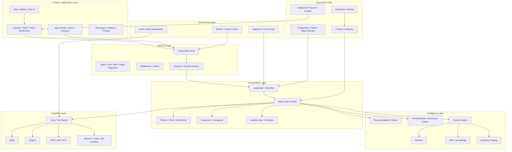

# Architecture Overview

## Role in the Agent System

This document is the system map. It defines how product, Harness, runtime, intelligence, capabilities, governance, and operations fit together. It is the reference point for deciding where a new feature belongs.

## 1. Architecture layers

## 2. Ownership boundaries

| Layer | Owns | Must not own |
|---|---|---|
| Product | User experience, business-facing configuration, artifact presentation | LLM reasoning loop internals |
| Harness | Composition, lifecycle, registries, extension loading, middleware | Domain transaction truth |
| Orchestration | State transitions, routing, delegation, pause/resume | Unbounded arbitrary business writes |
| Intelligence | Prompt, model, context, memory, retrieval | Authorization decisions |
| Capability | Executable actions and integrations | Tenant identity source |
| Governance | Identity, policy, approval, audit, safety | Model-specific prompt assembly |
| Operations | Deployment, metrics, tracing, recovery, evaluation | Product-specific domain semantics |

## 3. Request lifecycle

1. Gateway authenticates the caller and resolves tenant/user.
2. Application resolves Agent Definition and version.
3. Harness creates or resumes Runtime with a stable session/thread ID.
4. Runtime loads checkpoint, event history, runtime configuration, and policy context.
5. Context Engine builds the model-visible context.
6. Orchestrator runs deterministic nodes and model-driven nodes.
7. Tool Discovery exposes only relevant capabilities.
8. Tool Executor performs policy checks and calls domain services or isolated sandboxes.
9. Human approval interrupts the graph when needed.
10. Results and state are persisted; events are streamed to the UI.
11. Final answer and artifacts are delivered.
12. Trace and trajectory are evaluated asynchronously.

## 4. Key architectural distinctions

- **Agent Definition vs Runtime Instance**: configuration vs execution.
- **Conversation vs Thread vs Turn**: user-facing grouping vs graph execution continuity vs one request cycle.
- **Session Event vs Checkpoint**: durable facts vs state snapshot.
- **Context vs Memory**: current prompt material vs cross-task retained information.
- **Business Catalog vs Tool Registry**: knowledge about all system capabilities vs executable allowed tools.
- **Skill vs Plugin vs Tool**: procedural knowledge vs code extension vs callable action.
- **Harness vs App**: reusable runtime vs deployable product.
- **Agent vs Workflow**: dynamic decision-maker vs deterministic process.

## 5. Recommended topology

Start with a modular monolith for the Harness and a separate worker process for long-running/background jobs. Keep the Java business system as the transaction authority. Split tool execution, sandbox, memory, or retrieval into services only when isolation, scale, or operational ownership justifies it.
