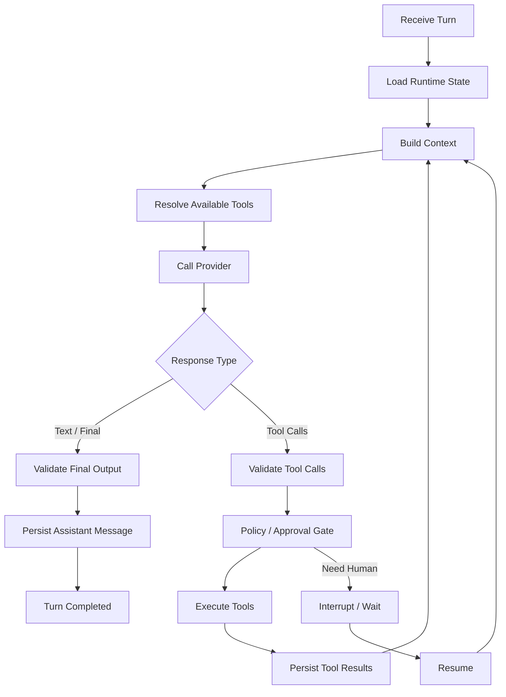

# 07. Agent Loop 与模型调用

## Role in the Agent System

Defines the reasoning, model-call, tool-execution, and termination loop.

**Primary responsibility:** Own this capability as a reusable subsystem with explicit contracts, state ownership, security boundaries, and observable outcomes.

**Boundary:** This subsystem must not silently take over responsibilities owned by adjacent layers. Its public interface should be testable without running a full Agent conversation.

## 1. Agent Loop 是什么

Agent Loop 是重复执行“构造请求 → 调用模型 → 解析输出 → 执行工具 → 追加结果 → 再次推理”的控制循环，直到满足结束条件、等待用户、失败或达到预算。

LLM API 不应被当作长期状态管理器。除少数 Provider 托管状态功能外，Runtime 必须显式维护历史、Tool Call、Tool Result 和任务状态。

## 2. 标准 Loop

## 3. Turn / Step / Tool Call

- Turn：一次用户输入引发的完整任务。
- Step：一次 LLM 请求和响应。
- Tool Call：模型提出的单次工具执行请求。
- Tool Execution：Runtime 真正执行的一次工具实例。
- Tool Result：执行结果。
- Approval：写操作前后的授权决策。

一个 Turn 可以包含多个 Step；一个 Step 可以包含多个 Tool Call；多个 Tool Call 可以并行或串行，取决于依赖关系。

## 4. 结束条件

模型返回有效最终回答、任务完成、达到最大 Step / Token / Cost / Wall Time、等待用户澄清或审批、用户取消、不可恢复错误或安全策略拒绝。

必须防止无限工具循环。设置 `max_steps`、`max_tool_calls`、`max_cost`、`deadline` 和重复调用检测。

## 5. Tool Call 处理规则

1. 检查工具是否在本轮可见集合中。
2. 校验工具版本和参数 Schema。
3. 从服务端上下文绑定 tenant/user。
4. 执行 Policy Check。
5. 若需要审批则创建 Pending Approval 并暂停。
6. 生成 idempotency key。
7. 调用 Executor。
8. 保存结果和审计。
9. 将 Tool Result 追加给模型。
10. 下一次请求根据新状态重新组装 Context。

不要直接相信模型提供的 userId、tenantId、role、permission。

## 6. 错误分类

| 错误 | 处理 |
|---|---|
| 网络超时/429/5xx | 有界重试、退避、抖动 |
| 参数 Schema 错误 | 返回结构化错误，允许模型修正一次 |
| 业务规则拒绝 | 不重试，解释拒绝原因 |
| 权限拒绝 | 不重试，不泄露无权资源 |
| 需要用户决策 | Interrupt / Approval |
| Provider 输出不完整 | Adapter 处理或有限重试 |
| 不可预期异常 | 记录 Trace，终止或人工恢复 |

## 7. 并行工具

只有当工具之间没有数据依赖、写冲突或顺序要求时才并行。并行执行必须有独立 Execution ID、超时和取消、部分失败策略、稳定结果顺序和写操作并发冲突检测。

## 8. 可靠性原则

LLM 的一次响应不等于业务操作完成。写操作完成必须以业务服务返回和后续验证为准。工具执行结果必须先持久化再继续下一次模型调用。
