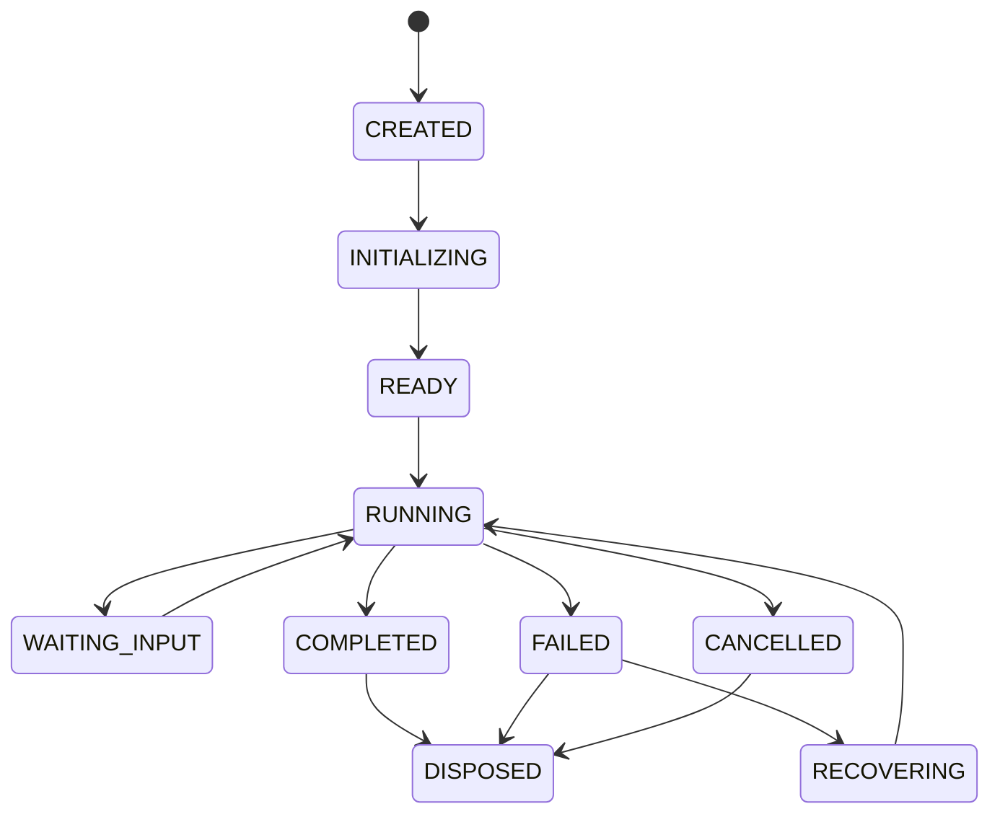

# 06. Harness 与 Agent Runtime 设计

## Role in the Agent System

Defines the runtime host that assembles and governs an Agent's executable environment.

**Primary responsibility:** Own this capability as a reusable subsystem with explicit contracts, state ownership, security boundaries, and observable outcomes.

**Boundary:** This subsystem must not silently take over responsibilities owned by adjacent layers. Its public interface should be testable without running a full Agent conversation.

## 1. Harness 的定义

Harness 是包围模型推理循环的工程运行环境。它负责把模型、工具、上下文、状态、存储、安全、观察、入口和扩展机制组合成可部署系统。Harness 不等于 Agent，也不等于 LangGraph。

| 层 | 定义 | 例子 |
|---|---|---|
| Model | 推理服务 | Claude、GPT、Qwen、DeepSeek |
| Agent | 目标/角色/策略配置 | HR 带教专家 |
| Agent Runtime | 执行 Agent 的运行时 | LangGraph StateGraph |
| Harness | 装配和治理运行时的系统 | Provider、Memory、Tools、Plugins、Storage |
| Product | 用户实际使用的产品 | 鹅博士、企业助手 |

## 2. 推荐 Harness 结构

- Composition Root：装配 Provider / Engine / Plugin。
- Agent Registry：管理 Agent Definition 和版本。
- Runtime Factory：创建 Runtime。
- Runtime Session：一次运行的资源集合。
- Capability Registry：能力目录。
- Policy Layer：身份、授权和风险策略。
- Persistence：Session、Event、Checkpoint、Memory。
- Observability：Trace、Metric、Audit。
- Lifecycle：启动、健康检查、关闭、热更新。

## 3. Agent Definition 与 Runtime Instance

Agent Definition 是不可变或版本化配置；Runtime Instance 是执行实例。

```typescript
interface AgentDefinition {
  id: string;
  version: string;
  name: string;
  description: string;
  systemPolicyRef: string;
  modelProfileId: string;
  enabledToolsets: string[];
  enabledSkillIds: string[];
  allowedPluginIds: string[];
  permissionProfileId: string;
  contextProfileId: string;
}

interface AgentRuntimeInstance {
  agentId: string;
  agentVersion: string;
  sessionId: string;
  tenantId: string;
  userId: string;
  runtimeStatus: "created" | "running" | "waiting" | "completed" | "failed" | "cancelled";
}
```

## 4. Runtime 生命周期



生命周期至少处理配置解析、Scope 创建、Credential 注入、Checkpointer 绑定、Tool / Skill 装配、Memory / Context Provider 装配、执行取消、资源释放和 Trace 关闭。

## 5. 模块化单体边界

V1 建议一个 Node.js 服务内分包：
- `core`
- `runtime`
- `memory`
- `context`
- `tools`
- `skills`
- `plugins`
- `business-catalog`
- `governance`
- `observability`

后台 Worker 负责代码扫描、记忆提取、Skill Review、索引更新等异步任务。只有在隔离、扩容、可靠性或权限边界有真实需求时才拆独立服务。

## 6. 关键接口

```typescript
interface AgentRuntimeFactory {
  create(input: CreateRuntimeInput): Promise<AgentRuntime>;
}

interface AgentRuntime {
  invoke(input: UserTurnInput): Promise<AgentTurnResult>;
  stream(input: UserTurnInput): AsyncIterable<AgentStreamEvent>;
  resume(input: ResumeInput): Promise<AgentTurnResult>;
  cancel(reason?: string): Promise<void>;
  inspect(): Promise<RuntimeSnapshot>;
  dispose(): Promise<void>;
}
```

## 7. 设计检查

- Agent Definition 是否版本化？
- Runtime 是否能恢复？
- 每个 Runtime 是否有明确 tenant/user/session Scope？
- Plugin 是否有 dispose？
- 是否能替换 Provider、Memory、Storage？
- 业务工具是否不能绕过 Java 服务？
- Runtime 是否能被测试 Stub 替换？
