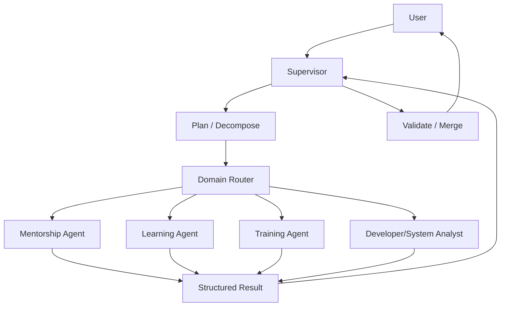

# 08. Multi-Agent 编排设计

## Role in the Agent System

Defines delegation, subagent boundaries, parallel work, result contracts, and supervisor coordination.

**Primary responsibility:** Own this capability as a reusable subsystem with explicit contracts, state ownership, security boundaries, and observable outcomes.

**Boundary:** This subsystem must not silently take over responsibilities owned by adjacent layers. Its public interface should be testable without running a full Agent conversation.

## 1. 什么时候需要多 Agent

适合：子任务可清晰分解、领域知识差异明显、需要上下文隔离、可以并行研究、子任务有独立权限和交付物。

不适合：只是为了“看起来先进”、简单查询、单个写操作、共享可变状态却没有冲突控制、子任务无法定义明确输入/输出。

## 2. 常见模式

| 模式 | 结构 | 适用 |
|---|---|---|
| Supervisor | 主 Agent 规划、子 Agent 执行 | 跨领域任务 |
| Router | 分类后路由到一个专家 | 领域选择 |
| Handoff | 一个 Agent 将控制权交给另一个 | 流程阶段切换 |
| Subagent | 主 Agent 创建独立子任务 | 深度检索、分析 |
| Parallel Fan-out | 多个 Agent 并行执行 | 多源调研、独立检查 |
| Peer Team | Agent 通过 Inbox 协作 | 长期协作和多方任务 |
| Hierarchical | Supervisor 下再有 Supervisor | 超大任务，需谨慎 |

## 3. 推荐架构



## 4. 子 Agent 合约

```typescript
interface SubagentTask {
  taskId: string;
  parentSessionId: string;
  tenantId: string;
  requesterId: string;
  specialistAgentId: string;
  objective: string;
  input: Record<string, unknown>;
  allowedCapabilities: string[];
  deadlineAt: string;
  outputSchema: JSONSchema;
}

interface SubagentResult {
  taskId: string;
  status: "completed" | "failed" | "cancelled" | "waiting";
  result?: unknown;
  evidence: EvidenceRef[];
  errors?: AgentError[];
  childSessionId: string;
}
```

子 Agent 不应直接继承父 Agent 全部权限。权限要按任务委派最小化。

## 5. 上下文隔离

父 Agent 传给子 Agent：明确目标、必要背景、数据引用、输出 Schema、允许工具、禁止操作、时间和成本预算。

不要把父 Agent 全部历史消息复制给子 Agent。传摘要和引用，让子 Agent 自己按需检索。

## 6. 协作和冲突

- 每个子任务有独立 taskId / childSessionId。
- 父任务可取消子任务。
- 子任务有 deadline。
- 结果需校验 Schema。
- 多个子 Agent 写同一资源时使用业务版本号/锁/命令队列。
- 子 Agent 的结论要附 evidence。
- 父 Agent 负责合并、去重、冲突处理和用户沟通。

## 7. 企业带教场景

用户：“分析所有带教项目的延期情况，并给出需要 HR 处理的学员清单。”

Supervisor：
1. 查询可见项目。
2. 为每个项目派发进度分析任务。
3. Mentorship Agent 查询学员、计划、任务。
4. 多个只读查询可以并行。
5. Supervisor 合并延期清单。
6. 需要修改导师或学员状态时，另走审批工作流，不让分析子 Agent 自行写数据。

## 8. 评估指标

Task completion rate、Delegation precision、Child task latency、Result schema validity、Evidence coverage、Duplicate work rate、Token / cost per completed task、Permission violation rate（必须为 0）。
