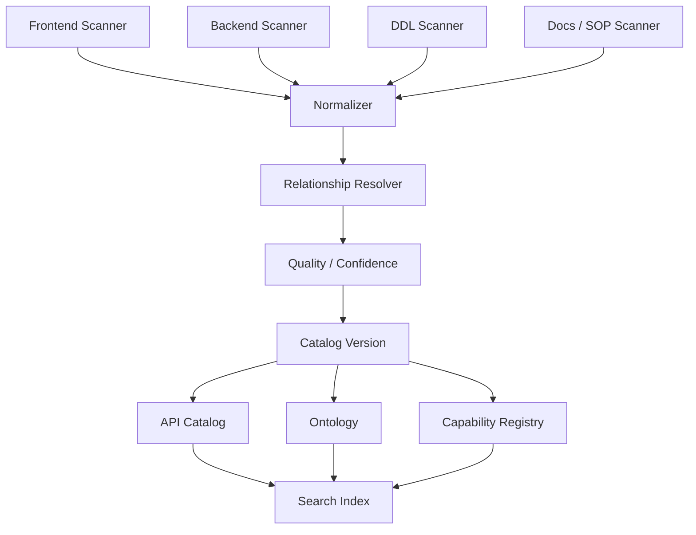

# 16. Business System Intelligence：企业系统知识编译器

## Role in the Agent System

Compiles source code, APIs, database metadata, and workflows into an agent-readable business catalog.

**Primary responsibility:** Own this capability as a reusable subsystem with explicit contracts, state ownership, security boundaries, and observable outcomes.

**Boundary:** This subsystem must not silently take over responsibilities owned by adjacent layers. Its public interface should be testable without running a full Agent conversation.

## 1. 目标

让 Agent 能够理解前后端分离系统的菜单、页面、API、DTO、Service、数据库、业务实体、状态机和权限关系，而不是把所有 API 都变成 Tool。

核心结构：
- API Catalog：完整技术接口目录。
- Business Ontology：业务实体、字段、关系。
- Capability Registry：业务能力目录。
- Tool Registry：Agent 可执行入口。
- Runtime Retrieval：按任务检索相关知识。

## 2. 数据来源

| 来源 | 提取内容 |
|---|---|
| 前端菜单配置 | 模块、菜单、层级、权限编码 |
| Router | Route、Page、参数 |
| Page / Component | 表单、表格、操作、字段 |
| API Client | 页面与 API 的绑定 |
| OpenAPI / Controller | Method、Path、Request、Response |
| DTO / VO | Schema、校验、字段描述 |
| Service | 业务规则、事务、调用链 |
| Mapper / SQL | 数据查询和写入 |
| PostgreSQL DDL | 表、字段、主外键、索引、注释 |
| Enum / Dictionary | 状态和类型 |
| Security Annotation | 权限编码、角色 |
| 文档 / SOP | 人工确认的业务流程 |

## 3. 编译流程

## 4. 关键关系

- Menu → Route → Page → Component → API
- API → Controller → Service → Mapper → Table
- API → Request DTO / Response VO
- Entity → Field → Relation
- Workflow → Capability → Tool → API
- Role / Permission → Capability / Action
- State Machine → Allowed Transition → Domain Command

每个关系都要有 source file、symbol、commit、confidence 和 verification status。

## 5. 自动推断与人工确认

自动扫描能发现 API 路径、DTO 字段、SQL 表名、Controller-Service 调用、前端 API 调用、Enum 值。

但不一定能准确推断字段业务含义、隐式业务规则、哪些状态转换合法、哪些接口仅内部使用、某个页面按钮的业务意图、事务外副作用。

因此元数据需要状态：
`DISCOVERED → INFERRED → REVIEW_REQUIRED → VERIFIED → PUBLISHED`

不能把 LLM 根据代码猜测的关系直接当作已验证事实。

## 6. Capability 设计

Capability 是业务动作，例如：
- `mentorship.project.search`
- `mentorship.learner.progress.read`
- `mentorship.learner.status.transition`

一个 Capability 可以映射多个 API。Tool Registry 只暴露审核过、具有权限定义的 Capability。

## 7. 自动同步

CI 流程：
1. 代码提交。
2. 扫描差异。
3. 更新 API / Entity / Page Catalog。
4. 检测 Schema Breaking Change。
5. 找出受影响 Tool / Skill。
6. 自动生成影响报告。
7. 人工审核业务语义变化。
8. 发布 Catalog Version。
9. Runtime 按版本加载。

## 8. 检索模式

- 业务问答：Ontology + SOP + 文档 RAG。
- API 探索：API Catalog + Code Search。
- 实时查询：Tool → Java API。
- 业务写入：Domain Command → Java Service。
- 代码调用链：静态分析索引 + 必要时源码 RAG。

## 9. 不允许的设计

- 不把整个 DDL 直接塞 Prompt。
- 不允许模型根据表名猜测业务操作。
- 不允许通用 SQL Tool 任意读写业务库。
- 不将 API 文档描述当成权限。
- 不将旧 Catalog 当作实时事实。
