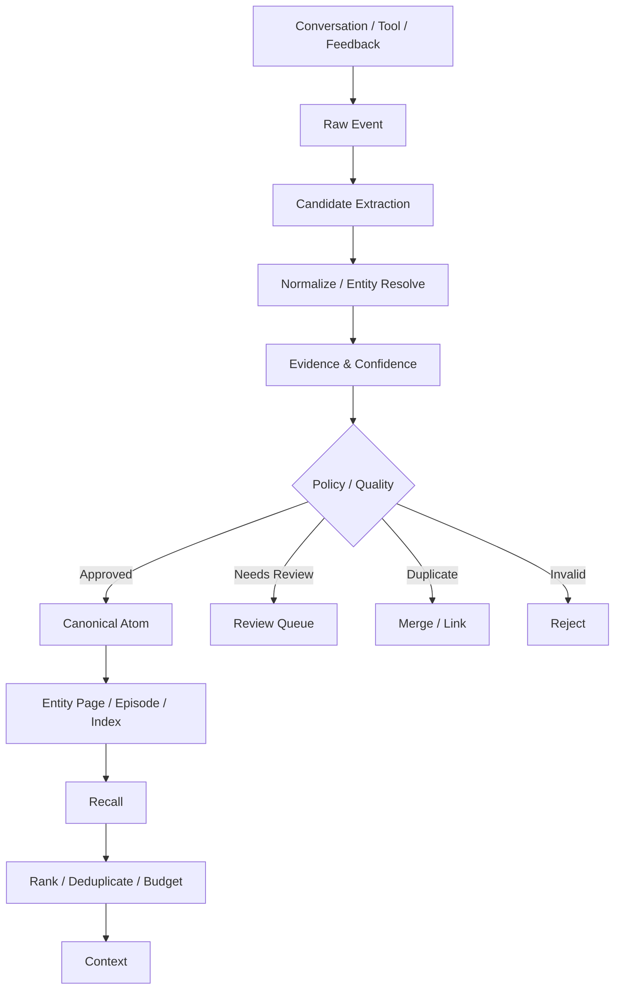

# 10. Memory Engineering

## Role in the Agent System

Stores and recalls reusable cross-turn and cross-session knowledge with evidence and lifecycle controls.

**Primary responsibility:** Own this capability as a reusable subsystem with explicit contracts, state ownership, security boundaries, and observable outcomes.

**Boundary:** This subsystem must not silently take over responsibilities owned by adjacent layers. Its public interface should be testable without running a full Agent conversation.

## 1. Memory 与其他持久化概念

| 对象 | 保存什么 | 真相来源 |
|---|---|---|
| Session History | 原始对话和工具交互 | Session Event Log |
| Checkpoint | 当前图执行状态 | LangGraph Checkpointer |
| Memory | 跨任务可复用的稳定信息 | Memory Pipeline + Evidence |
| Business Catalog | 软件结构和业务元数据 | 源码、OpenAPI、DDL、人工审核 |
| Business Data | 当前项目、学员、任务状态 | Java 业务服务 / 数据库 |
| Workspace | Agent 工作文件和产物 | Workspace Backend |

## 2. 推荐 Memory Scope

- User Memory：个人偏好和工作方式。
- Agent Memory：Agent 自身已验证经验。
- Project Memory：某项目决策、背景和约定。
- Organization Memory：组织制度、术语、业务知识。
- Episode Memory：某次重要任务经历。
- Entity Memory：围绕用户、项目、系统、客户等实体的事实。

每条记忆都必须有 Scope、Owner、Tenant、Visibility 和来源证据。

## 3. 分层 Pipeline



## 4. Memory Item Schema

```typescript
interface MemoryItem {
  id: string;
  tenantId: string;
  scopeType: "user" | "agent" | "project" | "organization" | "episode";
  scopeId: string;
  memoryType: "preference" | "fact" | "decision" | "procedure" | "episode";
  content: string;
  normalizedKey?: string;
  entities: EntityRef[];
  confidence: number;
  evidence: EvidenceRef[];
  sourceType: string;
  sourceId: string;
  validFrom?: string;
  validUntil?: string;
  sensitivity: "public" | "internal" | "confidential" | "restricted";
  status: "candidate" | "active" | "review" | "superseded" | "archived";
  version: number;
}
```

## 5. 记忆提取规则

适合保存：用户明确要求记住的信息、稳定偏好、长期项目决策、经验证的工作方式、反复出现且有价值的上下文、具有长期复用价值的任务经验。

不应自动保存：一次性临时查询、未验证猜测、敏感信息或不必要个人数据、实时易变业务状态、密码/密钥/访问令牌、用户明确要求不记忆的内容。

## 6. 冲突与更新

例如旧记忆：项目采用方案 A；新证据：用户明确决定改为方案 B。

不能简单覆盖原始证据。应创建新版本、旧版本标记 superseded、记录 supersedes 关系、保留生效时间，召回时优先当前有效版本。

对于组织制度和用户偏好冲突，按来源可信度和 Scope 优先级处理，不能由模型自行决定越权。

## 7. Recall 策略

建议混合：
- FTS / BM25 词法检索
- 向量检索（可选，经过评估再启用）
- Entity / Tag / Scope 过滤
- Recency / Validity
- Confidence / Source trust
- Rerank
- Deduplication
- Token Budget

不要把 Vector DB 当作 Memory 本身。检索索引可以重建，Canonical Memory 才是记忆事实存储。

## 8. 异步 Consolidation

主对话只写 Raw Event 或明确的 memory_save；后台 Worker 进行候选提取、去重、实体归并、质量检查和晋升。显式“记住这个”可以走高优先级路径，但仍需权限和敏感信息规则。

## 9. 删除与遗忘

提供删除单条记忆、删除 Scope、用户撤回、数据保留期限、导出、证据链清理、向量索引同步删除和缓存失效。

删除需要跨主表、索引、缓存、备份策略处理，并保留法律/审计允许的最小删除凭证。

## 10. 与 Octop / Hermes 的借鉴

Octop Memory：Raw Event、Candidate、Atom、Entity Page、Episode、Tree、Recall Budget、Portable Export。
Hermes：Memory Provider 抽象、User/Agent Memory 分离、Session Search 与 Memory 区分、会话结束后后台 Review。
企业增强：Tenant ACL、敏感级别、证据、版本、时效、删除和审批。
