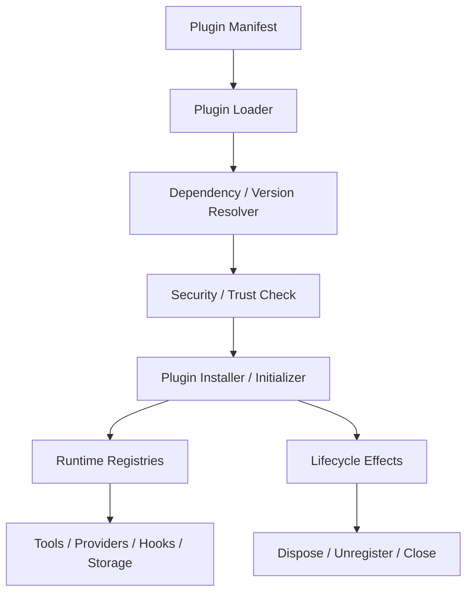

# 13. Plugin Extension System

## Role in the Agent System

Defines code extensions, plugin manifests, lifecycle, extension points, and trust boundaries.

**Primary responsibility:** Own this capability as a reusable subsystem with explicit contracts, state ownership, security boundaries, and observable outcomes.

**Boundary:** This subsystem must not silently take over responsibilities owned by adjacent layers. Its public interface should be testable without running a full Agent conversation.

## 1. Plugin 的职责

Plugin 是可安装、可启用、可卸载、可版本化的代码扩展包。它可以向 Runtime 注册 Tool、Provider、Storage、Hook、Context Source、Memory Provider、Channel、Connector 等能力。

Skill 是知识包；Plugin 是代码扩展；Tool 是可调用能力；Connector 是外部系统连接实现。

## 2. 插件架构



## 3. Plugin Manifest

```yaml
id: com.example.wecom-connector
name: WeCom Connector
version: 1.2.0
apiVersion: 1
entry: dist/index.js
permissions:
  - network:api.weixin.qq.com
  - secrets:wecom-app
capabilities:
  - tool
  - connector
dependencies:
  runtime: ">=1.0.0 <2.0.0"
  plugins: []
configurationSchema: ./config.schema.json
```

Manifest 只是声明，不代表自动授予权限。用户/管理员必须授权具体权限。

## 4. 生命周期

DISCOVERED → VALIDATED → INSTALLED → ENABLED → INITIALIZING → ACTIVE → DEGRADED / FAILED → DISABLING → DISPOSED。

每个注册行为必须可逆。Plugin 初始化失败应回滚已完成注册，不能留下半启用状态。

## 5. Extension Points

Provider Adapter、Tool Provider、Tool Middleware / Hook、Memory Provider、Context Provider / Context Engine、Storage Backend、Workspace Backend、MCP Connector、Channel Adapter、Skill Source、Observability Exporter。

## 6. Service / Event / Scope

借鉴 DeepSeek Harness / Cordis：
- Service：通过 Context 提供具名能力。
- Event：跨模块发布生命周期和执行事件。
- Scope：限制注册项的可见范围。
- Effect：注册副作用并返回 disposer。

事件要区分：
- Durable Domain Event：业务事实，持久化。
- Runtime Event：执行过程。
- Hook / Waterfall：可拦截或修改执行。
- Telemetry Event：观察，不改变业务事实。

## 7. 插件安全模型

默认不启用第三方插件；签名/来源校验；版本锁定和依赖锁；权限声明与管理员授权；Secret 通过 Secret Manager 注入；外部网络 allowlist；文件访问根目录限制；高风险代码在独立进程/容器执行；插件崩溃隔离和资源限制；运行期升级需要 Drain / Graceful Shutdown。

## 8. 插件依赖方向

业务模块依赖 Plugin SDK 接口，不直接依赖具体插件实现。Plugin 依赖稳定的 Runtime Contract。禁止循环依赖和通过全局变量隐式访问其他插件内部对象。

## 9. 版本兼容

Plugin API Version 与 Plugin Version 分开。升级前进行兼容性检查；支持灰度、回滚和配置迁移。Tool Schema 变化需要独立版本记录。

## 10. V1 建议

V1 先做进程内可信插件：manifest、registry、lifecycle、dependency、permissions、disposer、health status。

不要一开始做任意第三方远程代码动态装载。后续可增加 Worker / RPC Plugin Host，实现进程隔离。
