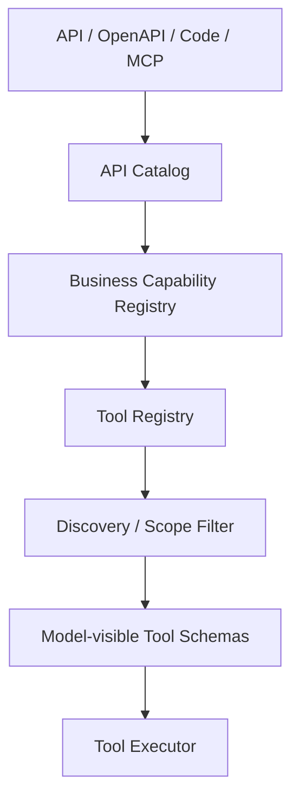
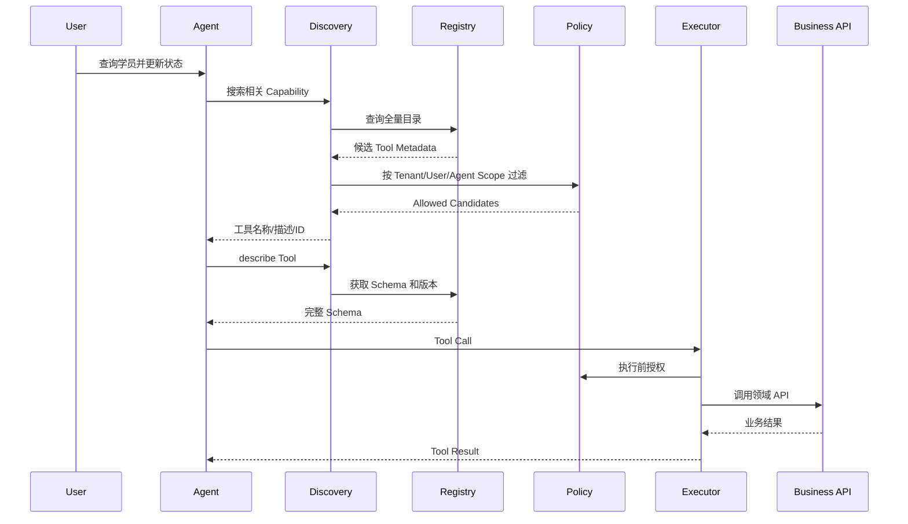

# 11. Tool System 与 Dynamic Tool Discovery

## Role in the Agent System

Defines callable capabilities, registry, discovery, schema loading, policy checks, and execution.

**Primary responsibility:** Own this capability as a reusable subsystem with explicit contracts, state ownership, security boundaries, and observable outcomes.

**Boundary:** This subsystem must not silently take over responsibilities owned by adjacent layers. Its public interface should be testable without running a full Agent conversation.

## 1. 目标

支持数百至数千个底层 API / MCP / Plugin 能力，但模型每次只看到与当前任务相关的一小组 Tool。

关键区分：
- API Catalog：全量技术接口目录。
- Business Capability Catalog：业务语义和能力组合。
- Tool Registry：可执行能力定义。
- Model-visible Tools：本次模型请求实际暴露的工具 Schema。

## 2. 三层目录



一个业务 Capability 可以组合多个底层 API；一个 Tool 可以封装一个领域命令，也可以是通用只读查询工具。

## 3. Tool 类型

1. Meta Tools：搜索能力、描述能力、查询 Schema。
2. Generic Query Tools：受控实体查询、详情、关系、聚合。
3. Domain Query Tools：复杂领域查询。
4. Domain Command Tools：修改、发布、分配、审批等命令。
5. Integration Tools：MCP、外部 API。
6. Runtime Tools：文件、浏览器、代码执行等，默认按需授权。

## 4. Dynamic Discovery 流程



## 5. 三桥接工具模式

可借鉴 Hermes：
- `tool_search(query, filters)`
- `tool_describe(tool_id, version)`
- `tool_call(tool_id, arguments)`

也可以把 Discovery 做成 Runtime 内部服务，而不是暴露给模型。对模型暴露桥接工具时要防止模型伪造 tool_id、越权 describe 或 call。

## 6. 搜索策略

推荐混合检索：
1. Tenant / Agent / User 权限过滤。
2. Domain、Operation、Risk 等结构化过滤。
3. BM25 / FTS 搜索 name、description、tags、parameter names。
4. 向量检索作为语义补充。
5. Rerank。
6. 去重和 Capability 聚合。
7. 返回少量候选，并允许模型进一步 describe。

搜索不应只依赖向量相似度；精确工具名、权限、状态和版本要使用结构化过滤。

## 7. Tool Definition

```typescript
interface ToolDefinition {
  id: string;
  name: string;
  description: string;
  inputSchema: JSONSchema;
  domain: string;
  operation: "query" | "command";
  riskLevel: "low" | "medium" | "high" | "critical";
  requiredPermissions: string[];
  approvalPolicy: "none" | "conditional" | "always";
  version: string;
  handlerRef: string;
  source: "builtin" | "business" | "mcp" | "plugin";
  enabled: boolean;
}
```

## 8. Generic Query 与 Domain Command

查询适合抽象：
- `search_entities`
- `get_entity`
- `query_relations`
- `aggregate_entities`

但必须用 Entity Schema、字段白名单、过滤白名单、关联白名单、分页限制和租户过滤，不允许任意 SQL。

写操作应领域化：
- `transition_mentee_status`
- `assign_mentor`
- `publish_learning_plan`
- `archive_project`

禁止 `update_any_record(table, id, field, value)` 这类万能写工具。

## 9. 执行 Pipeline

Schema Validate → Scope Validate → Identity Bind → Permission Check → Approval Check → Idempotency Check → Rate Limit → Execute → Result Normalize → Audit → Persist Tool Result → Optional Read-after-write Verify。

## 10. 目录版本与缓存

Tool Schema 必须有 version / catalogVersion。搜索索引可以缓存，但执行前要再次确认工具仍启用、权限仍有效、版本兼容。Catalog 更新后使相关缓存失效。

## 11. 安全

Tool Search 的结果也属于受控信息，不能把用户无权使用的工具名称和描述泄露给用户。`tool_call` 必须再次鉴权，不得信任前一轮搜索结果或模型记忆。

## 12. 指标

Tool Search Precision@K、Tool Selection Accuracy、Schema Load Count、Tool Call Success Rate、Invalid Argument Rate、Unauthorized Attempt Rate、Tool Latency、Duplicate Execution Rate、Cost per successful business task。
