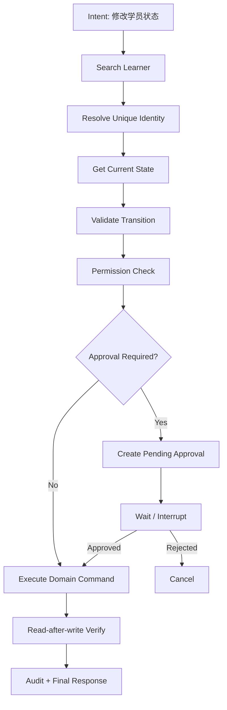

# 17. Workflow 与 Human Approval

## Role in the Agent System

Pauses risky or ambiguous work for human input and binds approval to exact action parameters.

**Primary responsibility:** Own this capability as a reusable subsystem with explicit contracts, state ownership, security boundaries, and observable outcomes.

**Boundary:** This subsystem must not silently take over responsibilities owned by adjacent layers. Its public interface should be testable without running a full Agent conversation.

## 1. Agent 与 Workflow 的分工

Agent 擅长理解自然语言、规划和处理不确定性；Workflow 擅长确定性步骤、业务状态迁移、审批和补偿。

复杂企业操作采用混合模式：
- Agent 负责识别意图、收集信息、选择流程。
- Workflow 负责确定性执行。
- Java Domain Service 负责最终业务规则。
- Human Approval 负责高风险决策。

## 2. 示例：修改学员状态



## 3. 审批对象

```typescript
interface ApprovalRequest {
  approvalId: string;
  tenantId: string;
  requesterId: string;
  sessionId: string;
  toolExecutionId: string;
  action: string;
  targetRef: string;
  beforeState: unknown;
  proposedChange: unknown;
  reason?: string;
  expiresAt: string;
  status: "pending" | "approved" | "rejected" | "expired" | "cancelled";
}
```

审批必须绑定请求人、目标资源、具体参数、数据版本、Tool Definition Version 和过期时间。

用户批准后，如果目标记录版本已变化，必须重新校验或要求重新确认。

## 4. Human-in-the-loop

LangGraph Interrupt 可用于暂停和恢复，但审批记录必须在业务 DB 持久化。不能只依赖浏览器状态或内存变量。

## 5. 写操作可靠性

- 幂等键
- 业务命令 ID
- 乐观锁
- Outbox Event
- 操作审计
- Read-after-write
- 超时 UNKNOWN 状态查询

## 6. 补偿

分布式事务不应假设跨微服务可以一个 DB Transaction 全部回滚。对于多步骤业务采用 Saga / Compensation：
- 已执行步骤记录。
- 每步定义可补偿动作。
- 补偿失败进入人工处理。
- 补偿不能掩盖原始审计。

## 7. Agent 不能决定绕过审批

模型可以建议风险级别，但审批策略由 Policy Engine 根据工具、资源、用户、影响范围、操作类型决定。
