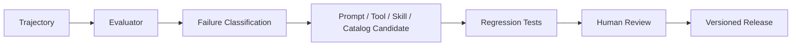

# 20. Observability、Evaluation 与 Trajectory

## Role in the Agent System

Captures execution traces and trajectories so failures and quality regressions can be explained.

**Primary responsibility:** Own this capability as a reusable subsystem with explicit contracts, state ownership, security boundaries, and observable outcomes.

**Boundary:** This subsystem must not silently take over responsibilities owned by adjacent layers. Its public interface should be testable without running a full Agent conversation.

## 1. 为什么必须单独建设

Agent 的失败可能来自用户意图解析错误、Context 缺失、Memory 召回错误、Skill 不匹配、Tool 选择错误、参数错误、业务 API 失败、权限拒绝、Provider 输出异常、Checkpoint 恢复错误。只记录最终聊天消息无法定位问题。

## 2. Trace 层级

```text
Trace
  └── Agent Turn
       ├── Context Build
       ├── Memory Recall
       ├── Skill Load
       ├── Tool Discovery
       ├── Model Request / Response
       ├── Tool Execution
       ├── Approval
       ├── Verification
       └── Final Response
```

所有子步骤使用 traceId / correlationId / causationId 关联。

## 3. Trajectory

Trajectory 是一次 Agent 执行的结构化轨迹：
- User Input
- State Snapshot Reference
- Context Source References
- Model / Provider / Prompt Version
- Tool Schema Version
- Tool Calls / Results
- Approval Decisions
- Workflow Transitions
- Final Output
- Evaluation Result

Trajectory 用于回放、评估和经验提取，不应无条件包含原始敏感数据。

## 4. 核心指标

| 类别 | 指标 |
|---|---|
| Reliability | Turn Success Rate、Recovery Rate |
| Quality | Task Completion、Answer Groundedness |
| Tools | Selection Accuracy、Argument Validity、Execution Success |
| Context | Recall Precision、Freshness、Token Usage |
| Memory | Useful Recall、False Recall、Conflict Rate |
| Skills | Trigger Precision、Workflow Compliance |
| Multi-Agent | Delegation Success、Duplicate Work |
| Cost | Cost / Turn、Cost / Task |
| Latency | TTFT、Tool Latency、End-to-end |
| Security | Unauthorized Attempt、Cross-tenant Violation |

## 5. Evaluation 分层

- Unit：Schema、Parser、Policy、Tool Handler。
- Component：Memory Recall、Tool Search、Context Builder。
- Workflow：完整业务任务。
- Regression：历史 Trajectory 回放。
- Adversarial：提示注入、越权、歧义、同名实体。
- Model Matrix：多个 Provider / Model 对同一测试集。
- Human Review：高风险任务和业务语义审核。

## 6. Golden Dataset

每个业务领域建立标准问题、必须检索的实体、允许工具、期望 Tool Call、期望业务结果、禁止行为和评分标准。

## 7. Learning Loop



Agent 不应直接在线自改生产 Prompt、Skill、Policy 或工具定义。先生成候选，测试和审核通过后再发布。

## 8. 数据脱敏

Trace 只保存必要信息；PII、Credential、敏感业务字段按分类脱敏。对原始输入和 Tool Result 可使用加密对象存储和访问审计。
