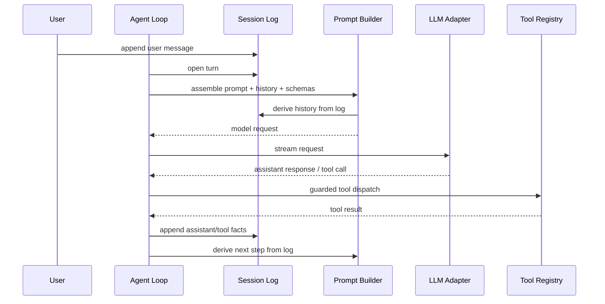

# 03. DeepSeek Harness 源码拆解

## Role in the Agent System

Studies plugin composition, scopes, typed events, session logs, tool guards, and replaceable Agent drivers.

**Primary responsibility:** Own this capability as a reusable subsystem with explicit contracts, state ownership, security boundaries, and observable outcomes.

**Boundary:** This subsystem must not silently take over responsibilities owned by adjacent layers. Its public interface should be testable without running a full Agent conversation.

## 1. 核心架构思想：Everything is a Plugin

DeepSeek Harness 的关键不是“有很多工具”，而是将模型适配器、Session Log、System Prompt、Tool Registry、Agent Loop 等核心能力都作为可替换插件挂载到共享 Context。

Cordis 提供：
- Plugin composition
- Shared Context / Service
- Typed Events
- Scoped registration
- Reversible effects / unload cleanup

因此扩展点不必直接修改核心循环；插件通过服务和事件接入。

## 2. Core Package Spine

| Package | 责任 | 设计价值 |
|---|---|---|
| `core/session` | Append-only SessionEvent Log | 会话事实的单一来源 |
| `core/system-prompt` | Prompt Sections / Tool Schema Assembly | Prompt 可组合 |
| `core/tools` | Scoped Tool Registry / Guarded Execution | 工具隔离和执行治理 |
| `core/agent` | Agent Contract / Registry / Events | Agent 公共接口 |
| `core/agent-loop` | 默认 Driver | Loop 可替换 |
| `core/scope` | Scope Primitive | 每个 Agent 的能力隔离 |
| `llm/llm` | Message / ContentBlock / StreamChunk / Adapter Seam | Provider 适配边界 |



## 3. Session Event 与 Agent Event

公开架构将事件分为：
- **Session Events**：持久事实，追加到日志，Reload 后仍可重建。
- **Agent Events**：运行期控制事件，如 inbox、step、status、request、validation、continuation。
- **Streaming Frames**：临时流式输出，不能与最终持久化消息混淆。

设计结论：
- 用户消息、Assistant 最终消息、Tool Call、Tool Result、Turn / Step 边界应有持久表示。
- Token chunk、心跳、UI 动画是瞬态数据。
- Event Log 负责事实，Live Event 负责通知和控制。

## 4. Scope：能力注册的隔离边界

Scope 让某个 Agent 只接收属于自己运行上下文的注册项和事件。

企业实现可以扩展成：
- Agent Scope
- Tenant Scope
- User Scope
- Session Scope
- Plugin Scope
- Workspace Scope

Scope 不应被误当成完整安全权限。它解决“哪些注册项对哪个 Runtime 可见”，真正的数据授权仍由 Policy Engine 和业务服务校验。

## 5. Tool Pipeline

建议参考其工具生命周期：
1. Tool 注册。
2. Schema 进入 Prompt Assembly。
3. 模型发起 Tool Call。
4. `pre-execute` 进行校验/阻断/审批。
5. 执行 Handler。
6. `post-execute` 进行结果处理/审计/通知。
7. Tool Result 写入 Session Log。
8. 下一 Step 基于更新后的 Session History 推理。

Hook 必须明确同步/异步语义、是否允许 veto、失败是否影响主流程。

## 6. Plugin 生命周期和可逆副作用

注册 Tool、事件监听、Service、资源时，应返回 disposer 或由 Plugin Context 自动管理。卸载时：
- 移除注册
- 取消订阅
- 关闭连接池/文件句柄
- 停止后台任务
- 释放子插件
- 避免残留监听器和重复注册

不要只做 `register()`，而不设计 `dispose()`。

## 7. Agent Loop 可替换

插件依赖 Agent Contract，而不是依赖默认 Loop 实现。依赖方向：

```text
Plugin -> Agent Interface
Agent Loop -> Agent Interface
Composition -> chooses Agent Loop
```

不要让所有业务插件都 import 具体 `DefaultAgentLoop`。这样以后可替换为 LangGraph Runtime、Workflow Runtime 或测试 Stub。

## 8. Subagent / Delegation

DeepSeek Harness 将 Subagent Provider 与模型可见的 Delegation Tool 分开：
- Provider 负责创建和驱动子 Session。
- Tool 负责向模型呈现委派入口。
- 子 Session 有自己的事件日志。
- 子 Agent 的模型路由和授权需要显式约束。
- 父 Agent 接收结构化结果，而不是无限共享子 Agent 全部上下文。

## 9. 本方案吸收与调整

直接吸收：
- 插件化核心能力
- Typed Event
- Append-only Session Log
- Scope-aware Registry
- Tool Guard Pipeline
- Agent Contract 与 Driver 分离
- Package Group 按能力组织
- Extension Cookbook / Contract-first 开发文档

需要调整：
- 使用 LangGraph JS/TS 作为主流程引擎。
- 不必复刻 Cordis 的全部 API。
- 企业审批、RBAC、Tenant Policy 单独设计。
- 业务状态迁移放 Java Service。
- 不把所有业务状态都塞进 Session Event。

## 10. 上游资料
- <https://github.com/deepseek-ai/deepseek-harness>
- <https://github.com/deepseek-ai/deepseek-harness/blob/master/docs/architecture.md>
- <https://github.com/deepseek-ai/deepseek-harness/tree/master/docs/subsystems>
- <https://github.com/deepseek-ai/deepseek-harness/blob/master/docs/cookbook/extension-cookbook.md>
- <https://github.com/deepseek-ai/deepseek-harness/tree/master/packages/core>
