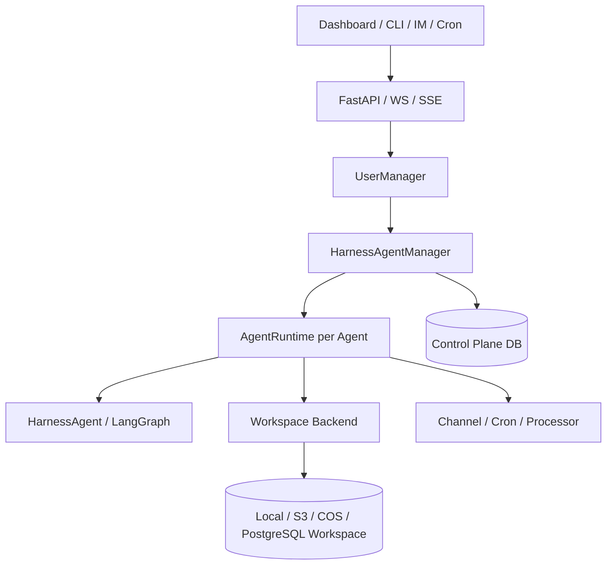

# 02. Octop 生态源码拆解

## Role in the Agent System

Explains Octop's platform, Harness, and Memory decomposition as a reference for reusable runtime and memory services.

**Primary responsibility:** Own this capability as a reusable subsystem with explicit contracts, state ownership, security boundaries, and observable outcomes.

**Boundary:** This subsystem must not silently take over responsibilities owned by adjacent layers. Its public interface should be testable without running a full Agent conversation.

## 1. 仓库边界

需要区分三个相关仓库：

1. `TencentCloud/Octop`：面向多用户、多 Agent 的自托管助手平台。
2. `TencentCloud/octop-harness`：建立在 `deepagents` / LangGraph 之上的可部署 Agent Runtime 封装。
3. `TencentCloud/octop-memory`：独立的持久化、可迁移 Agent Memory 系统。

它们不是同一个仓库的不同目录。Octop 主应用组装 Harness、Gateway、控制面、用户、通道和工作区；Harness 负责 Agent 执行封装；Memory 负责记忆采集、提取、召回和迁移。

## 2. Octop 主应用架构

公开架构说明其采用单 Python 进程组合：
- FastAPI / WebSocket / SSE / Dashboard / CLI 入口
- UserManager
- HarnessAgentManager
- 每个 Agent 的 AgentRuntime
- HarnessProcessor
- ChannelManager / CronManager
- SQLite 或 PostgreSQL 控制面
- BackendWorkspace

### 借鉴点
- 控制面与 Agent 工作区分离。
- Agent Manager 管理 Agent 注册和生命周期，而非将 Agent 对象散落在 API Controller。
- 不同入口统一进入同一个 Processor / Runtime。
- 单进程模块化部署可以是 V1 的合理起点。
- Workspace 使用 Backend 抽象，避免业务代码直接依赖本地文件系统。

### 不照搬点
Octop 是个人/团队助手平台，企业 SaaS 需要额外强化租户隔离、业务权限、审批、审计和跨服务事务。单进程决策适合其部署目标，不代表大规模企业场景永远不需要拆分。

## 3. Octop Harness

公开 README 表明：
- 对 `deepagents.create_deep_agent` 做生产化封装。
- `HarnessAgentManager` 管理多个 Agent。
- `HarnessAgent` 暴露 call、stream、stream_events、history、append_messages、cancel 等能力。
- 使用 LangGraph Checkpoint 实现可恢复对话。
- `ChatModelFactory` 负责 Provider / Model 解析。
- `BackendWorkspace` 抽象本地、S3、COS、PostgreSQL 等工作区。
- middleware 负责 model routing、skill filter、tool guard、memory、PII 等横切能力。
- 支持浏览器、搜索、文件操作、Subagent、MCP、ACP 和团队 Peer Inbox。

### 值得借鉴
1. **Facade over framework**：对底层 Agent Framework 提供稳定 Facade，避免业务层直接依赖底层细节。
2. **Manager / Runtime 分离**：Manager 管理注册、创建和查询；Runtime 负责单 Agent 执行。
3. **Workspace Backend**：把 Agent 可见文件和运行时本地持久化分清。
4. **Middleware 横切治理**：安全、PII、工具护栏、记忆等不要散落在每个 Tool。
5. **协议适配**：UI、CLI、IM、ACP 是不同入口，不应复制 Agent 核心。
6. **模型路由可配置**：Provider / Model 通过工厂解析，而不是硬编码在 Agent 中。

### 注意的工程边界
Octop Harness 基于 Python deepagents，用户目标栈是 TypeScript + LangGraph。推荐移植设计模式和契约，不建议直接混合运行时对象。若采用 Octop Memory Python 服务，可通过 HTTP/JSON-RPC 适配，不要在 TS 代码中模拟 Python 内部类。

## 4. Octop Memory

公开项目说明：
- SQLite / FTS5 可作为轻量基础。
- 可选 PostgreSQL。
- Memory Service 提供事实存储与 Prompt Recall。
- 原始事件经模型辅助提取、晋升成为结构化事实。
- AtomCard、Entity Page、Episode、Memory Tree 用于组织信息。
- Recall 支持全文检索、排序、去重和 Token Budget。
- Export / Import / Portable Package 用于跨宿主迁移。
- 可作为 Python Library、CLI、JSON-RPC Bridge 使用。
- LangGraph Checkpoint 是可选能力，且与长期记忆职责不同。
- README 明确指出当前向量搜索接口及 Chroma/Qdrant 适配仍未被完整真实集成测试验证，不能把它描述成默认成熟生产向量能力。

### 记忆层次的工程理解

| 层 | 作用 | 典型内容 |
|---|---|---|
| Raw Event | 保存候选来源 | 对话、用户纠正、工具结果摘要 |
| Candidate | 待评估记忆 | 提取出的候选事实 |
| Atom | 可独立引用的事实 | 用户偏好、决策、项目约定 |
| Entity Page | 围绕实体聚合 | 用户、项目、系统、客户 |
| Episode | 事件/经历摘要 | 某次复杂任务和结论 |
| Tree / Index | 组织和检索 | Root / Branch / Leaf |

不要将上述层次直接当成每条数据必须逐级经过的固定数据库事务；实际 Pipeline 应允许人工确认、跳过、合并、撤销和过期。

## 5. 对企业 Agent 的转化

建议吸收：
- Agent Manager + Agent Runtime 分离。
- Workspace Adapter。
- Memory Candidate → Canonical Memory。
- Recall Token Budget。
- Session Checkpoint 与 Memory 分离。
- Middleware / Guard。
- Multi-Agent Peer Inbox 的异步协作思想。

需要增强：
- tenant_id、owner_id、visibility、classification。
- 记忆来源和证据链。
- 企业制度与个人偏好冲突规则。
- 记忆过期、撤回和删除。
- 对实时业务状态强制查询源系统。
- 写工具权限由 Java 业务服务最终判定。

## 6. 建议源码阅读入口

- Octop 主仓库：`docs/architecture.md`、`AGENTS.md`、`src/octop/infra/agents/`、`src/octop/infra/connectors/`、`src/octop/infra/backend/`。
- Octop Harness：`src/octop_harness/agent.py`、`manager.py`、`middleware/`、`memory/`、`backends/`。
- Octop Memory：`src/octop_memory/`、`tests/`、README Architecture / Integration Guide。

## 7. 上游资料
- <https://github.com/TencentCloud/Octop>
- <https://github.com/TencentCloud/octop-harness>
- <https://github.com/TencentCloud/octop-memory>
- <https://github.com/TencentCloud/octop-memory/blob/main/README.md>
- <https://github.com/TencentCloud/Octop/blob/main/docs/architecture.md>
- <https://github.com/TencentCloud/octop-harness/blob/main/README.md>
