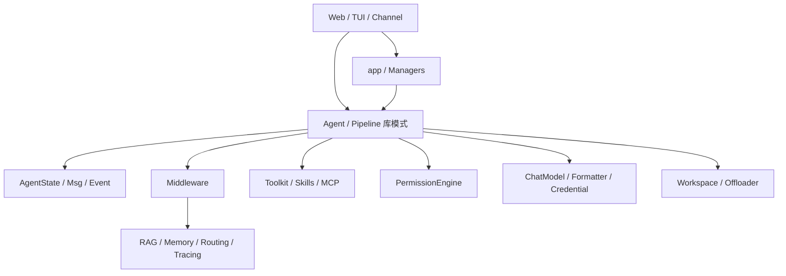
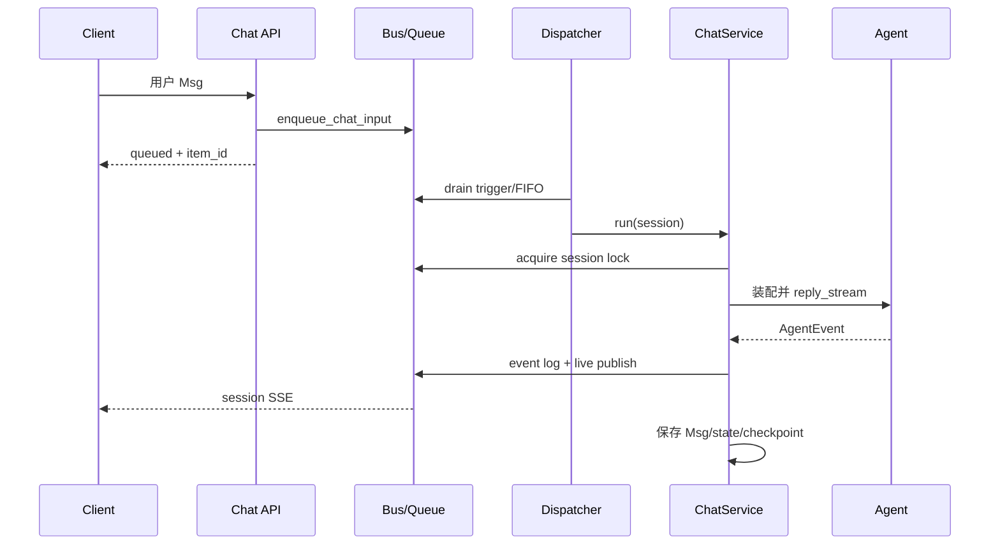
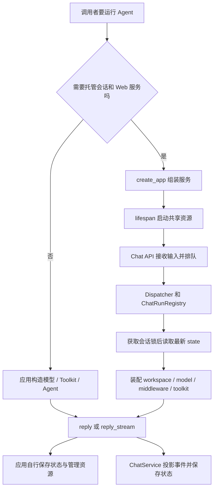
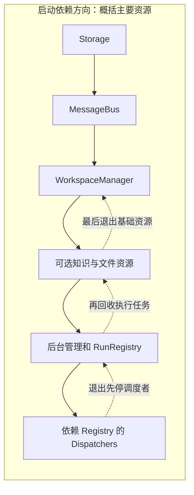
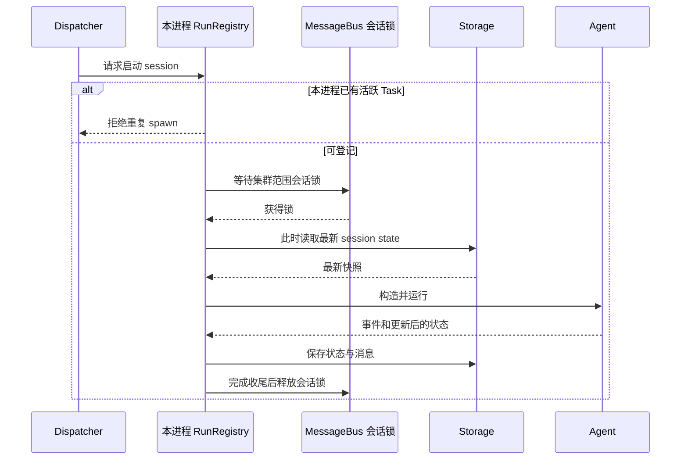
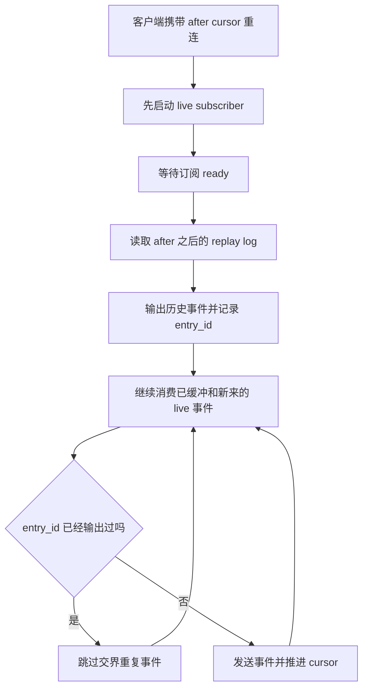
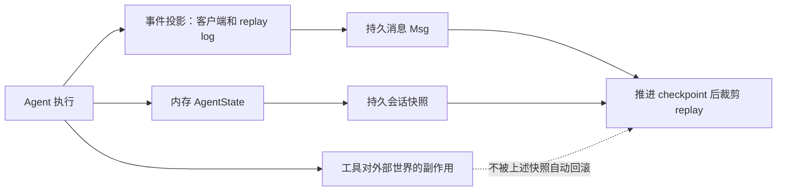

# AgentScope 2.0.12dev 整体架构、分层与调用链

依据当前本地源码与贡献指南。`src/agentscope/_version.py` 为 `2.0.12dev`；`docs/changelog.md` 是 v1 历史资料，里面的 ReActAgent 不能直接当当前 API。当前核心是统一的 Agent。此前 1,259 份 Markdown 的统计有误，过滤失效混入非 Markdown；本次 rg 扫描公开 Markdown/MDX 为 21 份，隐藏目录需另列。

## 设计理念如何落到代码

`CONTRIBUTING.md` 明确维持单一核心 `agentscope.agent.Agent`，专门领域 Agent 尽量通过组合能力实现，放在 examples。`Agent.__init__`（`agent/_agent.py:122`）接收 model、toolkit、middlewares、state、offloader 和四类配置；没有 state 时创建 AgentState，PermissionEngine 绑定 state.permission_context，内部压缩能力被注册成 FunctionTool。这解释了运行时为什么在同一个 Agent 对象上汇聚：统一入口降低 API 碎片，但 `_agent.py` 约四千行，必须按方法簇理解。

模型接入也不是只换 SDK。贡献指南要求 credential、model、model-card YAML 和两类 formatter 同时齐备；可选依赖 lazy import，使基础导入不要求安装所有 provider。

## 代码分层（分析视角）

| 层 | 目录 | 核心责任 |
|---|---|---|
| 产品接入 | app、tui、console | API、Manager、会话、显示、应用生命周期；库模式可以绕过 app |
| 协作编排 | pipeline、sop | leader/member、目标执行/验证与流程；复用 Agent 协议 |
| 运行核心 | agent/_agent.py、agent/_config.py | 动作决策、推理、行动、压缩、暂停恢复、终结 |
| 数据协议 | state、message、event | 运行事实、内容块、流式增量 |
| 横切扩展 | middleware | 推理/模型/工具/权限/提示词等拦截点；RAG/记忆/路由/追踪 |
| 能力与治理 | tool、mcp、skill、permission | 能力注册、schema、执行、权限判断 |
| 推理适配 | model、formatter、credential | 内部消息与 provider 协议转换、认证和模型能力 |
| 执行资源 | workspace | 本地/容器/云 backend 与大内容 offload |
| 实时语音 | realtime、agent/_realtime、asr、tts | 连续音频和 transport，与离散 reply 生命周期不同 |



## 主调用链

```text
reply_stream / reply
  _reply                         on_reply 链
    _reply_impl                  输入分流、循环、取消清理
      _next_action               只读决策：Reasoning / Acting / Exit
      Reasoning:
        compress_context → _inject_runtime_state
        _reasoning → _reasoning_impl
          _prepare_model_input → _get_system_prompt
          _call_model            retry/fallback + on_model_call
            ChatModelBase.__call__
          事件转换 → _save_to_context → 候选 final Msg
      Acting:
        _batch_tool_calls → 顺序/并发执行器
          _execute_tool_call     可用性、JSON/schema、权限、事件、状态
            _check_permission
            _acting → _acting_impl → toolkit.call_tool
      Exit:
        暂停：等待消息，无 ReplyEnd
        完成：ReplyEnd 穿过 middleware 后返回 final Msg
```

对应 `_agent.py` 行号为 290、334、902、1046、3590、1720、3331、3369、2118、2452、2752、2806。可按方法名重新定位，行号可能随版本移动。

## State、Msg、Event 的区别

State 是运行事实：ReplyContext 包含 reply_id、cur_iter、结构化要求；ToolContext 包含激活工具组与文件缓存。Msg 是结构化上下文，tool_call/tool_result 有 ID 和状态；Event 是执行增量，如文本 delta 或确认要求。UI 将事件应用到 Msg 快照，不能把“收到 token”视为响应已完整保存。

TUI README 指出 launcher 串行调用 reply_stream，避免共享上下文并发修改。内核支持并发工具并不意味着同一个 Agent 支持并发 reply。状态可序列化也不等于部署层已有数据库事务/多实例恢复，app manager/storage 需单独核对。

## 继续阅读

[Agent Loop 深拆](02-Agent-Loop.md) 解释运行内核；[Middleware](03-Middleware.md)、[上下文](04-Context-Engineering.md)、[状态](05-State-and-Session.md)、[记忆](06-Long-Term-Memory.md)、[知识](07-RAG-and-Knowledge.md)、[工具](08-Tools-Skills-MCP-and-Permissions.md)、[Workspace](09-Workspace-and-Artifacts.md)、[模型](10-Models-and-Provider-Abstraction.md) 给出功能层分析。以下继续把它们接到实际应用服务链路。全部结论基于静态阅读，没有运行应用或测试。

## 1. 架构的两个入口：库对象与托管服务

库模式是开发者自己构造 model/toolkit/state/middlewares/workspace，直接调用 Agent.reply_stream；应用负责输入排队、状态保存、授权和资源清理。服务模式则以 create_app 注入 StorageBase、MessageBus、WorkspaceManager，由 app 层完成记录解析、资源装配、后台执行、事件流和持久化。

两者共用 Agent 内核，但生命周期管理不同。服务层每次运行从记录重建 Agent，不能把它想成 Web 进程永久保存一个全局 Agent 单例。真正跨调用延续的是 session state、业务记录、工作区、bus inbox/事件等数据。

## 2. 整体目录按职责而非“所有都是 Agent”理解

```text
agentscope/
 agent/        统一离散 Agent、A2A 适配、实时 Agent
 state/        上下文、reply、任务、工具缓存、middleware 数据
 message/      Msg 与多模态/工具/提示块
 event/        增量运行协议
 model/        聊天模型适配及能力卡
 formatter/    内部消息到 provider API 的翻译
 credential/   凭证与工厂
 middleware/   路由、预算、记忆、RAG、引导、追踪、TTS
 tool/         工具协议、函数/MCP 适配、内建工具
 mcp/, skill/  连接/发现与技能加载
 permission/   模式、规则、决策与授权上下文
 workspace/    文件/命令 backend、技能/MCP 资源、offload
 rag/          文档、切分、embedding+vector-store 句柄
 pipeline/     多 Agent/目标验证的库级组合
 sop/          SOP 相关逻辑
 realtime/, asr/, tts/  连续音频/转写/合成
 app/          HTTP、服务编排、记录持久化、总线、调度和渠道
```

这些不是强制网络微服务。很多组件是同一 Python 进程内对象；真正跨进程的协调由具体 MessageBus/Storage/Workspace backend 决定。

## 3. 分层设计背后的三条核心原则

贡献指南强调单一核心 Agent，domain specialization 用组合和 examples 表达；这让通用状态机保持一致，知识/工具/策略通过依赖注入改变。代价是核心 _agent.py 很大，要按状态决策、推理、行动、上下文、事件转换分方法簇阅读。

第二，执行模型与 provider 协议分离。Agent 看 Msg、ChatResponse、ToolChoice；formatter/credential/model card 处理提供商差异。业务逻辑不必直接操作不同 API 的 tool_call JSON。

第三，数据存储与运行信号分离。Storage 保存用户资源/会话/消息/state，MessageBus 做队列、锁、inbox、live/replay 事件。SQL 持久化可以配 Redis bus；“用了 SQL”不等于有跨进程事件广播，“用了 Redis”也不代表所有数据都只存在 Redis。

## 4. 关键源码导航

| 链路节点 | 源码位置 | 负责什么 |
|---|---|---|
| 服务工厂 | [create_app](/D:/work/fanchen/projects/company/web/ai-agent-design/open/agentscope/src/agentscope/app/_app.py:115) | 注册依赖、routers、配置与扩展 |
| 资源启停 | [lifespan](/D:/work/fanchen/projects/company/web/ai-agent-design/open/agentscope/src/agentscope/app/_lifespan.py:38) | AsyncExitStack、后台 worker/service 装配 |
| HTTP 聊天 | [chat router](/D:/work/fanchen/projects/company/web/ai-agent-design/open/agentscope/src/agentscope/app/_router/_chat.py:414) | 输入分流、排队/恢复触发 |
| 请求调度 | [WakeupDispatcher](/D:/work/fanchen/projects/company/web/ai-agent-design/open/agentscope/src/agentscope/app/_manager/_wakeup_dispatcher.py:77) | 消费触发、串行推进 session |
| 本地任务句柄 | [ChatRunRegistry](/D:/work/fanchen/projects/company/web/ai-agent-design/open/agentscope/src/agentscope/app/_manager/_chat_run_registry.py:26) | session→asyncio.Task、取消和退出清理 |
| 服务执行入口 | [ChatService.run](/D:/work/fanchen/projects/company/web/ai-agent-design/open/agentscope/src/agentscope/app/_service/_chat.py:292) | 运行/错误报告外壳 |
| 执行主体 | [ChatService._run_impl](/D:/work/fanchen/projects/company/web/ai-agent-design/open/agentscope/src/agentscope/app/_service/_chat.py:895) | 会话锁、读取、装配、事件、提交 |
| 工具装配 | [get_toolkit](/D:/work/fanchen/projects/company/web/ai-agent-design/open/agentscope/src/agentscope/app/_service/_toolkit.py:40) | 多来源能力按角色拼装 |
| Agent 构造点 | [运行对象创建](/D:/work/fanchen/projects/company/web/ai-agent-design/open/agentscope/src/agentscope/app/_service/_chat.py:1307) | 记录/资源变成可执行对象 |
| Agent 内核 | [Agent](/D:/work/fanchen/projects/company/web/ai-agent-design/open/agentscope/src/agentscope/agent/_agent.py:119) | 推理/工具/暂停/终结 |
| SSE 连接 | [stream_session_events](/D:/work/fanchen/projects/company/web/ai-agent-design/open/agentscope/src/agentscope/app/_router/_session.py:837) | replay+live、heartbeat |
| UI/跨会话投影 | [SessionProjection](/D:/work/fanchen/projects/company/web/ai-agent-design/open/agentscope/src/agentscope/app/_service/_session_projection.py:45) | durable registry 投影与发布 |
| 库级协作协议 | [PipelineProtocol](/D:/work/fanchen/projects/company/web/ai-agent-design/open/agentscope/src/agentscope/pipeline/_base.py:16) | 与 Agent 兼容的流接口 |
| 完整样例 | [agent_service/main.py](/D:/work/fanchen/projects/company/web/ai-agent-design/open/agentscope/examples/agent_service/main.py:1) | storage/bus/workspace/知识/记忆/渠道实际组合 |

## 5. App 工厂只组装，真正资源启动在 lifespan

create_app 必传 storage、message_bus、workspace_manager；知识 manager 可选，为 None 时知识 endpoints 不启用。额外 HTTP middleware 与 extra_agent_middlewares 是不同扩展：前者处理 Web 请求，后者参与 Agent 执行阶段。

create_app 的 resource_access_policy 默认路线引入 DenyAllResourceAccessPolicy；不能从“有共享 Agent/Hub”推断默认任何用户都能访问任何资源。具体跨 owner 策略由 ResourceAccessService 和存储读取共同执行。

额外能力还包括 extra_agent_tools、custom_subagent_templates、custom_agent_cls、渠道注册与 ICE 配置。factory 是组装根，最适合先看“项目在运行什么”，而不是一开始陷进每个 API handler。

## 6. Lifespan 的依赖进入/退出顺序

lifespan 用单 AsyncExitStack 顺序 enter storage→message_bus→workspace_manager→可选 knowledge manager/blob_store→hubs→background manager→run registry→scheduler 等。后续组件启动失败会逆序退出已进入组件；应用关闭也逆序清理。

run registry 在 wakeup/cancel dispatchers 之前进入，故退出时 dispatchers 先停、registry 后收尾剩余任务。只在进程关闭时先杀 bus、再等待依赖 bus 的运行任务，可能丢取消/状态提交；明确资源次序是架构正确性的一部分。

knowledge manager 自己 enter vector store，避免 app 重复管理同一连接。ChatService/SessionService 本身没有独立 lifecycle，创建时拿活资源引用。外部 memory middleware 的资源仍未必由这个 stack 自动托管，需看具体 factory 的管理方式。

## 7. /chat 的返回与回答流已经解耦

当前 router 文件头明确：endpoint 不直接返回模型 SSE，而是触发后台运行，前端从长连接 `GET /sessions/{sid}/stream` 看事件。普通用户消息进入 per-session FIFO，返回 queued 与 queue_item_id；确认/外部结果入 run-trigger queue。



队列忙可能 503，队列满可能 429，所有普通输入统一入 FIFO，减少 idle/busy check-then-spawn 的竞态。文档中的“started/queued”表示接受调度，不保证模型已开始、更不代表业务完成。

## 8. 恢复与普通输入为何走不同队列

UserConfirmResultEvent/ExternalExecutionResultEvent 可能是子 Agent 映射到 leader UI 的确认。router 通过 SubagentHitlProjector/SessionProjection 找真实 worker session，再入 resume trigger，避免错误占用 leader run slot。

dispatcher 统一 spawn 能把 resume 排在尚未退出的 parked run 后面，减少旧 409 race。None continuation 仍保留直接 registry.spawn 的兼容路径，因此“dispatcher 唯一入口”的抽象要限定常规用户和恢复路径，不能忽略 legacy 分支。

## 9. 两层串行化解决不同范围问题

ChatRunRegistry 是进程内 session→Task 字典，重复 spawn 活跃 session 被拒绝，并 close 未启动 coroutine 避免泄漏；完成 callback 只有当字典仍指向自身 task 才删除，防止旧 task 删除新 task 的登记。

集群范围靠 MessageBus session lock，_run_impl 进入锁后才从 storage 读 session_record。若先读后等锁，会用前一持锁者已经更新掉的旧 snapshot 装配 Agent，造成覆盖。进程内 registry 不能代替分布式锁，分布式锁也不提供本地 Task handle 供 cancel。

锁的 TTL/续租/故障语义依赖具体 MessageBus backend，本篇只确认调用位置与数据顺序，不声称所有部署天然 exactly-once。

## 10. ChatService 在锁内如何装配运行对象

_run_impl 先 resolve_agent（owner/shared access），再 get_session(user, agent, session)，缺失明确错误；解析 team/SOP/channel 运行身份，取得 workspace 一次并复用。

内置 middleware 先装 Steering、Inbox、StateChange；按配置追加 ToolOffload，worker 则 TeamMemberLoop，SOP dispatch 则 SOPStepSubmit，再调用 extra_agent_middlewares(user,agent,session[,workspace])。随后按会话加入 TTS/其它能力。

这说明服务的 Agent 行为比手写 `Agent(...)` 丰富：Inbox、中途引导、后台工具、团队回报、SOP 提交都通过能力组合加入，而不是全部硬塞进基础 Agent 类。

## 11. get_toolkit 的能力来源不是单独工具清单

函数按 workspace builtins→Task 工具→后台停止工具→schedule 工具→team 角色工具→调用方 extras→channel 工具组合，再加入 workspace Skill/MCP，以及 middleware.list_tools 提供的能力。

worker 通常只拿 TeamSay 等角色能力，leader 可拿创建/管理团队工具。组装发生在服务运行身份已确定后，不能只从 Agent 模板 system_prompt 判断真实工具可见性。

这里也说明库模式和服务模式 list_tools 行为的差别：库模式应用须显式注册 middleware tools；服务 get_toolkit 可以集中收集。不能把库构造函数行为泛化到整个服务装配。

## 12. 模型、提示、配置、状态在最终构造点汇合

ChatService 的构造源码（删节原文）：

```python
agent_state = session_record.state
agent_state.session_id = session_id
chat_config = agent_record.data.chat_config
agent = self._agent_cls(
    name=agent_record.data.name,
    system_prompt=system_prompt,
    model=model,
    toolkit=toolkit,
    model_config=ModelConfig(fallback_model=fallback_model),
    context_config=chat_config.context_config,
    react_config=chat_config.react_config,
    state=agent_state,
    middlewares=middlewares,
    offloader=workspace,
)
```

模型来自会话配置解析，Agent 记录提供基础名字/系统提示和 chat config，SessionState 提供执行进度，Workspace 同时作为能力来源和 offloader。不是把数据库 AgentRecord 当运行对象直接反序列化执行。

同一个 Agent 模板可有多个 session；workspace 可能按 PER_AGENT 隔离、跨 session 共享。记忆的持久范围因此不必等同 session 范围。样例 longterm_memory_factory 用 workspace backend 保存 Markdown，在默认 per-agent 工作区中支持同 Agent 跨会话。

## 13. 内核只负责推进，不替服务保存所有记录

Agent._reply_impl 在内存 state 上循环，用 _next_action 决定 Reasoning/Acting/Exit。工具 result、hint、thinking/text 等块通常聚合到同 reply_id 的 assistant Msg；最后输出的用户回答 Msg 与完整 Agent context 不完全相同。

ChatService 消费 event，以 reply_msg.append_event 重建显示/持久消息并 publish。事件投影和 AgentState 是两条并存数据路径：前者便于客户端流、历史回放和跨会话投影，后者保证模型/工具恢复。不能只存最终回答文本就认为整个任务状态已持久化。

## 14. 完成、暂停、失败是不同服务状态

本地 Agent ASK/SUBMITTED 时可退出当前生成器而无 ReplyEnd；ChatService 看到 awaiting 状态会停止继续 drain 普通 None turn，保留输入等恢复。客户端应显示待确认，不将流退出当任务成功。

模型/工具普通错误、DeveloperOrientedException、取消都可能走不同内核/服务错误路径。ChatService.run 捕获 Exception 记录并通知队列失败，避免单次失败杀掉 dispatcher；_run_impl 对装配阶段也合成失败消息/事件，不让前端只看到无声停流。

run 没向 HTTP 抛错不表示业务成功。真实失败应从消息 finished_reason/error 和事件观察，而不是单看触发请求 200。

## 15. 取消路径跨进程广播、本地执行

ChatRunRegistry 文件说明公开 cancel 不是直接查本机 Task，而由 bus session cancel broadcast 到 CancelDispatcher，后者定位当前进程 task.cancel。这样请求落到任意 API 副本都能通知持有执行任务的副本。

Agent 处理 CancelledError，关闭未完成工具并产生 interrupted result；服务 finally 仍保存状态。外部工具已提交的副作用是否停止依赖执行端，不因 task.cancel 自动回滚。后台 ToolOffload 则有自己的 BackgroundTaskManager/工具停止路径，需要单独生命周期分析。

## 16. 持久化为什么必须在释放会话锁之前

_run_impl finally 创建 `_persist`，在 event checkpoint lock 内依次 upsert reply messages、update_session_state、推进 checkpoint cursor、trim replay log。外部取消由 shield 保护提交，目的是防止下一 run 拿会话锁却读到尚未写回的旧 state。

```python
for msg in reply_msgs:
    await self._storage.upsert_message(user_id, session_id, msg)
await self._storage.update_session_state(
    user_id=user_id, agent_id=agent_id,
    session_id=session_id, state=agent.state,
)
# 随后更新 bus checkpoint，并 trim 之前事件
```

Storage 和 MessageBus 可以是两个系统，连续 await 不是跨系统数据库事务。顺序和 checkpoint lock 缩小竞态、保护回放边界，但崩溃在任意写入间的恢复语义仍需看 backend/回放协议。不能把 shield 写成 ACID，也不能宣称外部业务副作用与 state exactly-once。

## 17. SSE 为什么先订阅，再回放

session stream 启 feeder subscribe→等待 ready→log_read(since=after) replay→消费 live。若先读历史再订阅，中间事件可能永远丢失。先订阅则交界事件可能两边都有，用 entry_id 去重。

SSE 输出 JSON event，内部 replay 最大长度受 SESSION_REPLAY_MAX_LEN 限制，不是无限历史；持久 Msg 与 checkpoint 是另一个恢复层。pending 子 Agent HITL 卡还可从 durable registry 重新注入，不只依赖短期事件日志。

断开 SSE 是观察连接断开，与取消 Agent run 是两个 API/信号。独立触发和订阅也让同一客户端可跨重连观察后台任务，但前端仍需保存/使用正确 cursor 和 session 身份。

## 18. Pipeline、服务 Team 与远端 Agent 的边界

PipelineProtocol 只是结构化协议，提供 def reply_stream 返回 AsyncGenerator，Agent/GoalPipeline/TeamPipeline 可被相同 console/UI 消费。不是要求它们都继承统一父类，也不是 LangGraph StateGraph。

库级 TeamPipeline 用 leader external tool 分派成员、成员最终结果回 leader；服务级 Team 则有独立 session、bus 消息、TeamSay、HITL 投影和 wakeup 生命周期。概念有关联，执行/持久化路径不同，不能用一段 TeamPipeline 源码解释所有服务多 Agent 行为。

A2AAgent 不拥有本地 model/toolkit/loop，而是适配远端 context/task；RealtimeAgent 由连续 transport 驱动。它们暴露相似交互 API，不代表逐个等待/结束事件语义都相同。

## 19. 知识、文件与运行进度三种持久域

| 数据 | 主要所有者 | 典型内容 |
|---|---|---|
| 产品记录/运行进度 | StorageBase | Agent/session/model/credentials/messages/AgentState |
| 运行协调与投影 | MessageBus | queue、inbox、locks、live/replay events、registries |
| 工作文件/长期事实 | Workspace backend | 代码/产物、Skill/MCP配置、Memory Markdown、offload |
| 知识语料索引 | Knowledge manager/vector store/blob store | 原始文档、解析任务、chunk、向量/metadata |

前三种都可能用文件/Redis/SQL，但逻辑职责不能混。清理 session 未必意味着删除 per-agent 工作区；删除记忆索引未必删 topic 文件；trim 事件日志也不等于删持久聊天记录。

## 20. 部署选择怎样改变真实架构

样例用 RedisStorage + InMemoryMessageBus，提示多进程可换 RedisMessageBus。进程内 bus 不会因为 storage 在 Redis 就自动跨副本广播/锁住任务。多个 API 进程加本地 workspace，也需确保实际文件可达与隔离一致。

enable_index_worker 可将知识索引留本进程或交独立消费者；enable_channel_worker 让 API 副本不都持 IM 长连接；scheduler 可开关。它们是实际后台活动边界，不只是性能优化参数。

库基线没有强迫 LangGraph。当前 AgentScope 自己的 Agent 状态机实现推进，不能因为其它项目用 LangGraph，就把本仓库标成 LangGraph execution runtime。

## 21. 从需求定位应修改哪一层

| 需求 | 优先阅读/修改层 |
|---|---|
| 调整单轮停止条件 | Agent._next_action 与 ReActConfig |
| 在答案前自检/收尾 | on_reply/on_reasoning middleware |
| 新 provider | Credential + Model + Card + Formatter |
| 新业务 API 能力 | ToolBase/FunctionTool + 服务授权 |
| 新执行沙箱 | Workspace/backend + app WorkspaceManager |
| 跨会话事实召回 | memory middleware + workspace/client scope |
| 队列顺序/用户中途更改 | router/bus_ops/Dispatcher/Steering |
| 断线恢复/事件历史 | session stream + replay/checkpoint + storage |
| 新知识库后端 | VectorStoreBase + KnowledgeBaseManager |

这张映射减少“为了一个功能复制 Agent Loop”的倾向，也要求承认横切功能通常触及多层。例如新 sandbox 需要库对象、服务生命周期、权限和下载 URI 一起闭合。

## 22. 一个端到端执行案例

用户在 Web 提交“查资料并修改报告”：/chat 校验并排队→dispatcher spawn→run 内取 session lock 后读取最新记录→resolve workspace/model→组 middleware/toolkit→构造 Agent→Reasoning 前压缩/注入→模型调 RAG 搜索、Read/Edit→权限 ASK 时保留 reply_id 并退出当前 run→服务持久化 state/投影→用户通过同一 session SSE 看到卡。

批准后 API 将确认入 resume queue→下一 run 锁内重建 Agent，但沿用原 state/reply_id→执行授权工具→模型总结→事件写 replay/live→finally 更新消息和 State、checkpoint→释放会话锁。整个过程可以跨多次 HTTP 请求和不同 API 进程，身份连续性来自数据，不来自始终挂起的同一个 Python 调用栈。

## 23. 已读依据与尚未证明的结论

本轮精读 create_app 签名/契约、lifespan 资源次序、chat router 的普通/恢复输入路径、ChatService 锁内装配/持久化关键段、Task registry、SSE replay/live 交接和 get_toolkit 装配契约。没有逐分支审完全部 service/router、SQL/Redis 事务、租约续期或所有部署组合，也未运行测试。

架构最重要的事实是：统一 Agent 负责执行语义，服务层负责身份/资源/排队/持久化，事件协议连接 UI 和跨会话工作，Workspace 与 Knowledge manager 管各自数据。边界处的取消、快照和消息投影决定系统可靠性，不能仅用目录树证明生产性质。

## 图解深化：服务装配、运行协调与恢复交互

本节依据前文已定位的 factory、lifespan、ChatService、registry 与 stream 源码展开。图中的 storage 写入、bus 事件与外部工具副作用是不同提交域，箭头顺序不代表跨系统事务。

### A. 先从库模式和服务模式选择入口



两种模式复用执行内核，但外围责任不同。Library 中的一次 `Agent(...)` 不会自动附带服务端 FIFO、共享恢复队列、权限资源解析或存储写回。

### B. 资源进入与退出为何需要反向顺序



实际 optional 组件以 lifespan 注册顺序为准。图强调依赖原则：停机时若先断 bus，仍在收尾的任务可能无法发布状态或完成协调。AsyncExitStack 负责逆序退出，不替所有外部系统提供业务回滚。

### C. 两种锁与两个不同竞态



Registry 保护本进程 Task 生命周期；bus lock 保护跨进程会话执行。读快照必须放在获得锁之后，否则“排队时读到的旧 state”可能覆盖前一次 run 的结果。锁续租与异常语义仍由具体 backend 决定。

### D. SSE 的回放与实时交接



先订阅能覆盖“回放期间产生的新事件”，去重解决两路都收到同一事件的问题。短 replay log 不等于永久聊天历史；断 SSE 也不等于取消后台 run。

### E. 三条提交路径的交汇



例如外部发布成功后，宿主在保存 state 前崩溃，重放需要靠业务幂等键避免再次发布；仅有 session lock 与 checkpoint 不足以证明发布 exactly-once。

### F. 从现象选择排查层

| 现象 | 首先区分 | 阅读位置 |
|---|---|---|
| HTTP 已返回但没有答案 | 已接受排队还是实际启动 | router、dispatcher、registry |
| 同会话恢复丢进度 | 获锁前读旧 state，还是提交失败 | ChatService 锁内读取与 finally |
| 重连后重复事件 | replay/live 交界是否按 entry_id 去重 | stream handler |
| 其它副本无法取消 | bus 是否跨进程，以及 CancelDispatcher 是否运行 | MessageBus 与 registry |
| 聊天清空但文件仍在 | session 与 workspace 的生命周期不同 | WorkspaceManager isolation |

建议用一个“发消息 → 等授权 → 重连 → 批准 → 继续”的案例同时验证这五层；单看最终回答正确，无法证明恢复链路正确。本节仍为静态推演，未运行该案例。
