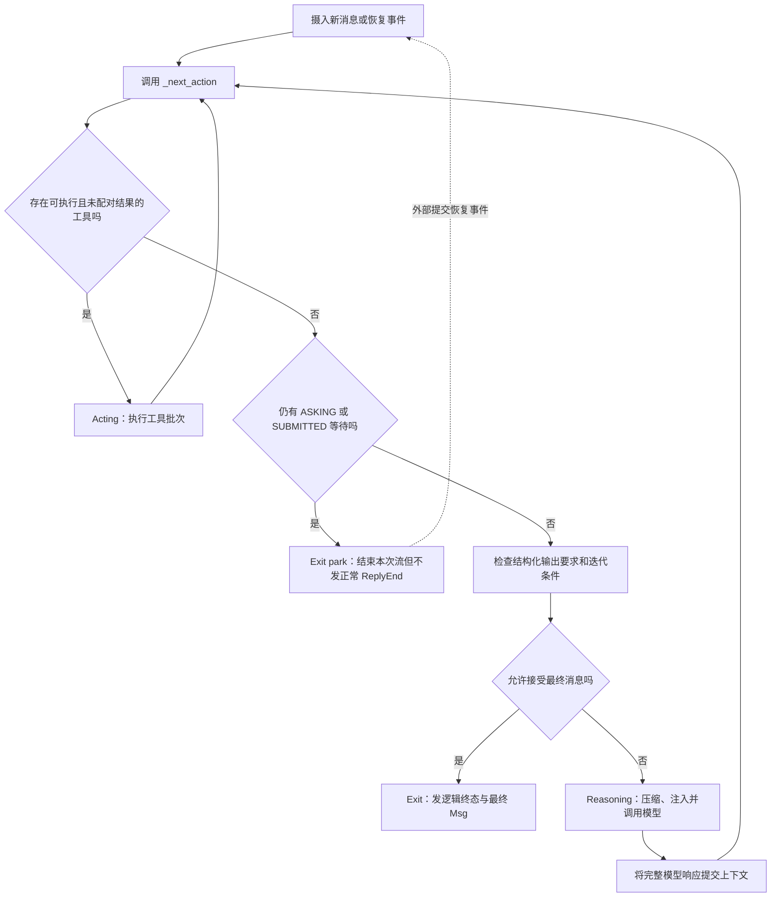
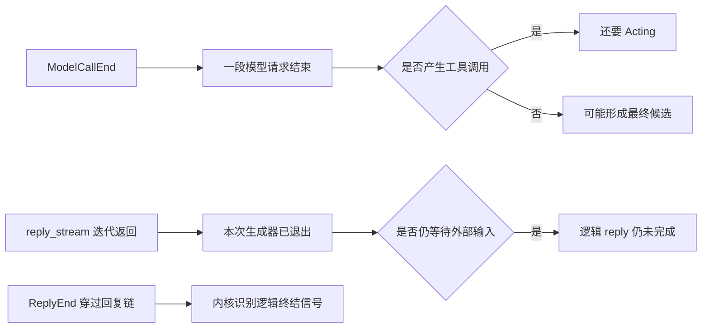
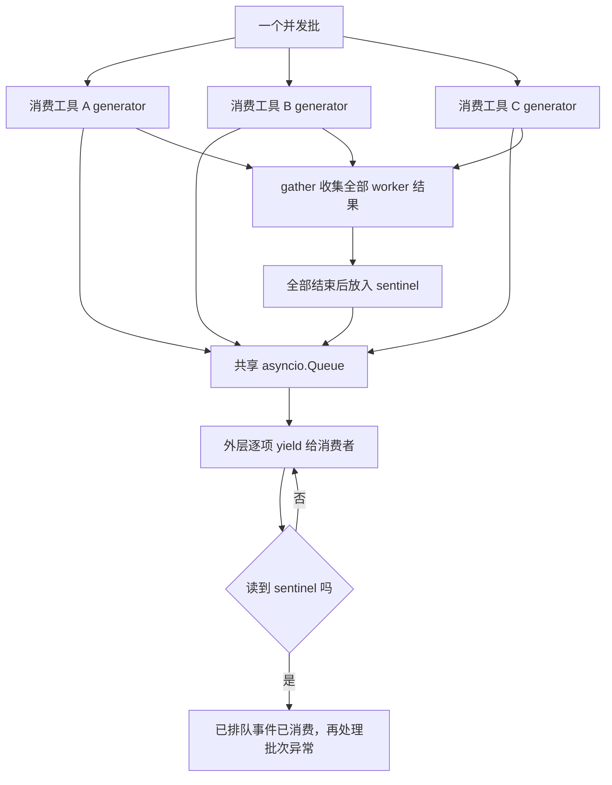
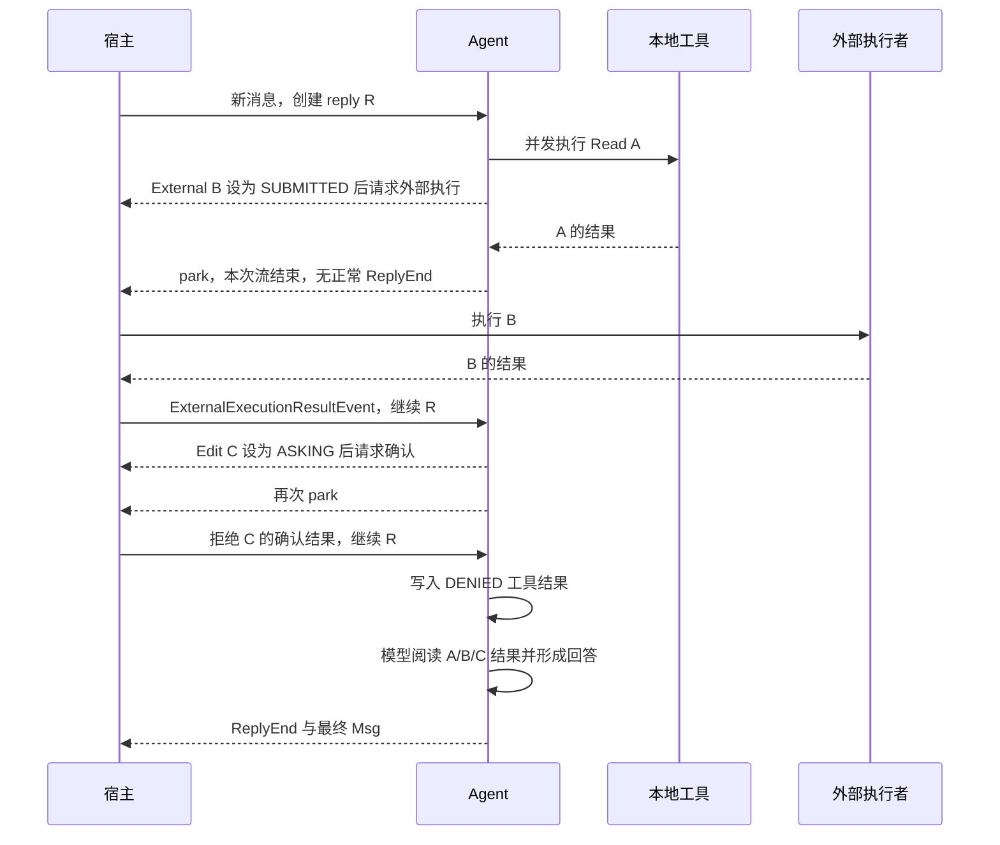
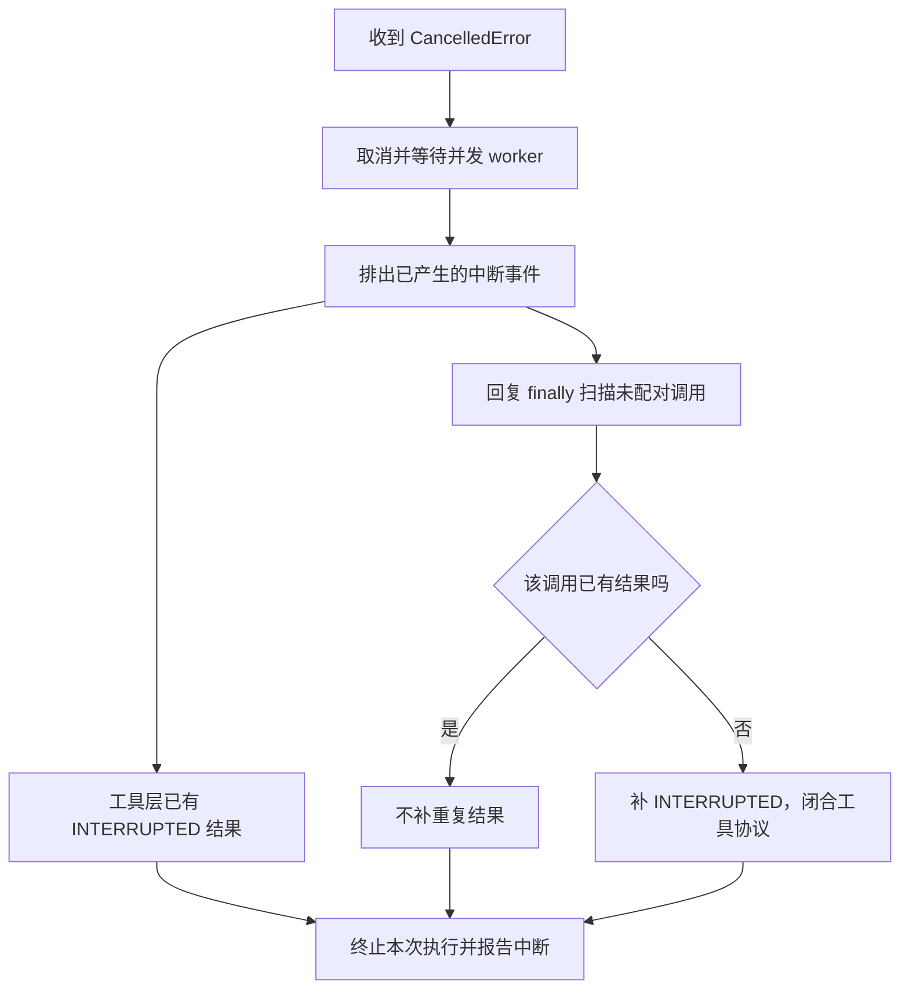

# Agent Loop 深层源码拆解

## ReAct 在本项目中的实现：Reasoning → Acting → Observation

AgentScope 当前统一 Agent 原生实现 ReAct 执行模式。它没有要求导入一个叫 ReAct 的外部执行器，也没有在主路径使用 LangGraph；控制流程由 `_reply_impl` 与 `_next_action` 完成。ReAct 是运行机制，ReActConfig 是该机制的配置，不是单独服务。

### 1. ReAct 概念与源码逐项对应

| 概念 | 源码与实际含义 |
|---|---|
| Reasoning：决定下一步 | [_reasoning_impl](/D:/work/fanchen/projects/company/web/ai-agent-design/open/agentscope/src/agentscope/agent/_agent.py:1720) 调模型，模型产生工具调用或候选回答 |
| Action：结构化行动请求 | [ToolCallBlock](/D:/work/fanchen/projects/company/web/ai-agent-design/open/agentscope/src/agentscope/message/_block.py:147)，包含名称、JSON 参数、ID 与调用状态 |
| Acting：实际执行行动 | [_execute_tool_call](/D:/work/fanchen/projects/company/web/ai-agent-design/open/agentscope/src/agentscope/agent/_agent.py:2452)，参数/权限通过才执行 |
| Observation：观察结果 | [工具结果写回](/D:/work/fanchen/projects/company/web/ai-agent-design/open/agentscope/src/agentscope/agent/_agent.py:2714)，ToolResultBlock 进入 state.context |
| 再推理 | [_prepare_model_input](/D:/work/fanchen/projects/company/web/ai-agent-design/open/agentscope/src/agentscope/agent/_agent.py:3331) 将 context 送入下一次模型请求 |
| 迭代控制 | [_reply_impl 循环](/D:/work/fanchen/projects/company/web/ai-agent-design/open/agentscope/src/agentscope/agent/_agent.py:1168) 与 [_next_action](/D:/work/fanchen/projects/company/web/ai-agent-design/open/agentscope/src/agentscope/agent/_agent.py:3590) |
| 最终回答/暂停 | `_next_action` 返回 Exit，区分带 ReplyEnd 的完成与不带 ReplyEnd 的等待 |
| 配置 | [ReActConfig](/D:/work/fanchen/projects/company/web/ai-agent-design/open/agentscope/src/agentscope/agent/_config.py:362)，迭代预算、结构化宽限与中断策略 |

Observation 没有独立名为 Observation 的分支。它是工具返回写回上下文的阶段，完成后循环再次选择 Reasoning。不要因为没有这个类名，就认为工具结果没有参与后续推理。

### 2. 动作类型把控制流变成显式状态机

[_utils.py](/D:/work/fanchen/projects/company/web/ai-agent-design/open/agentscope/src/agentscope/agent/_utils.py:26) 定义的原文核心类型：

```python
class Acting(BaseModel):
    tool_calls: list[ToolCallBlock]

class Reasoning(BaseModel):
    hint: HintBlock | None = None
    tool_choice: ToolChoice | None = None

class Exit(BaseModel):
    exit_msg: Msg
    exit_events: list[AgentEvent] | None = None
```

Reasoning 可以携带提醒和工具选择限制；Acting 可以一次带多个调用；Exit 同时表达最后消息及结束事件。主循环通过 match 分派，不靠搜索模型回复里是否出现英文 `Action:` 字符串决定执行什么。

### 3. 主循环真正执行了哪些 ReAct 操作

以下是按真实方法顺序缩写的伪代码：

```python
while True:
    action = self._next_action(final_msg)
    match action:
        case Reasoning(hint=hint, tool_choice=choice):
            # 可选 hint → context
            await self.compress_context()
            # 注入时间/任务/预算等动态信息
            async for item in self._reasoning(tool_choice=choice):
                # 事件交给消费者，Msg 作为候选 final_msg 留给决策器
                ...
        case Acting(tool_calls=calls):
            for batch in await self._batch_tool_calls(calls):
                # 顺序或并发执行；结果写入 context
                ...
        case Exit():
            # 完成、预算终结或等待外部输入
            ...
    if not self.state.get_unfinished_tool_calls(self.name):
        self.state.cur_iter += 1
```

真正的“推理”由模型完成，`_next_action` 不替模型规划业务，它只根据工具/结构化/预算状态判断框架下一阶段。模型决定要读什么文件，框架决定这个调用是否可执行、是否要审批、是否已经结束。

### 4. 模型输出怎样从 Reasoning 变成 Action

`_reasoning_impl` 准备 messages/tools 并调用 `_call_model`，流式响应转换为 UI 事件；完整响应最后 `_save_to_context(content, usage)`。如果完整内容带 ToolCallBlock，就不产生普通最终 AssistantMsg；下一次 `_next_action` 从最后消息中找到无对应 result 的调用，返回 Acting。

工具输入增量用于显示，实际行动以完整响应落入 context 的 ToolCallBlock 为依据。不能在半段 JSON delta 到达时就按展示文字触发副作用。

### 5. Observation 是反馈，不只是用户界面输出

正常工具执行中，ToolChunk 可以持续向用户发进度；完整 ToolResponse 生成 ToolResultBlock，必要时截断/offload，再 `_save_to_context`。下一轮 `_prepare_model_input` 追加 state.context，使模型实际看到这个结果。

这两条路径存在区别：用户可能已看到完整工具输出，模型上下文只保留裁剪后的结果和路径提示。ReAct 的观察能力受上下文预算约束，工具输出越长不等于模型获得的信息越完整。

ERROR、DENIED 也属于 Observation。框架把失败结果交回模型，使模型可以改参数、换方法或解释拒绝；它不是把所有工具失败都当 Python 程序终止。开发者协议违约异常仍可能上抛，详见执行内核部分。

### 6. 为什么这不是 prompt 文本版 Thought/Action/Observation

早期常见 ReAct 示例让模型按文本写 Thought、Action、Observation，再解析字符串。本项目主要用原生 Tool Calling：工具 JSON schema 随请求发送，动作是 ToolCallBlock，观察是 ToolResultBlock，控制状态由 Python 数据结构管理。

ThinkingBlock 可以保存模型提供的思考内容，但不是 ReAct 必需字段。模型不暴露思考文本，只返回 tool call 和回答，仍可完整运行 ReAct。不要把 Reasoning 阶段误解为必须读取或展示模型隐藏思维链。

### 7. 与固定 Workflow 的边界

固定 Workflow 通常由开发者预先规定业务节点/边；这里模型每次根据已有 Observation 选择下一工具。代码预先规定的是“推理/行动/退出”的通用规则，并未预先规定每个业务任务的全部工具顺序。

Pipeline/SOP 可以在更外层约束目标或流程，每个 Agent 内部仍用该循环。两层并存：外层规定业务阶段，内层自主决定某阶段怎样调用工具。

### 8. 工程扩展怎样改变经典 ReAct

一个 Reasoning 可产多个 Action，按工具声明分并发/顺序批；Action 可被权限拦成 ASKING；external Action 可变 SUBMITTED；Observation 可跨调用回传；压缩会替换早期上下文；结构化输出需要指定工具完成协议；预算耗尽可强制禁工具总结。

这些扩展不改变反馈闭环，但使“一轮”不等于一个 API 请求或一次函数调用。只有当前工具结果闭合才推进 cur_iter；人类确认只是恢复旧轮，不赠送新迭代预算。

### 9. 具体任务的状态快照

用户要求“检查配置，必要时修正”：模型先产生 Read(call-1)→context 保存 call-1→Acting 读文件→result-1 写入→下一模型看到配置错误→产生 Edit(call-2)→权限 ASK，流退出但无 ReplyEnd→用户批准→继续同 reply 执行 Edit→result-2 写入→模型最终解释修改→Exit(COMPLETED)。

若 Edit 被拒绝，result-2=DENIED，模型应解释无法修改或提出可行替代；若达到 max_iters，下一步受强制收尾限制。ReAct 选择业务动作，权限与预算保证执行不会无约束推进。

### 10. 与后文的阅读关系

以下主循环解析解释单个阶段；同文件后面的执行内核分析继续深入恢复 ID 校验、并发 queue/sentinel、工具结果提交、异常组与取消清理。ReAct 在这里是贯穿整个 Agent 的执行架构，而非附加的一次提示词技巧。源码映射已核对，未运行实际模型任务。

本篇先建立主循环控制模型；更细的恢复校验、并发队列、Toolkit、结果提交和取消实现见 [执行内核逐段源码解析](02-Agent-Loop.md#execution-internals)。后者提供完整源码导航、关键片段和贯穿多次暂停的执行示例。

目标源码：`open/agentscope/src/agentscope/agent/_agent.py`，当前 `2.0.12dev`。下文行号对应本地快照；标为伪代码的片段仅保留控制关系。

## 公开入口：流式和非流式共用内核

`reply_stream:290` 与 `reply:334` 都进入 `_reply`。stream 默认过滤最终 Msg，开启 yield_final_msg 才返回它；reply 消费同一生成器并收集 final Msg，缺少 Msg 则 RuntimeError。非流式是消费方式，不是另一套运行引擎。

输入支持 Msg、消息列表、确认结果、外部执行结果、UserInterruptEvent 或 None。一次函数调用可能创建新 reply，也可能只是继续原 reply，不能按 HTTP 请求数计算逻辑回复数。

## 决策与执行分离

`_reply_impl:1046` 执行 loop；`_next_action:3590` 只读状态，返回 Reasoning、Acting、Exit。等价伪代码：

```python
while True:
    action = self._next_action(final_msg)
    match action:
        case Reasoning():
            await compress_context()
            yield runtime_state_events
            final_msg = await reasoning_and_stream()
        case Acting(tool_calls=calls):
            for batch in await batch_tool_calls(calls):
                yield tool_execution_events(batch)
        case Exit():
            yield end_events_or_waiting_msg
            return_if_parked_or_end_observed()
    if not state.get_unfinished_tool_calls(name):
        state.cur_iter += 1
```

这使下一步决策与 I/O/状态写入分开。模型输出的 final_msg 只是候选，仍由决策器判断是否满足结束条件。

## 输入启动和恢复

新输入经过 `_handle_incoming_messages`，创建 ReplyContext(reply_id、cur_iter=0、structured_schema)，发 ReplyStartEvent。恢复事件先由 `_check_incoming_event` 核对，再 `_handle_incoming_event` 更新旧状态；恢复时新传 schema 被忽略并告警，避免改变已暂停任务的协议。UserInterruptEvent 对存在 awaiting 工具的 reply 直接走清理，无推理；空闲时无输出 no-op。

## 下一动作的优先级

`_next_action` 首先取最后消息的 tool calls，以已有 result IDs 过滤已结束调用；ALLOWED 可执行，PENDING 只有在不存在 awaiting 调用时执行。有可执行工具先 Acting；否则有 awaiting 就 park；之后才检查结构化输出、候选回答和迭代上限；最后默认 Reasoning。

这个顺序保证“文本+工具”先执行工具，等待确认时不让模型猜执行结果。result ID 过滤是内部重复执行防线，不能替代外部业务幂等。

## 上下文与模型调用

`_prepare_model_input:3331` 的原文关键片段：

```python
messages = [SystemMsg(name="system", content=await self._get_system_prompt())]
if self.state.summary:
    messages.append(UserMsg(name="user", content=self.state.summary))
messages.extend(self.state.context)
tools = await self.toolkit.get_tool_schemas(
    self.state.tool_context.activated_groups,
)
```

system prompt 由基础提示、Skill 指引、Workspace 指引拼接，再顺序经过 on_system_prompt。摘要包装为 UserMsg，历史在其后；工具按激活组暴露。每次推理前先压缩和注入运行状态，模型输入并非仅原始聊天记录。

`_call_model:3369` 先 primary 后 fallback，每个最多 max_retries+1 次；on_model_call 可换模型/参数。它包裹的是 await model(...)；返回 generator 后，流迭代发生在外部，因此不能保证中途断流也由本层自动重试或 fallback。

## 推理响应的提交规则

`_reasoning_impl:1720` 发 ModelCallStart，消费普通 ChatResponse 或 async generator；普通块转换为 block events，is_last=True 保存为 completed_response。结束时闭合所有活跃块，若没有完整终块则 RuntimeError，避免半段 JSON 被当成功。发 ModelCallEnd 后 `_save_to_context` 提交完整内容。

只有未 interrupted、没有 ToolCallBlock、且不是 thinking-only，才产生候选 AssistantMsg。thinking-only 会再推理，不是用户最终回答。工具调用则保留在上下文等待 Acting。

## 工具分批与执行

`_batch_tool_calls:2118` 保留调用顺序，按连续 is_concurrency_safe 构建 concurrent 或 sequential 批。例：safe A、safe B、unsafe C、safe D → concurrent[A,B] → sequential[C] → concurrent[D]。不能把所有 safe 工具提前。方法注释提及 is_read_only，但此处分支实际只看 is_concurrency_safe，应以实现为准。

`_execute_tool_call:2452` 的边界是完整工具生命周期：检查工具可用/激活组→修复并解析 JSON→jsonschema.validate→权限→调用→事件与上下文提交。AgentOrientedException（如参数错误）转换为 ERROR tool result，让模型纠正。原始 I/O 才委派 `_acting`，由 on_acting 包裹 toolkit.call_tool。

并发批 kept_rules 对相同建议授权规则覆盖的确认请求去重，后续调用保持 PENDING 等恢复后重判；bypass_immune 的 safety ASK 不去重。某批产生确认或外部执行要求后，后续批次暂缓。

## 暂停不是完成

`_next_action` 对 awaiting 情况返回（删节原文）：

```python
return Exit(
    exit_events=None,
    exit_msg=AssistantMsg(...),
)
```

loop 返回等待消息却不发 ReplyEnd。当前事件流结束，逻辑 reply 还在。恢复沿旧 reply_id/调用 ID 继续；部分确认时不会重发剩余全部卡片，客户端需保留它们。前端不应把 StopAsyncIteration 自动解释为任务完成。

## 轮次和强制收尾

只有没有 unfinished 工具才增加 cur_iter。带工具的推理加完整工具结果合成一轮，审批期间不把未完成轮重复计数。普通模式在 cur_iter==max_iters 时追加一次强制收尾，注入总结提示并 ToolChoice(mode="none") 禁工具；该回答标记 EXCEED_MAX_ITERS。因此 max_iters 不是模型调用总次数硬上限。

结构化输出通过 `_GenerateStructuredOutput` 工具校验并存入 reply_context。超过普通预算后强制选择此工具，额外允许 structured_output_grace_iters；满足后 final Msg 带 structured_output，否则超限终结。

## Middleware 能改变终结语义

`_reply:902` 只有在 ReplyEnd 真正穿过整个 on_reply 链时设置 `_receive_reply_end=True`，并在 yield 前设置。若 middleware 吞掉 end，loop 再推进，可实现最终自检。made_progress 防止无 reasoning/acting 连续吞 end 的空转，第二次会 RuntimeError；middleware 应先解锁预算/状态。

## 取消与清理

CancelledError 构造 INTERRUPTED end，finally 里 `_close_unfinished_tool_calls` 补 interrupted tool result，再发 end 和 fallback Msg。按 interruption_raise_cancelled_error 可重新抛异常。新 reply 和恢复阶段的 await asyncio.sleep(0) 是显式取消检查点，即便后面 await 全部立即完成，取消也能进入清理作用域。

## 一次完整例子

用户要求编辑文件→新 ReplyContext→模型输出 Read→工具校验/权限/结果提交→模型输出 Edit→ASK 发卡并暂停（无 ReplyEnd）→收到 UserConfirmResultEvent→原 reply 执行 Edit→工具结果提交并增加轮次→模型返回说明→决策器接受候选→ReplyEnd 穿过 middleware→final Msg。reply_id、tool_call_id、result state 连接整个过程。


<a id="execution-internals"></a>

## Agent Loop 执行内核：恢复协议、并发调度与状态提交

本文接续 [主循环专题](02-Agent-Loop.md)，按当前 2.0.12dev 实现逐段追踪。所有引用为当前本地源码；精读对象包括 Agent、AgentState 与 Toolkit.call_tool。代码块标注原文或删节原文，省略号表示有意省略，不能直接复制运行。

### 一、源码入口地图

| 阶段 | 可点击位置 | 核心职责 |
|---|---|---|
| 公开 API | [reply_stream](/D:/work/fanchen/projects/company/web/ai-agent-design/open/agentscope/src/agentscope/agent/_agent.py:290) | 过滤/转发事件和最终消息 |
| 洋葱入口 | [_reply](/D:/work/fanchen/projects/company/web/ai-agent-design/open/agentscope/src/agentscope/agent/_agent.py:902) | on_reply 链、观测结束事件 |
| 主循环 | [_reply_impl](/D:/work/fanchen/projects/company/web/ai-agent-design/open/agentscope/src/agentscope/agent/_agent.py:1046) | 分流输入、执行动作、取消清理 |
| 下一动作 | [_next_action](/D:/work/fanchen/projects/company/web/ai-agent-design/open/agentscope/src/agentscope/agent/_agent.py:3590) | 工具优先、暂停、结构化、完成、预算 |
| 恢复验证 | [_check_incoming_event](/D:/work/fanchen/projects/company/web/ai-agent-design/open/agentscope/src/agentscope/agent/_agent.py:1865) | 确认/执行结果是否对应 pending 工作 |
| 恢复应用 | [_handle_incoming_event](/D:/work/fanchen/projects/company/web/ai-agent-design/open/agentscope/src/agentscope/agent/_agent.py:1948) | 更新授权、写结果、规则累积 |
| 新消息 | [_handle_incoming_messages](/D:/work/fanchen/projects/company/web/ai-agent-design/open/agentscope/src/agentscope/agent/_agent.py:2057) | 复制、校验、媒体降级 |
| 分批 | [_batch_tool_calls](/D:/work/fanchen/projects/company/web/ai-agent-design/open/agentscope/src/agentscope/agent/_agent.py:2118) | 保留顺序与并发屏障 |
| 顺序执行 | [_execute_sequential_tool_calls](/D:/work/fanchen/projects/company/web/ai-agent-design/open/agentscope/src/agentscope/agent/_agent.py:2158) | 首次暂停或中断后停止后续调用 |
| 并发执行 | [_execute_concurrent_tool_calls](/D:/work/fanchen/projects/company/web/ai-agent-design/open/agentscope/src/agentscope/agent/_agent.py:2210) | queue、sentinel、gather、异常组 |
| 单工具 | [_execute_tool_call](/D:/work/fanchen/projects/company/web/ai-agent-design/open/agentscope/src/agentscope/agent/_agent.py:2452) | 参数、权限、执行、截断、状态和事件 |
| 原始调用 | [Toolkit.call_tool](/D:/work/fanchen/projects/company/web/ai-agent-design/open/agentscope/src/agentscope/tool/_toolkit.py:225) | 调用形状兼容、累计结果、错误归一化 |
| 上下文写入 | [_save_to_context](/D:/work/fanchen/projects/company/web/ai-agent-design/open/agentscope/src/agentscope/agent/_agent.py:3518) | 过滤音频、消息聚合、usage |
| 聚合规则 | [AgentState.append_context](/D:/work/fanchen/projects/company/web/ai-agent-design/open/agentscope/src/agentscope/state/_state.py:298) | 同 reply 的 blocks 合并到同一 Msg |
| 取消补全 | [_close_unfinished_tool_calls](/D:/work/fanchen/projects/company/web/ai-agent-design/open/agentscope/src/agentscope/agent/_agent.py:981) | 给无 result 调用补 INTERRUPTED 结果 |

### 二、先明确三个不同的“结束”

模型调用结束不代表 reply 结束：模型返回工具调用后还要行动；工具执行结束不代表 reply 结束：通常还需要模型消化工具结果；一次 reply_stream 迭代结束也不代表逻辑 reply 完成：等待人工确认时流返回，但没有 ReplyEnd。

这不是措辞区别，而是服务/UI 必须实现的协议。应按 ReplyEndEvent 判断逻辑终态，按 RequireUserConfirm/RequireExternalExecution 显示暂停，按 ModelCallEnd 管理一段模型生成。

### 三、State 的形状决定整个 loop 写法

AgentState.append_context 原文：

```python
if (
    self.context
    and self.context[-1].role == "assistant"
    and self.context[-1].name == name
    and self.context[-1].id == self.reply_id
):
    self.context[-1].content.extend(blocks)
else:
    self.context.append(Msg(
        id=self.reply_id, role="assistant", name=name, content=blocks,
    ))
```

同一个逻辑 reply 的多次推理、多个工具调用和结果通常积累成一个 assistant Msg，而非每个模型调用都另建一条 Msg。reply_id 同时用作该消息 ID，事件可以按 reply_id 更新同一个 UI 容器。

这也解释了许多辅助方法只检查 context[-1]：当前 Agent 的执行痕迹被设计为尾部消息。middleware 若在不合适时机追加其它角色/名称消息，会改变这个假设，应检查影响，而不是认为任意 append 都无害。

### 四、工具生命周期和工具业务结果是两个枚举

ToolCallState 表示调用生命周期：PENDING、ASKING、ALLOWED、SUBMITTED、FINISHED；ToolResultState 表示执行结果：SUCCESS、ERROR、DENIED、INTERRUPTED 等。FINISHED 不等于成功，拒绝和失败也必须结束调用，防止 loop 无限把它当未处理任务。

`get_unfinished_tool_calls` 依据的是“是否存在同 ID ToolResultBlock”，而不是仅看 call.state。这样即使某处 shallow-copy 导致 state 没同步，匹配结果仍能证明调用已闭合。`_next_action` 同样用 result IDs 排除执行候选，形成第二道保护。

`get_awaiting_tool_calls` 当前实现中 ASKING 直接被选中，SUBMITTED 才显式排除已有 result ID；不能把注释的抽象描述照抄成两者都做同一条件判断。这种差异需要在异常恢复分析中保留。

### 五、新消息不是任意模型消息导入通道

`_handle_incoming_messages` 先 deepcopy，避免降级媒体/合并上下文时修改调用者对象；拒绝 system 角色以及包含 tool_call/tool_result/thinking 的输入。调用者不能通过用户输入伪造一段模型工具执行历史。

媒体支持按 model.formatter.supported_input_media_types 的 fnmatch 模式判断。对于不支持的 DataBlock：已有 URL 保留路径，base64 有 offloader 时保存到工作区；最终换成 TextBlock 说明附件位置或不支持的类型。模型因此可以用文件工具处理附件，而不强行把不支持媒体发给 provider。

这里复制不等于整批事务：逐条消息处理后 append，后面一条失败时之前条目可能已入 context。应用若需要批量输入原子性，不能从 deepcopy 自动推断已有。

### 六、恢复验证：先确认调用仍在等待

`_check_incoming_event` 先分出 ASKING IDs 和 SUBMITTED IDs。没有传事件却有等待调用，会抛 ValueError；不是自动把新消息当用户批准。收到确认但没有 ASKING 调用，同样拒绝。

确认 IDs 的检查使用集合差（原文）：

```python
extra_ids = set(
    _.tool_call.id for _ in event.confirm_results
) - set(awaiting_confirmations)
if extra_ids:
    raise ValueError(...)
```

这是子集验证，允许一次只确认部分工具；不能包含任意额外 ID。外部执行结果也同样检查 SUBMITTED IDs。这里未直接比较 event.reply_id 与 state.reply_id，因此 reply_id 的服务路由和工具 ID 的内核验证是不同层，不能把这段写成“已验证全部会话归属”。

### 七、确认通过后为什么仍不立即调工具

`_handle_incoming_event` 把确认映射为 id→confirmation。通过的调用改为 ALLOWED，将用户可修改的 name/input 写回原 ToolCallBlock，并把 confirmation.rules 加到权限引擎。然后交回主循环，由 `_next_action` 再选择 Acting。

这个分离保留同一套执行校验路径：修改后的工具仍需重新检查可用性、解析 JSON、验证 schema。授权内核 `_check_permission_impl` 遇 ALLOWED 会短路允许，但 on_check_permission middleware 仍然执行，可再次施加宿主策略。

因此“确认通过”是把 pending 工作转可运行，并非绕过全部执行校验。应用若允许用户改工具名/参数，确认提交端必须控制可修改范围，内核不会仅凭原 prompt 自动判断改动意图。

拒绝路径调用 `_handle_error_tool_call(...DENIED)`，生成真实工具结果，后续模型能看见拒绝原因；调用不再永久悬挂。

### 八、外部结果为何直接进入上下文

SUBMITTED 表示执行责任已移交外部。恢复时找到对应工具后先 `check_external_result` 验证形状，再将 output 转事件、发 ToolResultEnd、保存结果并将 call 标 FINISHED。外部形状校验失败直接抛异常，不伪造成功结果，reply 保持待恢复。

此处使用工具结果 name 查工具，ID 归属在前一步校验；名字与原调用关系、宿主外部执行鉴权需要结合调用方继续审查，不能仅把“有 schema 校验”说成外部结果可信。

### 九、yield 前的赋值为什么是正确性要求

Agent 在 ASK 分支先 `_update_tool_call_state(...ASKING)`，再 yield RequireUserConfirm；外部调用先 ALLOWED、发 ToolResultStart，再设 SUBMITTED，最后 yield RequireExternalExecution。

异步生成器在 yield 处暂停，消费者可能收到事件后 break 或关闭流。若把状态赋值放 yield 后面，就可能永远不执行，下一次恢复找不到对应等待状态。这里源码注释明确强调这个顺序，是事件协议驱动的状态提交。

### 十、并发不是 asyncio.gather 后一次性返回

每个工具调用由 `_into_queue` 消费它的 AsyncGenerator，把事件逐条 `queue.put`。外层一边 `queue.get` 一边 yield，因此慢工具不阻塞快工具的流式进度。

```text
tool A generator ─┐
tool B generator ─┼→ shared queue → 外层 AsyncGenerator → UI
tool C generator ─┘
```

队列是默认无界 asyncio.Queue；没有本段显式背压容量。消费者很慢时事件可积累，不能凭用了 queue 就认定内存已受限。调度只承诺并发批，不保证事件按工具调用原始顺序返回，UI 必须用 tool_call_id 归并。

### 十一、sentinel 比“看 task.done”更严格

`_run_all` 原文关键代码：

```python
results = await asyncio.gather(
    *[self._into_queue(tc, queue, kept_rules) for tc in tool_calls],
    return_exceptions=True,
)
await queue.put(sentinel)
return results
```

sentinel 在所有 worker 完成之后才入队，因此它之前的事件已全部排队。外层读到 sentinel 才退出，避免“任务已 done，但队列还有末尾 ToolResultEnd 没发”的尾部丢事件。

一个 worker 抛普通异常不取消其它 worker，return_exceptions=True 将失败作为值保留；排完事件后收集 `isinstance(r, Exception)` 构建 ExceptionGroup。适合独立工具尽量完成，但没有跨工具事务回滚：A 成功修改文件，B 崩溃，并不会撤销 A。

### 十二、批次共享 kept_rules 为何没有锁

并发 worker 共享一个 list，收集已展示确认的 suggested_rules。后续相同规则覆盖的普通 ASK/PASSTHROUGH 调用可维持 PENDING 不再发重复卡，等用户确认把规则加入后再评估。bypass_immune safety ASK 不去重。

源码称同步片段在单线程事件循环中修改 list，无需线程锁。这个说明只覆盖同步读写片段；自定义 tool.match_rule 可 await，具体去重顺序仍受调度影响，不能把同批重复 prompt 永远归并视为严格分布式保证。

### 十三、顺序批与并发批的暂停区别

顺序执行器遇首个确认/外部执行请求或 INTERRUPTED result 即停，后续同批调用尚未开始。并发批所有 worker 已启动，某个工具请求确认不取消其它 worker，它们仍可完成并发出结果。主循环只在该批消费完之后停止后续批次。

例：concurrent[ReadA, ExternalB] → sequential[EditC]。B 请求外部执行时 A 可以继续完成；C 不会启动。用户仅恢复 B 后，loop 才推进到 C。不能把“遇审批暂停”解释成整个批次所有工具都没有执行过。

### 十四、Toolkit 承担的真正执行工作

Toolkit.call_tool 再检查工具组可用性，再解析输入，必要时为本地非 MCP/非 external 工具注入 `_agent_state`。然后区分 coroutine function、普通调用、async generator、sync generator，将每个 ToolChunk 累计入 ToolResponse，最终总是产出完整 ToolResponse。

这里重复检查不是纯冗余：Agent 的前置校验到真正执行之间，中间件或并发可能改变工具注册/组状态。同步工具在这个方法里并未统一自动放线程池，直接执行同步 `__call__`/generator 可能阻塞事件循环；FunctionTool 适配器自身是否 offload 要另看适配器，不能泛化所有工具都异步无阻塞。

### 十五、错误必须分开发给模型还是抛给开发者

Toolkit 把 MCPError 和普通业务 Exception 转成 ERROR ToolChunk，随后累计 ToolResponse；DeveloperOrientedException 重新抛出，表示工具接口实现违约，例如返回了不支持的对象类型。取消转 INTERRUPTED chunk，交给 Agent 识别并进入回复级清理。

ToolResponse 在 finally 里 yield，表示执行器试图总给出完整响应；但上游异常仍可能在生成器继续迭代后传播。因此收到一次 ToolResultEnd 不一定证明整个并发批无异常，应继续看外层完成/错误。

### 十六、进度事件和模型可见结果不是同一份内容

中间 ToolChunk 被转 ToolResultTextDelta/DataDelta 给 UI，最终 ToolResponse 才生成 ToolResultBlock 并切分/截断。若超限，保留前缀加 TRUNCATED/path 提示，余下内容 offload。模型下一轮读的是保留内容；UI 可能已经看到全部流式输出。

MCP progress 额外转 CustomEvent，合并 reply_id/tool_call_id 供 UI 路由，不代替实际工具结果。消费方不能把 progress=100 当 ToolResultEnd。

### 十七、正常工具结果的状态提交顺序

正常执行的关键顺序：构造 ToolResultBlock→切分结果→必要时 offload→_save_to_context→call.state=FINISHED→yield ToolResultEnd。正常结果的 ended 事件出现时，内存上下文已写好。

外部恢复路径却先 yield ToolResultEnd，再 _save_to_context/FINISHED；`_handle_error_tool_call` 也在 yield End 后才最后更新 call.state（但 result 已保存）。所以“所有 End 事件之前都完成所有状态写入”并不成立。服务若在某个 yield 点立即抓快照或关闭迭代器，必须考虑这些差别。这是源码时序事实，不是已验证漏洞结论。

### 十八、模型流转事件时还有一套局部状态机

[_convert_chat_response_to_event](/D:/work/fanchen/projects/company/web/ai-agent-design/open/agentscope/src/agentscope/agent/_agent.py:3852) 维护 text/thinking 当前块 ID、tool IDs 和 data IDs。首次见文本发 Start，后续 Delta 复用 ID；切到别类内容时闭合对应块。thinking 先于 text 处理，让同 chunk 的思考事件先到。

仅 data chunk 不关闭已有 text/thinking，避免音频 delta 夹在文本间把一个回答拆成许多气泡。工具 ID 首次出现发 ToolCallStart，每块 input 发 Delta，后续 chunk 缺席的工具 ID 发 End；剩余未闭合块由 reasoning 末尾统一闭合。

URLSource 不作为流式二进制 delta 输出，Base64Source 才按稳定 data block ID 生成 DataStart/Delta。工具结果的 URLSource 则可由 `_convert_tool_chunk_to_event` 输出 URL 事件，两种转换不能混为一谈。

### 十九、上下文为什么主动排除 assistant 音频

`_save_to_context` 过滤 assistant 生成的 audio DataBlock，但 usage 仍能保存，音频已通过流给用户。不把原始音频历史继续入模能减小持久化/计数/formatter 的负担。代价是事件回放与持久 Msg 不一定拥有同样二进制内容，完整音频重播需要另有存储。

usage 从 ChatUsage 转 Usage，聚合到当前 reply 的 Msg；`_get_reply_usage` 只在尾消息 ID 与当前 reply_id 匹配时返回副本。因此 context 被压缩时要专门保住 usage，见上下文专题。

### 二十、外部取消如何避免孤儿工具

并发执行器捕获 CancelledError：cancel gather_task→await 其结束→排空已排队事件→重新抛取消。await gather 可将取消传给 workers，Toolkit 在取消路径产生的 INTERRUPTED chunk 因此也有机会被发出去。

在进入 Toolkit 前就取消的工具没有产生自己的终结果，reply finally 的 `_close_unfinished_tool_calls` 再扫尾部 Msg，找 call 无 result 的项补 INTERRUPTED。这是两层清理：工具层收集已执行路径，reply 层补从未进入工具的空洞。

清理时 ALLOWED/SUBMITTED 已发过 ResultStart，不重复；PENDING/ASKING 先补 Start，再 delta、end 和 ToolResultBlock，保持 UI 生命周期尽量配套。取消在这里仅描述执行请求已中断，不能保证外部服务器已回滚或已停止。

### 二十一、迭代预算的精确计算示例

初始 cur_iter=0，模型输出两个 tools 时 unfinished 非空，不计数；完成二者后无 unfinished，cur_iter=1。若其中一项 ASK，另一项已成功，轮次仍未结束；恢复确认并完成最后一项后才增加。

纯 thinking-only 响应没有 tool，但仍使本轮无 unfinished，增加计数后再推理。max_iters 默认 50，普通模式等于上限时多一次禁止工具的总结调用；结构化模式另有默认 5 次 grace。max_iters 不是费用或 API 次数硬限制，摘要/检索模型调用还可能在其它能力中发生。

### 二十二、完整过程：并发、拒绝、外部执行和最终回答

假定模型生成 safe ReadA、safe ExternalB、unsafe EditC。分批为 concurrent[A,B]→sequential[C]。

1. 新 Msg 深复制后进入 context，创建 reply R，发 ReplyStart。
2. reasoning 产生 call A/B/C，完整响应提交到 R 的 Msg。
3. A/B worker 启动；A 通过并写结果，B 设 SUBMITTED 并请求外部执行。
4. sentinel 确认本批事件发完，后续 C 不启动；_next_action 因 B 等待返回 park，无 ReplyEnd。
5. 宿主提交 B 的 ExternalExecutionResultEvent，ID 子集通过；结果 shape 验证，事件与 context 更新，B FINISHED。
6. 尚有 PENDING C，下一动作仍 Acting，而不是直接调用模型。
7. C 请求确认，先设 ASKING 再发卡，reply 再次 park。
8. 用户拒绝 C，生成 DENIED result；无 unfinished 后本轮计数推进。
9. 模型根据 A/B 成功和 C 被拒绝生成说明；候选 final Msg 经 _next_action 接受。
10. ReplyEnd 穿过 middleware，_receive_reply_end=true，最终 Msg 返回。

这个例子展示了一次逻辑 reply 可以跨三次调用，且只有一次起始身份 R。前两次流结束都不等于成功完成任务。

### 二十三、阅读结论与验证边界

核心设计是“显式状态决策 + 异步生成器事件 + 工具协议闭合”。细节主要花在暂停恢复、并发收尾与状态/事件时序，而不是 while(model→tool) 这个外壳。本文依据实际源码静态分析，没有运行测试；外部执行鉴权、同 Agent 并发 reply、生成器提前关闭、同步工具阻塞和服务快照时机需结合应用层验证。

## 图解深化：动作选择、并发排队与暂停闭合

以下图解对照 `_reply_impl`、`_next_action`、工具执行器和输入恢复代码。它们展开前文已有结论；决策图按相关条件归纳，不逐一列出全部错误、预算和结构化输出事件。

### A. 每一轮先决定动作，再执行动作



重点是先处理未闭合工具，再判断继续推理或退出。模型生成文本只是候选 final，真正的回复终态仍由内核与 middleware 合作决定。

### B. 三种结束不能共用一个布尔值



UI 应分别维护模型生成、待确认、外部执行、回复完成等状态。把网络流结束当完成会让授权卡无法恢复，也可能错误显示任务成功。

### C. 并发批的事件生产与 sentinel



worker 完成不等于队列已消费完；sentinel 让尾部 ToolResultEnd 不因 task.done 提前退出而丢失。队列在此没有显式容量限制，因此慢消费者仍可能造成积压。

### D. 一次逻辑回复跨三次调用



R 的连续性来自 ReplyContext 与工具 ID，而不是三个调用共用一条未退出的 Python 栈。B 的外部副作用不由 Agent 取消协议自动回滚。

### E. 取消时的两层补结果



正常结果、错误结果和外部恢复路径在 yield/写入 state 的顺序上并不完全相同。做快照时应对照实际分支，不能把所有 End 事件一律当作全部状态已持久提交。

### F. 用状态快照审查执行

| 时间点 | 内存中应检查的证据 | 不能仅凭什么判断 |
|---|---|---|
| 模型发出工具调用 | ToolCallBlock 与 ID、参数 | 一段自然语言“准备执行” |
| 发确认卡之前 | call.state 已为 ASKING | UI 卡片已经渲染 |
| 外部执行交接 | SUBMITTED 与合法等待 ID | HTTP 调用已返回 |
| 工具完成 | 同 ID ToolResultBlock 与业务结果状态 | call.state=FINISHED 就当成功 |
| 回复终结 | ReplyEnd、finished_reason、最终消息 | 最后一个 token 已收到 |

建议故障注入点是每一个 yield 前后：消费者关闭流、重复确认、部分确认、并发某一项失败，分别考察调用能否继续闭合。本轮没有运行这些故障实验。
