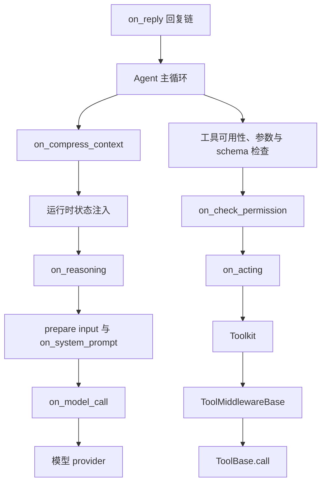
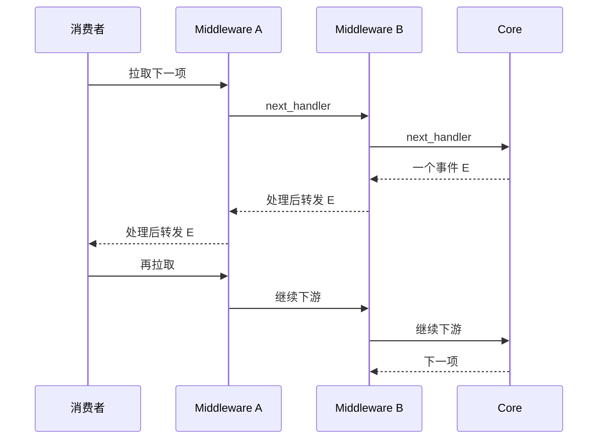
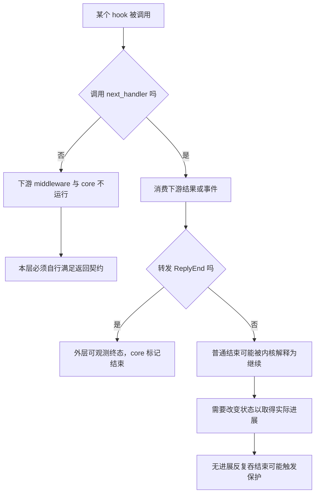
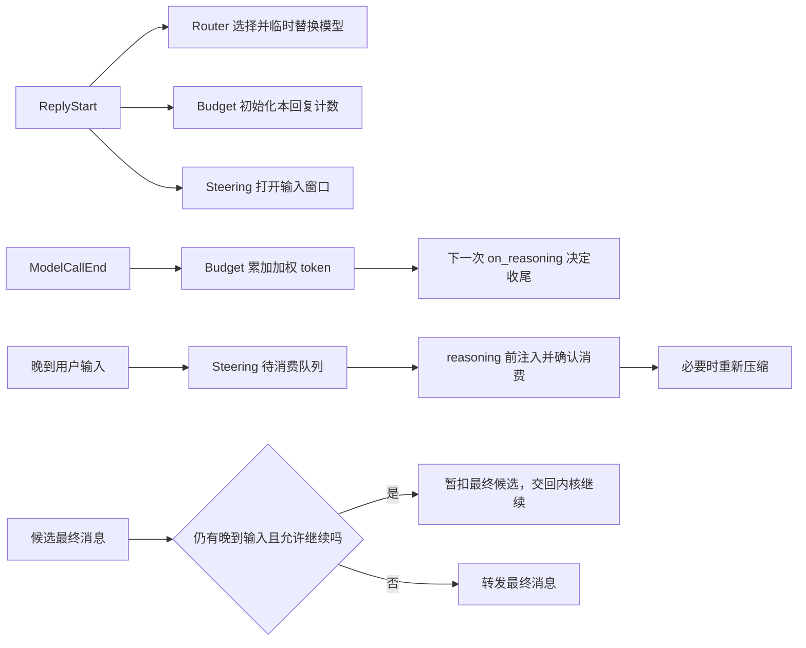
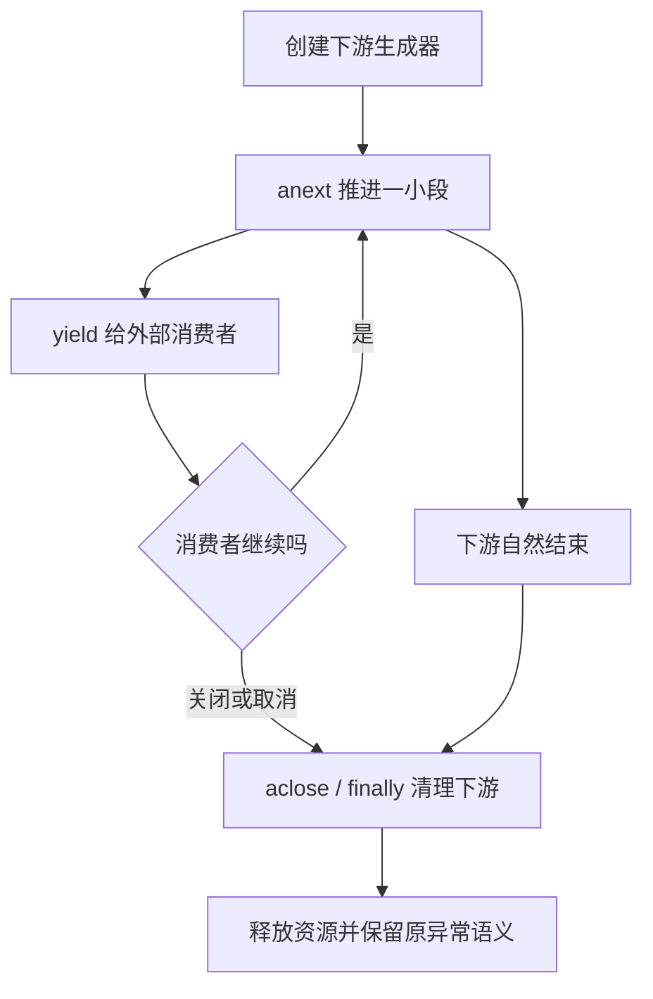

# Middleware：执行扩展的权力与边界

依据 `middleware/_base.py` 与 `_agent.py`。初始化时 is_implemented 比较子类/基类方法，把真正覆写的 hook 分类。六个 hook 使用洋葱链，on_system_prompt 使用顺序字符串变换。

| hook | 覆盖范围 | 关键语义 |
|---|---|---|
| on_reply | 整次回复 | 吞 ReplyEnd 会让 loop 继续 |
| on_reasoning | 一轮推理 | 包裹模型推理与事件 |
| on_model_call | 原始模型调用 | 可改 current_model/messages/tools/tool_choice |
| on_check_permission | 已解析校验后 | 返回 PermissionDecision；不委派可绕过默认权限解析 |
| on_acting | toolkit.call_tool I/O | 不覆盖校验、权限和 Agent context 写入 |
| on_compress_context | 压缩执行 | 管理压缩过程 |
| on_system_prompt | prompt 构建末端 | 顺序变换提示字符串 |

execute_chain(index) 递归进入 middleware，next_handler 委派下一层并可覆盖 kwargs，最后进入原实现；事件或结果返回时逆序穿过外层。因此第一个 middleware 最外层。流式 hook 是 AsyncGenerator，不能直接用普通 await 链代替。

on_acting 只包 I/O，便于 offload；但 is_state_injected 工具拿到 live AgentState，仍可能有共享状态并发写。on_check_permission 收到调用/输入副本，改副本不改变真正工具参数；它的权力来自返回决策，完全不调用 next_handler 会绕过默认判断。

on_reply 吞结束事件会改变 loop 生命周期，不是只隐藏 UI 通知。吞掉后必须保证下一轮可以推进，否则 busy-loop 防护报错。追踪类 middleware 应保留工具 ID、结果和终结语义；单次模型调用路由可用 on_model_call，内置 Router 则在 on_reply 替换整轮模型；RAG/记忆通过推理/prompt/tool 扩展，不必复制整个 loop。

## 1. 源码导航与阅读范围

下文继续向实际执行器和内置实现下钻，重点区分自定义单次调用路由与内置 ModelRouterMiddleware 的整轮替换行为。本篇以当前源码为准。

| 实现 | 可点击源码 |
|---|---|
| 基类与 hook 契约 | [MiddlewareBase](/D:/work/fanchen/projects/company/web/ai-agent-design/open/agentscope/src/agentscope/middleware/_base.py:13) |
| 初始化 hook 分类 | [Agent.__init__](/D:/work/fanchen/projects/company/web/ai-agent-design/open/agentscope/src/agentscope/agent/_agent.py:122) |
| 回复链 | [_reply](/D:/work/fanchen/projects/company/web/ai-agent-design/open/agentscope/src/agentscope/agent/_agent.py:902) |
| 推理链 | [_reasoning](/D:/work/fanchen/projects/company/web/ai-agent-design/open/agentscope/src/agentscope/agent/_agent.py:1663) |
| 权限链 | [_check_permission](/D:/work/fanchen/projects/company/web/ai-agent-design/open/agentscope/src/agentscope/agent/_agent.py:2361) |
| 工具执行链 | [_acting](/D:/work/fanchen/projects/company/web/ai-agent-design/open/agentscope/src/agentscope/agent/_agent.py:2752) |
| 模型调用链 | [_call_model](/D:/work/fanchen/projects/company/web/ai-agent-design/open/agentscope/src/agentscope/agent/_agent.py:3369) |
| 压缩链 | [compress_context](/D:/work/fanchen/projects/company/web/ai-agent-design/open/agentscope/src/agentscope/agent/_agent.py:388) |
| 系统提示变换 | [_get_system_prompt](/D:/work/fanchen/projects/company/web/ai-agent-design/open/agentscope/src/agentscope/agent/_agent.py:3306) |
| 内置路由 | [ModelRouterMiddleware](/D:/work/fanchen/projects/company/web/ai-agent-design/open/agentscope/src/agentscope/middleware/_model_router.py:37) |
| 内置预算 | [ReplyBudgetControlMiddleware](/D:/work/fanchen/projects/company/web/ai-agent-design/open/agentscope/src/agentscope/middleware/_budget.py:66) |
| 用户中途引导 | [SteeringMiddleware](/D:/work/fanchen/projects/company/web/ai-agent-design/open/agentscope/src/agentscope/middleware/_steering.py:21) |
| 追踪 | [TracingMiddleware](/D:/work/fanchen/projects/company/web/ai-agent-design/open/agentscope/src/agentscope/middleware/_tracing/_trace.py:117) |
| 文本转语音 | [TTSMiddleware](/D:/work/fanchen/projects/company/web/ai-agent-design/open/agentscope/src/agentscope/middleware/_tts_middleware.py:24) |

## 2. Middleware 不只是“调用前后打印日志”

它可以修改模型、替换参数、暂停工具 I/O、追加上下文、改变权限决策、消费/生成事件，甚至阻止一次回复结束。代价是执行语义变得依赖注册顺序与 hook 类型。审查 Agent 配置时，middleware 列表应视作程序控制流的一部分。

```text
on_reply（整个调用/恢复）
 └─ 主循环
     ├─ on_compress_context
     ├─ 运行状态注入
     ├─ on_reasoning
     │   └─ prepare_model_input → on_system_prompt
     │      └─ on_model_call → provider
     └─ 工具校验 → on_check_permission
         └─ on_acting → Toolkit → ToolMiddlewareBase → ToolBase.call
```

这也显示两个横切系统：Agent middleware 与工具自身 middleware。前者围绕 Agent 阶段，后者围绕单工具，不能用同名“middleware”推断二者参数/时序完全一致。

## 3. hook 检测按方法身份，不靠字符串配置

基类 is_implemented 原文：

```python
base_method = getattr(MiddlewareBase, hook_name, None)
sub_method = getattr(type(self), hook_name, None)
return base_method is not sub_method
```

Agent 初始化只扫描一次，分别构造七个私有列表。继承自中间父类的覆写也会被识别；仅在实例上 monkey-patch 方法或初始化之后修改 middleware 列表，不一定更新分类。这不是运行时插件热加载注册器。

基类未实现的 hook 会抛 RuntimeError；部分生成器方法末尾的不可达 yield 是为保持 async-generator 函数形状，不表示实际产出空事件。list_tools 默认空列表、get_middleware_key 默认类名，是另外两个辅助协议，不属于七个拦截点。

## 4. 洋葱顺序的精确推演

注册 `[A, B, C]`，假设三者实现同一 hook，则执行 `A.pre → B.pre → C.pre → core → C.post → B.post → A.post`。流式输出不是等整个 core 结束才反向处理，而是每个事件从 C 到 B 到 A 逐层返回，然后下一次拉取继续深入。

若 B 不调用 next_handler，C 和 core 都不会执行；B 必须自行满足该 hook 的输出契约。权限 hook 可以直接返回决策；推理 hook 若吞掉所有事件/最终 Msg，主循环可能再推理或异常；回复 hook 若不产最终 Msg，reply() 会 RuntimeError。

因此短路不是“跳过这一层继续”，而是切断剩余链。自定义缓存若直接返回模型结果，需维持正确消息/事件/usage 语义，而不只是 return 一段字符串。

## 5. 参数覆盖为什么使用字典合并

`_reply` 中 next_handler 原文关键段：

```python
async with aclosing(
    execute_chain(index + 1, **{**input_kwargs, **kwargs}),
) as stream:
    async for item in stream:
        yield item
```

input_kwargs 是这一层当前输入，调用者 kwargs 覆盖同名键。内层仅 next_handler() 时保留外层改动，不重新落回最外层初始参数；内层只传 tool_choice 等部分键时其它字段继续传递。这解决嵌套 middleware 修改丢失问题。

这里字典合并是浅层，messages/Msg 等对象不自动深拷贝。on_model_call 原地改 list 可影响下游和共享对象；权限链则特别 deepcopy tool_call/tool_input。参数隔离不是所有 hook 的统一保证。

## 6. AsyncGenerator 与 Awaitable 必须分别处理

on_reply/on_reasoning/on_acting 是 async generator，使用 async for 消费并 yield。on_check_permission 是 await 得 PermissionDecision；on_compress_context 是 await 得 None；on_model_call 先 await 得 ChatResponse 或 AsyncGenerator；on_system_prompt 是 await 得字符串。

尤其 on_model_call 的一次 await 可能只拿到生成器，没有消费 provider 数据。若在 await next_handler 后立即结束计时/span，就漏掉整个流式生成耗时；若检查响应正文，也必须先处理普通响应和 generator 两种形状。

## 7. on_reply 的结束事件是控制信号

_reply 在事件穿过整个链后才设置 `_receive_reply_end=True`，且在对外 yield 前设置。core 发 ReplyEnd 后重新检查这个标志，若未穿过就继续 reasoning/acting。这使最终自检可以在 on_reply 截获 end 后续跑。

中断 end 的 finally 清理路径不能据此继续。普通 end 若连续两次被吞且没有推进，made_progress 防护抛错。它防止热空转，不证明所有自定义 middleware 最终必定终止。

如果外层观测 middleware 依赖每次 ReplyEnd 清空预算或关闭引导窗口，内层/外层继续机制可能破坏它；内置预算和 Steering 都专门处理了这个问题。

## 8. aclosing 解决什么，没解决什么

_reply 的 execute_chain、next_handler、mw.on_reply 多层用 aclosing，保证消费提前退出时能执行生成器的 aclose，让 finally 有机会释放资源。裸 async for 的生命周期、外部 task cancellation、GeneratorExit、athrow 等不完全相同，不能把任何 break 都等同业务中断事件。

取消是 BaseException 路径之一，普通 except Exception 不会覆盖全部；需要清理时用 finally，并决定是否重新抛取消。自定义 middleware 在 finally yield 新事件要特别注意生成器已被关闭的协议，不能任意把清理日志都变成输出事件。

## 9. on_check_permission 的特权与限制

它在工具可用性和 JSON/schema 检查后运行。收到 deepcopy 调用和输入，修改这些副本不会更改最终工具参数；但返回 ALLOW 可绕过默认 engine，返回 DENY 可收紧结果；完全不调用 next_handler 就不执行内建规则。

已由用户批准的 ALLOWED 调用仍经过 middleware，内建末端 `_check_permission_impl` 才短路 ALLOW。宿主能对恢复后的工具继续加约束。它不是纯通知 hook，而是有执行授权权力的服务端扩展，应只装可信实现。

## 10. on_acting 的边界为何支持后台执行

原始工具 I/O 在这里，schema 校验/权限/结果上下文提交在 Agent 外侧。因此后台 middleware 可以把 next_handler 交给后台任务而不直接运行 Agent 的标准 context 提交过程。

但 state-injected 工具拿 live AgentState，仍可自行修改任务/缓存等状态。ToolMiddlewareBase 也能改变 kwargs。因此“外置原始 I/O”不是快照隔离，也不是给任意工具自动加并发安全。

## 11. 模型调用 hook 在 retry 内部

Agent._call_model 对 primary/fallback 的每次 attempt 构造模型链，故一次逻辑 reasoning 可多次进入 on_model_call。日志计数/span 若把每次 attempt 当独立用户任务会重复；retry middleware 若自己重试又叠加 Agent/provider 重试，次数可乘积增长。

上层 reasoning 输入预算通常按 agent.model 算；on_model_call 仅换 current_model 未改 agent.model 时，可能把按大窗口准备的上下文发给小窗口模型。内置 router 选择更外层 on_reply 正是影响整个阶段的另一种方案。

## 12. 内置 ModelRouter：以 reply 为路由单位

候选 ChatModelCandidate(name, model, description) 名称唯一；classifier 可是 ClassifierModelBase，也可是 ChatModelBase.generate_structured_output，后者 schema 限定 enum 候选名。空输入、分类失败、未知候选退回原模型并记录日志。

on_reply 先保存 original_model，识别 Msg/list 为新回复；恢复输入则从 middle_context[key][reply_id] 找上次候选。遇 ReplyStartEvent 后才得到新 reply_id、分类并记录，替换 agent.model，finally 恢复 original_model。

这影响的不只是单次 API：本轮 token 计数、context_size、压缩、模型能力也沿 agent.model 变化。恢复必须继续相同候选，避免审批后突然换模型。候选映射保存在 middleware 对象、候选名存在 State；进程重启若候选名改了会退原模型，持久化状态不自动恢复旧 Python 对象。

## 13. 路由与其它 middleware 的顺序效应

假设 Router 外层、Memory 内层。Memory 在 next_handler 前自动检索，可能还没遇到 ReplyStart，不能认为它已经拿到了 Router 选中的模型；只有 ReplyStart 消费路径中切换之后，后续 reasoning 使用候选模型。

如果另一个 outer middleware 在 ReplyStart 后修改 agent.model，最终模型取决事件冒泡顺序。多个 router 使用默认同类 middleware key 还会覆盖 middle_context。需要独立 get_middleware_key 或避免重复同类状态 middleware，类名默认 key 不提供实例唯一性。

## 14. 预算控制：事件计费，下一轮收尾

ReplyBudgetControlMiddleware.on_reply 在 ReplyStart 清旧 budget hints、将 middle_context[key] 设 `{reply_id:0}`；ModelCallEnd 按 `input_weight*input_tokens + output_weight*output_tokens` 累计。HITL 恢复没有新 ReplyStart，继续旧计数。

不在 ReplyEnd 清理，因为 end 可能被其它 middleware 吞掉续跑。下一次新 reply 才退役旧 hints，避免“预算耗尽立刻收尾”永久污染之后对话。清理只删特定 source 的 HintBlock，保留其它实际内容。

## 15. 预算不是硬费用上限

on_reasoning 读取 used>=budget 时插 HintBlock 并改 tool_choice=none，要求下一次模型总结；它无法阻止刚结束的调用超出预算，也仍要支付总结调用。摘要、路由、记忆抽取若不经过 ModelCallEnd 不在这里计费。

结构化输出待完成时，不禁用全部工具，而只允许 `_GenerateStructuredOutput`。若输入原本强制该工具才保持 forced，否则 tools=[该名]、mode=auto，避免 thinking provider 不接受强制 tool choice。这是让预算策略服从最终输出协议，而非一刀切禁工具。

末端输入如果被内层 middleware 再改 tool_choice，预算约束可能被覆盖，所以策略顺序也是实际治理配置。

## 16. Steering：不中断模型，等正常推理边界插入

on_reply 对新 ReplyStart 开启 source 输入窗口，对确认/外部恢复则直接用旧 reply_id 重开；finally 才 finish_reply，不在 ReplyEnd 时关闭，因为结束事件可能被吞继续。

on_reasoning 先 _consume 待处理输入，成功注入后再 compress_context，把新增文本/附件纳入预算；然后消费下游，把候选 Msg 暂存在 terminal_messages，不马上 yield。

模型若只输出文本且预算尚未强制收尾，Steering 再检查一次新输入。如果又有输入，暂扣 final Msg 并 return，让主循环没有 final candidate，从而正常进入下一次推理。它不是复制一个私有 while loop，也不杀当前模型/工具。

## 17. Steering 的确认与回滚很关键

_consume 按 session/reply read 输入，验证仅 TextBlock/DataBlock，转成稳定 ID 的 HintBlock。先 append hints 并取得 rollback，再异步 acknowledge 输入源。ack 失败 rollback，避免输入未消费却重复注入。

取消不等于 ack 失败：源码 shield 等待 ack outcome，成功后先 yield 所有已提交 HintBlockEvent，再重抛取消。注释说明服务按事件投影持久化，如果只改 Agent context 不发事件，恢复后的服务历史会漏掉已经消费的 steering 输入。

这属于“源输入确认—内存写入—事件投影”三个层次的协调，仍不是跨数据库 ACID 事务。source 的 read/ack 幂等与持久性契约需结合 _steering_queue.py/服务层继续核验。

## 18. Tracing：不能跨 yield 持有 OTel context token

on_reply/on_acting 手动 start_span，生成 span_context，只在推进下游 `anext(gen)` 时 attach，在同一次推进结束 detach，然后再 yield。注释明确为跨 task 关闭生成器时的 context detach 问题。

若整个 async generator 外围一直保持 current span，消费者在另一个 asyncio context aclose 会尝试 detach 不是本 context 创建的 token。这里 span 生命周期和 context 激活生命周期分离，保证子调用有 parent，但不污染事件消费方上下文。

on_model_call 对普通 ChatResponse 直接记录响应；generator 则返回 tracing wrapper，保持 span 到流消费完成。外部执行结果不走本地 _acting，因此 on_reply 会补 synthetic execute_tool span。没有这个特判，分布式轨迹会缺外部工具阶段。

## 19. TTS：只捕获合成失败，不吞消费者异常

TTSMiddleware.on_reply 原样 yield 文本事件后处理合成。非实时模型积到 TextBlockEnd，实时 TTS 可按 delta push；音频输出变 DataBlockStart/Delta/End 事件，和主文本共享 reply_id。

初始化失败可按 continue_on_error 禁用本轮 TTS并发 CustomEvent；合成失败也可降级文本。源码刻意把 outward yield 放在 TTS exception handler 外，防止消费者 athrow 的异常误被当“合成失败”吞掉。

finally 通过 AsyncExitStack 关闭 TTS；已有上游/消费者异常时，清理错误只记录，避免替换原始失败。没有原错误且 strict 模式才传播清理错误。维护“首个业务异常不被 cleanup 掩盖”是资源型 middleware 的重要模式。

## 20. 记忆和 RAG 证明 hook 会改变模型工作集

AgenticMemory/ReMe 在 on_reply 启动后台检索，on_reasoning poll 后注入；Mem0 可在 ReplyStart 注入预取结果；RAG 也可用 middleware 或工具。注入内容可能发生在核心自动压缩之后，因此扩展应自身限长，或像 Steering 再调用压缩。

middleware.list_tools 不代表 Agent 构造自动注册工具，通常调用者须显式 Toolkit(tools=await mw.list_tools())。对这些持资源 app/task 的 middleware，Agent 也不统一负责 close；每个实现的宿主清理责任不同。

## 21. state.middle_context：持久化运行数据与实例配置分开

预算、Router 等把 per-reply 状态写入 AgentState.middle_context，实例保存固定模型/权重配置。这样复用对象不会把每个 Agent 的计数放同一个 self.used 字段，HITL 序列化也可保留进度。

但 key 默认类名，同类多个实例冲突；dict 数据仍需 JSON 可序列化；实例级模型映射/客户端不在 state 内，重建配置必须兼容旧状态。其它实现如 AgenticMemory 单 task 字段并未采用相同隔离，不能因为都继承 MiddlewareBase 就推导共享安全。

## 22. 一个完整组合推演

注册 `[Tracing, Router, Budget, Steering, Memory]`，分别按各自实现的 hook 分类；不是每个阶段都调用全部五个。

新回复：Tracing 建 parent→Router 准备原模型→Budget 等 ReplyStart 重置→Steering 开窗口→Memory 启搜索→core 摄入输入发 Start。事件冒泡时各层按逆序处理，Router 在 Start 选择候选。

Reasoning：Budget 检查 used→Steering 注入待处理用户修正并重压缩→Memory 尝试注入完成搜索→模型发流。ModelCallEnd 被外层 Budget 计入成本，Tracing 记录流 span。模型给 final candidate 时 Steering 可因晚到输入扣住它，使 core 下一轮继续。

HITL 暂停：当前调用退出，Router finally 恢复原模型、Steering 关闭输入窗口；预算状态留在 State。恢复时 Router 读旧 route，Budget 无新 Start 不重置，工具通过后继续原逻辑。注册顺序变化可影响具体观测与输入可见性，应当作为程序配置审查。

## 23. 现有测试交叉定位

| 测试 | 对应约束 |
|---|---|
| [吞 ReplyEnd 续跑](/D:/work/fanchen/projects/company/web/ai-agent-design/open/agentscope/tests/middleware_test.py:125) | end 不只是通知 |
| [内层省略 kwargs 保留外层输入](/D:/work/fanchen/projects/company/web/ai-agent-design/open/agentscope/tests/middleware_test.py:695) | 闭包与 dict 合并 |
| [模型调用部分 kwargs](/D:/work/fanchen/projects/company/web/ai-agent-design/open/agentscope/tests/middleware_test.py:1105) | 输入不能恢复旧默认 |
| [权限洋葱顺序](/D:/work/fanchen/projects/company/web/ai-agent-design/open/agentscope/tests/middleware_test.py:1488) | 嵌套求值 |
| [权限短路](/D:/work/fanchen/projects/company/web/ai-agent-design/open/agentscope/tests/middleware_test.py:1689) | 跳过内建 engine |
| [预算跨 HITL 保留](/D:/work/fanchen/projects/company/web/ai-agent-design/open/agentscope/tests/middleware_budget_test.py:518) | reply 与 invocation 不同 |
| [新回复不继承旧预算提示](/D:/work/fanchen/projects/company/web/ai-agent-design/open/agentscope/tests/middleware_budget_test.py:411) | 清理持久 hint |
| [恢复维持路由](/D:/work/fanchen/projects/company/web/ai-agent-design/open/agentscope/tests/middleware_model_router_test.py:199) | 候选名持久化 |

本轮已读实现并定位这些测试，未执行测试。不同生成器提前关闭路径、追踪 wrapper 的完整 span.end 保证、SteeringSource 后端和所有 middleware 组合并发仍需单独验证，不将代码推断写成已复现问题。

## 图解深化：hook 的位置、洋葱传播和控制权

### A. 一个回复中哪些阶段被哪种 hook 包裹



on_acting 后还有 Agent 负责的结果整理、offload 与上下文提交；图中终点只表示工具 I/O。权限 hook 与工具 middleware 分属不同可信扩展点，后一层改参可能让“获准参数”和“执行参数”不同。

### B. 每个事件也要走洋葱的返回方向



后置逻辑不一定等整个 core 结束才运行；流式 middleware 可以逐事件处理。因此“第一个注册最先看到所有返回事件”是错的：它最先进入，返回事件先经过更内层。

### C. 短路、转发、吞终结分别影响什么



图中的 ReplyEnd 处理针对 on_reply。其它 hook 的返回形状不同，不能给 on_check_permission 也套一个“吞事件续跑”的协议。

### D. 路由、预算与 Steering 各自观察什么



这三者不是共享一个私有执行循环，而是利用不同 hook 影响核心回路。Router 改整个 reply 的模型，Budget 在调用结束后结算，Steering 在安全边界消费新输入；注册顺序仍会改变最终效果。

### E. 异步生成器的资源生命周期



Tracing 的 span 存活时间与 context attach 时间需要分离：在推进下游时激活 context，yield 给消费者前 detach。资源型中间件也应避免 cleanup 异常掩盖原始异常。

### F. 中间件代码评审的输入输出清单

| 扩展 | 必须说明的前置条件 | 必须保持的输出契约 |
|---|---|---|
| 缓存短路 | 缓存身份、版本、权限仍有效 | 不能只返字符串而破坏模型结果/usage |
| 模型路由 | 新模型窗口与模态兼容 | 恢复时候选身份连续，finally 复原 |
| 自动检索 | 注入预算与检索任务生命周期 | 取消后不泄漏后台任务或共享缓存 |
| 权限控制 | 是否仍委派默认引擎 | 明确返回 ALLOW 的授权责任 |
| 自检续跑 | 吞结束后下一步如何推进 | 不形成空转，不误清预算和输入窗口 |

这些检查适用于宿主扩展代码，不说明所有第三方 middleware 都已满足。源码与测试入口仍以前文导航为准，未进行运行验证。
