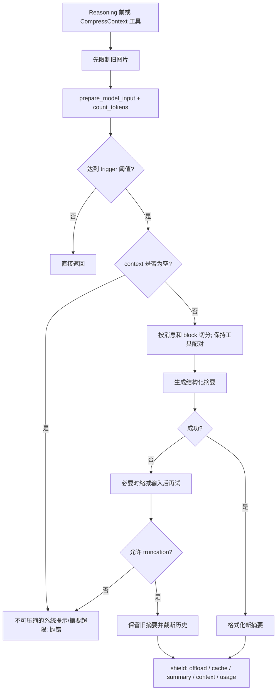
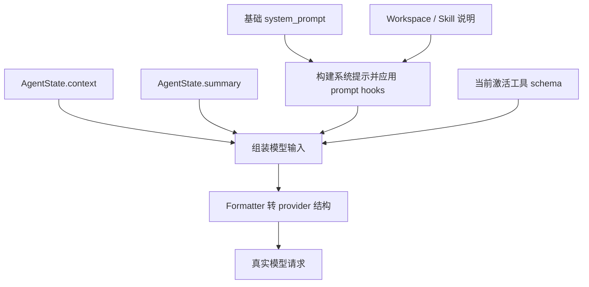
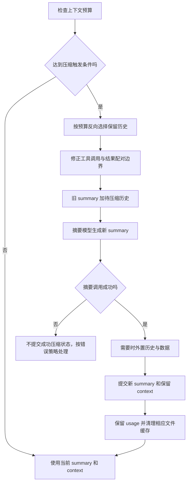
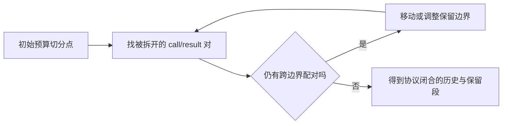
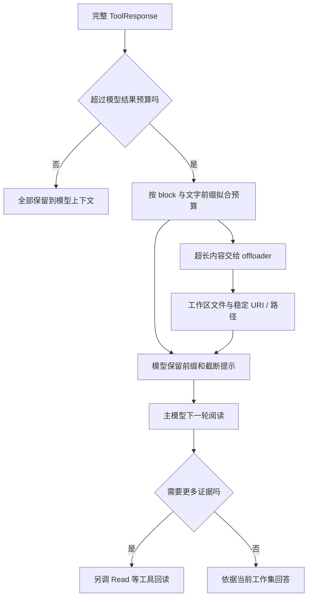
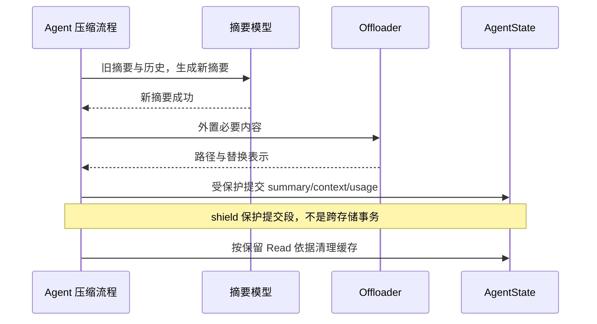

# 上下文工程：预算、压缩、图片与工具结果

配套深拆：[输入组装、运行状态注入与外置执行链](04-Context-Engineering.md#context-assembly)。该篇详细解释时间/任务/预算/重复错误四类注入，并核对上下文检查与 middleware 的实际顺序。

## 为什么它是独立子系统

Agent 长任务不是不断追加聊天记录。当前实现把输入拆成 system prompt、summary、context、工具 schemas，再由 ContextConfig 决定压缩阈值、保留窗口、图片数与工具结果大小。执行入口在每轮 Reasoning 前，而不是等 provider 报超长才处理。

主要源码：`agent/_config.py:9` SummarySchema、`:51` ContextConfig；`agent/_agent.py:388` compress_context、`:492` _compress_context_impl、`:794` _limit_context_images、`:2911` _split_context_for_compression、`:3092` _split_tool_result_for_compression、`:3331` _prepare_model_input。

## 输入预算如何计算

压缩首先限制图片数量，再调用 `_prepare_model_input()`，以当前模型 count_tokens(messages, tools) 估算总输入。工具 schema 也占预算，不能只算用户消息。阈值是 `trigger_ratio * model.context_size`，默认 trigger_ratio=0.8；reserve_ratio=0.1 表示保留近期上下文的目标；context_buffer_ratio=0.2 用来提前提示接近压缩，并不是把 context_size 直接减少 20%。

关键原文（_compress_context_impl）：

```python
await self._limit_context_images(cfg)
kwargs = await self._prepare_model_input()
estimated_tokens = await self.model.count_tokens(**kwargs)
threshold = cfg.trigger_ratio * self.model.context_size
if estimated_tokens < threshold:
    return
```

阈值达到才处理。若 context 已空而 system+旧 summary 仍超限，明确抛 RuntimeError，无法靠继续删历史解决。工具 schemas 和静态系统提示过大因此是设计问题。

## 怎么选择保留段

`_split_context_for_compression` 从最新消息向前扩展，计算 system+旧 summary+候选保留消息+tools 的 token，而不是固定保留 N 条。返回待压缩段与近期保留段。reserve 过大导致待压缩为空时，调用方降为 0 再分割。

分割时特别保护 unfinished tool calls：内部压缩工具可能在 Acting 中被调用，此时 call 已写入、result 尚未返回。若把 call 摘要掉，稍后写入的 result 就失去配对。源码扫描 unfinished_tool_call_ids 调整分界，因此压缩边界必须服从调用协议完整性。

## 摘要不是普通“概括聊天”

SummarySchema 分成 task_overview、current_state、important_discoveries、next_steps、context_to_preserve。它服务于继续工作：保留约束、产物路径、失败尝试、待完成任务，而不只是复述话题。compression_prompt 要求相对时间改绝对时间、代词改成路径/ID、后台任务标明 owner/status，减少多轮再摘要的信息漂移。

链路为 `旧 summary + 待压缩历史 + 可选 instructions + compression_prompt → model.generate_structured_output(summary_schema) → summary_template → state.summary`。近期段继续留在 state.context。注意这里直接调 model.generate_structured_output，并没有经过普通 `_call_model`，不能假定享有相同 on_model_call/reply 事件或 fallback 路径。

## 失败和取消如何处理

若摘要请求估计已溢出，失败后逐步减少最旧消息，重新尝试生成摘要。最终失败时由 compression_fallback_to_truncation 控制：默认允许截断，保留旧摘要或加入早期内容已截断说明；关闭则抛错。成功摘要返回 INTERRUPTED 时抛 CancelledError，避免提交不完整结果。

提交阶段将 offload、summary/context 更新、文件读缓存清理和 usage 维护放进 `_apply_change` 任务，并用 asyncio.shield 保护；取消时 await 提交完成再重抛。它避免在压缩状态切换中间停止，不代表数据库事务，也不自动回滚外部文件。

压缩消耗不经过普通 ModelCall 事件，源码单独把摘要调用 usage 加回上下文末尾，避免成本统计漏算。

## 大图片与工具返回

ContextConfig 默认 max_image_num=5，超出后旧图片在有 offloader 时外置并替换为路径提示；没有 offloader 则删图并加提示。tool_result_limit 默认 50,000 token，防止单个返回突增。工具结果拆分与文本 token 前缀拟合分别在 `_split_tool_result_for_compression` 与 `_fit_text_prefix_to_token_limit`，这些细分方法还需继续逐段核对，不能把普通字符串长度直接当精确 token。

## 主动压缩与被动压缩

compression_tool_enabled 默认 false；开启后暴露 CompressContext，让 Agent 在接近阈值或任务间隙主动请求压缩。它的 FunctionTool 被声明不可并发且允许执行；这避免压缩与同批安全工具随意并行改变上下文。被动阈值机制仍存在，二者是主动控制与兜底的组合。

上下文压缩仅改变当前模型可见工作集；长期记忆是独立存储/检索机制；offload 则保留大内容的外部副本。这三者不能混为“memory”。

## 源码导航：从哪个文件的哪一行开始看

下面链接直接进入当前工作树。行号指方法入口，说明中的代码段均在该方法内部；上游更新后可按方法名重新搜索。

| 阅读对象 | 实际源码位置 | 要回答的问题 |
|---|---|---|
| 配置 | [ContextConfig](/D:/work/fanchen/projects/company/web/ai-agent-design/open/agentscope/src/agentscope/agent/_config.py:51) | 阈值、近期预算、降级策略来自哪里 |
| 摘要结构 | [SummarySchema](/D:/work/fanchen/projects/company/web/ai-agent-design/open/agentscope/src/agentscope/agent/_config.py:9) | 压缩后还必须保留哪些信息 |
| 触发位置 | [_reply_impl](/D:/work/fanchen/projects/company/web/ai-agent-design/open/agentscope/src/agentscope/agent/_agent.py:1046) | 压缩发生在模型调用的前面还是后面 |
| 外部入口 | [compress_context](/D:/work/fanchen/projects/company/web/ai-agent-design/open/agentscope/src/agentscope/agent/_agent.py:388) | middleware 如何包裹压缩 |
| 主体 | [_compress_context_impl](/D:/work/fanchen/projects/company/web/ai-agent-design/open/agentscope/src/agentscope/agent/_agent.py:492) | 阈值、摘要、降级和提交如何串联 |
| 主动压缩 | [_compress_context_tool](/D:/work/fanchen/projects/company/web/ai-agent-design/open/agentscope/src/agentscope/agent/_agent.py:444) | 模型主动请求与被动阈值有何差别 |
| 图片控制 | [_limit_context_images](/D:/work/fanchen/projects/company/web/ai-agent-design/open/agentscope/src/agentscope/agent/_agent.py:794) | 图片删除如何避免半提交 |
| 历史切分 | [_split_context_for_compression](/D:/work/fanchen/projects/company/web/ai-agent-design/open/agentscope/src/agentscope/agent/_agent.py:2911) | 如何保持工具调用/结果成对 |
| 文件缓存 | [_clear_unreserved_read_cache](/D:/work/fanchen/projects/company/web/ai-agent-design/open/agentscope/src/agentscope/agent/_agent.py:3066) | 被压缩的 Read 与缓存怎样同步 |
| 工具返回切分 | [_split_tool_result_for_compression](/D:/work/fanchen/projects/company/web/ai-agent-design/open/agentscope/src/agentscope/agent/_agent.py:3092) | 大返回如何保留前缀并外置剩余 |
| 文本拟合 | [_fit_text_prefix_to_token_limit](/D:/work/fanchen/projects/company/web/ai-agent-design/open/agentscope/src/agentscope/agent/_agent.py:3251) | 比例截断不准确时怎样纠正 |
| token 估计 | [ChatModelBase.count_tokens](/D:/work/fanchen/projects/company/web/ai-agent-design/open/agentscope/src/agentscope/model/_base.py:379) | 数字是否来自真实 tokenizer |
| 历史保存 | [WorkspaceBase.offload_context](/D:/work/fanchen/projects/company/web/ai-agent-design/open/agentscope/src/agentscope/workspace/_base.py:1049) | 旧内容去了哪里 |

## 把一次压缩当成状态变换，而不是工具函数

进入前有三组核心数据：静态/动态系统提示 P，旧摘要 S，原始消息数组 C。工具 schemas T 也参与计数。切分产生 C_old、C_recent，摘要模型生成 S_new，成功提交后下一次主推理看到 `P + S_new + C_recent + T`。

这里有两个不变量：未结束的 tool call 仍须留在 C_recent，未来结果才能附回；一旦提交，旧上下文与新摘要应配套更新。实际代码为这两个不变量花费的逻辑，比“请求模型总结”本身更多。



## 逐段分析历史切分：两个层次的反向扫描

在 `_split_context_for_compression`，第一轮按 Msg 向前扫描（原文）：

```python
msg_index = len(self.state.context) - 1
while msg_index >= 0:
    reserved_tokens = await self.model.count_tokens(
        system_msg + self.state.context[msg_index:],
        tools,
    )
    if reserved_tokens >= to_reserved_tokens:
        break
    msg_index -= 1
```

每次把更早一条消息纳入近期候选。`system_msg` 包含系统提示和旧摘要，因此 reserve_ratio 所给的数字不是纯近期消息容量。若系统提示本身已超近期目标，扫描在最后一条就停止，随后仍需要做 block 级切分。

第二层将边界消息复制两份，取出内容块，从尾部向前试保留。完整的早期消息放压缩段、完整的晚期消息放保留段，只有这一条边界消息按内容块切开。这解释了为什么实现不以 Msg 数量固定截断：一次模型消息可能包含许多工具调用和结果块，体积差异很大。

接着检查未完成调用。源码先在全消息维度找到最早 unfinished call，必要时把 msg_index 移回；再在边界块维度把 block_index 降到其前面。这是协议约束优先于 token 目标：宁愿保留更多上下文，也不把尚未返回的 call 写成摘要。

## 逐段分析工具配对：为什么需要 while True 重算

边界消息内可能交错排列 call/result。实现从保留段尾部反向扫描，遇 result 记 ID，遇 call 删 ID。扫描结束仍存在的 result，就是对应 call 不在保留段。

原文关键片段：

```python
remain_result_ids = {}
for i in range(len(boundary_msg_content) - 1, block_index, -1):
    block = boundary_msg_content[i]
    if isinstance(block, ToolResultBlock):
        remain_result_ids[block.id] = i
    elif isinstance(block, ToolCallBlock):
        remain_result_ids.pop(block.id, None)
```

通常把未配对 result 也移到压缩段；但移动边界可能拆开另一对，所以外面使用循环直到稳定。如果移动会越过 unfinished call，则反向选择：把 result 对应的 call 一起留在保留段。这里保护的不是文本完整性，而是下次 Provider 消息格式仍合法。

例子：内容块为 `[call A, call B, result A, result B]`。初始若只保留 result B，必须调整边界，不能提交一个孤立 result。若 B 尚未完成，则不能把 call B 压缩掉；系统会优先保留等待结果的调用。上下文预算在这种情况下是软目标，协议合法性是更强约束。

## token 估计究竟有多准确

基类 count_tokens 并没有调用真实 tokenizer：把 text/thinking/hint/tool input/tool output 和工具 JSON schema 的文本收集后，以 UTF-8 字节数除 4 四舍五入；每个 DataBlock 加固定多模态估计。子类可以覆写。

因此所谓“阈值 80%”是基于模型适配器估计，不保证 Provider 真实计费刚好 80%。图片分辨率、视频长度等也不由基类逐项精算。参数约束 trigger_ratio≤0.9 的预留有用，但不能代替准确 tokenizer 或提供商的限制检查。

## 主动压缩的阈值和返回语义

`_compress_context_tool` 使用配置副本，将 trigger_ratio 改成 `trigger_ratio - context_buffer_ratio`。默认 0.8-0.2=0.6，因此模型主动请求可在 60% 时生效，被动压缩仍在 80%。修改的是本次副本，不是全局阈值。

该工具用压缩前后 `len(state.context)` 是否变化来决定返回“成功压缩”或“长度不足”。这只是启发式：边界内容改变但消息数没变时，返回说明未必精确。分析时应区分状态真的怎样变了与工具给模型的自然语言描述，不能把该判断当压缩成功的严格证明。

## 摘要调用失败时，哪些数据会变

第一次失败且估计超长时，函数依次去掉最早的待压缩消息，重新计算输入直到低于 trigger threshold，再尝试一次摘要。即使最终成功，摘要模型可能只见 C_old 的后半段；offload 则仍保存原待压缩段。这是“摘要可继续工作”与“历史可找回”的不同路径。

第二次仍失败，fallback=true 会重用旧 summary，随后仍丢弃 C_old，仅保留 C_recent；有 offloader 时旧历史可读取，没有时信息可能永久丢失。fallback=false 抛异常，避免摘要提交。但函数入口已执行图片限制，不能声称任何失败都会让全部输入对象字节级不变。

生成结果带 INTERRUPTED 时显式抛 CancelledError，不按普通摘要成功提交。普通压缩工具包装器捕获 Exception 转 ToolChunk ERROR；取消在当前 Python 的异常继承语义下不会简单等同普通业务异常。

## 提交段为什么用 shield，具体保护了什么

`_apply_change` 顺序是：格式化摘要→offload old msgs→加历史路径提示→清文件读缓存→保存当前 reply usage→替换 summary/context→必要时恢复 usage→累计摘要 usage。

原文提交边界：

```python
apply_task = asyncio.create_task(_apply_change())
try:
    await asyncio.shield(apply_task)
except asyncio.CancelledError:
    await apply_task
    raise
```

shield 避免外部取消直接取消提交 task；收到取消后等待提交结束再交还取消。它不捕获所有 I/O 错误，也不提供回滚。若 offload 成功后缓存清理失败，外部文件已变化，内存替换可能尚未执行。准确说这是取消保护的提交过程，不能写成 ACID 原子事务。

## 图片删除为何先准备替换列表

`_limit_context_images` 搜索顶层 DataBlock、ToolResult.output 和 Hint.hint 中的图片，按上下文遍历顺序删除最旧超额项。URLSource 可复用原 URL；Base64Source 有 offloader 时先保存。逐项 I/O 时只积累 replacements，最后没有 await 的循环里一次应用替换，避免取消留下半数图片已删、半数未删的状态。

替换类型也受消息 schema 约束：非 user 顶层可以 HintBlock，user 顶层和嵌套输出用 TextBlock。不是为了 UI 风格，而是 UserMsg 不接受 hint 这一内容类型。图片数据不再直接入模，但保留可读回位置。

## 工具结果超长：先按 block，再拟合文字前缀

`_split_tool_result_for_compression` 首先 count_tokens，未超限原样返回。超限后找完整块前缀；边界为 TextBlock 才可切文字，其它块整体外置。创建 retained/offloaded 两个 ToolResultBlock 时保留同一调用 ID、state、metadata、created_at/finished_at，让历史外置不破坏工具身份。

文字先按平均 token 密度估计可保留字符数，再 `_fit_text_prefix_to_token_limit` 重新计数；若估计超标，在 0..upper_bound 二分前缀长度。它主要修正中英文混合文本密度不均导致超限，不一定穷举全字符串找真正最长前缀：比例估计若偏保守且 fits，直接返回，不向 upper_bound 之外扩展。

## 源码中值得继续核验的一个边界

ToolResultBlock.output 类型允许 str。该切分方法对 copied_tool_result.output 做了 TextBlock 列表化，但后续分块有多处仍使用原 `tool_result.output[:i]` 和原对象索引。若调用者传超长 str 且没有事先统一为块列表，语义可能变成字符切片而不是 block 切片。这里是静态阅读发现的待核验路径，尚未沿全部调用者证明是否实际可达，也没有执行测试；不能直接宣称已确认缺陷。

后续调用链核对补充：常规本地工具路径 `_execute_tool_call` 构造 ToolResultBlock 时会把字符串 ToolResponse.content 转成 `[TextBlock(...)]`，所以该路径进入切分时已列表化。上述疑点主要针对其它直接调用/自定义调用路径，不应描述成普通工具执行已确认会失败。外部执行结果恢复则直接保存结果，并不走此切分函数。

## Read 缓存清理为什么要联动

`_clear_unreserved_read_cache` 只收集保留消息中名为 Read 的 ToolCallBlock，修复解析 input 后提取 file_path，交给 ToolContext.clean_file_cache。旧读取被摘要后，模型已失去精确内容依据，清理缓存可避免工具层仍假设模型持有旧完整文件视图。解析失败的调用不贡献保留路径。

## 一个带数字的执行推演

假设适配器报告 context_size=100,000，trigger=0.8，reserve=0.1，buffer=0.2。模型输入估计 83,000 时被动压缩触发；近期目标 10,000 中还包含 system/旧 summary/tool schema。如果这些固定部分已有 7,000，给近期消息的剩余空间仅约 3,000，并且未完成调用可能迫使超出。

系统切出旧消息生成结构化摘要，外置历史，留下 summary+recent。若模型在 65,000 时主动调用 CompressContext，因为降低阈值至 60,000 也会触发。若摘要模型失败且允许截断，旧历史仍被裁掉；调用者应从日志和 offload 路径判断信息风险，而不是把函数正常返回一概当作摘要成功。

## 设计评价与阅读结论

这段实现围绕四个目标：输入可控、工具协议完整、取消不打断提交、历史可追溯。代价是计数/边界调整有额外模型估计调用，摘要引入成本与信息损失，外置依赖可靠 backend，状态提交仍非事务。本文已静态追踪上述方法；没有运行测试，服务并发、真实 tokenizer 与所有 provider 的差异仍需结合部署层核验。


<a id="context-assembly"></a>

## 上下文工程执行链：输入组装、动态注入、预算反馈与外置

本篇接续 [压缩与切分的逐段解析](04-Context-Engineering.md)。那篇详细解释摘要、消息/block 边界、工具配对、图片和取消提交；本篇追踪“模型最终看到什么、为什么此时注入、预算何时计算，以及外置内容怎样重新引用”。依据当前 AgentScope 2.0.12dev 静态源码，不将已阅读测试等同于已运行测试。

### 1. 先画出完整执行顺序

```text
新输入 → _handle_incoming_messages（复制/媒体降级）
       → state.context
每次 Reasoning：
  compress_context
    → 图片限制 → _prepare_model_input → count_tokens → 必要时压缩
  _inject_runtime_state
    → 扫描旧提示/任务 → 决定 time/tasks/context/tool-error 字段
    → state.append_context(HintBlock) → 可选 HintBlockEvent
  _reasoning / middleware
    → RAG/记忆等可能追加上下文
    → _prepare_model_input
      → system + summary + context + tools
    → _call_model / middleware → provider formatter → 模型
```

这个顺序揭示一个预算边界：压缩检查在动态注入和 reasoning middleware 之前；它不是保证所有扩展追加内容后仍在硬窗口内的最终统一闸门。自定义 middleware 一次注入大量资料，可能让压缩检查后的输入再次增长，需由扩展控制预算。

### 2. 源码导航

| 方法或类型 | 直接源码 | 在链路中的作用 |
|---|---|---|
| _reply_impl | [入口](/D:/work/fanchen/projects/company/web/ai-agent-design/open/agentscope/src/agentscope/agent/_agent.py:1046) | 决定压缩/注入/推理的调用次序 |
| _validate_configs | [配置约束](/D:/work/fanchen/projects/company/web/ai-agent-design/open/agentscope/src/agentscope/agent/_agent.py:248) | 校验跨配置阈值关系 |
| _get_system_prompt | [提示拼装](/D:/work/fanchen/projects/company/web/ai-agent-design/open/agentscope/src/agentscope/agent/_agent.py:3306) | 基础 prompt、Skill、Workspace、middleware |
| _prepare_model_input | [输入组装](/D:/work/fanchen/projects/company/web/ai-agent-design/open/agentscope/src/agentscope/agent/_agent.py:3331) | 摘要、历史和工具 schemas |
| _inject_runtime_state | [注入主体](/D:/work/fanchen/projects/company/web/ai-agent-design/open/agentscope/src/agentscope/agent/_agent.py:1387) | 四种动态维度的触发与写入 |
| _get_repeated_tool_error | [循环错误检测](/D:/work/fanchen/projects/company/web/ai-agent-design/open/agentscope/src/agentscope/agent/_agent.py:1328) | 以名称/参数判断重复失败 |
| InjectionConfig | [配置定义](/D:/work/fanchen/projects/company/web/ai-agent-design/open/agentscope/src/agentscope/agent/_config.py:195) | 时区、模板、周期、任务工具等 |
| HintBlock | [内容模型](/D:/work/fanchen/projects/company/web/ai-agent-design/open/agentscope/src/agentscope/message/_block.py:110) | 提示内容、source、ID/时间戳 |
| count_tokens | [基类估计](/D:/work/fanchen/projects/company/web/ai-agent-design/open/agentscope/src/agentscope/model/_base.py:379) | 文本和数据块的预算估计 |
| offload_context | [历史文件](/D:/work/fanchen/projects/company/web/ai-agent-design/open/agentscope/src/agentscope/workspace/_base.py:1049) | JSONL 与媒体路径化 |
| offload_tool_result | [工具内容文件](/D:/work/fanchen/projects/company/web/ai-agent-design/open/agentscope/src/agentscope/workspace/_base.py:1130) | 平面文本与媒体占位 |
| offload_data_block | [二进制文件](/D:/work/fanchen/projects/company/web/ai-agent-design/open/agentscope/src/agentscope/workspace/_base.py:1189) | base64 解码和 workspace URI |

### 3. 系统提示不是构造时生成一次的常量

`_get_system_prompt` 每次重新获取基础 `_system_prompt`，从 Toolkit 按当前 activated_groups 取得 Skill 指引，若 offloader 是 WorkspaceBase 再取环境指引，最后按顺序调用所有 on_system_prompt。

原文主体：

```python
prompt = [self._system_prompt]
skill_instructions = await self.toolkit.get_skill_instructions(
    self.state.tool_context.activated_groups,
)
if skill_instructions:
    prompt.append(skill_instructions)
if isinstance(self.offloader, WorkspaceBase):
    offload_instructions = await self.offloader.get_instructions()
    if offload_instructions:
        prompt.append(offload_instructions)
result = "\n".join(prompt)
for mw in self._system_prompt_middlewares:
    result = await mw.on_system_prompt(self, result)
```

改变工具组可能改变 Skill 提示；记忆 middleware 也可能每次读 MEMORY.md 改变 system 内容。运行状态不用 system 的设计有利于缓存，但不保证完整系统提示永远恒定，也不保证 provider 一定命中缓存。

offloader 仅实现普通 Offloader 协议、而非 WorkspaceBase 时，不进入 workspace instructions 这个分支。可写外部历史不自动意味着模型已收到完整工作环境指引。

### 4. 输入顺序决定上下文权重与角色

`_prepare_model_input` 的顺序固定是 SystemMsg → 可选 UserMsg(summary) → state.context。summary 没有放到 system，也不替换原系统规则；它是过去工作状态的输入资料。工具定义独立走 tools 参数。

`messages.extend(state.context)` 不是对所有 Msg 深拷贝；返回值引用现有对象，后续扩展若原地修改消息会影响 state。调用方不应假设“prepare”是纯快照函数。

开启 compression_tool_enabled 时，本方法检查 Toolkit 中 CompressContext 是否正是当前 Agent 的 `_compression_tool` 对象；不是则注册。使用对象 identity 而不只看工具名，避免共享 Toolkit 中另一个 Agent 的压缩工具绑定了错误 self。注释也明确保留注册以稳定 schema、利于缓存。

但多个 Agent 共用同一 Toolkit 交替替换同名压缩工具时仍需管理并发，identity 检查不是跨 Agent 注册事务。

### 5. 配置约束表达的真实含义

`_validate_configs` 强制 reserve_ratio < trigger_ratio。buffer 仅在启用 runtime injection 或主动压缩工具时要求小于 trigger_ratio；两个功能都关闭就不使用这个约束。

构造函数还接受旧 InjectionConfig.context_buffer_ratio，若非 None 会 warning，并覆盖 ContextConfig 对应值。这是迁移兼容逻辑，调试预算时需要看最终运行配置，而非只看 ContextConfig 初始传参。

默认 threshold=0.8、buffer=0.2，对应提前提醒点 0.6。reserve=0.1 是保留输入目标，不是“给输出保留 10%”。输出、摘要请求、schema 和不可压缩系统内容的预算需要分别理解。

### 6. 为什么动态信息写成 HintBlock

`_inject_runtime_state` 注释明确：时间等会持久追加，帮助模型感知时间推进和过去状态；不修改 system prompt，降低动态内容对 prompt cache 的干扰。

HintBlock.source 使用配置 injection_source 的固定字符串，默认是带 label/sublabel 的 JSON 文本。它不是只供 UI 展示，还用于回扫识别既有注入。如果改 source，旧注入不再匹配，可能重新发时间/任务提醒。

HintBlock 容器保存在 assistant Msg 中，但其模型输入语义由 formatter 转换，类型文档说明它会转成 user message。数据库角色、块类型与 provider 角色是三层概念，不能把它们合并解释。

### 7. 注入算法先反向扫描已有上下文

先按 task.state 统计 pending/in_progress；若没有未完成任务，aware_of_tasks 初始 true，无需扫描任务。若存在未完成任务，则反向遍历 assistant 消息和内容块。

遇 source 匹配的 HintBlock，从 string 或 TextBlock 列表抽文字：首次找到 `<current-time>` 保存为 last_time_text；首次找到 `<tasks>` 标记 aware。遇 TaskCreate/TaskGet/TaskList/TaskUpdate 的 ToolCallBlock 也标记 aware。两个维度均确定便提前退出扫描。

这里不是读取“最新一个提醒”就停止，因为最新提醒可能只含 context-length，不含时间。分别寻找最新有效时间和任务认知，避免把独立触发维度误混。

任务调用存在只证明模型曾接触任务工具，不证明任务状态仍最新；这个策略以避免重复提示为目标，不是每次做任务列表一致性同步。

### 8. 时间注入是时区敏感的增量判断

没有记录时默认注入。已有时间时按当前 time_format 解析；解析失败重新注入。若 datetime 无 tzinfo，则从同一旧提示中的 `<timezone>` 还原，不直接用当前配置时区解释旧墙钟时间。

然后计算 elapsed_hours。原文：

```python
elapsed_hours = (now - last_time).total_seconds() / 3600
inject_time = not (
    0 <= elapsed_hours <= self.injection_config.time_interval
)
```

默认 0.5 小时以内不重复，超过才提醒；若系统时钟回拨导致负值，也重发当前时间。等于阈值仍不发。时区配置改变但实际时间差未超周期，不必因为字符串不同就重发。

默认 time_format 含完整年月日。只用时分秒时 strptime 会缺失真实日期，注释指出可能落到 1900 年导致频繁注入。源码异常回退与配置合法性是不同问题，不能认为支持任意格式都获得正确时间感。

### 9. 任务提醒与压缩之间的耦合

当 tasks_context 仍有 pending/in_progress，而上下文里已没有任务工具调用或旧 tasks 提示时，注入简短计数并建议 TaskList。典型触发是压缩把任务历史裁走，任务结构化状态却仍保留。

这让持久 TaskContext 成为模型认知的恢复来源：状态在，模型未必看见；提示的作用是提醒主动查询，而不是把完整任务数据每轮全量注入。只统计 pending/in_progress，也不意味着 completed/canceled 永久消失，它们只不触发这条提醒。

### 10. 预算预警只在回复首轮评估

`if state.cur_iter == 0` 才组装输入、计数并检查 buffer 区间。其余轮次仍可注入时间/工具错误，但不会每次重新生成 context-length 提示。默认严格条件 `input_tokens > (trigger-buffer)*context_size`，等于不触发。

源码（删节）：

```python
if self.state.cur_iter == 0:
    kwargs = await self._prepare_model_input()
    input_tokens = await self.model.count_tokens(**kwargs)
    if input_tokens > (
        (self.context_config.trigger_ratio
         - self.context_config.context_buffer_ratio)
        * self.model.context_size
    ):
        injections["context-length"] = ...
```

允许主动压缩且 in_progress==0 时再建议 CompressContext；pending>0 并不阻止建议。这是以“没有正在执行任务”为任务间隙启发式，不是业务流程证明已安全落到 checkpoint。

由于先压缩后注入，超 hard threshold 的输入可能已经被压缩到低于 buffer，当前轮不会再提示“即将压缩”；这符合执行顺序，不能从缺少预警推断压缩未执行。

### 11. 重复工具失败如何识别

`_get_repeated_tool_error` 只看当前 Agent 尾消息；最新结果必须 ERROR。逆序取连续同工具 ERROR 的 ID，遇不同工具或非 ERROR 就停；数量至少 tool_retries_limit（默认 3）再比较输入。

输入从 ToolCallBlock 按 ID 关联；合法 JSON 用 `json.dumps(json.loads(raw), sort_keys=True)` 规范化，键顺序变化不影响判断；非法 JSON 比较 raw.strip。再取从最新开始参数相同的前缀，达到阈值返回工具名与次数。

```python
try:
    arguments.append(json.dumps(json.loads(raw), sort_keys=True))
except (TypeError, ValueError):
    arguments.append(raw.strip())
```

它防的是同参数无效重试，不会把多文件 Read 各失败一次误认同调用重复。并发结果按完成顺序入 context，因而“连续”是结果保存顺序，未必原始发起顺序。该机制仅加提示，既不禁止工具也不扣独立重试预算，模型仍可能继续犯错。

### 12. extra_fields 与模板不是独立触发器

只有 injections 非空才合并 extra_fields，再用 template.replace 替换 `{runtime_state}`。extra_fields 不会单独触发，即便业务希望每轮带某字段也不能只配它。dict.update 意味着自定义同名键可覆盖内建 time/tasks 等值，属于宿主配置权力。

template validator 要求占位符存在，避免静默漏注入；使用 replace 而非 format 保留其它 JSON/代码花括号。字段最终拼成 XML-like `<key>value</key>`，不是 XML DOM 序列化，配置值的标签内容不应假设已自动转义。

### 13. 状态写入与 UI 事件是两条输出

先 state.append_context(HintBlock)，再在 emit_hint_event=true 时 yield HintBlockEvent。关闭事件只影响前端通知，不关闭模型提示。注入默认会持久保留，压缩也可能将其内容写入 summary。

注入后没有在同一函数再次 count_tokens 校验新提示体积。大量 extra_fields/长错误模板会增长上下文；“基于预算预警”本身也占预算。构造扩展时需要把提示长度纳入总容量。

### 14. token 估计不是 provider 最终请求字节

ChatModelBase.count_tokens 收集文本块、thinking、hint、tool input/result、工具 JSON schema，以 UTF-8 bytes/4 估算；DataBlock 用固定成本。它没有先完整 formatter 请求再用真实 tokenizer。多模态 detail/fps、provider 特有思考签名、消息封套/角色标记的真实开销未必与估计一致。

子类可覆写这个方法。跨模型 fallback 时还要注意：压缩预算取当前 self.model.context_size 和 counter，而 fallback 可能窗口更小；仅有 fallback 配置不自动统一两模型上下文限制。这是由调用边界推导的风险，尚未对每个 provider/fallback 组合运行验证。

### 15. 外置历史：保持可回读，不等于模型自动检索

压缩提交把旧 msgs 传 WorkspaceBase.offload_context。它 deepcopy，递归把 ToolResult/Hint 里的 base64 数据换成 workspace URI，序列化为 JSONL；然后读旧文件再写 `existing+payload`。摘要只附历史路径提示，不自动让下一轮模型重新扫描全文。

这是一种按需工具读取设计：保留“继续任务必要摘要”和“可追溯历史文件”两层。读取旧历史仍消耗工具调用/返回预算，可能再次截断；把文件路径加到摘要不等于无限上下文。

### 16. 工具结果外置格式与并发边界

offload_tool_result 写 sessions/<session>/tool_result-<id>.txt；同名存在时递增 `(1)`、`(2)`。文本块原样拼接，DataBlock 变 `<data url=...>` 占位，base64 先外置。

file_exists 后 write_file 是两个 await，不是原子 exclusive-create；并发同 ID 写可能选择同一未存在路径。正常工具 ID 应唯一，但异常重放/共享实例下需 backend 或服务协调，不能把后缀循环当严格并发去重锁。

平面文本文件不是原 ToolResultBlock 的完整 JSON：metadata、state、结构化块边界不全保留。需要可再读正文时足够，若要审计完整工具结果身份应结合主消息/事件存储。

### 17. 数据块如何得到稳定 URI

offload_data_block 对 base64 字符串求 SHA256，按 media_type 猜扩展名，解码写入 data/<hash>.<ext>，返回保留原 block.id/name 的新 DataBlock，source 改为 workspace:///data/...。URLSource 原样返回。

散列针对编码文本，不是解码 bytes：同一字节若有不同合法 base64 表示，理论上可得到不同 key。相同 key+扩展名路径已存在则跳过写入。workspace URI 的解析依赖服务根据会话定位实际 workspace；它不是浏览器天然可访问的公网 URL。

### 18. 工具结果截断还有“提示文字”预算

内部结果先按 tool_result_limit 切出 retained 部分，随后 Agent 再追加 TRUNCATED 和 offload 路径说明。因此 limit 更接近主体裁剪目标，最终整个工具结果含提醒后可能稍超目标。外置 reminder 的 token 不在先前二分拟合范围内。

外部结果恢复 `_handle_incoming_event` 直接保存输入 ToolResultBlock，和本地 ToolResponse 经 `_split_tool_result_for_compression` 的路径不同。外部 executor 是否也做结果限制必须看宿主契约，不能声称所有结果都经过同一个裁剪门。

### 19. 与测试源码交叉对照

以下是已定位并部分阅读的现有测试，未运行；测试名称和 assertions 用来定位设计约束，而非宣称当前环境验证通过。

| 测试位置 | 对应约束 |
|---|---|
| [时间首次注入](/D:/work/fanchen/projects/company/web/ai-agent-design/open/agentscope/tests/agent_injection_test.py:141) | 新 context 没时间要注入 |
| [压缩后重新注入](/D:/work/fanchen/projects/company/web/ai-agent-design/open/agentscope/tests/agent_injection_test.py:190) | 提示裁掉后需恢复认知 |
| [旧时区解释](/D:/work/fanchen/projects/company/web/ai-agent-design/open/agentscope/tests/agent_injection_test.py:250) | 正确恢复旧墙钟时间 |
| [额外字段不触发](/D:/work/fanchen/projects/company/web/ai-agent-design/open/agentscope/tests/agent_injection_test.py:290) | extra_fields 仅附带 |
| [任务间主动压缩](/D:/work/fanchen/projects/company/web/ai-agent-design/open/agentscope/tests/agent_injection_test.py:365) | in_progress 决定建议 |
| [JSON 参数规范化](/D:/work/fanchen/projects/company/web/ai-agent-design/open/agentscope/tests/agent_injection_test.py:497) | 键顺序不改变重复调用识别 |
| [交错结果打断 streak](/D:/work/fanchen/projects/company/web/ai-agent-design/open/agentscope/tests/agent_injection_test.py:545) | 只看尾部连续失败 |
| [多工具对稳定分界](/D:/work/fanchen/projects/company/web/ai-agent-design/open/agentscope/tests/compress_context_test.py:922) | 调整一次边界不一定够 |
| [压缩工具自身配对](/D:/work/fanchen/projects/company/web/ai-agent-design/open/agentscope/tests/compress_context_test.py:1765) | in-flight call 不能丢 |
| [保留结果元信息](/D:/work/fanchen/projects/company/web/ai-agent-design/open/agentscope/tests/compress_tool_result_test.py:573) | 分割后身份/时间保持 |
| [混合文字前缀](/D:/work/fanchen/projects/company/web/ai-agent-design/open/agentscope/tests/compress_tool_result_test.py:655) | 比例估计后要重计数 |

已读工具裁剪测试中 below/equal limit 都返回原对象、offload=None；边界 text 用自定义 count_tokens 将文本长度当 token，直接检查块内容拼接。它验证算法结构，不验证真实 provider tokenizer 精度。

### 20. 完整推演：长任务跨越预警和压缩

假设模型窗口 100k、trigger=.8、buffer=.2，任务上下文 65k，当前没有 in_progress，上一时间提示已超过半小时。

首次 Reasoning 前图片/硬阈值检查通过，不压缩；注入器独立触发 current-time 与 context-length，附建议 CompressContext。模型可主动压缩，阈值副本降至 60k；分割保留未完成的压缩工具 call，用结构化摘要继续任务。

压缩后 TaskContext 若仍有 pending，但工具历史/tasks 提示已裁掉，下一轮注入任务计数；若旧时间提示也丢失，重新注入时间。即使摘要自然语言写了时间，识别器只扫描匹配 source 的 context HintBlock，不把 summary 当已注入依据。

后续某工具连续三次相同参数 ERROR，注入 tool-error 改变模型策略；如果模型换参数或中间成功/其它工具结果，连续计数打断。该提示不强制停止 Agent Loop，仍受 max_iters 等整体终止机制控制。

### 21. 设计取舍与剩余边界

当前上下文工程通过“常驻规则、近期事实、结构化摘要、外部文件”共同提供工作集，并用动态提示帮助模型管理任务。其复杂度集中于合法工具配对、取消提交、估计误差和跨扩展顺序。需要继续结合 formatter/provider 逐个验证最终请求、真实多模态预算、服务并发与 workspace 引用解析；本篇没有将静态推断当已复现缺陷。

## 图解深化：模型工作集、压缩提交与外置回读

### A. 模型请求不是直接发送 context 列表



RAG、记忆和动态状态可能通过不同 hook 增加内容。某个预算检查只覆盖它运行时已存在的输入，不保证内层 middleware 之后加的内容也被计入；模型选择也应和实际窗口一致。

### B. 自动压缩的核心状态变换



切分不能仅按最后 N 条消息：同一 reply 的工具调用和结果可能在同一 Msg 内，拆错会让 provider 收到孤立工具结果。摘要质量与协议完整性是两个验收维度。

### C. 为什么要反复修正切分点



一次修正可能带进其它调用，需重新检查，不能只扫一遍就假设闭合。最终保留量可能偏离最初近似预算，应留 provider token 计数误差的安全余量。

### D. 外置与截断是两件事



路径提示提供可回读性，不保证模型一定回读。UI 在流式阶段可能已经看到比模型保留部分更多的内容；模型结果限额也不限制 backend 最初收集 stdout 的内存量。

### E. 摘要生成与提交之间的取消边界



失败和取消必须分清发生在生成摘要前、外置期间还是状态提交期间。shield 保证的是该段异步收尾不被外层取消轻易打断，不保证外部存储故障时所有对象自动原子回滚。

### F. 数字例子应如何解读

若模型窗口为 W，触发比例为 t，预留比例为 r，目标不是“永远把历史压到固定消息数”，而是在有效输入预算内保留协议完整、近期相关的信息。具体 token 估计受 formatter、工具 schema、图片估价和模型路由影响。

| 调整 | 可能收益 | 仍需核查 |
|---|---|---|
| 更早触发压缩 | 降低临界溢出概率 | 摘要次数与辅助模型成本 |
| 增大保留段 | 保住近期证据 | 新摘要加工具 schema 是否仍超限 |
| 更多 offload | 减少常驻正文 | 模型能否定位并按需回读 |
| 缩小结果前缀 | 降低工具结果占用 | 关键结论是否恰在被截去部分 |

本节图解沿用前文静态分析，不额外声称摘要语义保真或所有 provider 的输入计数已运行验证。
