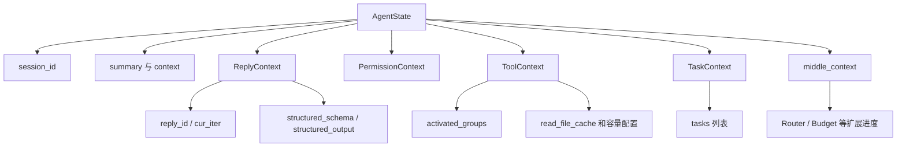
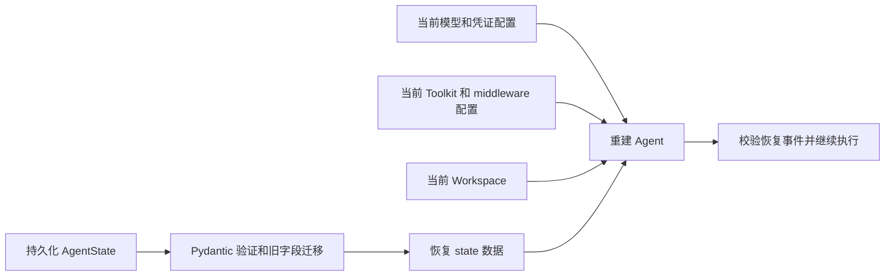
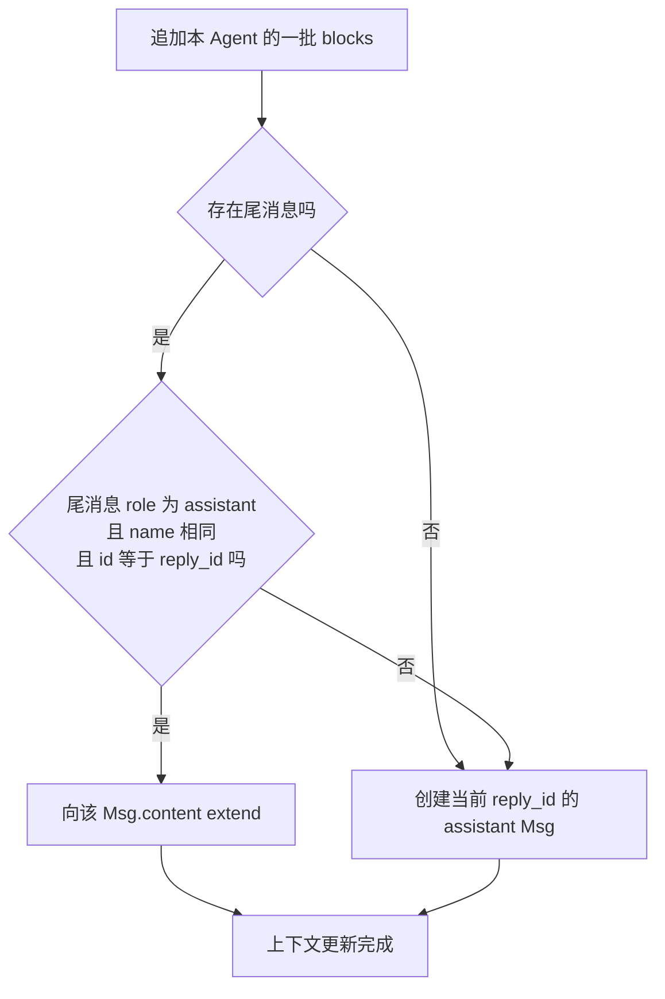
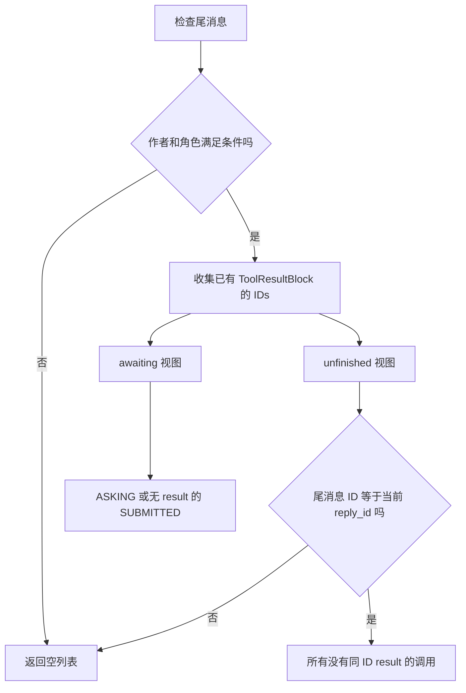
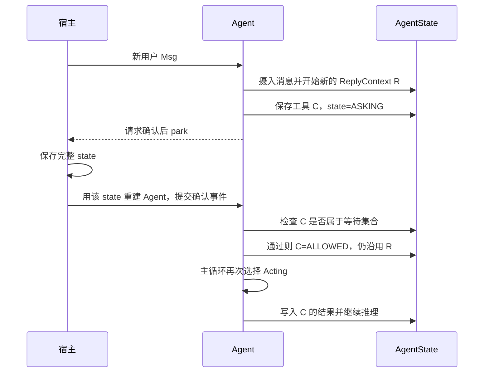
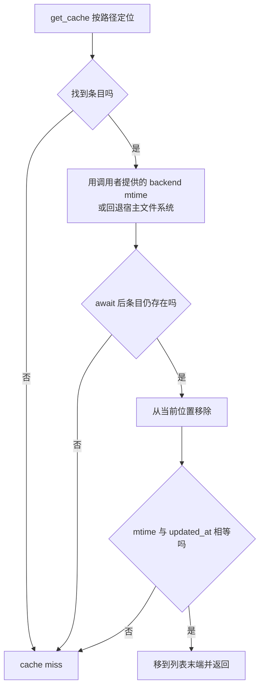
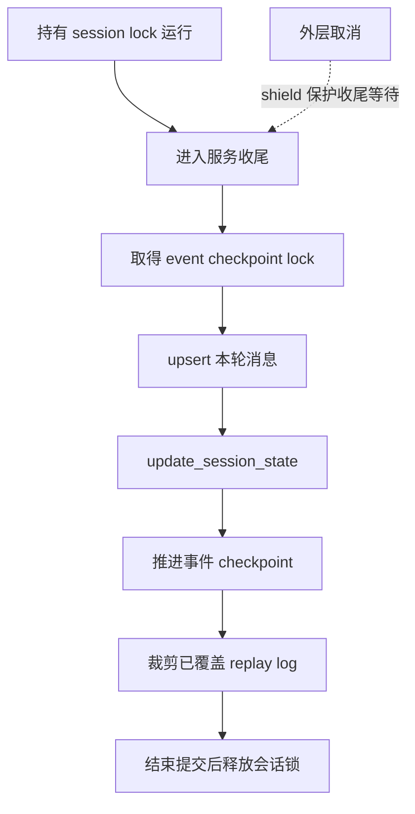

# 运行状态、会话与恢复

核心源码：`state/_state.py` 的 ReplyContext:182、AgentState:209、append_context:298、get_awaiting_tool_calls:345、get_unfinished_tool_calls:374；工具状态枚举位于 `message/_block.py`。

## AgentState 持有的内容

AgentState 是应当保存/载入的运行数据模型。session_id 表达会话；context 是未压缩消息，summary 是压缩内容；reply_context 保存当前回复 ID、迭代和结构化结果；permission_context、tool_context 等保存权限规则、工具组和文件缓存。它不是只含 messages 的列表。

ReplyContext 原文：

```python
reply_id: str = Field(default_factory=_generate_id)
cur_iter: int = 0
structured_schema: Type[BaseModel] | dict | None = None
structured_output: dict | None = None
```

structured_schema 在进程内可以是 Pydantic 类，序列化时转换为 JSON schema dict，使恢复状态不必保存 Python 类对象。AgentState before-validator 将旧的顶层 reply_id/cur_iter 迁移进 reply_context，维持旧存档兼容。

## 会话与回复不是一个层级

同 session 可以有多个 reply；新 Msg 启动新的 ReplyContext，确认/外部结果继续旧 ReplyContext。工具 result 用调用 ID 关联；get_awaiting/get_unfinished 从结构化消息块判定当前待完成工作。暂停不能简单地只保存聊天文本，否则会失去 call state、permission 和结构化输出要求。

## 工具读缓存

ToolContext 管理 ReadCacheEntry（path、mtime、lines、bytes），命中时校验修改时间并移到末端，近似 LRU。注意 bytes 字段在当前实现中按 KiB 计算，详见后文缓存流程。cache_file 先去同路径旧条目，超出总限按最旧逐出，单条目本身超限则不驱逐其它缓存。压缩后根据仍保留的 Read 调用清理缓存，让缓存与模型可见的读取依据尽量一致。它服务于文件操作，不是跨会话语义记忆。

## 持久化边界

AgentState 提供数据结构与迁移，不会仅凭这个类自动落库。库模式调用方需选择保存时机和隔离方式；服务模式由 app storage/session manager 协调。单对象并发 reply 会共享可变状态，TUI 用队列串行推进；多进程一致性、工具副作用幂等和崩溃恢复需要继续追 app 层，不能从 BaseModel 可序列化直接推断。

## 源码深化：状态形状、恢复判断与持久化时序

以下补充按本地 2.0.12dev 的 state、Agent 输入恢复和 ChatService 保存路径展开，不将可序列化等同可靠恢复。

### 1. 状态被分成六个职责区



session 是长期容器；reply_context 表示当前逻辑回复；context 是模型工作历史。PermissionContext 保存模式/规则等执行配置，TaskContext 保存任务，middle_context 保存扩展自行定义的运行数据。模型连接、Toolkit 对象、workspace 活资源等不靠这份 JSON 自行重建。

### 2. 恢复需要数据和代码配置同时兼容



例如 Router 在 state 中只保存候选名，真正模型映射仍在 middleware 实例。若部署升级删掉候选名、工具名或外部结果 schema，旧快照可以解析却仍不能原样继续。恢复兼容性应覆盖这些运行依赖。

### 3. append_context 的尾消息复用条件



一个 reply 可能有多次模型与工具交互，却累计进一个 assistant Msg。恢复助手用“尾消息”查调用时依赖这一组织约定；不合时机插入其它作者/角色消息会改变它的读取结果。

### 4. 等待调用与未完成调用如何判断

| 方法 | 范围限制 | 命中条件 |
|---|---|---|
| get_awaiting_tool_calls | 尾消息为本 Agent 的 assistant 消息 | ASKING，或 SUBMITTED 且无同 ID result |
| get_unfinished_tool_calls | 上述条件再加尾消息 id=当前 reply_id | 所有无同 ID result 的 call，不论 state |
| has_awaiting_tool_calls | 复用 awaiting 方法 | 列表是否非空 |

ASKING 分支在当前实现中没有额外 result_id 排除条件，不能把它和 SUBMITTED 的表达式写成完全一致。FINISHED 也不是业务成功；结果状态在 ToolResultBlock 中。



### 5. 新消息与恢复事件的身份变化



新普通消息不自动等于批准，也不能把 call state 或结果伪造成用户消息导入。恢复事件只允许当前等待 ID 的子集，允许部分确认；会话路由鉴权仍是宿主责任。

### 6. 旧存档迁移是局部兼容协议

before-validator 将旧顶层 reply_id、cur_iter 补入 reply_context；已有嵌套键优先，不应被旧值覆盖。ReplyContext.structured_schema 为 Python 类时，序列化转换 JSON schema dict，避免把不可移植类对象直接存入 JSON。

这个迁移只保证代码明确处理的字段格式，不是所有历史版本自动可恢复。middle_context 也需要扩展作者保持数据可序列化与 key 稳定；同类 middleware 默认 key 冲突需额外处理。

### 7. Read 缓存：mtime、容量单位与 LRU



远端文件必须传同一 backend 获得的 mtime，否则回退宿主路径可能检查了错误文件系统。mtime 检查也不是内容 hash，不保证检测所有相同时间戳覆盖。

cache_file 对容量的计算是 `sum(len(line.encode('utf-8'))) / 1024`。因此虽然字段叫 bytes、max_cache_bytes，当前保存值的单位实际是 KiB；默认 25000 约为 24.4 MiB，而非 25000 字节。比较和驱逐也用该值，运维配置不能按名字直接换算。

写缓存前先去掉同路径旧条目；单项超总限则不存，不驱逐无关条目；否则依次按最大文件数与总量从头逐出，再把新条目放末端。超大新版本会使该路径旧缓存移除，但其它路径仍保留。

clean_file_cache 只保留 reserved_file_paths；压缩后可用仍可见的 Read 依据同步清理。这是工作缓存，不是事实长期记忆或可靠文件备份。

### 8. 服务保存顺序与崩溃窗口



消息和 state 分开写，bus 又是另一个系统；shield 不是 ACID。崩溃在任意两步之间时，应根据保存快照和 checkpoint 决定回放，外部工具副作用还需业务幂等。

### 9. 四类“保存了”需要分别验证

| 表述 | 真正证据 | 仍不证明 |
|---|---|---|
| 内存 state 更新了 | 对象字段/工具结果变化 | 已落库 |
| UI 看见更新了 | state_updated 或其它事件到达 | 快照 durable commit |
| session 保存了 | update_session_state 成功 | 外部副作用只执行一次 |
| 文件仍存在 | Workspace/backend 可读 | 当前聊天历史仍引用该文件 |

排查恢复问题时，应携带 session_id、reply_id、tool_call_id 与事件 cursor。只比较最终回答文本无法定位身份错配或重复执行。

### 10. 验证范围

新增分析直接对照 state/_state.py 的字段、序列化、缓存与尾消息查询，以及前文已追踪的 Agent/ChatService 控制流。未运行状态恢复、跨 worker 竞争或断电实验。任务细节见 [计划专题](15-Planning-and-Task-Management.md)，授权恢复见 [HITL 专题](11-Human-in-the-Loop.md)。
