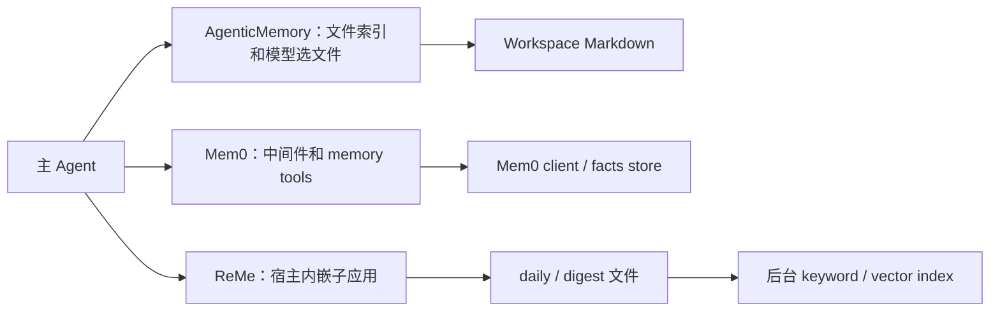
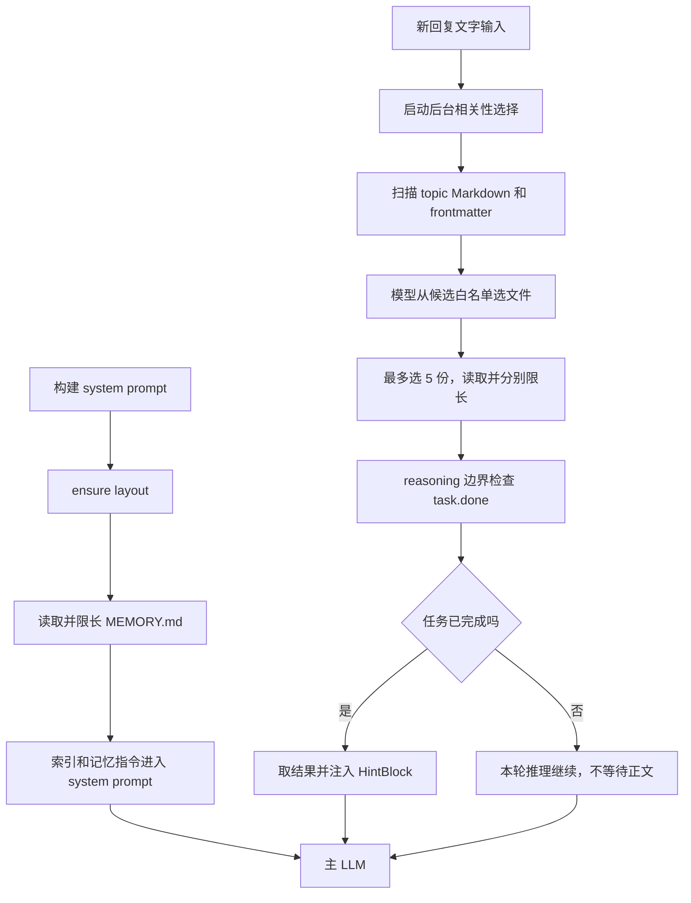
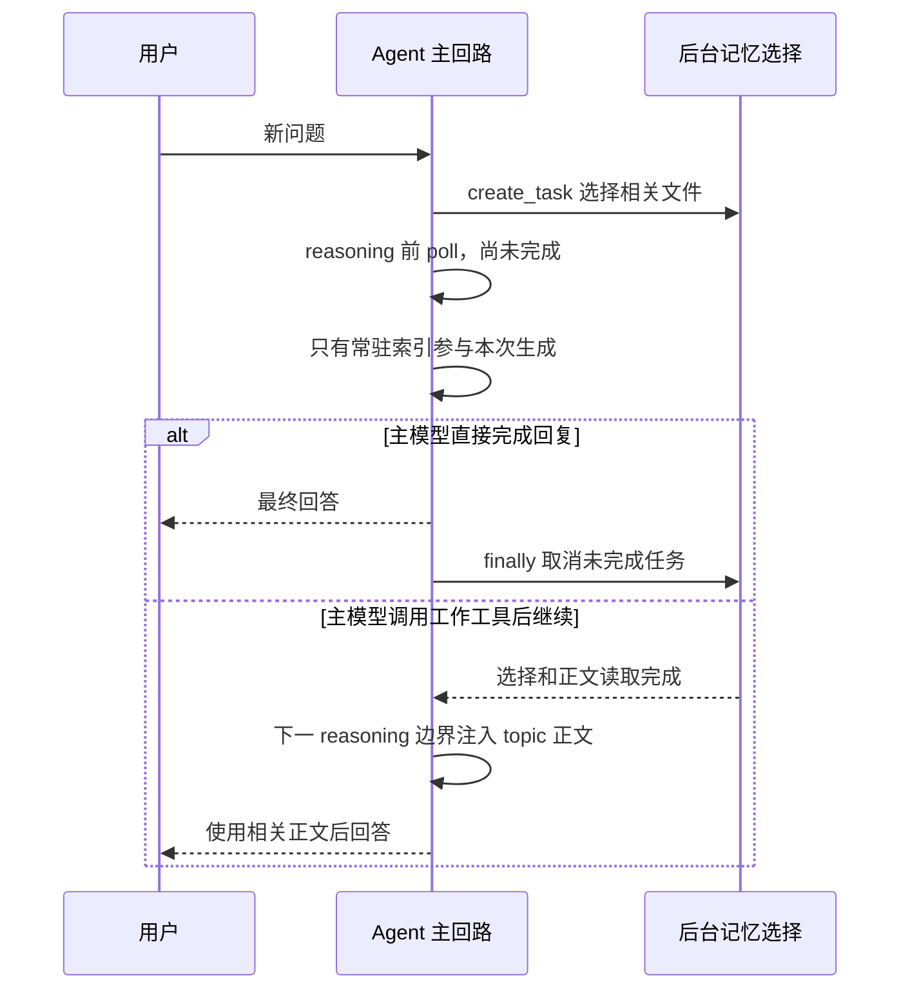
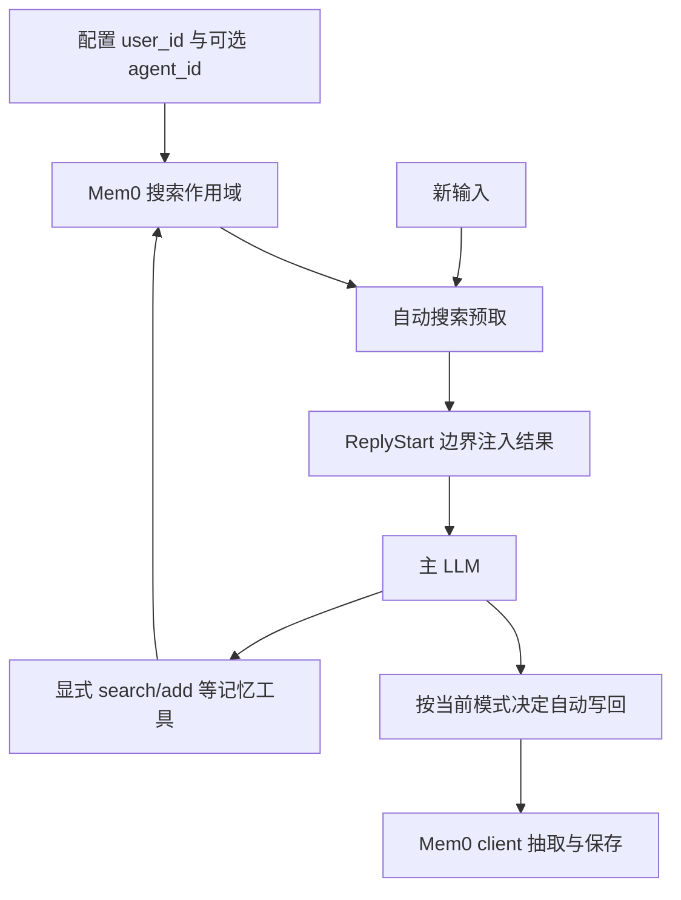
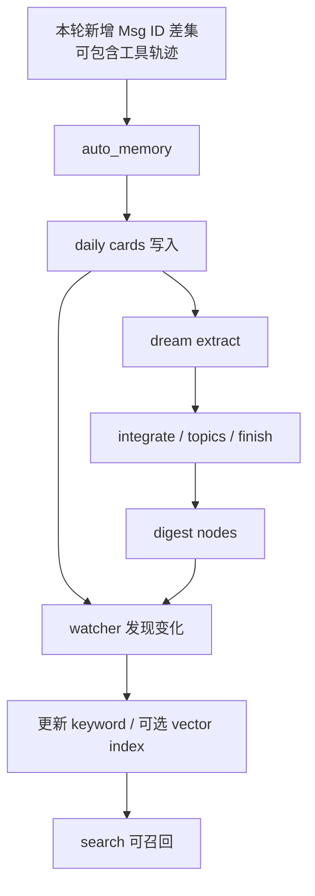

# 长期记忆：机制对照与源码阅读入口

本页用于导航，具体实现已拆为三篇源码逐段分析。此前本页对 Mem0 的默认 agent_id 和 ReMe 写回内容存在错误，已按当前实现纠正。分析对象为本地 AgentScope 2.0.12dev。

## 先区分四种“记忆”

AgentState.context 是当前工作历史，summary 是压缩表示；ToolContext.read_file_cache 是文件工具缓存；长期记忆是跨会话可复用的外部事实；workspace offload 是旧历史/大内容的外部副本。它们的数据结构、写入者、读取时机和失效方式不同。

## 三篇深拆

- [AgenticMemory](06-Long-Term-Memory.md#agentic-memory)：文件索引、frontmatter、模型选择白名单、异步注入、取消回收与共享实例边界。
- [Mem0](06-Long-Term-Memory.md#mem0)：client 构建、阻塞预取、ReplyStart 注入、namespace、工具并发去重、抽取失败原文回退、自动写回。
- [ReMe](06-Long-Term-Memory.md#reme)：嵌入 app、session task 分区、消息 ID 差集、完整轨迹写回、后台索引可见性与生命周期。
- [后端、模型适配与记忆生命周期深拆](06-Long-Term-Memory.md#memory-backends)：Mem0 线程/事件循环桥接、配置与工厂注册，ReMe 启停、后台索引、dream 整理、组件权限预算和跨实例持久性。

## 当前实现对照

| 维度 | AgenticMemory | Mem0 | ReMe |
|---|---|---|---|
| 持久介质 | Markdown/backend | AsyncMemory/Platform client | ReMe app 的 card/index/digest |
| 常驻提示 | MEMORY.md | 工具指令（控制模式允许时） | 工具指令（控制模式允许时） |
| 自动检索 | 后台模型选文件 | next_handler 前 await search | 后台 job search |
| 注入时间 | reasoning 前 poll | ReplyStart 事件处 | reasoning 前 poll |
| 写入控制 | Agent 用文件工具 | 自动 pair 或 add_memory | 自动 turn increment |
| 默认 namespace | workdir/Memory | user_id；agent_id=None | workspace，写回带 session_id |
| agent_control 自动写回 | 不使用该模式名 | 否 | 是 |
| 检索任务字段 | 单 task 实例字段 | 自动搜索直接 await | session→task 字典 |
| 完成写入后能否立即召回 | 仍受候选选择时序影响 | 取决 client/index | 不保证，需等索引 |

## 为什么需要看实际实现

当前 Mem0 on_reply 使用固定 self._agent_id，工具也不注入 AgentState，不能引用 README 的其它描述推导默认 agent.name 或 session 解析。ReMe 自动回写的是 ID 差集里的 Msg，包含工具轨迹，不是两条纯文本。AgenticMemory 扫描会读取候选文件后才做数量上限，不能把 retrieval_max_files 解释为磁盘读取次数上限。

三篇都标明静态已读的具体方法、待验证路径和源码行号；尚未执行测试。分析深度以已追踪控制流和明确分支为准，不以标题数量判定完成。


<a id="agentic-memory"></a>

## AgenticMemory：从 Markdown 文件到模型上下文的完整源码路径

### 1. 实现入口与对象关系

核心实现在 [AgenticMemoryMiddleware](/D:/work/fanchen/projects/company/web/ai-agent-design/open/agentscope/src/agentscope/middleware/_longterm_memory/_agentic_memory/_middleware.py:359)。文档例子位于 `examples/long_term_memory/agentic_memory/README.md`。它是 Middleware，不是 AgentState 的一个“自动永久记忆”字段。

构造函数绑定 workdir、memory_dir、parameters 和 backend。默认 backend 是 LocalBackend，默认目录 Memory。实例另持 `_cached_input` 与 `_retrieval_task`，分别保存本次查询和在途选择任务。Memory 的持续性来自 backend 文件，不依赖旧 Agent 实例继续存活。

```text
Agent
 ├─ on_system_prompt → Memory/MEMORY.md
 ├─ on_reply → create_task(选择相关 topic 文件)
 ├─ on_reasoning → task.done → HintBlock → AgentState.context
 └─ Toolkit.Read/Write/Edit → Memory/<topic>.md
```

读取与写入是两条不同控制路径。middleware 不自动从每轮回答里抽取事实写文件；它提供系统指令、索引和自动相关性检索，真正更新 Markdown 通常由 Agent 工具调用完成。

### 2. 配置不是一个简单 top_k

[Parameters 定义](/D:/work/fanchen/projects/company/web/ai-agent-design/open/agentscope/src/agentscope/middleware/_longterm_memory/_agentic_memory/_middleware.py:369) 将索引和正文预算分开：

| 参数 | 默认 | 对执行的影响 |
|---|---:|---|
| memory_max_tokens | 4,000 | 每次 system prompt 里的 MEMORY.md 快照上限 |
| retrieval_async | true | 是否启动相关文件异步选择 |
| retrieval_model | None | None 使用 agent.model，否则用独立选择模型 |
| retrieval_max_tokens_per_md | 2,000 | 每份选中正文的注入上限 |
| retrieval_max_files | 200 | manifest 候选文件数上限 |
| retrieval_max_tokens_per_frontmatter | 256 | 单文件 type/description 的共享预算 |

这些名字里的 tokens 不能直接认作 provider 精确计数；实际截断 helper 按估算长度工作。上限分散在索引、候选元信息、正文三个位置，不能只修改一个参数就认为整个记忆输入有了总预算。

### 3. 第一条读取链：system prompt 每次装入索引

[on_system_prompt](/D:/work/fanchen/projects/company/web/ai-agent-design/open/agentscope/src/agentscope/middleware/_longterm_memory/_agentic_memory/_middleware.py:515) 执行顺序是 ensure layout → 读取 MEMORY.md → 限长 → 加截断读取提示 → 拼接 memory instructions → 返回新 prompt。

这里索引每次重新读，没有把首次读取永久缓存在 Python 对象里。人工编辑文件后，下次构建 prompt 可以看到变化。若超长，保留内容后加提示，告诉 Agent 用 Read 的 offset 读取其余部分。这让常驻索引与按需读取配合，避免所有记忆全文每轮进入 system。

[布局初始化](/D:/work/fanchen/projects/company/web/ai-agent-design/open/agentscope/src/agentscope/middleware/_longterm_memory/_agentic_memory/_middleware.py:807) 仅在 MEMORY.md 不存在时写空文件；依赖 backend.write_file 创建父目录，不执行 mkdir shell。这同时保持现有人工内容不被启动逻辑覆盖，并避免平台 shell 差异。

### 4. 第二条读取链：on_reply 启动任务但不等待

[on_reply](/D:/work/fanchen/projects/company/web/ai-agent-design/open/agentscope/src/agentscope/middleware/_longterm_memory/_agentic_memory/_middleware.py:570) 只从 Msg/Msg 列表获取文字，不把确认事件视为新查询。它把输入拼成 `name: text` 并缓存，随后启动 task。

关键原文：

```python
if self._cached_input:
    self._retrieval_task = asyncio.create_task(
        self._retrieve_relevant_files(agent, self._cached_input),
    )
```

create_task 后立即进入 next_handler，主回复不会等待相关性选择结束。这个任务不是普通关键词搜索，而是一次额外 LLM structured-output 请求。延迟节省来自并行，但第一轮推理未必得到完整 topic 内容。

### 5. 候选文件如何发现

[_list_md_files](/D:/work/fanchen/projects/company/web/ai-agent-design/open/agentscope/src/agentscope/middleware/_longterm_memory/_agentic_memory/_middleware.py:931) 递归列目录，排除系统索引 MEMORY.md 和非 `.md` 文件。绝对路径需要落在规范化 memory_dir 前缀内；相对项由 backend.join_path 拼接。路径处理依赖 backend 契约，不能仅从这个前缀检查推导所有 backend 都抵御链接逃逸。

对每份文件，读取 bytes，提取 frontmatter 和修改时间，构造 `_MemoryFileHeader(filename, path, description, type, mtime)`。读取/解析失败跳过该文件；目录扫描异常则返回空候选。最后按 mtime 新到旧排序，再截 retrieval_max_files。

这意味着“最多考虑 200 文件”在读取所有目录项之后生效，不保证只做 200 次磁盘读取。大记忆库的发现 I/O 可能仍随文件数增长；旧文件也可能因候选截断永久进不了模型选择，除非索引/Agent 主动 Read 引导到它。

### 6. frontmatter 并非完整 YAML 解释器

[_parse_frontmatter_fields](/D:/work/fanchen/projects/company/web/ai-agent-design/open/agentscope/src/agentscope/middleware/_longterm_memory/_agentic_memory/_middleware.py:876) 用正则找文件开头 `---` 块，再匹配单行 `key: value`。嵌套结构和复杂 YAML 不属于它的支持范围。

[_frontmatter_snippet](/D:/work/fanchen/projects/company/web/ai-agent-design/open/agentscope/src/agentscope/middleware/_longterm_memory/_agentic_memory/_middleware.py:900) 先设 bytes cap，但若发现完整 frontmatter fence，会延长到 closing fence，先解析完整元信息，再按预算裁剪 type/description。这解决“先截字节导致 closing fence 消失，从而所有字段丢失”的问题。

裁剪顺序 type 在 description 前，二者共用 remaining_bytes。保持完整解析不等于无预算，预算是在解析后应用。文件正文即使很长，也不全发给选择模型。

### 7. 相关性选择：模型能选择什么

[_retrieve_relevant_files](/D:/work/fanchen/projects/company/web/ai-agent-design/open/agentscope/src/agentscope/middleware/_longterm_memory/_agentic_memory/_middleware.py:711) 将 query 和 manifest 发给 retrieval_model 或 agent.model，并要求 `_MemorySelection`。

关键原文：

```python
raw_selected: list[str] = res.content.get("selected_files", [])
selected = list(
    dict.fromkeys(f for f in raw_selected if f in valid_filenames),
)[:5]
```

白名单只接受已经发现的 filename，拒绝选择模型幻觉路径；dict.fromkeys 保序去重；实际选中上限硬编码为 5，和 retrieval_max_files=200 是不同层次。前者是输出/注入数量，后者是输入候选数量。

随后 backend.read_file 逐个读取正文，按 per-md 上限截断；读取某文件失败继续其它文件。若有 mtime，加入 today/yesterday/N days ago 标签，否则只加路径。最终拼成单段检索提示。这里“记忆时间”来自文件修改时间，不一定是事实发生时间。

### 8. on_reasoning 的注入时机决定召回是否生效

[on_reasoning](/D:/work/fanchen/projects/company/web/ai-agent-design/open/agentscope/src/agentscope/middleware/_longterm_memory/_agentic_memory/_middleware.py:637) 的条件是 task 已完成，而不是 await task：

```python
if self._retrieval_task is not None and self._retrieval_task.done():
    task = self._retrieval_task
    self._retrieval_task = None
    try:
        retrieval_result = task.result()
    except (asyncio.CancelledError, Exception):
        retrieval_result = None
    if retrieval_result:
        agent.state.append_context(
            agent.name, [HintBlock(hint=retrieval_result)],
        )
```

取完即清 task 引用，因此每次检索最多注入一次。结果进入 state.context，会跨后续轮保留直到上下文压缩/清理；它不是只对这一次 API 请求临时拼接后丢掉。

失败会退化为无注入，主推理照常进行。因此“没有相关记忆提示”可能是无候选、无选中、读取失败、选择失败，或任务还没完成，产品不能全部解释为数据库没有这件事。

### 9. 两种具体时序

**单步回答**：t0 启动选择任务；t1 进入首次 reasoning，task 尚未完成；t2 模型直接回答；t3 on_reply finally 取消 task。该轮只有 MEMORY.md 常驻索引，没有 topic 正文自动注入。

**带工具回答**：t0 启动任务；t1 首轮 reasoning 未完成选择；t2 模型发工具调用；t3 工具执行期间选择完成；t4 下一轮 reasoning 读取 task.result 并加 HintBlock；t5 下一次模型调用能看到 topic 正文。并行策略因此对多步任务更有帮助，但工具运行也不保证选择必然及时完成。

### 10. 清理与共享实例限制

on_reply finally 对未结束任务 cancel，然后 await 它并吞掉取消/异常，最后清 `_retrieval_task` 和 `_cached_input`。作用是避免请求结束后遗留后台模型任务。

这两个字段是实例级，不按 session_id 分组。因此同一个 middleware 被两个 Agent 并发调用时存在覆盖引用、清理对方任务的风险。它与 ReMe 用 session→task 字典的结构不同；即便正常应用串行调用一个 Agent，也不能顺势认定跨 Agent 共享 middleware 并发安全。

### 11. 持久写入并不在这些 hooks 里

默认记忆指令要求 Agent 用 Write/Edit 新建 topic 文件并更新 MEMORY.md。用户说“记住”只是语义请求，真正持久化证据应该是工具成功结果和 backend 文件；仅模型回复“我记住了”不代表落盘。磁盘文件可人工检查、修改、版本管理，这是该设计的重要可解释性优势。

只保存 topic、不更新索引时，自动扫描仍可能发现 topic；但每轮常驻 MEMORY.md 不会指向它。只更新索引却没有 topic 正文时，相关性任务读不到有效内容。两份文件的更新不是原子事务，中途取消需应用/工具策略处理。

### 12. 设计取舍与尚未验证项

它用文件和模型选择替代向量数据库，适合规模较小、可人工维护的记忆库；代价是额外模型调用、目录扫描成本、候选 recency 截断和 best-effort 注入。filename 白名单保护选择阶段，真正写文件的权限仍由工具/backend/Workspace 保证。

本文已静态追踪 Parameters、构造、system/reply/reasoning hooks、文件发现、frontmatter、选择和清理；没有执行测试。符号链接行为、远端 backend 路径规范、跨实例文件并发更新和真实 tokenizer 误差仍需专门验证。


<a id="mem0"></a>

## Mem0：自动检索、工具记忆与写回的源码拆解

### 1. 阅读入口与版本冲突

实现是 [Mem0Middleware](/D:/work/fanchen/projects/company/web/ai-agent-design/open/agentscope/src/agentscope/middleware/_longterm_memory/_mem0/_middleware.py:86)，工具是 [_SearchMemoryTool](/D:/work/fanchen/projects/company/web/ai-agent-design/open/agentscope/src/agentscope/middleware/_longterm_memory/_mem0/_tools.py:61) 和 [_AddMemoryTool](/D:/work/fanchen/projects/company/web/ai-agent-design/open/agentscope/src/agentscope/middleware/_longterm_memory/_mem0/_tools.py:151)。

必须先纠正旧分析：当前构造函数 `agent_id: str | None = None`，on_reply 直接读 self._agent_id，没有默认取 agent.name 或按 state.session_id 解析 Agent。工具基类 `is_state_injected=False`，同样直接引用 middleware 的固定 namespace。README 某些共享/默认作用域描述与当前实现不一致，以这些代码为准。

### 2. 构造阶段如何选 client

[构造函数](/D:/work/fanchen/projects/company/web/ai-agent-design/open/agentscope/src/agentscope/middleware/_longterm_memory/_mem0/_middleware.py:143) 先验证非空 user_id 与合法 mode，再 [_resolve_client](/D:/work/fanchen/projects/company/web/ai-agent-design/open/agentscope/src/agentscope/middleware/_longterm_memory/_mem0/_middleware.py:417)。

| 调用方式 | 实际选择 |
|---|---|
| client 已传 | 直接使用；其它 model/config 参数忽略并 warning |
| 无 client，有 mem0_config | build_mem0_config 组合配置，可覆盖模型部分 |
| 无 client/config，两个模型齐备 | 创建 AsyncMemory 配 AgentScope adapters |
| 无配置且模型只传一个 | ValueError |
| 传同步 Memory/MemoryClient | TypeError，不支持隐式把同步 client 放进 async 路径 |

类型检查通过 `_looks_async(search/add)`，说明适配的是异步客户端调用形状；并非仅判断某个具体 OSS class。可用自建 client，但其 search/add 返回形状需兼容结果规范化。

### 3. mode 是执行策略，不是存储方式

static_control 自动搜索、注入、写回，不暴露工具；agent_control 的 on_reply 直接透传且 return，不做自动搜索/写回；both 两条路径都开。list_tools 只是返回工具对象，应用仍须将它们加到 Toolkit，system prompt 的工具提示不会自动注册工具。

### 4. 自动查询为何阻塞首次回复

[on_reply](/D:/work/fanchen/projects/company/web/ai-agent-design/open/agentscope/src/agentscope/middleware/_longterm_memory/_mem0/_middleware.py:285) 提取 query_text 后执行 `await self._async_search(...)`，搜索完成才调用 next_handler。它不像 AgenticMemory/ReMe 那样与第一次推理并发，优势是首轮模型调用可获得已检索记忆，代价是每轮首 token 延迟加上搜索延迟。

搜索异常 warning 后继续空 memories，不使正常回答失败。此时用户仍能得到回答，但它可能缺少长期事实，前端若要解释召回质量需要额外观测，不能只看 HTTP 成功。

### 5. 为什么等 ReplyStartEvent 才注入

源码关键片段：

```python
async for item in next_handler(**input_kwargs):
    is_reply_start = isinstance(item, ReplyStartEvent)
    if not injected and memories and is_reply_start:
        agent.state.context.append(self._build_memory_message(memories))
        injected = True
    if isinstance(item, Msg) and item.role == "assistant":
        final_msg = item
    yield item
```

Agent core 先把新用户消息放入 context，随后发 ReplyStartEvent；middleware 正在消费该事件时追加 memory，因此实际顺序是用户新消息→memory note→模型推理。若一开始直接 append，会把记忆放到新输入之前，且无法利用核心事件作为已摄入的时点。

injected 标志保证一轮只加一次。注入的 AssistantMsg(name=memory) 中含 HintBlock；容器角色是 assistant，但 formatter 会按 hint 的规则转成模型输入。不能用数据库里 msg.role 推断最终 provider role。

### 6. namespace 的精确行为

[_async_search](/D:/work/fanchen/projects/company/web/ai-agent-design/open/agentscope/src/agentscope/middleware/_longterm_memory/_mem0/_middleware.py:496) 原文：

```python
filters = {"user_id": user_id}
if agent_id:
    filters["agent_id"] = agent_id
kwargs = {"filters": filters, "top_k": ...}
raw = await self._client.search(query, **kwargs)
```

scope_search_by_agent=true 只表示“若配置了 agent_id，则用于搜索”。默认 agent_id=None 时仍只有 user_id。scope=false 忽略 agent 过滤但不删写入 tag，支持同用户宽读、按 agent 标记来源。

共享同一 middleware 的多个 Agent 会共享它的固定 user_id/agent_id。它不自动提供每个 Agent 独立 namespace；隔离必须由构造配置负责。user_id 不应由不可信模型参数决定。

### 7. 自动写回究竟保存什么

finally 中需 query_text 和 final_msg 均存在，且 assistant_text 非空。写入只有两个 dict：user=query_text，assistant=最终文字。它不自动序列化全部工具轨迹，和 ReMe 的 increment 写回不同。

代码没有在这里按 final_msg.finished_reason 过滤 COMPLETED；满足文字条件的中断/等待等情况是否进入写回，要沿上游产生的 Msg 判定。不能仅凭注释“completed exchange”认定实现只记成功完成的回复。

[_dispatch_write](/D:/work/fanchen/projects/company/web/ai-agent-design/open/agentscope/src/agentscope/middleware/_longterm_memory/_mem0/_middleware.py:668) 默认 await_write=true，在回复流清理路径等待 add；失败只 warning。false 则创建后台 task，异常在后台记录。用户可能已收到 final event，消费生成器退出仍需等待 finally；端到端“结束耗时”和最后一段回答到达不是同一个时间。

### 8. search_memory：多关键词并发，按文字去重

工具 schema 输入 keywords:list[str] 和 limit。空 keywords 返回正常提示。每个 keyword 调 `_async_search(top_k=limit)`，使用 asyncio.gather 并发；任一异常会走错误 ToolChunk。gather 的其他子任务如何继续受 asyncio 语义影响，这里没有显式逐个任务回收/取消。

结果按关键词列表顺序遍历，以 `set[str]` 去重并保留首次出现。limit 是每个 keyword 的上限，合并后没有全局再次截 limit；N 个关键词最多可能合并 N×limit 条。因此工具描述和调用者的输出预算都应考虑关键词个数。

is_concurrency_safe=true、is_read_only=true 表达搜索不改记忆；工具默认权限方法 ALLOW，但 PermissionEngine 的 deny/ask 规则仍可能先挡住，不能写成绝对绕过所有规则。

### 9. add_memory：只保存事实，不保存解释

schema 同时要求 thinking 和 content，源码只把 content join 后传 mem0；thinking 仅出现在工具结果的 rationale，留在执行轨迹以便审阅，不污染事实抽取。

空 content 返回 ERROR；写入工具 is_concurrency_safe=false，避免普通工具批调度把它随意与其它写操作并行。但 middleware 自动写回是另一条路径，不受这个工具标志约束。

### 10. “抽取为空”与“API 异常”是不同降级

[_async_add_with_fallback](/D:/work/fanchen/projects/company/web/ai-agent-design/open/agentscope/src/agentscope/middleware/_longterm_memory/_mem0/_middleware.py:571) 先 infer=true；若 `_mem0_extracted_anything(result)` 为 false，再 infer=false 原文保存：

```python
result = await self._async_add(messages, user_id=user_id, agent_id=agent_id)
if _mem0_extracted_anything(result):
    return result
return await self._async_add(
    messages, user_id=user_id, agent_id=agent_id, infer=False,
)
```

它救的是模型认为没有值得抽取内容的情况；第一次 add 直接抛异常时，不会自动进入原文 fallback，外层工具 catch 后返回 ERROR。注释“always persists something”是在客户端正常成功的前提下，不是所有网络故障下的写入保证。

自动 `_dispatch_write` 走 `_async_add`，不走这个强制原文 fallback。因此明确 add_memory 的保存语义比普通自动写回更强，不能把两条路径当等价。

### 11. Mem0 模型适配的额外层次

后续已继续逐段核对 bridge 的独立线程/事件循环、流式转换、embedding 首向量行为与 config 原对象修改，详见 [适配层深拆](06-Long-Term-Memory.md#memory-backends)。

[_agentscope_adapter.py](/D:/work/fanchen/projects/company/web/ai-agent-design/open/agentscope/src/agentscope/middleware/_longterm_memory/_mem0/_agentscope_adapter.py:63) 提供 _AsyncBridge、AgentScopeLLM、AgentScopeEmbedding。它们用于把 mem0 的模型接口接到 AgentScope 异步模型，区别于 Agent 主推理直接调用 ChatModelBase。这些 bridge 的线程/loop 生命周期尚需单独深入，本文没有仅凭类名宣称它无阻塞。

### 12. 一个完整推演

user_id=alice、agent_id=None、both：新用户说“我喜欢中文简短回答”→先按 alice 搜索→ReplyStart 时注入旧偏好→主模型回答；如果主动调用 add_memory，事实抽取为空则原文保存；最终 finally 再自动写回本轮问答。可能同时发生显式写和自动写，去重依赖 mem0 提取逻辑，不是 middleware 保证只写一次。

### 13. 已确认与未确认

已静态核对构造解析、自动回复 hook、检索 namespace、工具并发/去重、显式写 fallback 和自动写回。没有运行测试；OSS/Platform 不同版本的响应兼容、后台 task shutdown drain、adapter thread 生命周期及存储锁行为还需单独验证。


<a id="reme"></a>

## ReMe：会话增量、后台召回与嵌入式应用生命周期

### 1. 入口与不同于 Mem0 的边界

核心 [ReMeMiddleware](/D:/work/fanchen/projects/company/web/ai-agent-design/open/agentscope/src/agentscope/middleware/_longterm_memory/_reme/_middleware.py:88)，文档 `examples/long_term_memory/reme/README.md`。它管理一个嵌入 ReMe app，而不是只拿远程 memory.search/add client。

重要更正：当前写回不是 user/最终 assistant 两条文字，而是本轮新增 Msg 的结构化轨迹，包括工具调用/结果。它还有 per-session 检索任务字典，和 AgenticMemory 单个 task 字段不同。

### 2. 配置、启动与关闭

构造入口在 [_middleware.py:184](/D:/work/fanchen/projects/company/web/ai-agent-design/open/agentscope/src/agentscope/middleware/_longterm_memory/_reme/_middleware.py:184)。_build_app、_ensure_started、close 分别位于 227、252、286。实际 job 统一通过 [_run_job:459](/D:/work/fanchen/projects/company/web/ai-agent-design/open/agentscope/src/agentscope/middleware/_longterm_memory/_reme/_middleware.py:459) 懒启动后执行。

`response.success` 若显式 false 则抛 RuntimeError，避免底层以错误对象返回却被上层视为成功。读取 response 缺失 success 字段时默认 true，是对返回对象兼容的选择，调用方仍需检查业务 metadata 形状。

README 指出 AgentScope 只装配记忆生命周期必需 jobs，不加载 ReMe 所有资源摄取/独立聊天/每日论文等功能；默认 BM25，传 embedding_model 才启向量。框架名称相同不代表宿主启用了 ReMe 完整产品。

### 3. 检索 task 按 session_id 管理

[on_reply](/D:/work/fanchen/projects/company/web/ai-agent-design/open/agentscope/src/agentscope/middleware/_longterm_memory/_reme/_middleware.py:312) 读取当前 agent 的 session_id，再 pop 同 session 的旧 task，必要时 cancel。非 agent_control 且有 query_text 时 create_task(_search(query))。

```python
stale = self._retrieval_tasks.pop(session_id, None)
if stale is not None and not stale.done():
    stale.cancel()
if self._parameters.mode != "agent_control" and query_text:
    self._retrieval_tasks[session_id] = asyncio.create_task(
        self._search(query_text),
    )
```

按 session 分区允许不同会话共用 middleware 的检索任务；相同 session 并发回复仍会互相替换 task，不能推广为同 session 并发安全。session_id 缺失时也不应把 None 当作独立用户隔离。

### 4. 先拍消息 ID 集合，为什么不用长度切片

进入 core 之前抓取 `pre_ids = {m.id ...}`。回复后从 state.context 找不在 pre_ids 的 Msg，排除保留名字的 memory note。源码：

```python
increment = [
    m for m in agent.state.context
    if isinstance(m, Msg)
    and m.id not in pre_ids
    and getattr(m, "name", None) != _MEMORY_MSG_NAME
]
```

用 ID 代替起始数组下标，是因为 context 可能压缩/替换，长度不是可靠的轮次边界。排除 memory note 防止把检索回来的事实当本轮新事实再写回，形成记忆回声。

但 ID 差集不等于完整 event log：若旧 ID 的 Msg 在本轮被原地追加内容，它不会因内容变动进入差集；本轮新增消息若被压缩移出当前 context，也可能不在 finally 的 increment。是否影响具体 Agent 路径需要结合 append_context/_save_to_context 的合并策略进一步分析，不能仅依靠“increment”命名保证绝对完整。

### 5. 何时注入自动记忆

[on_reasoning:385](/D:/work/fanchen/projects/company/web/ai-agent-design/open/agentscope/src/agentscope/middleware/_longterm_memory/_reme/_middleware.py:385) 只 poll task.done，不等待。完成后 pop 任务并 task.result；异常记录 warning，空结果不注入。非空结果构造成 AssistantMsg+HintBlock 加进 context，再委派模型推理。

因此第一轮模型调用可能没有自动召回，后续工具回路才看到。这是首 token 延迟与首轮召回确定性的取舍，不等同检索准确率问题。若业务必须第一次回答就用历史，当前异步策略需要调整或显式使用 memory_search 工具。

### 6. finally：先回收任务，再计算增量

主流无论正常结束或异常退出都进入 finally：按 session pop task，未完成则取消，然后 await 回收并吞检索异常。之后计算 increment，再判断真实用户输入及至少一条非空 assistant 文字，满足才 `_write_back`。

写回条件在 agent_control 下仍然执行，这一点与 Mem0 的 on_reply 直接 return 不同。相同 mode 名称并不是跨实现统一协议。

没有按 finished_reason=COMPLETED 过滤，因此“有用户 query、有 assistant 内容”的中断轮是否写回，要看实际 increment。finally 表达资源和增量处理时机，不自动表达“业务成功”。

### 7. search 与 write_back 的外部形状

[_search:475](/D:/work/fanchen/projects/company/web/ai-agent-design/open/agentscope/src/agentscope/middleware/_longterm_memory/_reme/_middleware.py:475) 调 _SEARCH_JOB，query、limit 进入 job，从 metadata 抽取 memory text；搜索不按 session_id 过滤，是 workspace-wide。

[_write_back:489](/D:/work/fanchen/projects/company/web/ai-agent-design/open/agentscope/src/agentscope/middleware/_longterm_memory/_reme/_middleware.py:489) 要求 session_id，否则 warning 跳过；完整 Msg 以 model_dump(mode="json") 传 _AUTO_MEMORY_JOB：

```python
await self._run_job(
    _AUTO_MEMORY_JOB,
    messages=[m.model_dump(mode="json") for m in messages],
    session_id=session_id,
)
```

写回异常捕获并 warning，不传播到正常回答。因此“回答成功”与“记忆持久化成功”分离；想监控记忆可靠性需要观察 write job 的结果，而不仅是 reply 终态。

### 8. 共享范围与权限

session_id 为写回归属，不是读权限过滤；同 workspace 的多个 session 可以召回彼此内容。多用户若不应共享，须在 workspace/app 隔离，不能只给每人不同 session_id 就认为读取隔离。

搜索工具实现 [memory_search](/D:/work/fanchen/projects/company/web/ai-agent-design/open/agentscope/src/agentscope/middleware/_longterm_memory/_reme/_tools.py:73)，是普通 ToolBase 路径；list_tools 仍需应用注册。工具权限与底层存储数据隔离属于两个问题。

### 9. 落盘完成不等于可检索

README 区分 daily card 写盘、索引和 digest consolidation。auto_memory 返回后新 card 未必已入索引；样例主动 reindex 使下一次召回确定。这说明“write awaited”只等待当前 job，不必然保证 read-after-write 搜索可见。

完整链路应理解为 `turn increment → auto_memory → daily card → index → search → HintBlock → 主模型`，而不是 add 完立刻 search 必中。embedding 可选，BM25 也是实际召回通路。

### 10. 具体执行示例

session-1 用户给出偏好→启动后台搜索→主 Agent 调工具并回答→finally 回收搜索任务→按 ID 提取新增用户/assistant/tool blocks→排除 memory note→auto_memory(session-1) 写入。随后 session-2 使用同 workspace，搜索可跨 session 找到该偏好；但要等索引可见，且异步搜索结果要赶上 reasoning 入口。

若 session-2 单步快速回答，finally 会取消未完成检索；不能把这次漏用记忆直接归因“写入失败”。应分别检查 card、index、search result、注入时机和模型是否使用。

### 11. 资源边界和待验证项

后续核对确认 `_ensure_started` 只有标志、没有启动锁；close 也保留 app 引用。完整分析和后台 job 配置见 [ReMe 生命周期与记忆整理](06-Long-Term-Memory.md#memory-backends)。不同 session 的检索任务隔离不等于整个 app 首次启动具备并发互斥。

宿主关闭需 await middleware.close，Agent 不统一托管所有 middleware 生命周期。嵌入 app 启停锁和外部资源释放需要继续逐段审查，不能仅以“close 方法存在”宣称无资源泄漏。

本文已追踪 on_reply/on_reasoning/_run_job/_search/_write_back 的实际实现，没有执行测试。增量 ID 策略在 Msg 合并/上下文压缩后的完整性、相同 session 并发和底层 index consistency 是后续验证重点。


<a id="memory-backends"></a>

## 长期记忆深层实现：模型桥接、索引、整理、写入与资源生命周期

本篇在 [AgenticMemory](06-Long-Term-Memory.md#agentic-memory)、[Mem0](06-Long-Term-Memory.md#mem0)、[ReMe](06-Long-Term-Memory.md#reme) 三篇控制流分析基础上继续向下，解释记忆系统真正依赖的模型适配、后台任务和文件/索引。版本为当前本地 2.0.12dev；未运行应用或测试。

### 1. 先界定能证明到哪一层

AgentScope 仓库包含 middleware、配置生成、adapter、工具与样例；Mem0 的事实抽取算法、ReMe 的 dream/search step 实现主要属于依赖包。本篇精确拆解宿主怎样调用/配置它们，不把配置中的 backend 名字当成已经读过依赖算法源码。跨库深拆需要同时锁定依赖安装版本和读取实现。

### 2. Mem0 调用图：异步客户端内部仍有同步模型接口

```text
Agent 的 on_reply / search_memory / add_memory
  → Mem0 AsyncMemory.search / add
    → Mem0 LLMBase.generate_response       同步接口
      → AgentScopeLLM.generate_response
        → _AsyncBridge.run(coroutine)      阻塞等待
          → 独立线程事件循环
            → ChatModelBase.__call__       异步 provider 调用
    → Mem0 EmbeddingBase.embed             同步接口
      → AgentScopeEmbedding.embed
        → 另一个 _AsyncBridge
          → EmbeddingModelBase.__call__
```

这解释了“外层 AsyncMemory”不等于链路所有节点天然 async。适配器承担同步协议和异步模型之间的转换；模型调用的线程/loop 归属成为重要约束。

### 3. _AsyncBridge 的真实实现与过时注释

源码 [_AsyncBridge](/D:/work/fanchen/projects/company/web/ai-agent-design/open/agentscope/src/agentscope/middleware/_longterm_memory/_mem0/_agentscope_adapter.py:63)。文件最前面的 module docstring 仍提 run_until_complete，但当前代码实际是：

```python
self._loop = asyncio.new_event_loop()
self._thread = threading.Thread(
    target=self._loop.run_forever,
    name="mem0-agentscope-bridge",
    daemon=True,
)
self._thread.start()
```

run 方法原文：

```python
return asyncio.run_coroutine_threadsafe(coro, self._loop).result()
```

设计目的：固定长期存活 loop，让模型内部 async client 复用，避免每次 asyncio.run 创建/销毁 loop。调用方线程同步等待 concurrent future 结果，provider I/O 在 bridge loop 执行。

`.result()` 没有 timeout；请求若没有 provider timeout，调用线程可长期等待。这里也没有看到 bridge.close/loop.stop/thread.join。daemon 让线程不阻止解释器退出，但不等于模型连接已经优雅关闭。每个 LLM/Embedding adapter 分别建 bridge，所以一个 Mem0 配置可能有不止一个后台线程。

若同一个 model 对象同时用于主 Agent 的应用 loop 与 bridge loop，内部连接池/锁是否可跨 loop 需要逐 provider 核对。适配器接受实例不是线程安全证明。外部取消能否传到已经阻塞的同步 bridge，也要看 Mem0 如何调同步接口，宿主这段没有显式取消 future。

### 4. AgentScopeLLM 的构造和输入转换

[AgentScopeLLM](/D:/work/fanchen/projects/company/web/ai-agent-design/open/agentscope/src/agentscope/middleware/_longterm_memory/_mem0/_agentscope_adapter.py:94) 要求 config.model 是 ChatModelBase 实例，缺失 ValueError，类型不对 TypeError。它不接受任意模型名字符串替代对象。

[消息转换](/D:/work/fanchen/projects/company/web/ai-agent-design/open/agentscope/src/agentscope/middleware/_longterm_memory/_mem0/_agentscope_adapter.py:172) 仅映射 system/user/assistant 三类字典到 SystemMsg/UserMsg/AssistantMsg，未知角色丢弃。转换完为空则 generate_response 抛错，不向模型发空请求。

这不是完整 OpenAI conversation 适配：tool 角色、复杂 multimodal content 等不应仅因为参数名为 messages 就假设支持。当前记忆抽取主要使用文本，接口范围与主 Agent 完整消息能力不同。

### 5. 同步入口如何消费流式模型

`generate_response` 通过 bridge 执行 `_await_chat(model, messages, tools)`。该 helper 调 model，然后若是 AsyncGenerator 就完整遍历，仅保留最后一个 chunk；空生成器 RuntimeError。

```python
result = await model(messages, tools=tools)
if isinstance(result, AsyncGenerator):
    last = None
    async for chunk in result:
        last = chunk
    if last is None:
        raise RuntimeError(...)
    return last
return result
```

依赖 AgentScope 最后 chunk 含完整累计响应的契约。它不像 Agent 主 reasoning 显式检查 completed_response.is_last，因此自定义 model 若违反终块协议可能返回最后增量而不是完整结果。正常 ChatModelBase 包装层会累计，不能将自定义模型边界直接称为普通路径必然故障。

这条调用直接 model(...)，没有 Agent._call_model 的 fallback/middleware，也没有主 reply 的 ModelCallStart/End。记忆抽取成本和追踪需要模型自身 instrumentation 或独立观测，不能只汇总主 Agent 事件。

generate_response 的 response_format、tool_choice 参数在签名注明 unused；tools 传入，但 tool_choice 没被转为 AgentScope ToolChoice。调用形状兼容不意味着 Mem0 的每个策略参数都执行。

### 6. 输出扁平化会改变哪些信息

[_parse_chat_response](/D:/work/fanchen/projects/company/web/ai-agent-design/open/agentscope/src/agentscope/middleware/_longterm_memory/_mem0/_agentscope_adapter.py:191) 收集 TextBlock、ThinkingBlock、ToolCallBlock。thinking 包成 `[Thinking: ...]` 并放在 text 前；DataBlock 等忽略。若有 tools，返回 content/tool_calls dict；否则返回字符串。

工具 input 尝试 json.loads；坏 JSON 保留原字符串，而不是修复成一定合法 dict。tool call 输出保留 name/arguments，不保留全部 AgentScope 工具块 ID、状态、签名等元信息。这里是适配给 Mem0 的协议缩减，不是可逆持久化格式。

把 thinking 混到文本里可能让抽取器看到推理描述；是否会影响事实质量需结合 Mem0 prompt/模型行为验证，不能把任何 thinking 都当用户事实。adapter 也没有在这里单独按 finished_reason 处理 INTERRUPTED，需要看最终返回内容和下游异常策略。

### 7. Embedding adapter 为什么只返回一个向量

[AgentScopeEmbedding](/D:/work/fanchen/projects/company/web/ai-agent-design/open/agentscope/src/agentscope/middleware/_longterm_memory/_mem0/_agentscope_adapter.py:231) 把 dict config 转 BaseEmbedderConfig，要求 config.model 是 EmbeddingModelBase。embed(text:str|list[str]) 将 string 变 list，调用 AgentScope embedding 后，空结果抛 RuntimeError，始终返回 embeddings[0]。

所以传列表不代表返回批量向量；多个输入在这个适配接口会只返回第一条。已有 adapter 测试明确命名 `test_embed_list_of_strings_returns_first`，是当前接口行为，不应推导为意外截断。Mem0 是否只按单文本调用，需要沿其接口契约核对。

memory_action 参数未使用，模型维度也不会因为 vector store 已存在就自动迁移。变更 embedding model/dimensions 后既有向量的可比较性需要上层负责。

### 8. build_mem0_config 修改的是原对象

[配置构建](/D:/work/fanchen/projects/company/web/ai-agent-design/open/agentscope/src/agentscope/middleware/_longterm_memory/_mem0/_agentscope_adapter.py:287) 先注册 provider，再创建允许 agentscope 的配置子类。没有 mem0_config 时要求两个模型齐全并构造新 MemoryConfig；有 config 时对 `.llm`/`.embedder` 直接属性赋值，返回同一对象。

这不是 deepcopy 后局部覆盖。复用同一个 config 给多个不同 middleware 时，后一次模型覆盖会修改共享配置。Vector store/history/reranker 等未覆盖字段保留，但不应把“保留其它字段”误写成“无副作用配置构建”。

[_register_agentscope_provider](/D:/work/fanchen/projects/company/web/ai-agent-design/open/agentscope/src/agentscope/middleware/_longterm_memory/_mem0/_agentscope_adapter.py:386) 修改 Mem0 工厂全局 provider_to_class 字典；[_agentscope_config_classes](/D:/work/fanchen/projects/company/web/ai-agent-design/open/agentscope/src/agentscope/middleware/_longterm_memory/_mem0/_agentscope_adapter.py:400) 用 Pydantic field_validator 绕开原 provider 白名单，只在这些子类接受 agentscope。

这是对依赖内部工厂/配置结构的耦合。Mem0 升级修改字典值格式或 validator API，会影响桥接；只升级依赖而不核验 adapter 测试有兼容风险。

### 9. ReMe 是一个被宿主管理的记忆子应用

[构造/启动/关闭](/D:/work/fanchen/projects/company/web/ai-agent-design/open/agentscope/src/agentscope/middleware/_longterm_memory/_reme/_middleware.py:184) 持 `_app=None`、`_started=False`、workspace、parameters、session→task 字典。_build_app 懒导入 reme.ReMe，缺依赖时给 memory-reme extra 安装信息。

它根据 embedding_model.dimensions 生成配置，然后 `ReMe(**app_config)`。主 Agent 可以换路由模型，但 ReMe 的记忆模型在 middleware parameters 中固定，不会每次取 agent.model。这使共享 app 的 LLM 归属明确，也意味着主模型切换不自动改变记忆提取模型。

### 10. _ensure_started 的顺序与并发边界

源码 [_ensure_started](/D:/work/fanchen/projects/company/web/ai-agent-design/open/agentscope/src/agentscope/middleware/_longterm_memory/_reme/_middleware.py:252) 的顺序为：构建 app→若未 started，注入 as_llm/default model→注入 as_embedding/default model→await app.start→置 started=true。

```python
if self._app is None:
    self._app = self._build_app()
if not self._started:
    ...  # await update_component
    await self._app.start()
    self._started = True
```

这里有幂等标志，但没有 lock。两个不同 session 的首次搜索并发进入时，可能都在 await 间隙看见 false 并尝试 start。依赖 app.start 自身是否有幂等锁，当前仓库代码无法单独证明。不能因为检索任务按 session 分区就宣称整个共享 app 首次启动也严格并发安全。

启动失败不会置 true；下次调用可再试，但已注入/已部分启动的组件如何回收依赖 ReMe。close 仅在 app 存在且 started 时 await close，然后设 false，未清 app 引用；后续再用会尝试重启同一对象，是否支持需依赖契约验证。

### 11. 为什么配置显式保留在 Python 字典

[_config.py](/D:/work/fanchen/projects/company/web/ai-agent-design/open/agentscope/src/agentscope/middleware/_longterm_memory/_reme/_config.py:1) 不直接加载 ReMe default.yaml，避免依赖未来新增独立聊天、资源摄取或运营后台任务后，宿主进程无意增加后台工作。

配置把 AgentScope 所需生命周期固定为：auto_memory 写回、daily/digest 文件索引、search、dream consolidation、少量受限文件操作。它是一种宿主能力边界，而不只是方便写配置。

### 12. index_update_loop：真正保持记忆可搜索的后台任务

[_memory_jobs](/D:/work/fanchen/projects/company/web/ai-agent-design/open/agentscope/src/agentscope/middleware/_longterm_memory/_reme/_config.py:79) 装配 background job：watch_dirs=daily_dir/digest_dir，watch_suffixes=md，max_file_bytes=10MiB。先 init_changes_step，再 watch_changes_step，dispatch 到 update_index_step。

这揭示写回成功与检索成功之间的时间窗口：auto_memory 写 card→watcher 发现→更新 keyword/vector index→后续 search 才可见。单纯 await 写回不是 read-after-write 保证。reindex job 显式 clear_store 再 init_changes，适合样例确定性检查，但大库重建成本不容忽略。

max_file_bytes 是索引 job 的限制，不应推导成 Agent 整个记忆 vault 总量上限。超大文件是否跳过/报错由 step 实现决定。

### 13. 搜索配置表达了什么，不能证明什么

search job 使用 search_step，参数 query/limit/min_score，step options vector_weight=.7、candidate_multiplier=3、expand_links=false。node_search 的 multiplier=5，limit 默认20，供整理阶段找相关 digest。

这些是传给依赖的检索策略参数，不是宿主直接实现的排序算法。没有 embedding 时 components 根本不创建 vector store，不能从 vector_weight=.7 宣称始终执行 70% 向量混排。真实 BM25/vector score 归一化与融合公式需要 ReMe search_step 源码确认。

### 14. dream：从每日记录整理长期知识

[_dream_steps](/D:/work/fanchen/projects/company/web/ai-agent-design/open/agentscope/src/agentscope/middleware/_longterm_memory/_reme/_config.py:57) 依次配置 dream_extract_step→dream_integrate_step→dream_topics_step→dream_finish_step。默认 scan_days=2、max_units=5、topic_count=3、topic_diversity_days=7。

dream_cron 配 `0 23 * * *`，另有 auto_dream 供手动/确定性执行。表达的是 nightly consolidation 计划；时区解释依赖 cron backend，不能直接标成北京时间23点。整理后的 digest 也由同一 watcher 索引，因此存在第二条最终可见性路径。

```text
用户/工具运行轨迹
 → auto_memory → daily cards → index → search
                         └→ dream extract/integrate/topics/finish
                             → digest nodes → index → search
```

### 15. 内部抽取 Agent 的权限与预算

[_memory_components](/D:/work/fanchen/projects/company/web/ai-agent-design/open/agentscope/src/agentscope/middleware/_longterm_memory/_reme/_config.py:271) 的 agent_wrapper 设置 backend=agentscope、builtin_tools=false、permission_mode=bypass、max_iters=30、trigger_ratio=.8、reserve_ratio=.1、tool_result_limit=50k、model retries=1。

主 Agent 的权限和预算不会天然约束这个内部 Agent。builtin_tools=false 与受限 jobs 列表承担缩小能力面的职责；bypass 不应被解读为“主 Agent 用户授权自动传递”。记忆抽取和整理还会额外耗 token，不能把主回复 usage 当完整系统费用。

### 16. BM25 与向量后端的实际装配

默认组件含 regex tokenizer、BM25 keyword_index、local file_graph/file_store；file_store.embedding_store 初始为空。只有 embedding_dimensions 非 None 才加入 as_embedding 和 embedding_store，并把 store 引用设 default。

embedding_store 配 enable_cache=true、max_cache_size=3000、max_input_length=8192、max_batch_size=10。这是嵌入计算缓存/批处理配置，不是 memory top_k，也不是 memory facts 的总容量。

默认 as_llm 读 LLM_* 环境参数；宿主传 chat_model 时在 start 前覆盖实例。提供了注入实例却仍从默认配置文档推断使用某个模型名，会得到错误结论。

### 17. 文件记忆的写入规则本身也是设计

[DEFAULT_MEMORY_INSTRUCTIONS](/D:/work/fanchen/projects/company/web/ai-agent-design/open/agentscope/src/agentscope/middleware/_longterm_memory/_agentic_memory/_middleware.py:45) 将记忆分 user、feedback、project、reference 等类；要求明确“记住”时立即写，忘记时找到并移除；反馈保留原因和适用条件，项目事实将相对日期变绝对日期。

这些是提示契约，不是 schema 强制事实审查。frontmatter parser 只取简单标量，模型也可能不遵守正文格式。写工具成功证明写了 bytes，不证明事实真实、应长期保留或没有冲突。

保存 topic 正文与更新 MEMORY.md 是两个操作，没有跨文件事务。只改一边、写到一半取消、人工并发编辑、忘记时只删索引不删正文，都会造成不同结果。自动发现会扫描 topic 文件，故“从索引删除”不等于彻底忘记正文；需要移除或更新真实 topic 数据并核查相关副本。

### 18. 样例怎样证明跨实例持久性

[文件记忆样例](/D:/work/fanchen/projects/company/web/ai-agent-design/open/agentscope/examples/long_term_memory/agentic_memory/main.py:84) `_build_agent` 创建全新 middleware/Agent，绑定同 workspace 与 Read/Write；权限函数配置 workspace 可编辑目录。main 驱动记住/回忆，打印实际 Markdown，并提供 soft verification。

独立 AgentState 复用磁盘比同 Agent 连问两轮更能区分“聊天记住了”与“跨实例持久化”。不过 soft keyword 检查只是观测，不是语义正确性的证明；样例有 RESET_DEMO_WORKSPACE 标志，默认演示清理策略也不应照搬生产。

### 19. 失败分层与排查路径

| 现象 | 应沿哪层排查 |
|---|---|
| Agent 说记住但文件不存在 | 是否真正调用 Write、权限是否拒绝、工具是否 ERROR |
| 文件存在但没有召回 | manifest 候选截断、frontmatter、选择模型、异步任务时序 |
| Mem0 显式 add 成功但搜索缺失 | namespace、infer 结果、向量索引/客户端可见性 |
| ReMe card 已写但搜不到 | watcher/index 状态、文件大小、BM25/向量装配 |
| 主回复快但记忆延迟 | background write/search 与索引并行，不一定是丢写 |
| 退出时资源残留 | Mem0 bridge loop/thread、ReMe close、后台任务 drain |

分层判断可以避免一看到漏召回就更换 embedding，实际原因可能是没有写入、作用域不同或提示还没来得及注入。

### 20. 现有测试的证据边界

已定位 [adapter 消息映射测试](/D:/work/fanchen/projects/company/web/ai-agent-design/open/agentscope/tests/mem0_agentscope_adapter_test.py:42)、[流式取末块](/D:/work/fanchen/projects/company/web/ai-agent-design/open/agentscope/tests/mem0_agentscope_adapter_test.py:253)、[列表 embedding 返回首项](/D:/work/fanchen/projects/company/web/ai-agent-design/open/agentscope/tests/mem0_agentscope_adapter_test.py:340)、[配置部分覆盖](/D:/work/fanchen/projects/company/web/ai-agent-design/open/agentscope/tests/mem0_agentscope_adapter_test.py:406)、[工厂注册](/D:/work/fanchen/projects/company/web/ai-agent-design/open/agentscope/tests/mem0_agentscope_adapter_test.py:433)。

本轮仅静态阅读/定位，未执行。mock 适配测试即便通过，也不能单独证明真实网络 client 跨事件循环安全、Mem0 所有版本兼容、ReMe watcher 的故障恢复或数据隔离。

### 21. 从设计理念看三种实现的选择

文件记忆让 Agent 直接编辑可审阅事实，控制权在主工具回路；Mem0 把事实提取/存储委派独立 memory API，宿主做 namespace 和桥接；ReMe 引入可持续整理的子应用，维护 daily→digest→index 的生命周期。复杂度分别落在文件一致性、接口兼容/资源桥接、后台应用/索引一致性。

应按真实要求比较：是否允许首轮 best-effort、是否需要工具轨迹记忆、是否必须人工可编辑、是否允许跨会话共享、是否要确定性立即召回。不能只用“支持长期记忆”这个勾选项理解架构。

## 图解深化：长期记忆的读写时序与索引可见性

### A. 三种方案的控制权分别在哪里



它们共享“跨会话事实可复用”的目标，但写入控制、检索时机与资源生命周期不同。当前会话 context 记住一句话，不能证明其中任意一种长期存储写入成功。

### B. 文件记忆：常驻索引和相关正文两条读取链



候选数量 retrieval_max_files 与实际选中最多 5 份不是一个上限。扫描/读取后才截候选，也不能据此承诺磁盘 I/O 只有候选上限那么多次。

### C. best-effort 检索为何可能错过单步回答



首轮未注入不是文件不存在的直接证据。若业务要求首轮必定使用指定事实，需要同步检索或显式读取，而不能仅依赖异步 best-effort。

### D. Mem0：自动预取和显式工具的作用域



当前默认 agent_id=None，不应自动推导它等于运行 Agent.name。相同 user 下共享事实是否符合业务要求，必须在配置时决定。自动抽取失败的原文回退与事实去重也不等于真实性审核。

Mem0 同步侧接口和 AgentScope async model 之间还有持久事件循环/线程桥；关闭主 Agent 不自动证明桥接线程与 client 都已释放，生命周期需由宿主管理。

### E. ReMe：写卡、整理和可搜索是不同阶段



await 写回成功位于 D，不等于 I 已完成。dream 产生 digest 后还需再经过索引更新；默认 nightly cron 的时区由依赖解释，不能直接标为北京时间。无 embedding 配置时也不能从 vector_weight 参数断言一定进行向量融合。

### F. “忘记”操作需要覆盖哪一层


这是跨层验证建议，不是统一内置事务。文件记忆仅删 MEMORY.md 一行不一定删除 topic 正文，自动发现仍可能找到它；ReMe 删文件与索引同步也存在时间窗口。

### G. 用什么实验区分聊天记忆和长期记忆

| 检查 | 操作 | 能证明到哪一层 |
|---|---|---|
| 真实写入 | 核对文件/API 结果与 scope | 数据曾被写入 |
| 新 AgentState 回忆 | 换新对象，保留相同持久 backend | 不依赖旧聊天历史 |
| 不同 scope 回忆 | 换 user/workspace 等边界 | 检查是否发生不期望共享 |
| 写后立即与稍后搜索 | 分两次查询 | 测量索引可见窗口 |
| 关闭再重启 | 重建 client/app 和 Agent | 验证生命周期与持久恢复 |

这些是验证设计，未在本轮执行。外部库内部排序、索引强一致性与兼容性仍需依赖自身源码和集成实验确认。
