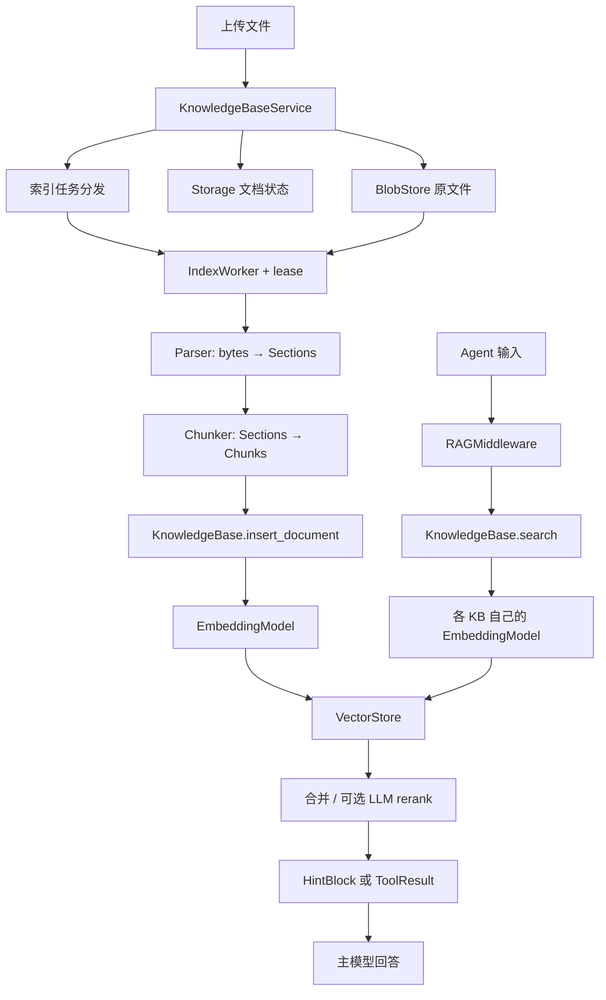
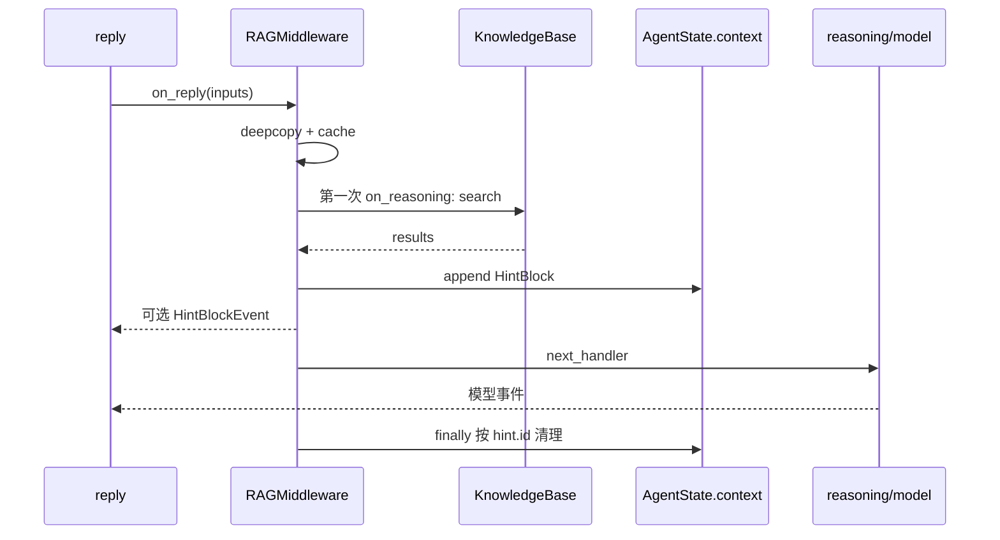
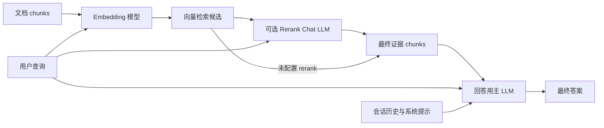
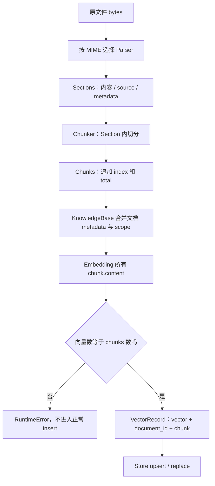
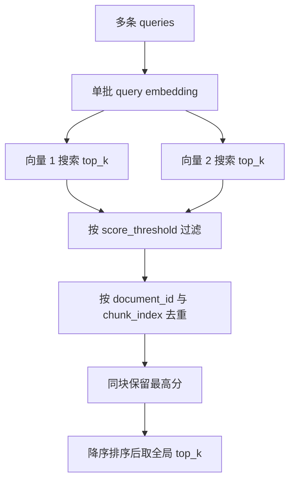
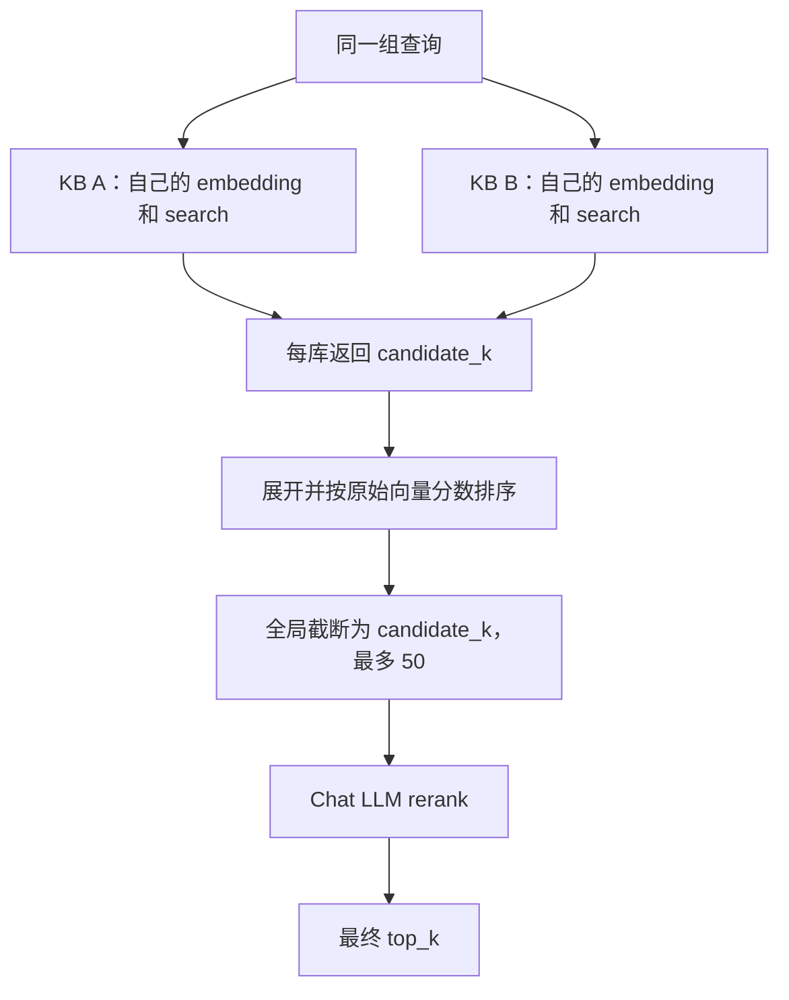
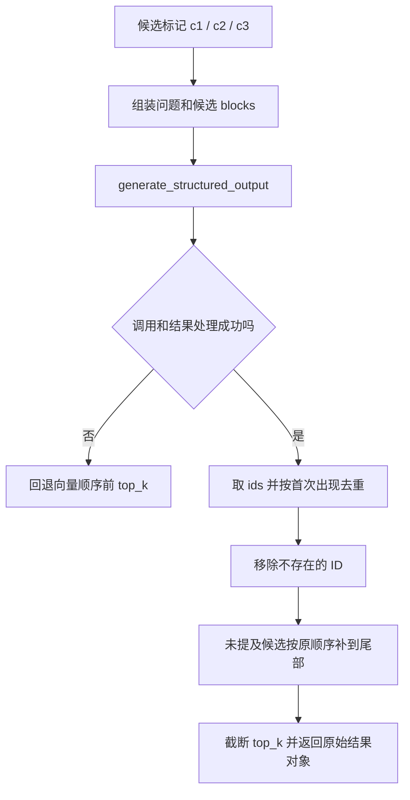
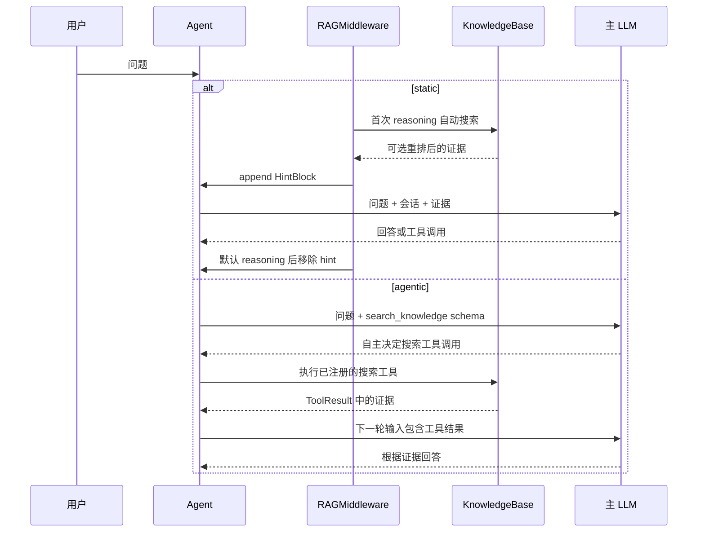

# RAG 与 Knowledge：从文件摄取到 Agent 上下文的源码级拆解

本文分析本地 `open/agentscope`，版本 **2.0.12dev**，基准提交 `4474c832dfccfd4d9a54a6f0a79a636c34817625`。结论以当前 checkout 的真实实现为准，不混用旧版本 API。文中的风险与建议是静态代码分析，不代表已通过线上实验验证。

AgentScope 的 RAG 分为三个层次：`rag/` 提供内容与向量操作，`middleware/_rag.py` 把检索接入 Agent Loop，`app/` 处理授权、上传、任务调度、状态与资源恢复。`KnowledgeBase` 是绑定 embedding、store、collection 和 scope 的运行句柄，不是完整知识库管理服务。

## 1. 源码地图与全链路

以下链接相对本篇定位源码，行号以本次基准为准。

| 问题 | 源码入口 | 重点对象 |
|---|---|---|
| 内容结构 | [数据模型](../../open/agentscope/src/agentscope/rag/_document.py) | Section、Chunk |
| 文件解析 | [ParserBase](../../open/agentscope/src/agentscope/rag/_parser/_base.py) | parse |
| 内容切块 | [ApproxTokenChunker](../../open/agentscope/src/agentscope/rag/_chunker/_approx_token_chunker.py) | chunk、_split_text |
| 向量操作 | [KnowledgeBase](../../open/agentscope/src/agentscope/rag/_knowledge.py) | search、insert_document、ensure_collection |
| 存储协议 | [VectorStoreBase](../../open/agentscope/src/agentscope/rag/_vdb/_vector_store.py) | VectorRecord、VectorSearchResult |
| 推理接入 | [RAGMiddleware](../../open/agentscope/src/agentscope/middleware/_rag.py) | 搜索工具、自动注入、重排 |
| 上传管理 | [知识库服务](../../open/agentscope/src/agentscope/app/_service/_knowledge_base.py) | register_document、delete_document |
| 后台索引 | [IndexWorker](../../open/agentscope/src/agentscope/app/_service/_index_worker.py) | process、pipeline、heartbeat |
| 资源解析 | [CollectionPerKbManager](../../open/agentscope/src/agentscope/app/rag/knowledge_base_manager/_collection_per_kb.py) | get_knowledge、collection 生命周期 |
| 独立使用 | [library 示例](../../open/agentscope/examples/rag/index_and_search.py) | 手动组装摄取与搜索 |



Library 模式从 Parser 开始即可，不依赖服务、blob、消息总线。服务模式最终复用同一套 KnowledgeBase 算法，只在外部增加文档生命周期。

## 2. 数据模型：为什么要区分 Section、Chunk 和向量记录

### 2.1 Section 是解析边界

Section 包含 `content: TextBlock | DataBlock`、`source: str`、`metadata: dict`。它表示解析器识别的自然区域，例如一页 PDF、PPT 的一段连续文本或一张图片。

Section 为 chunker 提供硬边界：不能跨两个 Section 拼接 chunk。页码、slide、sheet 等键没有统一检索语义，而是原样传递的来源信息。

这里必须区分模型 docstring 的举例和实际 parser：模型说明提到 Markdown 标题分段、PDF 图片等形式，但当前 TextParser 返回整份文本，PDFParser 只提取页面文本，不能由模型注释推断具体解析能力。

### 2.2 Chunk 是最终索引单元

Chunk 在内容、source、metadata 之外增加 `chunk_index` 和 `total_chunks`。一个 Chunk 对应一条向量记录。

| 字段 | 实际含义 | 不代表什么 |
|---|---|---|
| content | embedding 输入与召回内容 | 不限于字符串 |
| source | 来源展示名，通常是文件名 | 不是原文件下载 URL |
| chunk_index | 文档内序号、去重和记录定位 | 不是全库唯一 ID |
| total_chunks | 该批文档切块总数 | 不是检索命中数 |
| metadata | 页码、上传属性、scope 等 | 不保证全部进入模型提示 |

`ApproxTokenChunker.chunk(sections)` 对整个输入列表统一编号。因此应按一份文档调用一次；混入不同文件，会让 total_chunks 与编号变成整个列表的统计。

### 2.3 VectorRecord 和 VectorSearchResult 是外层包装

```text
VectorRecord       = vector + document_id + chunk
VectorSearchResult = score  + document_id + chunk
DocumentSummary    = document_id + source + chunk_count + metadata
```

向量与搜索分数没有直接写进 Chunk，避免同一个内容结构随处理阶段改变语义。document_id 由摄取调用者指定或自动生成，不依赖文件名，也不是内容哈希。

DocumentSummary 来自向量记录聚合；服务端 KnowledgeDocumentRecord 来自上传管理存储。前者看不到尚未成功索引的 pending/error 文档，不能替代后者。

## 3. Parser：格式支持的真实边界

### 3.1 统一接口与 MIME 路由

Parser 接收 `bytes | str` 和展示用 filename，返回 `list[Section]`。`supported_media_types` 声明可处理的 IANA MIME；扩展名用于发现、展示与类型猜测。

服务端 `_build_parser_registry` 支持列表和字典。列表展开每个 parser 声明，后面的同 MIME parser 覆盖前面的并 warning；字典遵循调用者映射，和声明不一致也只 warning。这使自定义 OCR、Markdown parser 可以替换默认实现。

异步接口并不保证解析不阻塞。pypdf、python-docx、python-pptx 等内部仍有同步 CPU 工作；服务层可注入 ProcessPoolExecutor，库模式需要调用者自行安排执行位置。

### 3.2 TextParser：整体读取，不做语义解析

[_text.py](../../open/agentscope/src/agentscope/rag/_parser/_text.py) 的实际步骤：

1. bytes 按 encoding 解码，默认 UTF-8；失败包装为 ValueError。
2. str 如果指向实际存在的文件则读取，否则直接作为文本。
3. 返回一个 Section，source 为 filename，metadata 为空。

Markdown、HTML、CSV、JSON 虽然是支持类型，但这条路径不会识别标题、抽网页正文、解析 JSON 字段或理解 CSV 行列。切分全部留给 chunker。

str 具有“路径或正文”的二义性：文本恰好等于现有路径时会变成读文件。需要明确按内容处理时可以传 bytes。

### 3.3 PDFParser：每页文本，无默认 OCR

[_pdf.py](../../open/agentscope/src/agentscope/rag/_parser/_pdf.py) 用 pypdf `PdfReader(io.BytesIO(file))` 逐页执行 `page.extract_text() or ""`，metadata 为从 1 开始的 page。

空页和纯图片页仍产出空文本 Section，随后被 chunker 丢弃。当前没有 OCR、嵌入图片抽取或版面表格重建。上传成功、索引 ready 都不能单独证明扫描件具备可检索内容。

异常范围覆盖 reader 构造与逐页读取，因为 pypdf 会延迟读取内容流；转换的具体类型是 PdfReadError，不能泛化成所有异常都统一变为 ValueError。

### 3.4 WordParser：按元素顺序累积文本

[_word.py](../../open/agentscope/src/agentscope/rag/_parser/_word.py) 处理 `.docx`，默认 `include_image=True`、`separate_table=False`、`table_format="markdown"`。

段落进入文本缓冲；表格渲染后默认并入缓冲，separate_table=True 时独立成 Section；图片打断缓冲并成为 DataBlock。实现还处理 XML content controls 等容器与嵌套段落，不能简化成遍历 doc.paragraphs。

保序指文档元素顺序，不是还原 Word 排版的视觉阅读顺序，也不产生真实分页。表格即使独立成 Section，后续通用 chunker 仍可能从行中间截断。

### 3.5 PPTParser：一页可以有多个 Section

[_ppt.py](../../open/agentscope/src/agentscope/rag/_parser/_ppt.py) 使用 python-pptx 处理 `.pptx`。

- `_iter_shapes` 递归展开 group，按 shape tree 顺序访问叶子，不按坐标推断阅读顺序。
- 连续文本与默认表格进入缓冲；图片或 separate_table 可以打断缓冲。
- `_normalise_breaks` 统一 CRLF、CR、垂直制表符，避免 Shift+Enter 内容粘连。
- 图片基于 Picture 类型识别，包括占位图片，保存为 base64 DataBlock。
- metadata 带 slide，默认正文还带 `<slide index=...>` 与 `</slide>`。

因此“一页一个 Section”只是粗略说法；真实实现按页内内容区域拆分，默认包装标签也会消耗 embedding 与上下文预算。

### 3.6 ExcelParser：表格转文本，不计算公式

[_excel.py](../../open/agentscope/src/agentscope/rag/_parser/_excel.py) 使用 pandas 读取 `.xlsx/.xls`，默认参数：

```python
include_sheet_names=True
include_cell_coordinates=False
include_image=False
separate_sheet=False
table_format="markdown"
```

读取使用 `header=None`、`dtype=object`、`keep_default_na=False`，避免首行转 pandas 列名后改写重复和空标题。`_restore_native_excel_errors` 从已打开的 openpyxl workbook 恢复被 pandas 变成 NaN 的原生错误值，如 `#DIV/0!`；不计算公式，也不对 `.xls` 做同样恢复。

separate_sheet=True 才能让各 sheet 文本成为硬分界；默认合并文本 Section，metadata 变为空字典。需要单元格引用时可以打开坐标，但引用如何呈现给模型仍取决上层 formatter。

图片可选提取，保持为独立 DataBlock；抽取失败有 warning。因此 ready 也不证明每张图片都被完整保留。

### 3.7 ImageParser：整张原图透传

[_image.py](../../open/agentscope/src/agentscope/rag/_parser/_image.py) 检测字节 MIME，base64 编码后放入 Base64Source，一张图形成一个 DataBlock Section。没有 OCR、caption 或裁剪。

多模态需要 Parser → Chunker → Embedding → Store → Reranker → 主模型都兼容。尤其查询侧静默过滤 DataBlock 不代表写入侧也过滤：insert_document 直接把 chunk.content 交给 embedding，文本模型可能拒绝图片。

## 4. ApproxTokenChunker 的字节算法

### 4.1 参数与处理顺序

默认 chunk_size=512、overlap=50。Parameters 保证 chunk_size≥1、overlap≥0、overlap<chunk_size。新 API 用 `ApproxTokenChunker.Parameters(...)`；旧直接参数仍可用，但 warning 并覆盖 Parameters 同名值。

chunk 对每个 Section 单独处理：TextBlock 切分后剔除空白，DataBlock 原样成为单块，metadata 复制为新顶层字典。最后统一设置 chunk_index 和 total_chunks。

### 4.2 为什么按 UTF-8 字节近似

```python
approx_tokens = len(text.encode("utf-8")) // 4
```

短文本直接返回；长文本先构造每个字符之后的累计 UTF-8 字节偏移，再二分查找块末尾与 overlap 起点。核心控制流：

```python
end = bisect_right(byte_offsets, byte_offsets[start] + chunk_size * 4) - 1
end = max(end, start + 1)
next_start = bisect_right(byte_offsets, byte_offsets[end] - overlap * 4) - 1
start = max(next_start, start + 1)
```

字符切片仍用 Python 字符索引，避免切坏 UTF-8；max 保证每轮前进，不被 overlap 卡住。代价是它不是实际 tokenizer，不识别句子、段落、代码块或表格行。

中文字符通常占多个字节，同样预算的中文与 ASCII 字符数明显不同。短文本分支使用 //4，因此最多 `4*chunk_size+3` 字节的文本仍可能直接通过；不能把 `4*chunk_size` 当成所有分支严格上限。二分回退使 overlap 也只是近似预算。

### 4.3 成本与检索影响

累计数组占 O(n) 空间，每块二分定位；输出还携带 overlap 的重复文本。没有 tokenizer 初始化成本，但不保证 embedding provider 的 token 上限。

短 Section 不会跨边界合并补满预算，因此许多短页会产生许多小块。扩大 chunk_size 不能跨页合并；需要章节聚合时，应先调整 Parser 的 Section 策略。

## 5. KnowledgeBase：资源绑定与 collection 生命周期

构造绑定 name、description、embedding_model、vector_store、collection、metadata_filter，不做 I/O。外部调用者负责连接生命周期，通常使用 `async with store:`；RAGMiddleware 也不拥有或关闭这些资源。

### 5.1 ensure_collection：双重检查与实例级缓存

[_knowledge.py:163](../../open/agentscope/src/agentscope/rag/_knowledge.py#L163) 的关键代码：

```python
if self._collection_ready:
    return
async with self._collection_lock:
    if self._collection_ready:
        return
    if not await self._vector_store.has_collection(self._collection):
        await self._vector_store.create_collection(
            self._collection, dimensions=self._embedding_model.dimensions,
        )
    self._collection_ready = True
```

锁防止同一实例并发首用重复创建；成功才置 ready，失败下次可重试。这不是跨进程或跨实例建表锁。

已存在 collection 不会在此验证维度；同维度但不同 embedding 模型更无法识别。ready 也不自动失效：外部删掉 collection 后，旧句柄仍认为已准备好。

服务端 CollectionPerKbManager 在创建 KB 时提前建 collection；不能把库层懒建表理解成所有模式唯一行为。

### 5.2 metadata_filter：隔离约定与可变性

search/list/delete 使用绑定 scope；insert 用 scope 覆盖冲突 metadata，避免调用者把记录写入另一 scope。删除要求 document_id 与 scope 同时匹配。

但“构造时固定”是使用约定，当前字典并非不可变：构造函数保留字典引用，property 也直接返回它。外部可修改 filter；需要强封装时应复制配置并避免暴露可变引用。

None 表示关闭 metadata 过滤，不代表自动带租户 ID。默认服务 manager 采用一库一 collection，权限在服务层完成。

## 6. insert_document：从 Chunk 到 VectorRecord

入口为 [_knowledge.py:286](../../open/agentscope/src/agentscope/rag/_knowledge.py#L286)。

1. chunks 为空直接返回已有或新 document_id，不建表、不嵌入、不写向量。
2. 解析 document_id，ensure_collection。
3. model_copy 生成本次写入的 Chunk 副本。
4. 合并 metadata，优先级为 `document_metadata < chunk.metadata < metadata_filter`。
5. 一次调用 embedding，输入所有 chunk.content。
6. 向量数量与 chunks 数量不一致时抛 RuntimeError。
7. 按位置 zip 成 VectorRecord，store.insert 后返回 document_id。

例如 document_metadata 写 tenant=A，parser 写 tenant=B，绑定 scope 写 tenant=C，最终是 C。新的顶层 metadata 字典保护本次合并，不改调用者原 chunk，支持同一批 chunks 在不同 scope 下重用；这不是对嵌套对象图的完全深拷贝保证。

KnowledgeBase 本层没有按 N 块分批调用 embedding、内容哈希去重或跨资源事务。provider 是否进一步分批由具体模型决定，不能从 store 的批次配置推导 embedding 的内存和速率行为。

### 6.1 稳定 ID 能解决什么

Qdrant 用 `UUIDv5(document_id + NUL + chunk_index)` 派生 point ID；Milvus、MongoDB、Elasticsearch 也按文档和块序号构造稳定 ID，使用 upsert/replace。

重试同一文档同一块可覆盖。但旧文档 10 块，新文档 7 块，覆盖 0..6 不会自动删除旧 7..9。服务端 Worker 因此先删整文档再插入；库模式调用者需自己处理替换语义。

这些记录 ID 没有包含 metadata scope。共享 collection 的不同 scope 若使用相同 document_id/chunk_index，可能覆盖相同物理记录；metadata 查询过滤不能代替写入 ID 的命名空间设计。

## 7. search：批量查询、并发检索与稳定去重

入口为 [_knowledge.py:197](../../open/agentscope/src/agentscope/rag/_knowledge.py#L197)。

```text
queries
 → 空输入直接 []
 → 非多模态 embedding 过滤 DataBlock，过滤后空直接 []
 → ensure_collection
 → 一批 query embedding
 → 每个向量并发 store.search(top_k, metadata_filter)
 → score_threshold 过滤
 → (document_id, chunk_index) 去重，保留最高分
 → score 降序 → 最终 top_k
```

本层不会改写 query、分解问题或自动生成多查询。多查询来自调用者，不是把多条输入拼接后生成一个向量。

例如 q1、q2 都命中 D/3，分数 0.70、0.84，最终保留 0.84 对应结果；没有求和、投票或 RRF。不同 chunk 即便 source 相同也不会合并。

top_k 同时限制每条 query 的召回和最终输出。q 个 query 最多约 q*k 个候选，去重后再取 k。阈值在后端返回后过滤，不会自动补足，所以最终可能少于 k。分数等于阈值会保留。

score_threshold=None 不代表自动判定语义相关性；向量库可能仍返回最接近的无关片段。

asyncio.gather 没有 return_exceptions=True，某一路异常会让本层整体抛错，不会返回其它 query 的部分成功结果。直接 API 的 top_k 也没有中间件 Parameters 那套 ge/le 校验，调用者需负责合法参数。

## 8. VectorStore：统一方向，不统一刻度

所有实现遵循 score 越大越相关；它不是概率，也不一定在 0..1。

| 后端 | 写入与载荷 | score 转换 | 关键差异 |
|---|---|---|---|
| [Qdrant](../../open/agentscope/src/agentscope/rag/_vdb/_qdrant.py) | UUIDv5 point，payload 保存 document_id/chunk | Cosine/Dot 原值，Euclid/Manhattan 取负 | 异步 client，支持内存/路径/远程 |
| [Milvus Lite](../../open/agentscope/src/agentscope/rag/_vdb/_milvus_lite.py) | 分批 upsert，另存 metadata JSON | COSINE/IP 原值，L2 取负 | 同步 client 经 asyncio.to_thread 调用 |
| [MongoDB](../../open/agentscope/src/agentscope/rag/_vdb/_mongodb.py) | ReplaceOne upsert，bulk_write | 直接用 vectorSearchScore | 索引等待，筛选字段需预声明 |
| [Elasticsearch](../../open/agentscope/src/agentscope/rag/_vdb/_elasticsearch.py) | 稳定 ID、dense_vector、flattened metadata | `2*_score-1` 还原 cosine | 默认 refresh=wait_for |

MongoDB 的 numCandidates 是 `min(10000, max(100, top_k*20))`，limit=top_k，拒绝 top_k>10000。filter 转为 `chunk.metadata.<key>` 的 $eq，多项用 $and；相关路径必须事先列入 vector index 的 filter_fields。

Elasticsearch 的 flattened metadata 不需要逐业务 key 声明。默认 refresh=wait_for 使写入返回前等待可搜索；关闭 refresh 换吞吐后，insert 返回与立即可见不再等价。

### 8.1 删除、文档列表与正文浏览

KnowledgeBase.delete_document 在非空 scope 下显式传 metadata_filter。自定义旧后端不支持时应该失败，不会静默退成无 scope 删除。没有 scope 时兼容旧 delete 签名。

list_documents 是向量记录聚合；list_chunks(document_id, offset, limit) 返回按 chunk_index 排序的正文块，后端可以不支持并抛 NotImplementedError。

chunk_index/total_chunks 支持邻域定位，但当前 RAGMiddleware 不会默认通过 list_chunks 扩展邻居上下文。数据模型支持一种扩展，不等于现有检索已执行它。

## 9. RAGMiddleware：配置与真实接入方式

真实构造签名使用 `parameters=RAGMiddleware.Parameters(...)`。部分顶部文档或注释仍出现 SearchConfig/search_config，不应据此编写当前版本调用代码。

| 字段 | 默认 | 含义 |
|---|---|---|
| mode | agentic | static 才自动检索注入 |
| top_k | 5 | 1..50，跨 KB 最终总数 |
| score_threshold | None | 同一个值透传各 KB |
| rerank_candidate_k | None | 显式值 1..50，且必须≥top_k |
| emit_hint_event | True | static 是否发前端事件 |
| persist_hint | False | 默认 reasoning 后移除 hint |
| hint_template | 内置 reminder | 恰有一个 {context} |
| rerank_prompt | 内置排序提示 | 包含 {query}，可含 {top_k} |

Parameters 为 frozen Pydantic 模型；两个提示模板用 SkipJsonSchema 隐藏于前端 schema，但仍可程序配置。

## 10. static：在第一次 reasoning 注入一次证据

### 10.1 on_reply 缓存什么

`on_reply`（859 行）读取 inputs，仅接受 Msg 或全部为 Msg 的列表。deepcopy 后删除空白 TextBlock，在每条消息第一个文本块前加 `msg.name:`，保存到实例字段 _cached_inputs，reply 的 finally 清空。

它保存当前调用输入，不是自动读取完整历史，也不执行独立问题改写。图片在前仍能给后面的第一块文字加说话者；纯图片输入不人为增加“用户名:”文本。每个 block 作为 embedding 输入，不保证一条 Msg 一个向量。

### 10.2 on_reasoning 的触发条件

`on_reasoning`（929 行）只在 mode=static、cur_iter=0、缓存非空时调用 _search_across。结果格式化后创建 HintBlock，append_context，再按配置 yield HintBlockEvent，最后调用下游 reasoning。



检索异常记录日志并使用空结果，主回复继续。没有结果就不追加 hint，不会默认强制给模型发送“知识库失败”。

### 10.3 one-shot 的具体后果

persist_hint=False 时 finally 倒序寻找 `msg.id == reply_id` 的载体，只删除本次 hint.id，保留其它中间件的 block。即使生成器在 HintBlockEvent 处被关闭，也会进入清理。

如果第一轮模型调用工具，后续 reasoning 不会重新搜索，也不会默认保留这份检索原文。多步任务需要持续证据时可评估 persist_hint=True 或 agentic。持久 hint 也仍受后续上下文压缩等机制影响。

emit_hint_event 与 persist_hint 独立；UI 展示过证据，不表示模型后续仍能看到它。

_cached_inputs 是中间件实例字段，不按 session 分桶。共享实例并发 reply 可能覆盖查询或提前清空缓存，应按 Agent/会话隔离或保证串行。

## 11. agentic：搜索工具、权限与 Toolkit 接线

### 11.1 工具生成与参数

list_tools 在 agentic 模式返回一个 _SearchKnowledgeTool，static 返回空列表。工具名 search_knowledge，声明只读、并发安全，check_permissions 返回 ALLOW。资源访问权限依靠上层绑定合法 KB，不是工具自己重新核验用户身份。

工具参数 query 和可选 knowledge_bases；description 列出 KB 名称、描述；schema 把可选名称缩成 enum。查询指令要求去除代词和相对时间，因为搜索本身没有完整会话语境。

knowledge_bases=None 搜全部，[] 无目标；call 实际按名字过滤，未知名被忽略。相同名称的多个 KB 会被一起选中。schema 是模型引导，不能当作直接 Python 调用的强权限检查。

异常转换为 ERROR ToolChunk，正文包含 `Search failed: ...`；没有命中返回 SUCCESS 和无相关内容提示。这与 static 只日志降级不同，模型可以看到搜索失败并重试。

### 11.2 挂载 middleware 不等于注册工具

当前 Agent 没有自动遍历 middleware.list_tools 的逻辑。服务在 [app/_service/_toolkit.py](../../open/agentscope/src/agentscope/app/_service/_toolkit.py) 收集中间件工具；库模式应显式注册：

```python
rag = RAGMiddleware(
    knowledge_bases=[kb],
    parameters=RAGMiddleware.Parameters(mode="agentic", top_k=5),
)
agent = Agent(
    name="knowledge-assistant",
    system_prompt="回答业务问题时检索知识库，并根据证据回答。",
    model=chat_model,
    toolkit=Toolkit(tools=await rag.list_tools()),
    middlewares=[rag],
)
```

此片段假设 imports、kb、模型和 store 生命周期已准备好。当前 integrate_with_agent.py 的 build_agent 使用空 Toolkit，仅挂载 middleware；按本地调用链不能声称它的 agentic 分支已把工具提供给模型。这是示例接线与运行接口的差异。

## 12. 跨库检索与 LLM rerank

### 12.1 _search_across：两层并发，原始分数合并

外层对 KB 并发调用 search；每个 KB 内部又对多个 query 向量并发查 store。

无 rerank 时每库取 top_k，展开结果，按原始 score 排序并全局截断 top_k。有 rerank 时候选 k 默认 min(2*top_k, 50)，显式值也封顶 50；每库取候选 k，汇总后先按原 score 截断到全局候选 k，再调用重排模型。

例如 3 库、top_k=5，各取 10 共最多 30，但只有原始分数最高的 10 条进入 reranker，而非 30 条全部进入。

当前不做跨 KB 去重、分数校准或 RRF。不同模型、metric、后端刻度不必相同，共享阈值也不必有同等语义。rerank 救不回全局截断阶段已排除的结果。源码注释提到可换 RRF，那是扩展建议，不是默认行为。

某个 KB search 失败会让 gather 抛错；没有默认的部分成功合并。明确的 fallback 只包围 rerank 阶段。

### 12.2 _rerank_results：返回 ID，保留原始证据

候选编号 c1、c2 等；query 文本、query DataBlock、候选 source 与正文组装成消息，调用 chat model.generate_structured_output，要求 `_RerankOutput(ids: list[str])`。

返回 ID 按首次出现去重，剔除不存在的 ID，再把没被提及的候选按原向量顺序补到尾部，最后取 final_count。比如 c2,c2,c999 只让 c2 提前，其余仍可补齐，不会创造新内容。

模型不能改写原 Chunk、metadata 和分数。重排后的 score 仍是原向量分数，不是新的 LLM 评分，结果顺序也不再保证按 score 降序。模型异常或结构化结果处理失败退回向量前 top_k。

多模态候选仍作为 block 交给 formatter；不支持的模态可能被丢弃或占位，提示要求不可读候选靠后，不等于自动 OCR。

### 12.3 结果格式化：保存 metadata 不等于完整引用

_format_results 给每条结果加 `[N] (source: 文件名)`；文本内联，DataBlock 保持独立，deepcopy 避免改写原载荷，相邻文本合并。

默认没有把 KB 名、document_id、page、slide、chunk_index、score 全部展示。页码虽然在 metadata 中，主模型未必看得到；跨库同名文件也不易区分。精确引用需要扩展 formatter/工具输出。

_wrap_hint 对纯文本输出 str，对多模态输出 block 列表，在首尾拼接模板文本，避免二进制被字符串化。

## 13. 服务层：文档记录、权限与原文件

### 13.1 register_document 的顺序和补偿

服务先 _require_edit 确认编辑权限并解析 owner，再生成 document_id，流式写 BlobStore，保存 KnowledgeDocumentRecord，最后 enqueue_index_task。

storage 写失败尝试删除刚写的 blob。任务入队发生在记录写入之后，此函数没有把 storage 与消息总线组成原子事务，不能宣称天然 exactly-once。pending 重发与恢复需继续查调度路径。

服务列表来自 storage，可展示 pending/parsing/chunking/indexing/error；库模式列表来自向量集合，两者数量不同可能是正常状态差异。

### 13.2 CollectionPerKbManager

创建 KB 生成 `kb_<record.id>`，用配置维度建立 collection，再保存 KB record。保存失败会补偿删 collection；补偿失败只日志记录，保留原始异常。

DimensionPolicyKind.ANY 意味每库独立选择模型支持的维度，不意味着任意数值对某个模型都有效。

get_knowledge 按用户和 KB ID 取 record，从资源 owner 的 storage 取 pinned credential，构造 embedding，返回绑定该 collection、metadata_filter=None 的句柄。隔离依靠服务权限与 collection，而非自动 tenant filter。

删除 KB 先删除 collection 再删除记录。创建/删除是顺序操作与补偿，不是跨存储事务。

### 13.3 delete_document 的失败边界

顺序为向量删除 → storage 记录删除 → 尽力删除 blob。向量删除失败保留记录与原文件供重试；最后 blob 删除失败可能留下待清理文件。

这改善恢复能力，但不证明与正在运行的索引任务存在原子互斥，也不保证各存储任意时刻同步。

## 14. IndexWorker：租约、背压与索引可见性

### 14.1 process：本地 semaphore 与跨 worker lease

process 先 CAS 获取文档 lease，失败直接跳过。成功后同时启动 guarded pipeline 与 heartbeat，FIRST_COMPLETED 等待；semaphore 默认限制 4 份文档进入 pipeline。

lease 先于 semaphore 获取，因此等执行槽时也有 heartbeat。默认 ttl=90s，续租间隔 max(ttl/2,5s)。失去租约时取消未完成 pipeline；pipeline 先完成则取消 heartbeat；finally 按 processing_node 做 CAS release。

这是重复任务竞争控制，不是向量数据库的 fencing token。取消协程不能保证已经发到远端的写请求撤销，也不能保证进程池里的解析立即停下。

### 14.2 _run_pipeline 的真实状态机

```text
读 document 与 KB record
 → 按 KB chunker_config 重建 chunker
 → 归一化 MIME 并选 parser
 → parsing：读 blob + parse
 → chunking：chunk(sections)
 → indexing：manager.get_knowledge
 → delete_document(document_id)
 → insert_document(chunks, document_metadata)
 → ready：保存 chunk_count
异常 → error
finally → release lease
```

未知 chunker 类型或非法参数会 warning 并回退 ApproxTokenChunker；旧记录没配置也回退默认。这提高可用性，但意味着配置错误可能以另一套切块参数正常完成，排查需看日志。

ready 没要求 chunk_count>0：纯扫描 PDF 可能 ready 且 0 块。需要业务层定义空内容是否应判失败。

### 14.3 分段读取不等于流式解析

_read_blob 每次读取 1 MiB，累积 bytearray，最后返回 bytes(buffer)。当前实际整份文件驻留内存，文件顶部“不会整份驻留”的概括不能作为实现结论。

同时还可能存在解析对象、Sections、Chunks、向量、base64 载荷和进程池复制。semaphore 限文档数，不限总字节数或单文档大小。

parser_executor 存在时 run_in_executor 调用模块级 _run_parser_sync，在子进程 asyncio.run(parser.parse(...))。自定义 parser 还需可序列化；持有不可序列化连接的 parser 不必然兼容。

### 14.4 重试与一致性的代价

先删旧向量再 embed/insert 可避免文档缩短遗留尾块，但删除到插入之间不可检索；embedding 或写失败时旧索引已消失。

向量写入与 ready 状态更新也不原子：写向量后状态更新失败，可能出现可检索但 UI 显示 error。无中断更新需另做 generation/version、临时 collection 或发布指针，本路径没有原子版本切换。

_sanitise_error 只保留异常类与第一行前 240 字符，不真正过滤首行中的路径或敏感值，不能当作完整脱敏器。

## 15. 一份文档如何成为模型证据

假设上传 handbook.pdf，document_id=D，第二页切出序号 3、4 两块。

1. Blob 保存原文件，storage 保存 D 的上传属性、blob_uri 与状态。
2. PDFParser 在第二页 Section.metadata 写 page=2。
3. Chunker 页内切分，保留 source/metadata，跨全文连续编号。
4. Worker 传入 filename/media_type/size_bytes；KnowledgeBase 合并 metadata。
5. embedding 产生向量，VectorRecord 携带 D/3、D/4，后端派生稳定 ID。
6. static 使用当前输入 blocks；agentic 使用模型生成的独立 query。
7. 命中 D/4，同块多查询召回仅保留最高分。
8. 跨库合并、可选 rerank 后，默认给模型 source 文件名与正文。
9. page=2 仍在结果对象中，但默认 formatter 未展示它。
10. static 默认清理 hint；agentic 走工具结果消息路径。

因此排查答案质量要拆成：是否解析到内容、切块是否合理、embedding 是否一致、是否召回、是否在跨库截断丢失、模型是否真正看见证据、证据是否保留到需要的推理轮次。

## 16. 故障定位与扩展位置

| 现象 | 优先检查 | 入口 |
|---|---|---|
| ready 但搜不到 | 扫描 PDF、空内容、chunk_count | PDFParser、Worker |
| 图片 query 没结果 | supports_multimodal 与过滤 | KnowledgeBase.search |
| Office 入库 embedding 报错 | 默认图片与纯文本模型不兼容 | Parser、insert_document |
| agentic 不搜索 | Toolkit 是否注册工具 | list_tools、toolkit 构造 |
| 跟进问题代词检索差 | 没有自动 query rewrite | on_reply、工具 query |
| 多库集中召回某一库 | 原分数刻度、rerank 前截断 | _search_across |
| 没有页码引用 | metadata 未格式化 | _format_results |
| 第二轮工具推理忘记证据 | one-shot hint | on_reasoning |
| 重试时暂时不可查 | delete → embed → insert | Worker |
| 旧尾块残留 | 库模式替换未先删旧文档 | 摄取调用者 |
| 多会话缓存串线 | middleware 共享实例 | _cached_inputs |
| 导入峰值内存大 | 全文件缓冲、向量批量、并发 | _read_blob、insert_document |

格式理解与 OCR 放 Parser；语义切块和表格保真放 Chunker；新存储放 VectorStoreBase；query rewrite、融合、引用呈现放检索编排；租约、任务恢复和版本发布放 service/worker。

本次追踪路径没有默认执行 BM25+dense 混合召回、知识图谱推理、邻居扩展、RRF、质量评测或自我进化闭环。可通过接口扩展，但可扩展不等于已有默认实现。

## 17. 验证依据与分析边界

本篇静态追踪覆盖：数据模型、parser/chunker、KnowledgeBase、四种 store 的写入与分数语义、检索/重排、static/agentic、service 上传删除、manager 资源恢复、worker lease/pipeline。

| 现有测试入口 | 对应契约 |
|---|---|
| [rag_chunker_approx_token_test.py](../../open/agentscope/tests/rag_chunker_approx_token_test.py) | overlap、不跨 Section、DataBlock、空白 |
| [rag_knowledge_metadata_test.py](../../open/agentscope/tests/rag_knowledge_metadata_test.py) | chunks 重用、并发 scope、失败不改原对象 |
| [middleware_rag_test.py](../../open/agentscope/tests/middleware_rag_test.py) | one-shot、事件后关闭清理、多模态、工具范围、rerank 非法 ID 与失败回退 |
| [rag_parser_test.py](../../open/agentscope/tests/rag_parser_test.py) | 格式解析边界 |
| rag_vdb_*_test.py | 各向量后端接口行为 |

本轮只修改分析文档，未执行测试，未连接 embedding API 或外部向量数据库。测试入口是后续验证导航，不代表本轮测试通过；第三方部署兼容性、性能、分布式故障时序和恢复强一致性均未运行验证。

建议精读顺序：_document → chunk/_split_text → insert_document/search → _search_across/_rerank_results → on_reply/on_reasoning → service 与 IndexWorker。先确定内容和向量契约，再看 Agent 接入与服务生命周期。

## 图解深化：RAG、主 LLM 与 rerank 的协作

### A. 三类模型不是同一职责



Embedding 找相似内容，reranker 选择证据，主 LLM 阅读证据后回答。这是推理时上下文增强，不会通过一次检索改变主模型权重；重排模型可以独立配置。

### B. 摄取数据如何逐层变化



source 是展示名，document_id 是业务标识，chunk_index 是文档内稳定定位。保留这三者的区别，才能解释同名文件、重试覆盖与引用缺页码等问题。

### C. 单库多查询的分数合并



这不是各 query 分数相加，也不是 RRF。阈值在各后端召回后应用，不会为被过滤的候选自动补召回。

### D. 跨库截断先于重排



top_k=5、candidate_k=20、3 个库时，可能先得到 60 条，再只让 20 条进入 rerank。不同库分数若不可比，前一步就可能丢掉有用资料；重排无法补救它未见过的候选。

### E. rerank 的结构化结果如何归一化



模型输出 `c3,c3,c999` 时只使 c3 提前，c999 无效，其它候选仍可补齐。返回对象的 score 不会变成 LLM 评分，chunk 正文也不会由排序模型重写。

### F. static 与 agentic 如何让资料真正进入主模型



agentic 依赖 Toolkit 实际注册；static 默认只参与第一轮 reasoning。选择模式要看任务是否需要主动改写查询、分步搜索与多轮持续阅读证据。

### G. 按阶段核查“RAG 没生效”

| 层次 | 要查的对象 | 常见误判 |
|---|---|---|
| 摄取 | Section/Chunk 数与正文 | ready 就代表扫描 PDF 已 OCR |
| 嵌入 | 模型身份、维度、模态 | 维度相同就一定可比较 |
| 检索 | 原始候选和阈值 | 无结果一定是知识不存在 |
| 重排 | 进入模型的候选 ID 集合 | rerank 会搜索被前面丢掉的全文 |
| 注入 | HintBlock 或 ToolResult | UI 显示来源就表示后续模型仍可见 |
| 生成 | 模型输入与引用字段 | 存在 page metadata 就能精确引用页码 |

新增图解描述本地实现，未调用 embedding、reranker 或外部向量服务。建议留存各阶段可审查输出，再对比最终回答，避免仅用答案看起来合理来判断 RAG 链路正确。
