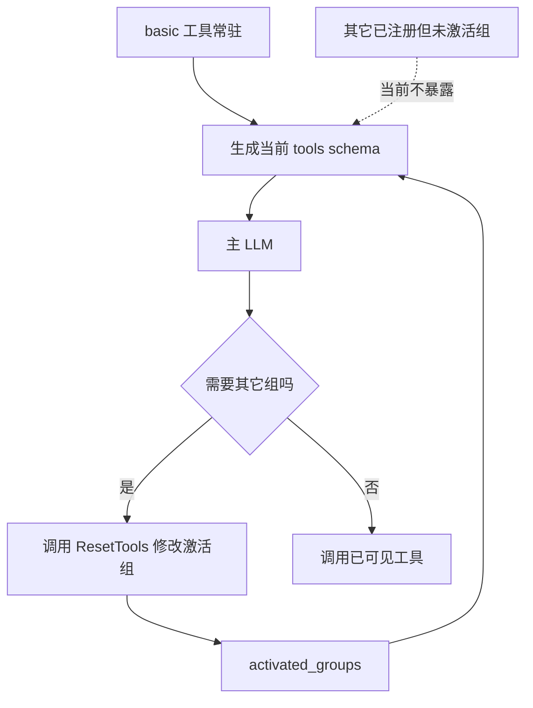
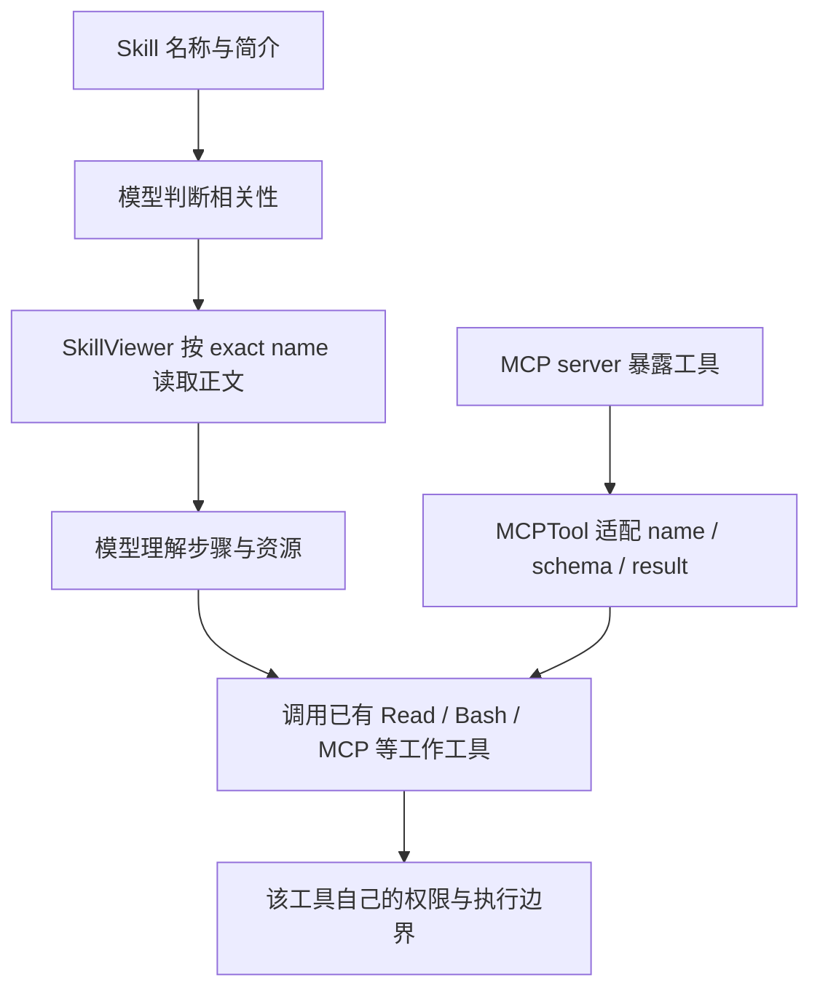
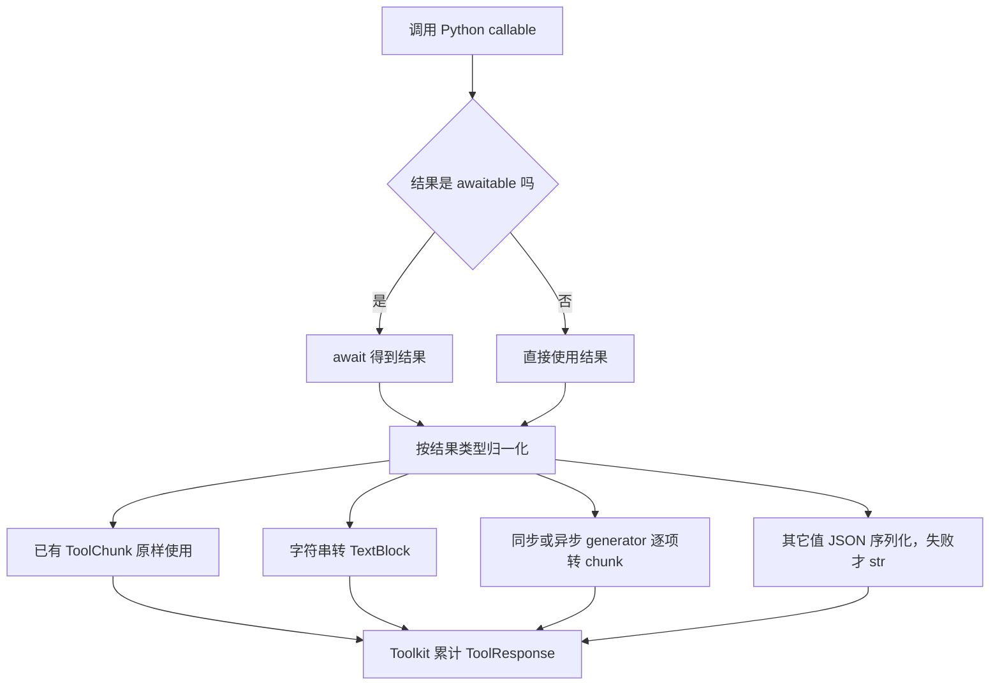
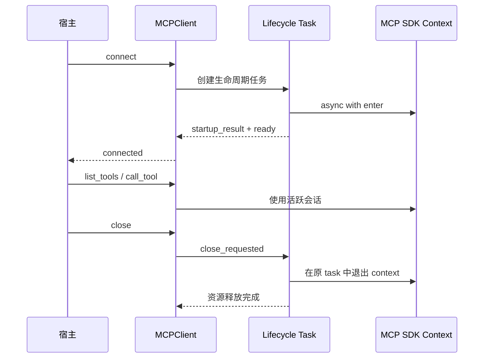

# Tools、Skills 与 MCP 源码拆解

主要源码为 `tool/_toolkit.py`、`tool/_base.py`、`tool/_adapters.py`、`permission/_engine.py`、`skill/`、`mcp/`。Toolkit 管注册/暴露与调用，PermissionEngine 管决策，Agent 管完整执行生命周期。

## 工具为什么分组

Toolkit 初始化保留 basic 组，并拒绝冲突组名；AgentState.tool_context.activated_groups 指定额外激活组，生成 schema 时 basic 始终可见。内建 ResetTools 允许调整暴露组，减少所有工具全量塞 prompt 的成本。注册不等于当前已激活；调用时仍通过 check_tool_available 检查。

## Skill 与 MCP 不同

Toolkit 的 DEFAULT_SKILL_INSTRUCTION 明确 Skill 不是可直接调用工具。模型先用 SkillViewer 读完整指令，再使用既有工具和资源完成工作。SkillLoaderBase/LocalSkillLoader 提供加载边界。MCPTool 则把远端工具适配成 ToolBase，同样参与 schema、调用、返回与治理。stateful MCP 在 Toolkit 初始化前必须已连接，连接生命周期不能由“注册成功”代替。

## 完整调用路径

`模型 ToolCallBlock → Agent._execute_tool_call → 可用性+JSON/schema → _check_permission → ASK/DENY/ALLOW/外部执行 → _acting → toolkit.call_tool → ToolChunk/ToolResponse → Agent 转事件/写 ToolResultBlock`。on_acting 只包原始 I/O。模型声明的工具名和参数不能自己赋予权限。

本篇先概览 Toolkit 与 Agent 执行边界，后续展开 Skill 加载、MCP transport 生命周期与结果适配。权限模式的完整对照见独立权限专题；Skill 归档安全等未穷尽的分支在文末单独说明。

## 1. 源码导航：能力系统的实现位置

本节以下是继续精读后的完整调用链分析，覆盖 ToolBase、FunctionTool、Toolkit、LocalSkillLoader、SkillViewer、MCPClient、MCPTool 和权限模式。前面的短文仅作概览。版本为本地 AgentScope 2.0.12dev，没有运行测试。

| 位置 | 需要理解的实现 |
|---|---|
| [ToolBase](/D:/work/fanchen/projects/company/web/ai-agent-design/open/agentscope/src/agentscope/tool/_base.py:100) | 工具协议、call/__call__、工具自身 middleware |
| [FunctionTool](/D:/work/fanchen/projects/company/web/ai-agent-design/open/agentscope/src/agentscope/tool/_adapters.py:39) | Python 函数到 schema/ToolChunk 的适配 |
| [Toolkit.get_tool_schemas](/D:/work/fanchen/projects/company/web/ai-agent-design/open/agentscope/src/agentscope/tool/_toolkit.py:171) | 给模型的能力集合 |
| [Toolkit._get_available_tools](/D:/work/fanchen/projects/company/web/ai-agent-design/open/agentscope/src/agentscope/tool/_toolkit.py:473) | 分组、MCP 动态发现、同名覆盖 |
| [Toolkit.call_tool](/D:/work/fanchen/projects/company/web/ai-agent-design/open/agentscope/src/agentscope/tool/_toolkit.py:225) | 实际调用、状态注入、流结果累计 |
| [LocalSkillLoader](/D:/work/fanchen/projects/company/web/ai-agent-design/open/agentscope/src/agentscope/skill/_local_loader.py:17) | 文件发现、frontmatter、mtime 缓存 |
| [SkillViewer](/D:/work/fanchen/projects/company/web/ai-agent-design/open/agentscope/src/agentscope/tool/_builtin/_skill.py:18) | 模型按名称读完整技能正文 |
| [MCPClient](/D:/work/fanchen/projects/company/web/ai-agent-design/open/agentscope/src/agentscope/mcp/_mcp_client.py:31) | transport、会话、发现、过滤 |
| [MCPTool](/D:/work/fanchen/projects/company/web/ai-agent-design/open/agentscope/src/agentscope/tool/_adapters.py:197) | 远端工具命名/schema、调用和进度 |
| [PermissionEngine](/D:/work/fanchen/projects/company/web/ai-agent-design/open/agentscope/src/agentscope/permission/_engine.py:17) | 模式与规则求值 |
| [权限模式文档](/D:/work/fanchen/projects/company/web/ai-agent-design/open/agentscope/src/agentscope/permission/_types.py:22) | 模式枚举；部分历史描述需对照 engine |
| [Agent 完整工具生命周期](/D:/work/fanchen/projects/company/web/ai-agent-design/open/agentscope/src/agentscope/agent/_agent.py:2452) | schema 校验、权限、暂停、执行和提交 |

## 2. 把能力系统理解成四个连续阶段

```text
注册来源                       模型可见范围
Python ToolBase ─┐             basic + activated_groups
MCPClient ───────┼→ Toolkit → tools schema + Skill 简介
SkillLoader ────┘                  ↓ 模型生成 ToolCallBlock
                              Agent 参数/权限检查
                                   ↓
                          ToolBase / FunctionTool / MCPTool
                                   ↓
                      ToolChunk 流 → ToolResponse → ToolResultBlock
```

注册定义“系统知道哪些能力”，激活定义“当前轮可见哪些能力”，权限定义“当前输入可否执行”，执行适配定义“实际如何调用”。四阶段都可能失败，不能因为模型已经生成工具名就跳过后面的检查。

## 3. ToolBase 的字段分别控制不同机制

name/description/input_schema 面向模型；is_concurrency_safe 供批调度；is_read_only/check_read_only 参与权限；is_external_tool 改成宿主接管执行；is_state_injected 决定是否传 live AgentState；is_mcp/mcp_name 标记远端来源；metadata_schema 用于外部执行结果契约。

它们不是一组等价安全标志。只读不自动等于并发安全；并发安全也不代表无写入。FunctionTool 默认 is_concurrency_safe=true、is_read_only=false，因此普通函数默认可并发，但仍需要授权。工具作者需要显式校准这些声明。

external tool 可以不实现本地 call：Agent 在允许后发 RequireExternalExecutionEvent 并设 SUBMITTED，等待宿主回传结果。metadata_schema 描述外部 executor 应返回的 metadata，output 仍保留面向模型可读内容；输入 schema 与结果 metadata schema 各管半边契约。

## 4. 新工具覆写 call，旧工具可能覆写 __call__

ToolBase.call 是新的实现扩展点；ToolBase.__call__ 负责接工具自身 middleware。外部工具直接调用默认 call 会 RuntimeError，普通未实现 call 则 NotImplementedError。

__call__ 拒绝实际 positional args，以 keyword-only 输入保持模型参数字典语义。没有 middleware 时，若 call 是 async-generator function，直接返回 generator；否则 await call。带 middleware 时，将不同返回形状统一为 AsyncGenerator，让每层 on_tool_call 都能相同方式消费。

直接覆写 __call__ 的旧工具不一定经过基类包装；分析自定义工具时不能只看继承 ToolBase 就宣称所有 ToolMiddlewareBase 都会运行。

## 5. 两套 middleware 的位置不能混淆

Agent.on_acting 包围 Toolkit.call_tool 附近的原始 I/O；ToolMiddlewareBase 包围单个 ToolBase.call。它们都在 Agent 已做权限判断之后。工具 middleware 可以通过 next_handler 覆盖 kwargs，因此若不可信 middleware 改掉路径/命令，授权参数和实际执行参数可能不同；配置这些 middleware 是宿主信任边界。

on_check_permission 的副本隔离只防止该权限 hook 直接改最终参数，不意味着所有后续工具 middleware 都不能改参。要审计真实执行，必须贯穿这两套链，而非只记录模型 input。

## 6. FunctionTool 怎样把 Python 函数变成模型能力

构造时 name 默认来自 callable，description 来自 docstring，input_schema 可显式 dict 或 Pydantic 类，否则从函数类型注解/docstring 提取。Pydantic schema 会去掉 title 减小噪声；Literal/Annotated Field 可表达枚举和范围。

这里生成 schema 是声明，不等于执行时依赖 Python annotations 自动验证；Agent 另做 jsonschema.validate。函数真正返回的 Python 类型也未必等于模型看到的 JSON 类型，需要结果归一化。

原文关键调用：

```python
result = self._func(**kwargs)
if inspect.isawaitable(result):
    result = await result
```

同步函数就在当前执行线程直接调用，没有统一 to_thread。慢同步 I/O/CPU 计算会阻塞 loop；同步 generator 的迭代也没有自动迁线程。声明 concurrency_safe 不会替你实现非阻塞。

## 7. FunctionTool 的返回值归一化

AsyncGenerator/Generator 逐项转 ToolChunk；已是 ToolChunk 原样返回；字符串转 TextBlock；其它值先 json.dumps(ensure_ascii=False)，失败才 str。新建 chunk 的 state 为 RUNNING，由 Toolkit 的最终响应累计规则收尾。

默认 check_permissions 返回 ASK，显式 permission 参数可改变。schema 或 docstring 描述“只读”不等于 is_read_only/check_read_only 已给正确结果，权限行为由实际字段/方法决定。

## 8. Toolkit 的 basic 组与动态激活

初始化把直接传 tools/skills/mcps 放 basic，额外 tool_groups 不可占 basic；组名不能重复。stateful MCP 要求预先 connected，Toolkit 不替调用方自动完成资源启动。

`_get_available_tools(groups)` 总将 basic 纳入。存在额外组则加入内置 ResetTools meta tool；当前组存在 Skill 则加入内置 SkillViewer。模型可以通过 meta 工具调整 activated_groups，再获得新一组 schemas。

这是一种能力上下文预算机制：基础能力常驻，其余按任务选择。它不能代替权限：激活写库工具不表示用户已授权写库。

## 9. Schema 发现会执行 I/O，且容忍单个 MCP 不可用

_get_available_tools 遍历选中组，收集 Python tools，再 await client.list_tools。单 MCP list 抛异常会 warning 并跳过，避免一个失效 token/服务器使整个回复失败。

因此某轮工具突然不可见可能是发现失败，不只是用户取消激活。产品排查应区分注册、组过滤和远端 discovery 失败。schema 组装不是天然纯内存只读函数，可能涉及多次网络请求。

同名工具使用字典赋值，后来的覆盖前面的并 warning。不是所有冲突都会启动失败：顺序会决定模型最终调用谁。MCP 名字 namespace 缓解冲突，但 sanitized 后重名、Python 自定义占同名等仍应检查。

## 10. 调用时再次检查可见范围

Agent 执行先 check_tool_available，Toolkit.call_tool 也重新获取当前 activated tools。若名字存在但组 inactive，返回提示先用 ResetTools 激活；真正不存在则 ToolNotFound ERROR。

两次检查之间仍可能有 middleware/共享注册变化，所以重新确认合理。它也可能重新发现 MCP，实际延迟需测量，不能从 schema 一次生成推断工具对象永远稳定。

## 11. Skills：先暴露说明，再读正文

Toolkit.get_skill_instructions 从选中组收集 Skill，Jinja 模板给模型 name/description/dir 和 SkillViewer 名称，明确“Skill 不是工具，先读完整说明”。没有 Skill 返回 None。

`activated_groups=None` 在 get_skill_instructions 表示兼容地包含所有组，而 `_get_available_skills(None)` 只含 basic；Agent 正常显式传 state 的组列表，避免误读默认行为。自定义调用者需要留意两个函数的 None 语义不同。

相同 skill.name 同样后覆盖并 warning。索引简介是模型发现技能的入口，不会把每份 markdown 脚本全文每轮全部注入。

## 12. LocalSkillLoader：真实文件扫描和缓存

directory 先规范化；默认 scan_subdir=false，只检查该目录根 SKILL.md，开启才 os.walk 子目录。发现目录的同步工作使用 asyncio.to_thread，单个文件异步读取，用 gather(return_exceptions=True) 并发加载。

加载按 root directory 缓存 Skill，比对 SKILL.md 的 mtime；mtime 一致返回缓存对象。读取编码 utf-8-sig 兼容 Windows BOM，否则 frontmatter 的开头分隔符可能无法识别。缺 name 或 description 跳过并告警；正文存 markdown，目录与 mtime 一起放 Skill 对象。

mtime 缓存不等同内容 hash：时间戳不变的覆盖或低精度文件系统变化可能无法感知；被删除文件仍要按发现阶段判断，不应仅按缓存条目数量代表当前能力数。错误被降级为空/跳过，失败不会一定使启动失败。

## 13. SkillViewer 怎样按当前状态读取

SkillViewer 的模型名称是 `Skill`，schema 只要 exact skill name；is_state_injected=true，call 接 `_agent_state` 并按 activated_groups 再次取可用 Skills。找不到返回 ERROR，不从任意路径读文件。

```python
skills = await self._get_skills_method(
    _agent_state.tool_context.activated_groups,
)
target_skill = skills.get(skill)
```

成功返回 target_skill.markdown。它只是读说明，不执行脚本、不自动授予文件/shell权限。脚本后续仍用普通工具执行，按该工具权限和 workspace 规则判断。Skill 文本属于可影响模型行为的资料，权限引擎不因它自称“允许”就改变规则。

## 14. MCPClient 配置先约束连接形状

MCPClient 是 Pydantic 模型，mcp_config 为 StdioMCPConfig/HttpMCPConfig 的 discriminator union；stdio 必须 stateful，HTTP 可二者。name 只允许 [a-zA-Z0-9_-]，因为会进入模型工具名称。

enable_tools/disable_tools 都是可选名字列表；存在交集则构造失败，不让冲突配置默默按某个顺序决定。execution_timeout 用于调用；stream_progress 默认 false。运行时 headers 另有校验路径，本篇未逐段核对其完整 transport 实现。

## 15. stateful MCP 为何单独设 lifecycle task

[connect](/D:/work/fanchen/projects/company/web/ai-agent-design/open/agentscope/src/agentscope/mcp/_mcp_client.py:337) 创建 SDK client、ready、close_requested、startup_result，并启动 _run_client_lifecycle。生命周期 task 从 async with enter 一直持有到 close_requested，再在同 task 中退出 context。

```python
async with client as connected_client:
    startup_result.append(connected_client)
    ready.set()
    await close_requested.wait()
```

这样启动与关闭 context 的 owner 一致，避免把 transport task/cancel scope 分散在不同调用任务中。connect 用 shield 等 ready，启动失败或取消则 cancel lifecycle、await 清理并重置字段，再抛原异常。

重复 connect 已连接状态会 RuntimeError，不是幂等 no-op；stateless 的 connect 则直接返回。宿主应明确生命周期，不随意每轮 connect。

## 16. close 与 stateless 的资源归属

[close](/D:/work/fanchen/projects/company/web/ai-agent-design/open/agentscope/src/agentscope/mcp/_mcp_client.py:413) stateful 设 close_requested，再 await lifecycle_task，finally 清 client/task/event/connected。普通清理异常默认 warning，可 ignore_errors=false 传播。未连接就 close 会 RuntimeError。

stateless 每次通过 client_gen 的 async context 临时建立/关闭连接。它减少长连接状态，但 discovery 与调用都可能重新建连；不是“完全不需要资源管理”。已返回的 stateful MCPTool 持旧 session，重连后是否仍引用有效 client 需要重新取工具，不能假定适配器自动替换所有旧对象。

## 17. 发现缓存和 enable/disable 不是访问控制全边界

[list_raw_tools](/D:/work/fanchen/projects/company/web/ai-agent-design/open/agentscope/src/agentscope/mcp/_mcp_client.py:466) 请求 SDK cache_mode=refresh，把完整未过滤列表存 _cached_tools，再应用 enable/disable。get_tool 从完整缓存按名字找，所以宿主代码可显式取一个 discovery 列表中过滤掉的工具。

因此 enable/disable 首先控制列举和模型暴露；不能把它单独当服务端禁止访问某远端操作的 ACL。实际远端服务器仍需认证授权，本地 Agent 也有权限引擎。

## 18. MCPTool 的 schema 与命名

工具名构成 mcp__<server>__<sanitized-tool>，调用远端仍用原 `_tool.name`。保留完整 input_schema，不只 properties/required，避免丢 $defs/$ref/anyOf 等嵌套约束；缺基本字段时补 object/properties/required。

默认 is_concurrency_safe=false，远端 readOnlyHint 决定 is_read_only。默认 check_permissions 只读 ALLOW，其它 ASK。注释有“allows all”旧描述，实际分支不是无条件允许，应以代码为准。

服务器声明 readOnlyHint 会影响本地 fast path，所以接入不可信 MCP 时必须考虑标注可信度；只读是声明/检查结果，不是本地对远端副作用的沙箱证明。

## 19. MCP 进度流不是结果日志

[_stream_call](/D:/work/fanchen/projects/company/web/ai-agent-design/open/agentscope/src/agentscope/tool/_adapters.py:358) 为每次请求建 queue(maxsize=1024)，进度到来若满先移除最旧，再加入新快照。进度 chunk 无 content、metadata.mcp_progress 承载 progress/total/message。

_invoke 在 AsyncExitStack 内按 stateful session 或 stateless client_gen 取得 client，再用原名字 call_tool，传 arguments、read_timeout_seconds、progress_callback。默认 stream_progress=false 仍消费底层执行，只对外保留 final chunk；开关控制可见进度，不改变远端业务本身。

进度队列会丢旧快照且没有丢失计数，不能用来审计每个执行步骤；final result 走独立完成通路，不因进度 overflow 被丢。MCP 的读超时也不一定等同远端操作硬停止，取消/重试需结合服务器语义。

## 20. Agent schema 校验与工具执行重解析

Agent `_execute_tool_call` 在判断权限前检查可用性，按 schema 修复解析 JSON，再 jsonschema.validate。失败变 ERROR 结果给模型。之后 Toolkit.call_tool 会再次解析 input，注入 state，再调用工具。

这意味着权限基于解析后的真实输入；middleware 权限链拿 deepcopy，不能靠修改这份 input 偷改最终调用。但后面的工具 middleware 仍可改参。参数修复是便利机制，不能替代业务值验证，例如账号是否属于调用用户、URL 是否允许等仍由工具/服务处理。

## 26. 正常、拒绝、外部执行三条结果链

ALLOW 本地：发 ToolResultStart→_acting→ToolChunk 增量→完整 ToolResponse→裁剪/offload→写 context→call FINISHED→ToolResultEnd。

DENY/参数错误：_handle_error_tool_call 写 DENIED/ERROR result，并结束调用，模型可据此改策略。它不会把拒绝永远当 pending，也不会在默认模式下自动结束整个业务任务。

ALLOW external：先设 SUBMITTED 再发外部执行要求，当前流 park；回传结果验证 metadata 契约后追加结果。输入 schema 和外部 output/metadata 校验是两条独立契约。

## 27. 贯穿例子：技能调用远端写操作

用户要求发布一份报告，发布 Skill 在 publish 组，MCP 发布工具也在该组。模型最初只见 basic 和 ResetTools，激活 publish 后看到 Skill 简介及 MCP schema；调用 Skill 工具读取正文，正文指导先生成报告再发布。

模型调用 mcp__publisher__publish，Agent 解析并校验输入，引擎命中 ASK，先改 call=ASKING 再发卡。用户只批准当前调用、不保存广泛规则，恢复后按原 ID 标 ALLOWED，仍校验修改后参数与权限 middleware，MCPTool 用远端原名发请求。

进度快照经 mcp_progress 转 UI，最终 CallToolResult 转 ToolChunk/ToolResponse，Agent 写入结果并继续模型总结。Skill 没有授权发布，激活组没有授权发布，服务器 readOnlyHint 也不应给写工具错误声明只读；这些是不同控制层。

## 28. 需要单独追读的边界

当前已沿协议、注册、加载、发现、权限、执行主路径静态深读。尚未穷尽 schema 提取 helper、MCP 各内容类型转换、header/token 热更新、所有工具路径/命令规则、Skill archive 安装及跨进程授权存储。本文标出的并发/安全风险来自代码边界推导，未经运行复现，不能当已确认漏洞。


## 权限专题入口

完整权限模式、规则求值、服务身份与协议治理已抽离至 [安全、权限与协议治理](14-Security-Permissions-and-Protocol-Governance.md)。本篇保留 Tools、Skills、MCP 机制，以及接口调用所需的授权边界说明。

## 图解深化：从能力发现到一次真实执行

### A. 四道门分别解决什么


注册只是系统知道能力；可见只是模型可以选择；schema 合法只是参数形状正确；获准才是当前动作可以执行。这些失败应分别记录，避免把所有 ToolNotFound 都归因于模型幻觉。

### B. 激活组为何会改变下一轮模型行为



模型下一轮能看到的新 schema 仍要通过权限。工具激活不是授权，省 schema token 也不应隐藏必要的故障诊断信息。

### C. Skill 是说明书，MCPTool 是可调用适配器



Skill 不会因声明“可以发布”就授予发布权限，也不负责自动执行脚本。MCP 描述、Skill 正文与工具结果均可能影响模型选择，但硬授权要由受信执行层兑现。

### D. FunctionTool 如何统一返回形状



同步 callable 和同步 generator 在当前线程执行，不因工具声明 concurrency_safe 就自动变成非阻塞。处理慢业务时应明确线程池、进程或异步客户端责任。

### E. Stateful MCP 的 context owner



在同一个 task 进入和退出 SDK context，是 transport/cancel scope 的生命周期要求；Toolkit 注册成功不意味着它替宿主拥有了这段连接生命周期。

### F. 能力冲突与发现失败的排查表

| 现象 | 检查 | 不能直接推断 |
|---|---|---|
| 某工具消失 | 激活组、MCP discovery warning、连接身份 | 工具已从服务器删除 |
| 同名调用行为变化 | 后注册覆盖、命名空间 sanitize | 模型挑错了实现 |
| Skill 正文没更新 | mtime 缓存和扫描目录 | 文件内容已经强制重新读取 |
| MCP 有进度但没结果 | progress 与最终 ToolResult 的区别 | progress=100 就业务成功 |
| 工具能执行但模型看不到 | 实际 schema 与组过滤 | 后端可调用就一定暴露 |

本节对照前文定位的源码展开，没有执行远程 MCP 或 Skill 脚本。
