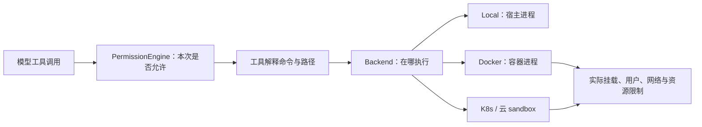
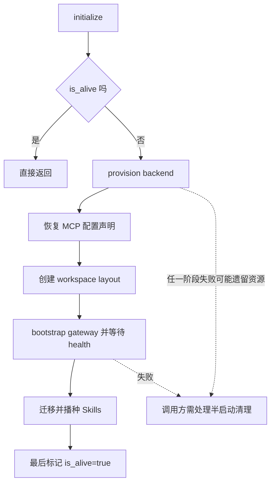
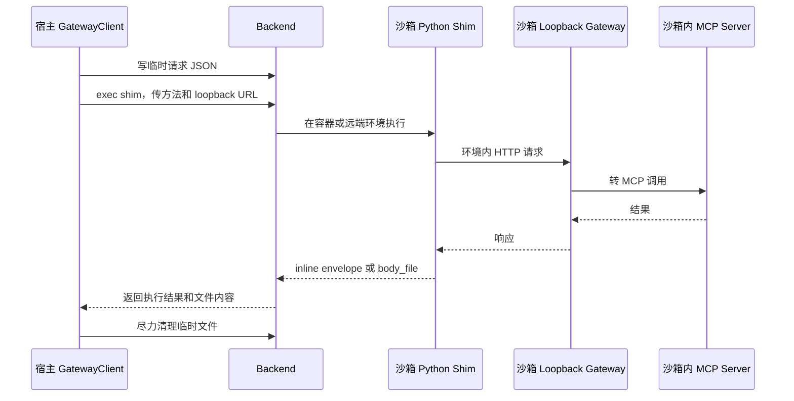
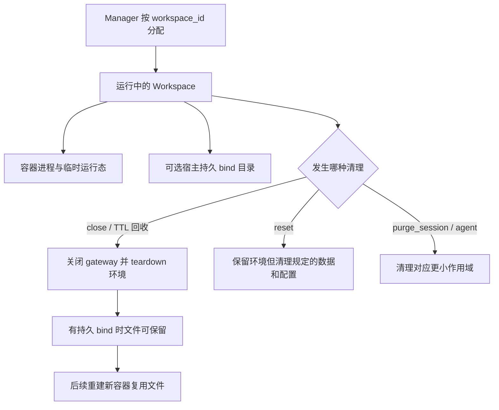
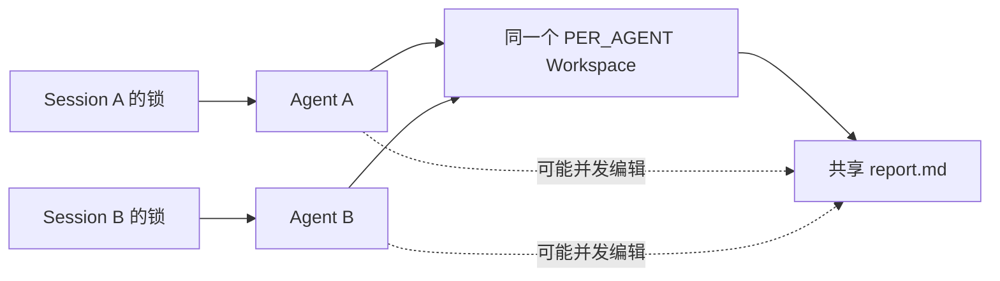

# Workspace：执行环境、资源与内容外置

核心是 `workspace/_base.py` 的 WorkspaceBase:261。它不只是文件夹：提供 backend、生命周期、工具、Skill、MCP 配置/实例与 offload。Backend 是实际文件/命令操作界面，Workspace 将资源组织成 Agent 可用能力；服务侧 workspace_manager 再管理应用生命周期。

## 生命周期和能力

initialize/close、async context manager、reset 管资源；list_tools 返回环境工具；list_mcps 按配置和作用域创建/复用连接；list_skills 管技能分区。相关方法在 _base.py:530、534、592、641、1240。目录中有 Local、Docker、K8s、E2B、Daytona、OpenSandbox、AppleContainer、Bubblewrap；各 backend 隔离和文件语义不同，仅有相同基类不代表相同安全承诺。

## offload_context 的真实数据流

`_base.py:1049` 将压缩前 msgs 放入 sessions/<session_id>/context.jsonl；先 deepcopy，避免把模型内存中的对象改成外部链接。递归遍历 DataBlock、ToolResultBlock.output、HintBlock.hint，把 base64 数据外置到 data/ 并换成 workspace:// URL，再序列化 JSONL。

关键原文（删节）：

```python
copied = deepcopy(msgs)
for msg in copied:
    if not isinstance(msg.content, str):
        msg.content = [await offload_block(b) for b in msg.content]
    lines.append(msg.model_dump_json())
existing = await backend.read_file(path)  # 缺失时用空 bytes
await backend.write_file(path, existing + payload.encode("utf-8"))
```

这里逻辑上是 append，但实现为读旧文件再整体写入。单 backend/路径的并发覆盖防护需要上层串行或 backend 保证，不能凭 JSONL 名称推断原子 append。大媒体外置让单行大小更可控，但并未让历史总文件无限增长没有代价。

## 与上下文和记忆的关系

压缩把历史变摘要，offload 保存可再读取的旧记录，两者一起避免“压缩即永久丢信息”。Markdown 长期记忆也可使用 workspace，但它保存筛选后的事实；context.jsonl 保存历史轨迹。tool result offload 和媒体 offload 各有方法（1130、1189），具体压缩/引用规则需继续展开。

## 资源管理要关注什么

MCP 有实例容量、按 session/agent purge、统一 close；Skill 有安装、archive、移除、布局迁移，说明环境不仅用一次就销毁。应用必须清理失效 session/agent 资源，不能只存 AgentState。本篇深读 offload_context，其他 backend、archive 路径校验和连接回收仍待单独审查。

## 1. 沙箱架构的真实层次

下面继续深拆执行环境，覆盖 Workspace、Backend、沙箱 gateway 与服务 WorkspaceManager。依据当前 2.0.12dev 静态源码，Docker 与共享模板已逐段核对；其它后端按实际阅读范围分别说明，没有运行沙箱或测试。

```text
Agent / Toolkit
  → Bash / Read / Write / Edit / Grep / Glob
    → BackendBase 三原语
      → Local subprocess / Docker API / 云沙箱 SDK / bwrap / K8s exec

WorkspaceBase
  → SandboxedWorkspaceBase（生命周期 + 沙箱内 MCP gateway）
    → DockerWorkspace / E2B / K8s / Daytona / OpenSandbox / ...

服务 WorkspaceManager
  → 分配 workspace_id、选择隔离粒度、缓存/预热/回收 Workspace
```

Backend 决定工具在哪执行，Workspace 组织环境资源和指令，Manager 管多个环境的归属与生命周期。PermissionEngine 决定一次动作是否允许，底层沙箱决定允许后进程能访问哪些实际资源；两层互补，不能相互替代。

## 2. 源码导航

| 实现 | 可点击位置 | 阅读目的 |
|---|---|---|
| Workspace 基类 | [WorkspaceBase](/D:/work/fanchen/projects/company/web/ai-agent-design/open/agentscope/src/agentscope/workspace/_base.py:261) | 工具、技能、MCP、offload 统一环境 |
| 后端协议 | [BackendBase](/D:/work/fanchen/projects/company/web/ai-agent-design/open/agentscope/src/agentscope/tool/_builtin/_backend.py:138) | 执行/读/写和派生文件操作 |
| 本地后端 | [LocalBackend](/D:/work/fanchen/projects/company/web/ai-agent-design/open/agentscope/src/agentscope/tool/_builtin/_backend.py:741) | 宿主执行，与容器区别 |
| 沙箱模板 | [SandboxedWorkspaceBase](/D:/work/fanchen/projects/company/web/ai-agent-design/open/agentscope/src/agentscope/workspace/_sandboxed_base.py:38) | 启停、bootstrap、gateway |
| Docker 环境 | [DockerWorkspace](/D:/work/fanchen/projects/company/web/ai-agent-design/open/agentscope/src/agentscope/workspace/_docker/_docker_workspace.py:42) | 镜像、容器、挂载 |
| Docker 后端 | [DockerBackend](/D:/work/fanchen/projects/company/web/ai-agent-design/open/agentscope/src/agentscope/workspace/_docker/_docker_backend.py:25) | exec/get_archive/put_archive |
| Docker 容器配置 | [_create_and_start_container](/D:/work/fanchen/projects/company/web/ai-agent-design/open/agentscope/src/agentscope/workspace/_docker/_docker_workspace.py:284) | 真实隔离/挂载参数 |
| 宿主 gateway facade | [GatewayClient](/D:/work/fanchen/projects/company/web/ai-agent-design/open/agentscope/src/agentscope/workspace/_gateway_client.py:447) | 通过 backend 发沙箱内请求 |
| gateway 请求传输 | [exec_request](/D:/work/fanchen/projects/company/web/ai-agent-design/open/agentscope/src/agentscope/workspace/_gateway_client.py:638) | 临时 JSON 文件、shim、响应传输 |
| 沙箱 MCP 代理 | [GatewayMCPClient](/D:/work/fanchen/projects/company/web/ai-agent-design/open/agentscope/src/agentscope/workspace/_gateway_client.py:173) | 与宿主直接 MCP 连接的区别 |
| Bubblewrap | [BubblewrapWorkspace](/D:/work/fanchen/projects/company/web/ai-agent-design/open/agentscope/src/agentscope/workspace/_bubblewrap/_bubblewrap_workspace.py:54) | Linux namespace 与共享网络声明 |
| Manager 协议 | [WorkspaceManagerBase](/D:/work/fanchen/projects/company/web/ai-agent-design/open/agentscope/src/agentscope/app/workspace_manager/_base.py:28) | workspace 分配与归属 |
| Docker Manager | [DockerWorkspaceManager](/D:/work/fanchen/projects/company/web/ai-agent-design/open/agentscope/src/agentscope/app/workspace_manager/_docker_workspace_manager.py:47) | 缓存、TTL、预热、路径边界 |

## 3. Workspace 不必然是隔离沙箱

LocalWorkspace 使用 LocalBackend，工作目录是宿主绝对路径；Windows list_tools 选择 PowerShell，其它平台 Bash。它统一工具文件环境和 offload，但不创建容器/namespace。路径权限仍依赖工具检查与宿主文件系统权限，不能把 workdir 字符串当 OS 级 chroot。

对外 API 可以同样叫 Workspace，因为它抽象的是“Agent 的工作环境”，不是一律承诺相同安全等级。换到 Docker 或云沙箱，工具代码多数不变，但运行边界改变。

## 4. BackendBase 三原语为何是关键抽象

核心接口为 exec_shell(argv,cwd,timeout)、read_file(path)、write_file(path,data)。大量 file_exists/list_dir/stat/delete_path 等派生操作可基于这些原语实现，避免每个远端后端重复写完整文件 SDK。

exec_shell 名字容易误解：DockerBackend 接收 argv，直接调用容器 exec，没有隐式 shell；需要重定向、管道才由调用者显式传 `["sh","-c",command]`。这让路径/数据传参可以避免不必要 shell quoting，但 Bash 工具本身当然仍要解释 shell 语法。

Backend 自带 join_path/normpath/isabs 等操作，远端 Linux 路径不能按宿主 Windows os.path 盲拼。Workspace 的 data/skills/sessions/gateway 路径应由 backend 处理，特别是跨平台部署。

## 5. SandboxedWorkspaceBase 是模板方法

子类提供 `_provision_backend`、`_teardown_backend`、`_bootstrap_commands`，以及 workdir/gateway_home/port。共享基类负责 MCP、目录、gateway、技能迁移/种子与 reset。

这减少 Docker/E2B/K8s 等路径的生命周期漂移：每个后端只实现环境创建与销毁，共用“环境中运行 MCP”的机制。但真正限制进程、网络、资源的参数仍属各子类/供应商，不能从继承关系推导相同安全承诺。

## 6. initialize 的精确顺序

[initialize](/D:/work/fanchen/projects/company/web/ai-agent-design/open/agentscope/src/agentscope/workspace/_sandboxed_base.py:177) 顺序为：

1. is_alive 则返回。
2. provision backend，并 assert backend 已绑定。
3. 从 .mcp 恢复声明。
4. 建 workspace layout。
5. bootstrap/启动 gateway 并 health 等待。
6. 迁移 Skill 布局、播种 Skill。
7. 最后置 is_alive=true。

这是完成标志，不是启动锁；并发 initialize 是否被外层 Manager 串行需另看。中途失败可能已创建容器/文件而 alive=false，调用方必须清理半启动资源。不能仅因为有 close 就声称 initialize 自身异常会自动回滚全部 provisioning。

## 7. gateway bootstrap 为什么把主脚本最后写

[_setup_mcp_gateway](/D:/work/fanchen/projects/company/web/ai-agent-design/open/agentscope/src/agentscope/workspace/_sandboxed_base.py:443) 用 gateway_script 是否存在作为 bootstrap 快路径；Docker 镜像通常已带 venv/script，云后端可首次执行 shell 安装依赖。

bootstrap 命令逐条 exec，检查 ExecResult.ok；失败带 stderr/stdout 抛 RuntimeError。先写 Glob helper，最后写 gateway_script，保证半途失败时主脚本仍缺失，下次能重试。它是简单完成标记，不是版本/完整性验证：脚本存在但依赖损坏/旧版本，需要其它机制处理。

## 8. gateway 重启、健康检测和诊断

先单独 exec pkill 清旧 gateway，再另一次 exec nohup 启动。注释解释若合并成一个命令，某些 provider 暴露整条 launch 命令给 pkill -f，会误杀自身。

GatewayClient health 轮询最大约30秒，退避0.1秒增长到1秒；失败读取 gateway log 最后2000 bytes 抛错。这样 startup 失败能看实际日志，而不只是“远程超时”。当前基类启动空 registry，不直接由 gateway 读 .mcp；会话首次 list_mcps 按需注册。Docker 模块早期说明仍有 gateway 读 .mcp 的旧描述，应以共享基类为准。

## 9. Docker 镜像缓存与实例生命周期

DockerWorkspace._provision_backend 创建 aiodocker client→构建/复用镜像→创建并启动容器。镜像 tag 由渲染 Dockerfile 与 COPY payload 内容 hash 得到；缓存命中跳过 build。环境依赖改动有机会产生新 tag，而不是反复安装到每个新容器。

这种 tag 缓存不自动等于供应链锁定：base image 若是可变 tag，外部包索引和镜像更新策略仍需单独管理。本篇只核对镜像缓存入口，未逐行审完构建上下文所有复制与依赖 pin 逻辑。

## 10. Docker 真实配置明确了什么

容器创建核心原文（删节）：

```python
config = {
    "Image": self._image_tag,
    "Cmd": ["sleep", "infinity"],
    "WorkingDir": CONTAINER_WORKDIR,
    "Labels": {...},
}
host_config = {}
if self.host_workdir is not None:
    host_config["Binds"] = [
        f"{os.path.abspath(self.host_workdir)}:{CONTAINER_WORKDIR}:rw",
    ]
config["HostConfig"] = host_config
```

当前这个方法没有显式配置 memory/cpu/pids limits、只读 rootfs、drop capabilities、禁网或非 root user；最终默认值还受镜像/daemon 控制。不能从“Docker sandbox”四字推断这些限制已经启用。

gateway port 不映射到宿主，调用经容器内 exec 的 loopback。Manager 某参数注释仍提随机 host port，当前 workspace 代码无 PortBindings，应以实现为准。host_workdir 是读写 bind，容器改该目录就是改宿主对应目录，这是持久性设计，也是应准确理解的边界。

## 11. 创建与恢复不是保留同一内存进程

容器名 as_ws_<workspace_id>，create_or_replace 后 start，backend 绑定正在运行容器。稳定 workspace_id 支持稳定槽位/目录映射，不保证之前 PID/内存/后台进程都恢复。

有 host_workdir 时 is_persistent=true，close 删除容器但 bind 目录可保留 .mcp、skills、sessions、data；没有 bind 则 ephemeral，删容器通常丢容器文件层。is_persistent 说的是文件保存能力，不是任意运行中任务的断点恢复。

## 12. DockerBackend 的命令调用与超时

exec 创建 Docker exec 对象，workdir 取参数或默认，stream.read_out 区分 stdout/stderr，读完再 inspect ExitCode，None 归 -1。输出先在 Python bytes 列表累计，最终合并，当前这层不是面向用户实时 streaming。

timeout 用 asyncio.wait_for 包 _run，超时返回 exit_code=-1、空 stdout、stderr='timed out'。此分支没有显式向容器进程发 kill；不能把“宿主 await 超时”当“沙箱内进程必然停止”。如果命令持续产生副作用，需更强的进程组/取消机制，具体是否被 Docker SDK/stream close 间接终止要运行验证。

stdout/stderr 默认全量累计也没有在此设置字节上限；Agent 最后的 tool_result_limit 是模型上下文限制，发生在输出已收集后，不是进程输出内存上限。

## 13. Docker 文件操作不走宿主路径直接 open

read_file 用 container.get_archive(path)，从 tar 中找普通文件读取；Docker 404 转 FileNotFoundError，finally 关闭 tar。这里没有把整个 tar 解包到宿主目录，避免把读取路径直接当宿主 archive extraction。

write_file 先计算容器路径 parent/name，exec mkdir -p parent，再构造单文件 tar，通过 put_archive 写容器。mkdir 使用 argv，不把文件名直接插 shell。写入不是应用级原子文件替换，失败可能留父目录或部分效果，具体归 Docker API。

## 14. 沙箱里的 MCP 为什么也要搬进去

如果工具本身是隔离的 Bash，但 MCP stdio 仍在宿主启动，它可以绕过沙箱访问宿主文件。SandboxedWorkspace 用 in-sandbox MCP gateway，将 MCP server 进程也放到对应执行环境，再由宿主 facade 访问。

Workspace 先恢复配置声明，再在 list_mcps 时按 agent/session 范围注册，GatewayMCPClient/GatewayMCPTool 对外保持类似 MCP 接口。宿主普通 MCPTool 可支持 progress stream，gateway 代理的具体结果/进度能力可能不同，不能假定全部透明等价。

## 15. GatewayClient 不是宿主直接 HTTP 连容器 IP

exec_request 把 body 写沙箱临时 JSON，执行沙箱 python shim 请求 `http://127.0.0.1:<port><path>`，shim 输出 JSON envelope；小结果 inline base64，大结果用沙箱 body_file 回传。临时请求/响应文件 best-effort 清理。

关键原文（删节）：

```python
result = await self.backend.exec_shell([
    "python3", "-c", SHIM_SCRIPT,
    method, f"http://127.0.0.1:{self.gateway_port}{path}",
    body_file, str(self.inline_limit), self.tmp_dir,
    (self.auth_token or "") if include_auth else "",
], timeout=self.timeout)
```

这统一容器、Pod、云 SDK 传输，不要求每种环境对宿主开放网络端口。代价是每个 gateway 操作有 exec/shim/文件开销，且传输 timeout 不必然取消远端 MCP 业务。

## 16. gateway 鉴权与网络隔离不是同一件事

gateway 服务绑定 loopback，可配置 bearer token；共享网络 namespace 的后端尤其需要防止宿主其它进程访问。health 请求不发 auth token，源码注释是避免端口竞争时泄漏 token 给非 gateway 进程。

token 只保护 gateway API，不会封锁执行代码访问其它网络服务。也不应将 env 里的 provider key、MCP key 暴露给所有任意 shell 任务而不理解同环境进程可读范围。注入什么凭证由宿主配置承担。

## 17. Bubblewrap 的实际 namespace 与挂载

BubblewrapBackend 构造 bwrap argv 含 --die-with-parent、--new-session、--unshare-all，挂 /proc、/dev，把 host_workdir 读写 bind 到 /workspace、host_tmp 到临时目录，部分目录 tmpfs、系统路径只读挂载，可另挂缓存。

若 share_net 为 true，追加 --share-net；当前 TCP gateway 架构的 Workspace 文档明确需要该模式，代码警告它不是网络沙箱，可达宿主 loopback、内部地址和云 metadata。不能因为 --unshare-all 在 argv 里就忽略后面的 --share-net 覆盖。

env 用 --clearenv 后按白名单设置，再 chdir/执行命令。这减少环境意外继承，不自动封锁显式传入的秘密。共享 package cache 是互信工作区的 opt-in，代码还检查缓存/工作目录重叠和 mount source 替换，完整 symlink/竞态防护需逐段专审。

## 18. K8s 与其它云后端应分开理解

K8sWorkspace 支持 namespace/image/resources/node_selector/tolerations/service_account/PVC/storage_class 等参数；close 是否删 PVC由 delete_pvc_on_close 控制，默认 false。资源隔离最终由 Pod spec、集群策略和 PVC 配置决定，namespace 名称本身不是网络策略。

E2B、Daytona、OpenSandbox、Apple Container 都有独立 workspace/backend；本轮只完成目录/接口定位，未逐行审完供应商 attach/resume/pause/kill 与凭证传输，因此不对它们作相同资源/网络保证。当前深读重点是共享模板、Docker、Bubblewrap 与 Manager。

## 19. close、reset、purge 分别删什么

Sandboxed.close 先 gateway.aclose，丢代理 instances/last-used，再 teardown backend，finally 清 backend/alive。Docker teardown kill+delete 容器、close aiodocker；Linux bind 文件可能先 chown 回宿主 uid/gid，避免容器 root 留下不可删文件。异常多为 best-effort 吞掉，不等于资源保证已成功移除。

reset 保留沙箱与 gateway，但清 .mcp、skills、sessions、data 并取消 MCP 注册。它比 close 更偏数据清理；default MCP 在下次配置时可重新播种，skill_paths 不一定自动重播。purge_session/purge_agent 则针对共享工作区内更小范围资源，不能把三个 API 互换使用。

## 20. 服务 Manager 决定环境共享范围

IsolationPolicy 有 PER_SESSION、PER_AGENT、PER_USER，默认 PER_AGENT。PER_SESSION 分配新环境，PER_AGENT/PER_USER 让相关会话共享；显式 workspace_id 可优先于策略。共享目录有利于长期记忆/项目文件，但同环境不同 session 可能并发写同文件，各自 session 锁不等于 workspace 全局锁。

WorkspaceManager 返回已初始化 workspace，ChatService 取一次并将其同时传工具装配、memory factory、Agent.offloader。这样 Read/Write、记忆文件和 offload 在同 backend，不会一部分写容器、一部分误写宿主。

## 21. Docker Manager 的路径保护与稳定身份

Manager._workdir_for 对 basedir/workspace_id realpath，要求目标严格在 root+os.sep 下；否则 ValueError，避免显式 workspace_id 把任意宿主目录读写挂进容器。保留旧 user/agent 布局兼容，新布局主要按 workspace_id，便于无 owner 时预热。

这保护 Manager 生成 bind 路径；直接构造 DockerWorkspace(host_workdir=...) 的调用者仍可指定其它目录，属于不同信任入口。不能把服务 Manager 的校验当所有构造路径默认都有。

## 22. 缓存、TTL 与预热不是持久化

DockerWorkspaceManager 缓存 workspace_id→(workspace,last_access_monotonic)，用 asyncio.Lock 协调本进程缓存；独立 sweeper 周期回收 idle，默认 ttl=3600s、sweep=300s；close_all 并行关闭；PrewarmMixin 可提前建可用环境。

TTL 回收释放运行资源，bind 数据可能仍保留；预热环境必须在分配前处理 owner/目录/技能/MCP 配置，避免上个使用者的数据泄漏。具体 warm pool 重新绑定和回收算法本篇尚未逐行分析，不宣称它已经满足所有多租户重新分配安全条件。

## 23. 工具权限、沙箱边界与资源限制对照

| 问题 | 谁主要负责 |
|---|---|
| 这次 Edit 是否批准 | PermissionEngine/工具权限/HITL |
| 进程运行在宿主还是容器 | Backend/Workspace |
| 能访问哪些挂载文件 | 容器/bwrap/云后端配置 |
| 可否访问公网/内网 | 网络 namespace/策略/供应商配置 |
| CPU/内存/PID 上限 | runtime/Pod/container resource 配置 |
| 超时后是否真正 kill | backend/工具进程管理 |
| 跨会话共享哪些文件 | WorkspaceManager isolation 与显式绑定 |
| 工作产物怎样下载/引用 | workspace URI 解析与服务鉴权 |

一个可审计系统要明确这些问题，不能用一个 sandbox 开关推导所有答案。

## 24. 端到端执行示例

服务会话配置 DockerWorkspaceManager→按 workspace_id 找持久目录/缓存或预热环境→Docker 镜像缓存与容器启动→恢复声明/建目录→gateway 健康→按需加载 MCP/Skill→get_toolkit 把 Backend 绑定给 Bash/Read/Write。

模型生成 Bash 调用→schema/PermissionEngine/HITL→Bash 通过 DockerBackend exec→结果返回 ToolResponse→过长正文外置在同容器 /workspace/sessions→模型看到路径并可再 Read。调用 MCP 时，宿主 gateway facade 通过容器内 shim HTTP 到 loopback gateway，实际 MCP 进程在环境内执行。

会话结束不必马上删环境，Manager 后续 TTL close；bind 内容可供下一次同 Agent session 复用。取消 Agent 不自动销毁整个 workspace，否则可能影响共享该环境的其它会话或长期文件。

## 25. 测试与静态分析边界

仓库有 tests/backend_docker_test.py、workspace_docker_test.py、workspace_docker_build_test.py、workspace_manager_docker_test.py、backend_bubblewrap_test.py、workspace_bubblewrap_test.py、workspace_skill_archive_test.py、workspace_prewarm_test.py，以及真实 Docker MCP e2e。它们分别适合追踪 backend I/O、启动、资源管理、技能归档与真实网关集成。

本轮没有运行这些测试，也没有构建镜像/启动容器；已确认的配置/超时/网络边界来自直接源码阅读。没有对容器逃逸、供应商安全、archive 所有恶意路径或完整多租户调度作安全审计结论。

## 图解深化：执行位置、网关传输与环境生命周期

### A. 权限与沙箱是串联的不同边界



权限放行不意味着容器一定禁网，容器存在也不代表业务动作已获授权。LocalWorkspace 不提供 chroot；Docker 的 rw bind 会把相应写入带回宿主目录。

### B. 初始化的完成标志在最后



is_alive 是完成状态，不是初始化锁；并发首次调用是否被 Manager 串行化应看外层。gateway 主脚本最后写入有利于失败重试，但脚本存在不是依赖版本完整性的证明。

### C. MCP 调用如何穿过沙箱边界



这不要求给宿主开放 Docker gateway 端口。也要注意超时只说明宿主等待超时，不证明 MCP 服务器的业务已取消。

### D. 持久文件与运行容器的生命周期



复用文件不等于恢复旧 PID、内存或后台进程。reset 比 close 更可能破坏应用数据，两者不能仅按名字互换。

### E. 会话锁不会锁住共享 workspace 文件



IsolationPolicy 默认 PER_AGENT 有利于跨会话项目和记忆复用，但两把 session 锁彼此独立。并发修改同一文件仍需要更细锁、隔离目录或变更合并策略。

### F. 超时应观察哪一个完成事实

| 信号 | 证明什么 | 不证明什么 |
|---|---|---|
| backend await 返回 timeout | 宿主停止等这一请求 | 容器进程已 kill |
| Agent reply 被取消 | Agent 已走中断清理 | 所有外部业务已回滚 |
| TTL close 完成 | 已尝试回收环境 | 持久 bind 数据删除 |
| gateway health 成功 | 控制端点可响应 | MCP 业务全部可用 |
| tool_result 截断 | 模型工作集受限 | 后端 stdout 内存收集受限 |

生产验证需要分别测量子进程、网络请求、容器、持久文件的生命周期。本轮没有启动容器或执行这些实验。
