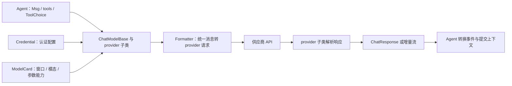
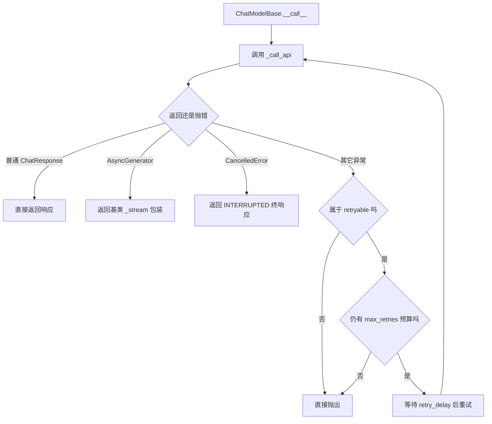
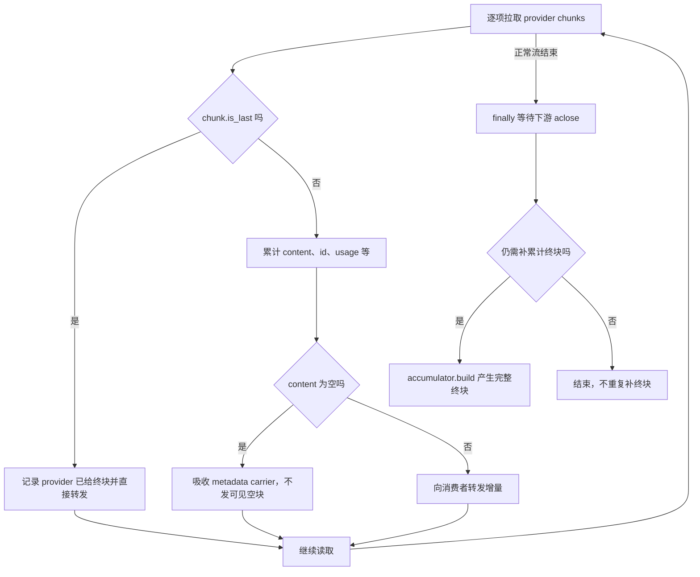
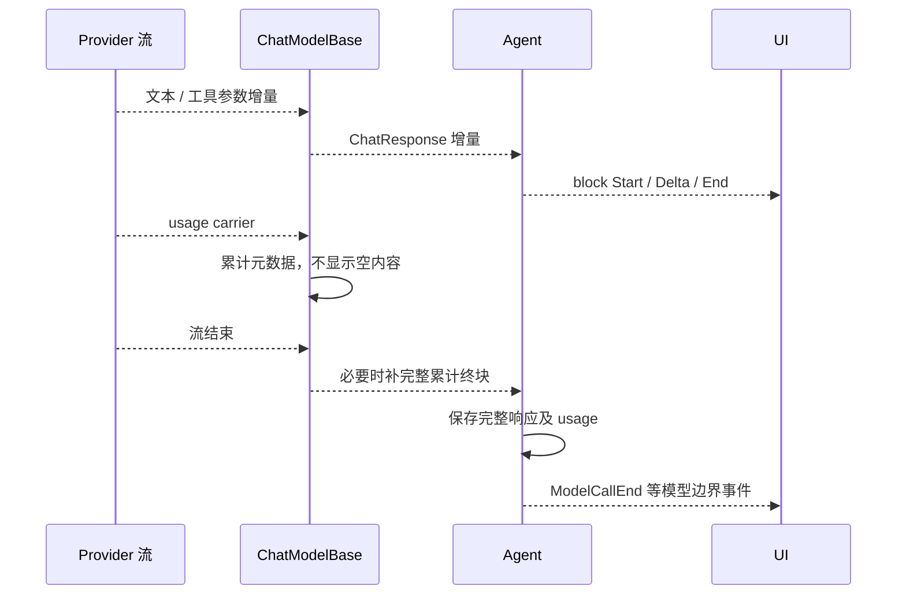
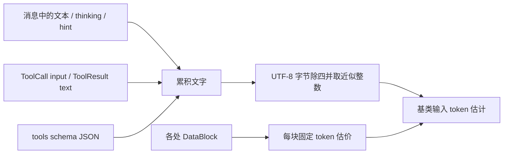
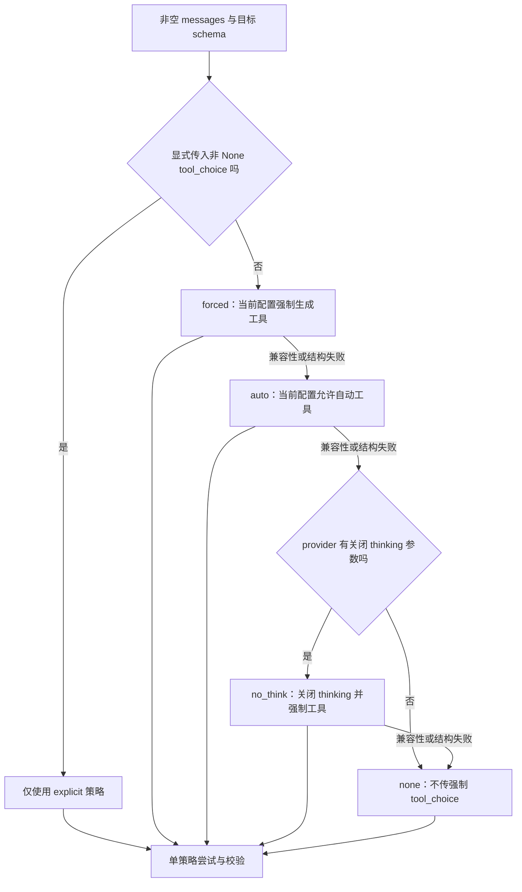
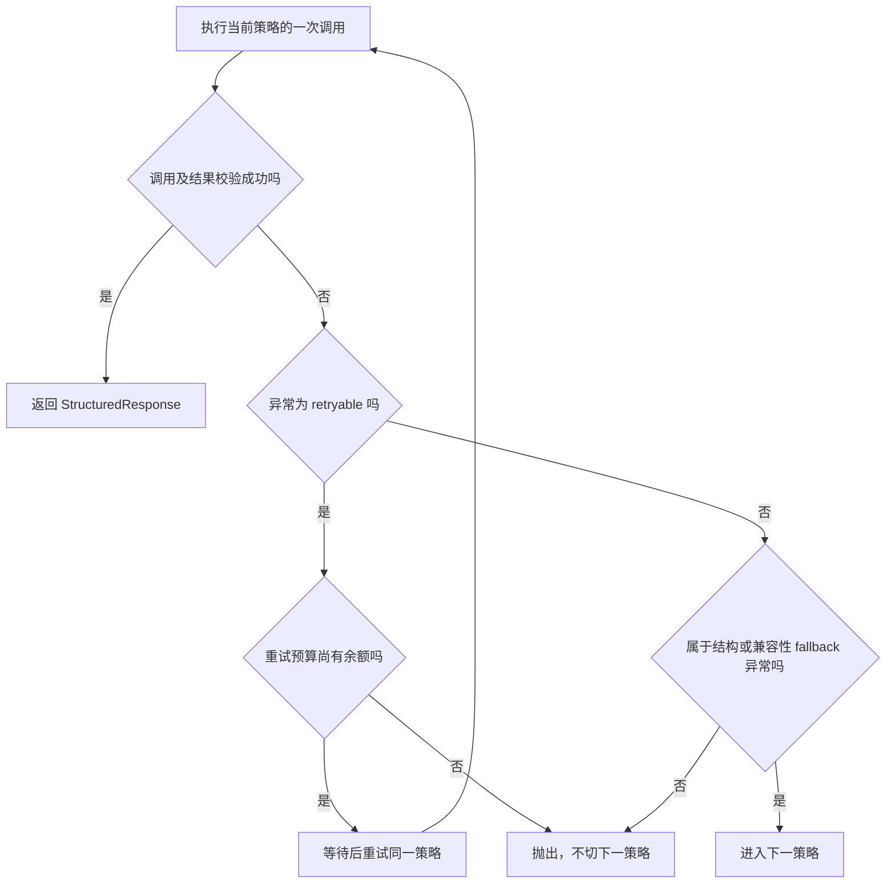
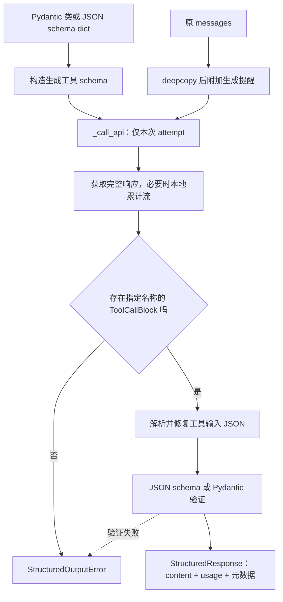

# 模型、Formatter、Credential 与流协议

源码 `model/_base.py` 的 ChatModelBase:37，入口 __call__:184、_call_api:303、count_tokens:379、generate_structured_output:467。贡献指南明确 provider 接入由 credential、model、model-card YAML、单用户/多 Agent formatter 四部分组成。

## 为什么需要分开

Agent 使用统一 Msg/ToolChoice/ChatResponse；Formatter 负责翻译 provider 消息结构，Credential 管认证，model card 管模态/上下文窗口/参数覆盖，model 负责 API 与响应转换。模型支持多模态不等于 Formatter 自动正确序列化所有块；新增 provider 必须核对整条链路。

## 两层重试

ChatModelBase.__call__ 调 _call_api，只有 _get_retryable_exceptions 命中的异常才消耗重试预算，次数 max_retries+1，重试之间 sleep(retry_delay)。Agent._call_model 在外面另有自己的 retry/fallback。因此真实请求次数可能叠乘，而不是只看一个配置。

CancelledError 在 model 层转换为 finished_reason=INTERRUPTED 的 ChatResponse，Agent reasoning 收到后再转取消清理。普通非重试异常直接抛出。

## 流式响应由谁累计

返回 async generator 后，基类 _stream 包装层用 _StreamAccumulator 收集增量；没有内容的 metadata-only carrier 吸收 id/usage，不直接发可见空块。provider 自己发 is_last 时不再额外补累计终块；否则流结束补 build()。取消时将累计结果标 INTERRUPTED；finally 显式 aclose 下游迭代器并等待释放。

原文关键结构：

```python
try:
    async for chunk in res:
        if not chunk.is_last:
            acc_res.append_chat_response(chunk)
        else:
            yield_acc_res = False
        # 实际实现还过滤空内容 carrier
        yield chunk
finally:
    aclose = getattr(res, "aclose", None)
    if aclose is not None:
        ...  # 调用并等待 cleanup
```

因此 Agent reasoning 的完整终块不仅来自 provider，也可能来自基类累计器。异步迭代期异常不位于获取 generator 的重试块里；不能承诺任意断流自动重试。

## count_tokens 和结构化输出

count_tokens 为上下文预算服务，必须把工具 schema 算进去。generate_structured_output 是独立方法，摘要和记忆文件选择直接用它；它与 Agent 最终结构化输出工具不是同一控制层。原生输出/工具 fallback 的完整 provider 分支还需继续核对，不能从一个方法名推断所有模型支持同一 JSON schema 子集。

## 源码深化：统一模型边界、流累计与结构化输出策略

本节直接对照本地 2.0.12dev 的 [ChatModelBase](../../open/agentscope/src/agentscope/model/_base.py)、[模型响应](../../open/agentscope/src/agentscope/model/_model_response.py)、[ModelCard](../../open/agentscope/src/agentscope/model/_model_card.py) 和 [FormatterBase](../../open/agentscope/src/agentscope/formatter/_formatter_base.py)。补全前文未展开的基类策略；provider 特有 API/参数仍应逐个审查，不能从基类推导全部供应商原生 JSON schema 能力。

### 1. 四个组件如何形成一次模型调用



Credential 不负责把 ToolResult 翻译成供应商角色；Formatter 不负责给业务动作授权；ModelCard 也不是一次真实请求已符合窗口的证明。新 provider 接入需要把这四部分一起闭合。

### 2. __call__：获取响应阶段的重试



这里的 try 包住 await _call_api，拿到生成器后才进入另一段消费逻辑。生成器迭代中途网络断开不能自动套用此获取阶段的重试循环。retry_delay 中的取消也不应被泛化为总能转换成一份完整累计响应。

Agent._call_model 外层还有 retry/fallback，具体 provider SDK 也可能重试。若某层最多 a 次、下一层 b 次，极端请求量可能接近 a*b，再计 SDK 策略；不能只用 max_retries 估系统 API 总次数。

### 3. 流式累计器如何产生最后一块



图中的循环是按 chunk 消费的概括。provider 如果已给 is_last，基类不重复发完整终块；若只给增量，基类结束时 build。中途 CancelledError 会把累计结果标 INTERRUPTED，安排补终块并清理下游。

metadata-only chunk 常用于尾部 usage，它不会因为不可见而丢弃账务信息。客户端如果只累计正文 delta，可能看不到 usage；Agent 应消费到模型边界的结束事件。

### 4. 两种累计不是同一层事件



ChatResponse、AgentEvent、最终 Msg 是三个层次。不能把 provider finish_reason 直接等同整次 Agent reply 的完成原因：模型可能只是要求调用工具。

### 5. ToolChoice 先校验名称，再映射供应商

_validate_tool_choice 检查 tools 子集中的名称存在于 schema 列表；mode 如果是具体工具名，也要在相应验证范围内。auto、none 等控制模式与指定名称是两类输入。

这个检查防止不存在工具名进入 provider 请求，但不能证明供应商支持每一种强制模式。某些 thinking 配置与 forced tool choice 不兼容，正是结构化输出策略降级存在的原因。

### 6. count_tokens 统计哪些东西

基类汇总 TextBlock、ThinkingBlock、HintBlock、工具输入、工具结果中的文本，追加 tools schema 的 JSON 文本；DataBlock 采用统一固定估价。文字按 UTF-8 字节除四近似，不是对最终 provider JSON 做精确 tokenizer。



图片 URL 不应该只按短路径估价，base64 也不按所有字符等价模型 token 计数。但固定块估价仍不区分真实分辨率、音频长度等成本；需要准确窗口控制时 provider 子类可以覆写。

### 7. generate_structured_output 的策略阶梯



阶梯切换针对 StructuredOutputError 和 provider 声明的 fallback exceptions。暂态异常不是换策略的理由：它会在同一策略重试，耗尽后抛出，不继续换四种参数反复打同一限流端点。显式 tool_choice 会绕过默认阶梯。

### 8. 单策略内如何区分重试和降级



CancelledError 不在这段 except Exception 内捕获，会按取消语义传播。这与普通 __call__ 中某些路径转换 INTERRUPTED 的行为不同，不应写成所有模型方法统一吞取消。

### 9. 基类默认结构化输出实际是工具协议

_call_api_with_structured_output 为 schema 构建 `generate_structured_output` 工具，deepcopy 输入消息并附加“调用生成工具”的提醒；一次 attempt 直接 _call_api，避免再套 __call__ 重试。



当前返回 content 是解析出的字典；Pydantic model_validate 用于校验，并不是把模型实例或其 model_dump 返回给调用者。类型转换或 validator 变换不应被想当然地视为已回写 content，需对照这里的返回值。

普通流 wrapper 有显式下游 aclose；结构化 helper 使用自己的一段流累计逻辑。不能因两处都使用 accumulator 就推导它们在提前 break、取消和清理上完全等价。

### 10. 两种“结构化输出”入口的差别

| 入口 | 控制者 | 常见用途 | 执行层次 |
|---|---|---|---|
| model.generate_structured_output | 直接模型 helper | 摘要、候选选择、RAG rerank | 内部生成工具与策略阶梯 |
| Agent 的最终结构化输出 | Agent Loop | 用户要求的最终交付对象 | ReplyContext 要求与终结决策 |

前者不自动走完整 Agent Loop，也不保证被主回复的 ModelCallEnd 预算统计。后者需要遵守 Agent grace iterations、权限/工具选择与结束事件协议，两者不能只因都返回 JSON 而混读。

### 11. provider 迁移时的具体验收面

| 验收 | 应观察 | 典型失败 |
|---|---|---|
| 文字流 | 增量、终块、usage | 可见空气泡、重复累计终块 |
| 工具流 | 稳定 call ID 与参数拼接 | 不同 call 结果串接 |
| 多模态 | Formatter 与 model card 支持一致 | 声称支持图片却丢失载荷 |
| 结构化 | 策略兼容、JSON 修复与验证 | thinking + forced 被供应商拒绝 |
| 重试 | 获取阶段与消费阶段分开 | 把所有断流当成可透明重试 |
| 取消 | 下游关闭与资源释放 | 仅停止上层消费、连接仍活跃 |
| fallback | 新模型窗口、schema 与能力 | 小模型收到按大窗口准备的请求 |

新增结论来自本地基类静态阅读。未调用真实 provider，也未证明所有 SDK、模型卡片或 formatter 的完整兼容性；专有 API 行为仍需针对实际模型做集成测试。
