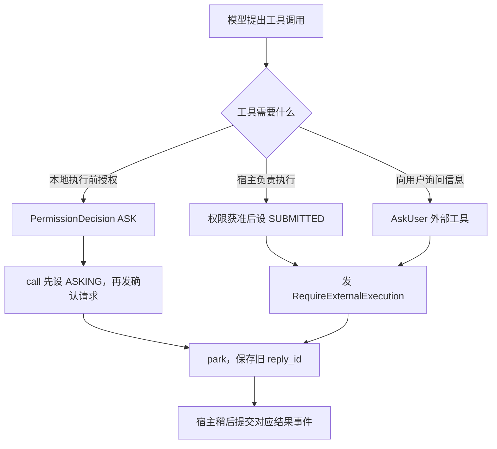
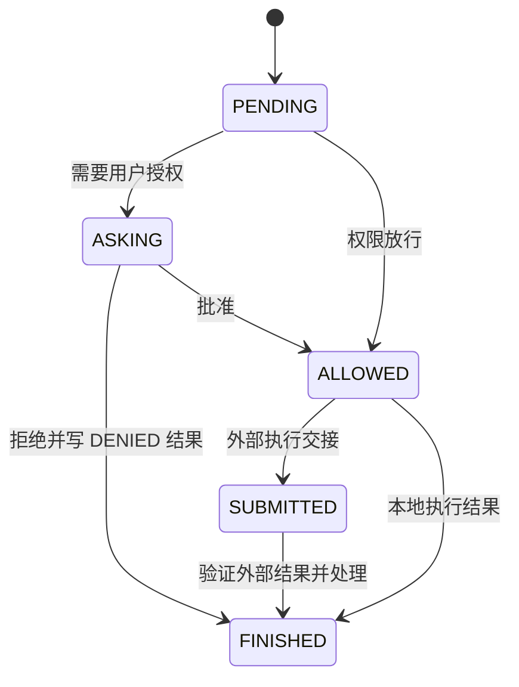
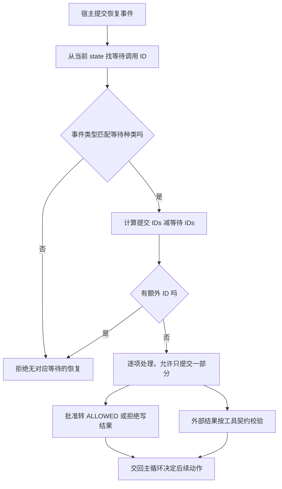
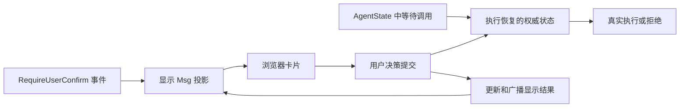
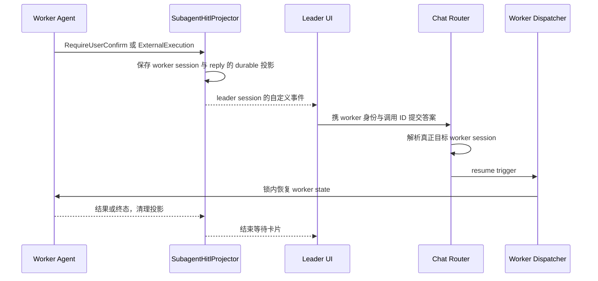

# HITL 深度源码解析：授权、询问、暂停、恢复与子 Agent 投影

本文分析当前本地 AgentScope 2.0.12dev 的 HITL 执行协议。范围涵盖内核、事件数据结构、AskUser、服务恢复与子 Agent 卡片投影；源码片段为原文或注明删节。没有运行应用或测试，权限安全和崩溃一致性判断均保留静态分析边界。

## 1. HITL 是持久状态协议，不是等待 input()

Agent 发出确认或外部执行事件后结束当前生成器调用，保存待处理工具块，下一次输入相应结果再继续原 reply。代码不靠一直挂起某个 Python Future 等人点击，所以服务可以保存状态、释放执行任务、等下一次触发重新装配 Agent。

这使等待与执行分离，但要求调用 ID、reply ID、权限规则、工具状态和结果协议都能正确恢复。仅在 UI 里加“确定/取消”按钮不能实现这些语义。

## 2. 三类人类参与行为

| 行为 | 请求事件 | 待处理状态 | 恢复事件 |
|---|---|---|---|
| 授权工具执行 | RequireUserConfirmEvent | ASKING | UserConfirmResultEvent |
| 回答问题/宿主执行工具 | RequireExternalExecutionEvent | SUBMITTED | ExternalExecutionResultEvent |
| 放弃等待任务 | UserInterruptEvent 作为输入 | 关闭 ASKING/SUBMITTED 等未完成调用 | 产生 INTERRUPTED result/end |

AskUser 属于第二行，它是“由人完成的外部工具”，无需先询问一次“是否允许向你提问”。授权与回答问题的返回值、结果校验完全不同。

## 3. 源码导航

| 实现 | 位置 |
|---|---|
| 确认请求 | [RequireUserConfirmEvent](/D:/work/fanchen/projects/company/web/ai-agent-design/open/agentscope/src/agentscope/event/_event.py:442) |
| 外部请求 | [RequireExternalExecutionEvent](/D:/work/fanchen/projects/company/web/ai-agent-design/open/agentscope/src/agentscope/event/_event.py:455) |
| 确认单项与批次 | [ConfirmResult / UserConfirmResultEvent](/D:/work/fanchen/projects/company/web/ai-agent-design/open/agentscope/src/agentscope/event/_event.py:468) |
| 等待中断 | [UserInterruptEvent](/D:/work/fanchen/projects/company/web/ai-agent-design/open/agentscope/src/agentscope/event/_event.py:495) |
| 外部结果 | [ExternalExecutionResultEvent](/D:/work/fanchen/projects/company/web/ai-agent-design/open/agentscope/src/agentscope/event/_event.py:520) |
| 授权并暂停 | [_execute_tool_call](/D:/work/fanchen/projects/company/web/ai-agent-design/open/agentscope/src/agentscope/agent/_agent.py:2452) |
| 恢复校验 | [_check_incoming_event](/D:/work/fanchen/projects/company/web/ai-agent-design/open/agentscope/src/agentscope/agent/_agent.py:1865) |
| 恢复应用 | [_handle_incoming_event](/D:/work/fanchen/projects/company/web/ai-agent-design/open/agentscope/src/agentscope/agent/_agent.py:1948) |
| 暂停决策 | [_next_action](/D:/work/fanchen/projects/company/web/ai-agent-design/open/agentscope/src/agentscope/agent/_agent.py:3590) |
| 取消补全 | [_close_unfinished_tool_calls](/D:/work/fanchen/projects/company/web/ai-agent-design/open/agentscope/src/agentscope/agent/_agent.py:981) |
| 结构化提问 | [AskUser](/D:/work/fanchen/projects/company/web/ai-agent-design/open/agentscope/src/agentscope/tool/_builtin/_ask_user.py:166) |
| 外部结果形状 | [ToolBase.check_external_result](/D:/work/fanchen/projects/company/web/ai-agent-design/open/agentscope/src/agentscope/tool/_base.py:273) |
| HTTP 恢复入口 | [chat](/D:/work/fanchen/projects/company/web/ai-agent-design/open/agentscope/src/agentscope/app/_router/_chat.py:414) |
| 服务恢复/持久化 | [ChatService._run_impl](/D:/work/fanchen/projects/company/web/ai-agent-design/open/agentscope/src/agentscope/app/_service/_chat.py:895) |
| 事件到消息投影 | [Msg.append_event](/D:/work/fanchen/projects/company/web/ai-agent-design/open/agentscope/src/agentscope/message/_base.py:247) |
| worker 卡片到 leader | [SubagentHitlProjector](/D:/work/fanchen/projects/company/web/ai-agent-design/open/agentscope/src/agentscope/app/_service/_projectors/_subagent_hitl.py:42) |
| 读取时校准旧卡 | [_worker_still_asking](/D:/work/fanchen/projects/company/web/ai-agent-design/open/agentscope/src/agentscope/app/_router/_session.py:777) |

## 4. 事件模型要求客户端返回什么

UserConfirmResultEvent 包含 reply_id 与 confirm_results:list[ConfirmResult]；ConfirmResult 包含 confirmed:bool、完整 ToolCallBlock、可选 rules:list[PermissionRule]。不是简单字符串 yes/no，也不只是 tool_call_id。

完整 ToolCallBlock 支持用户修改工具名称/参数；完整 PermissionRule 支持确认时创建接受的规则，而不只引用服务先前建议规则的下标。这个灵活性也要求宿主验证提交者身份及允许修改的范围，不能把任意客户端 JSON 自动视为可信人类授权。

ExternalExecutionResultEvent 包含 execution_results:list[ToolResultBlock]。结果自带 name、id、output、state、metadata，用原调用 ID 关联。metadata 是程序可验证的结构化返回，output 是给模型阅读的文字/多模态内容，两者不应相互替代。

## 5. 授权决策进入 HITL 之前已经做了什么

Agent 首先确认工具当前可用、JSON 修复解析、jsonschema.validate，然后调用 _check_permission。权限引擎的 ASK/PASSTHROUGH 才进入确认路径；参数错误直接生成 ERROR 工具结果，不先展示一个注定无法执行的确认。

safety ASK 的 bypass_immune 约束作用于 engine 规则求值，不是另一套前端确认类型；UI 最终仍消费 RequireUserConfirmEvent。BYPASS 模式可跳过工具 safety ASK，DONT_ASK 转 DENY，选择权限模式会改变是否走 HITL，不能当 UI 偏好。

## 6. 为什么先写 ASKING，再 yield 卡片

源码关键顺序（删节原文）：

```python
self._update_tool_call_state(tool_call.id, ToolCallState.ASKING)
tool_call.suggested_rules = decision.suggested_rules or []
yield RequireUserConfirmEvent(
    reply_id=self.state.reply_id,
    tool_calls=[tool_call],
)
return
```

异步生成器 yield 后由消费者决定是否继续。收到卡片就 break 的上层可能永远不再执行 yield 后的代码，因此等待状态必须先提交。否则下一次确认会遇到“not waiting for confirmation”。

_update_tool_call_state 直接更新 context 尾消息中的实际 ToolCallBlock，而不只修改可能来自浅拷贝的对象。数据位置正确是恢复判断的前提。

## 7. 外部工具多一个 SUBMITTED 阶段

ALLOW 后发 ToolResultStartEvent；若 tool.is_external_tool，再设 SUBMITTED、发 RequireExternalExecutionEvent、return。本地 _acting 不执行。SUBMITTED 表示执行权已交给宿主，不是工具已成功。

```text
PENDING → 参数/权限 → ALLOWED
                        ├─ 本地 I/O → FINISHED + result
                        └─ external → SUBMITTED → 外部 result → FINISHED
```

AskUser 的“答案”就是这个外部 result。宿主也可用同一机制让浏览器/远端设备执行本地内核无法直接调用的能力。

## 8. 主循环如何真正 park

_next_action 优先执行可运行调用，再检查 awaiting。没有当前可运行调用但仍有 ASKING/SUBMITTED 时返回 Exit(exit_events=None, exit_msg=等待说明)。_reply_impl 收到后 yield exit_msg 并 return，不发 ReplyEnd。

因此三件事分开：本次 Python 调用已返回、逻辑 reply 未完成、用户任务仍需行动。reply() 可能拿到等待 Msg；只依赖函数正常返回就记录任务成功是错误的服务集成方式。

## 9. 等待期间普通新输入不能自动冒充确认

_check_incoming_event 从 state 找 ASKING/SUBMITTED ID。等待中却 event=None 会 ValueError。传普通 Msg 进入该分支时也没有确认事件，不能自动覆盖 pending 调用继续模型。

服务因此将普通输入排进 FIFO，并在 parked 状态不强行 drain None；用户要么答卡片，要么中断旧任务，再处理普通新请求。Steering 是运行中推理边界引导，不等同同意权限。

## 10. 恢复验证只允许等待 ID 的子集

确认先验证确实有 ASKING，再做集合差：

```python
extra_ids = set(
    _.tool_call.id for _ in event.confirm_results
) - set(awaiting_confirmations)
if extra_ids:
    raise ValueError(...)
```

集合差为空就允许，包括只答一部分；不是要求一次回答全部。ExternalExecutionResultEvent 对 SUBMITTED ID 同理。重复提交已结束调用一般不再属于 awaiting，会被拒绝，不会当新操作再次执行。

这里没有单独显式比较 event.reply_id 与当前 state.reply_id；reply 路由/会话归属还依赖宿主。集合验证也不是端到端幂等事务：两个并发请求必须由服务 session lock 串行，否则检查和更新之间仍可能竞争。

## 11. 用户批准时修改哪些状态

_handle_incoming_event 把结果映射成 id→confirmation。对 confirmed=true 调用：更新原 call=ALLOWED，复制用户提交的新 name/input，逐条 engine.add_rule(confirmation.rules)。不在这里直接执行工具，而是交给主循环 Acting。

后续会重新进行工具可用性与 schema 校验。内建 _check_permission_impl 看到 ALLOWED 返回“already allowed by user confirmation”，但 on_check_permission middleware 仍运行。人工确认不跳过所有验证，也不保证工具名/参数修改符合产品策略；后者需提交端和宿主控制。

rules 是显式接受的可复用授权，与批准当前调用不同。State 中添加规则不等于自动更新所有 Agent/全部用户的系统级权限。跨会话规则保存取决服务 state/storage 设计。

## 12. 拒绝不是删除 call

confirmed=false 走 _handle_error_tool_call，给原调用 ID 写 DENIED ToolResultBlock并发结果事件，最终调用 FINISHED。模型下一轮可以解释拒绝并选择替代方案，而不是一直看到无结果 call。

当前 ReActConfig 有 stop_on_reject 字段，但本轮对 src 扫描只找到定义，没有找到执行读取。不能凭字段描述宣称设 true 就一定停止 loop；需要以真实调用路径或测试证明，当前静态证据不足。

## 13. 部分确认：谁能执行，谁继续等待

_next_action 有 awaiting 时仍允许 ALLOWED 调用执行，但不让普通 PENDING 调用抢跑。因此 A/B 都 ASKING，用户只批准 A，A 可执行，B 保持等待；A 完成后不会开始新 reasoning 猜 B 的结果。

cur_iter 只在没有 unfinished calls 后增加。一次部分确认/部分外部结果不重复赠送新预算，也不提前将工具轮结束。结构化输出要求保存在原 ReplyContext，恢复时新传 schema 不覆盖旧要求。

API 注释明确未答的卡不会每次自动重发，所以 UI 必须保留待处理项或从权威快照恢复，不能收到部分响应就清掉整批卡片。

## 14. 并发确认与规则去重

并发工具批共享 kept_rules。某工具发 ASK 时把 suggested_rules 累积，后续相同规则可覆盖的普通 ASK 留 PENDING 不再发重复卡。用户接受规则后恢复，PENDING 再进权限引擎；未保存广泛规则时仍可能再次询问。

safety ASK 不去重，因为普通 allow rule 不能替代危险操作当前确认。并发批已启动的其它工具仍继续，不会因为某个工具 ASK 就统一回滚。后续批次则等当前审批结束再推进。

## 15. 外部结果校验只约束成功形状

ToolBase.check_external_result 原文：

```python
if (
    self.metadata_schema is not None
    and result.state == ToolResultState.SUCCESS
):
    jsonschema.validate(result.metadata, self.metadata_schema)
```

SUCCESS 必须履行 metadata_schema；ERROR 等失败结果不被强制塞成功结构。校验失败抛异常，不记为完成，因此外部执行方可修正后再发。output 写“批准”却没有要求的 metadata，仍可被拒绝。

这只证明 schema 形状，不证明用户真的做了选择、答案与原 options 对应或业务审批有法律效力；这些属于可信宿主/业务验证。

## 16. AskUser 的问题与答案结构

AskUserParams 要求 1–4 个 questions，每题 2–4 options、header≤12字符，题目文字跨批唯一、option label 同题唯一。context 放需要用户审阅的草稿，preview 提供选项展示，multi_select 表达多选。

注意部分唯一性由 Pydantic after-validator 表达，不一定全部进入 JSON schema；Agent 执行入口 jsonschema.validate 不自动运行这些 Python validator。UI/服务构造对象和模型工具 schema 是不同验证路径，应按实际调用链确认，不应只看模型类就推断每次调用强制全部语义规则。

AskUserMetadata.answers 每项有 question、selected:list[str]、other。成功 result metadata 满足该形状，但基础 metadata schema 未把 selected 动态限定为本次题目 labels，也未强制“一题恰好一答案”。若程序据此执行重要分支，需额外把原请求和答案关联校验。

## 17. AskUser 为什么不再要求一次授权

工具 is_read_only=true、is_external_tool=true、is_concurrency_safe=true；check_permissions 返回 ALLOW，说明“不会先询问是否可以询问”。权限引擎前置 deny/ask 规则仍可覆盖，不能把工具自身 ALLOW 解释为跳过所有服务规则。

ALLOW 后直接发 RequireExternalExecutionEvent，UI 显示问题，答案用 ExternalExecutionResultEvent 回传。不要错误发送 UserConfirmResultEvent(confirmed=true)，那只说明批准工具，不包含实际业务答案，也不匹配 SUBMITTED 状态。

## 18. 库模式调用示意

以下为应用集成伪代码，不是直接可运行完整客户端：

```python
async for event in agent.reply_stream(user_msg):
    if isinstance(event, RequireUserConfirmEvent):
        persist_pending_card(event)
    elif isinstance(event, RequireExternalExecutionEvent):
        render_external_action_or_question(event)
    else:
        apply_event(event)

# 稍后，宿主鉴权并校验用户提交后：
answer = UserConfirmResultEvent(
    reply_id=old_reply_id,
    confirm_results=[ConfirmResult(confirmed=True, tool_call=original_call)],
)
async for event in agent.reply_stream(answer):
    apply_event(event)
```

无需在首次调用中 await 一个永不返回的人类 Future。跨进程使用时还需保存/重建 AgentState 与同样的工具/配置，不只是保存 old_reply_id。

## 19. 服务模式：恢复进入共享 trigger 队列

chat router 识别两类结果事件，先尝试从 leader projection 解析 worker 目标，再 enqueue_run_trigger(kind=RESUME)。dispatcher 在之前 run 彻底退出后调新 run，避免“卡刚出现用户马上点，旧 task 还在 finally”造成 registry 冲突。

ChatService 在 session lock 内读取最新 State 并装配 Agent。恢复路径读取已有 reply message，append_event(input_msg) 更新显示快照，再广播用户决策给其它标签页/渠道，让发起点击之外的观察者也清卡。

## 20. 合成 ReplyStart 保持同一回复身份

服务恢复会额外发布 ReplyStartEvent，reply_id 与原来相同。内核恢复并未创建全新 reply，但客户端需要知道有执行活动重新开始。

源码注释明确前端不能在收到同 reply_id 的 Start 时清空累计消息。正确动作是恢复该回复的活动指示，保留旧工具/文字/结果。把所有 Start 都当新 bubble 会让审批前内容消失或重复。

服务发决策广播/合成 Start 在内核真正消费恢复事件之前，因此观察到用户点击不等于工具成功执行；接下来仍可能 schema 校验失败、工具 ERROR 或取消。

## 21. Msg 投影与 AgentState 都需要更新

Msg.append_event(USER_CONFIRM_RESULT) 只对 ASKING call 转 ALLOWED/FINISHED，跳过中断后到达的 stale 结果，防止 UI 已取消又被旧确认重新点亮。AgentState 的 _handle_incoming_event 则负责真实执行状态与权限规则。

服务持久化的显示 Msg 和 Agent 内存上下文不是同一对象。只更新界面卡片不更新 AgentState，下一 run 仍会等确认；只更新 AgentState 不发布事件，其它客户端又会看到幽灵卡。状态、事件、持久快照必须按服务协议协调。

## 22. 子 Agent HITL：worker 是权威，leader 是镜像

SubagentHitlProjector 针对 session_record.team_id 找 team，若当前不是 leader，就将 RequireUserConfirm/RequireExternalExecution 映射到 leader 的 SessionProjection。payload 带 worker_session_id、worker_agent_id/name、reply_id、event_type、原 event。

entry key 为 worker_session_id:reply_id，投影无 TTL，真实审批可能等很久；ReplyEnd 或显式结果事件清理投影并发布 result 通知。不能按 agent_record.source 判断是否 worker，因为邀请来的普通 user-source Agent 也可能在团队中。

```text
worker AgentState(ASKING/SUBMITTED)  ← 权威
   → worker SSE/event
   → leader durable projection + live CustomEvent
   → leader UI 回答（携 worker reply_id）
   → chat router resolve → worker resume trigger
```

## 23. 投影键与部分确认的细节

投影 key 是每个 worker reply 一个 entry，不是每个 tool_call 一个 entry。单次并发批可能多次发卡，同 key upsert 会替换 payload；前端 live 事件和其聚合逻辑是否保留全部待处理工具，需要结合 UI/重放验证，不能从“有 durable entry”推导所有并发卡永久逐项保存。

投影删除操作幂等。卡最终消失不一定因“批准”，也可能工具拒绝、reply 取消/结束。客户端应按结果状态显示，不应把 projection delete 自己当业务审批通过。

## 24. SSE 读时修复幽灵卡

_worker_still_asking 重新读 worker session，检查尾 assistant Msg.id==reply_id，且有 ASKING/SUBMITTED call。worker 已结束/取消/会话消失的投影应删除或不重放。这是 reconcile-on-read，而非给卡设短 TTL。

该 helper 当前按状态检查，不逐项校验 result IDs，因此异常状态不一致的情形仍需结合保存路径审查。投影只是镜像，读取时回源是为了避免崩溃或跨进程清理失败留下永远待办。

## 25. 用户取消等待与取消运行是两条通道

UserInterruptEvent 面向 parked reply，_reply_impl 短路，不再模型推理。_close_unfinished_tool_calls 找无匹配 result 的调用，补 INTERRUPTED 工具结果，再发 ReplyEnd(INTERRUPTED) 与 fallback Msg。

运行中的 reply 则取消 underlying task，内核捕获 CancelledError；并发执行器取消 worker、回收队列事件，最后同样补未完成调用。外部 SUBMITTED 的服务端操作未必被 task.cancel 真正停止，应由 executor 另提供取消/幂等协议。

空闲状态收 UserInterruptEvent 是 no-op，不应伪造一条新的中断任务。配置 interruption_raise_cancelled_error 控制清理后是否重抛取消，不能因为有 fallback 事件就认为所有取消异常都被吞掉。

## 26. 取消后重复点击与幂等性

普通显示投影对 stale confirmation 有保护，内核也按当前 awaiting IDs 校验。服务的 session lock 将两个恢复请求串行，可避免同一 State 同时执行。后来的重复请求可能收到“不在等待”错误，而不是重复执行。

但数据库/bus 状态保存与外部工具副作用不是原子事务。工具成功后进程崩溃、结果尚未持久化时，下一恢复是否重做取决上层快照与工具幂等。授权只证明可以做，不证明执行 exactly-once。

## 27. 与迭代和预算 middleware 的协作

恢复不重建逻辑 ReplyContext，不重置 cur_iter；最后一个 unfinished call 结束才完成原工具轮。Budget middleware 计数放 middle_context，恢复没有新的内核 ReplyStart，因此不清预算；服务合成 Start 是对外广播，并非重新流过内核 on_reply 链创建新计数。

Router 在恢复时按旧 reply_id 找候选模型，finally 临时恢复原模型不丢路由名。结构化输出 requirement 也沿旧 reply_context 继续，用户批准后不能靠随意新 schema 改写交付协议。

## 28. 贯穿示例：问题、授权与部分结果

模型先调 AskUser 询问发布环境→SUBMITTED 并暂停→用户返回 metadata.answers 选择 staging→外部结果通过 shape 校验→模型并发发出 ReadReport 和 Deploy。

ReadReport 自动只读完成，Deploy ASKING；本轮仍有 unfinished 所以不计完。用户修改 Deploy 参数并只批准当前调用→重新校验可用性/schema→授权 middleware→执行部署→工具结果写回→模型总结→ReplyEnd。整个过程保持原 reply_id，可以经历多次服务 run。

若用户选择取消，不能只从页面移除卡；必须提交中断/拒绝协议，使 state 中调用闭合。若只关闭浏览器，服务通常仍保留 pending 状态，后续可重连继续。

## 29. 现有测试定位与证据边界

| 测试 | 覆盖意图 |
|---|---|
| [单次确认](/D:/work/fanchen/projects/company/web/ai-agent-design/open/agentscope/tests/hitl_user_confirmation_test.py:294) | 请求、暂停、恢复链 |
| [规则去重](/D:/work/fanchen/projects/company/web/ai-agent-design/open/agentscope/tests/hitl_user_confirmation_test.py:1316) | 并发 suggested rule |
| [部分确认不提前计数](/D:/work/fanchen/projects/company/web/ai-agent-design/open/agentscope/tests/hitl_user_confirmation_test.py:1763) | 工具轮只计一次 |
| [外部恢复预算](/D:/work/fanchen/projects/company/web/ai-agent-design/open/agentscope/tests/hitl_external_execution_test.py:1487) | 不能恢复刷新预算 |
| [混合确认与外部执行](/D:/work/fanchen/projects/company/web/ai-agent-design/open/agentscope/tests/hitl_mixed_test.py:932) | 两种等待共同存在 |
| [AskUser 成功 metadata 必须有效](/D:/work/fanchen/projects/company/web/ai-agent-design/open/agentscope/tests/ask_user_tool_test.py:102) | output 文字不能代替 schema |
| [失败结果无成功 metadata 要求](/D:/work/fanchen/projects/company/web/ai-agent-design/open/agentscope/tests/ask_user_tool_test.py:120) | ERROR 不需伪造答案 |
| [投影与发布](/D:/work/fanchen/projects/company/web/ai-agent-design/open/agentscope/tests/service_subagent_hitl_projector_test.py:150) | worker 到 leader |
| [reply end 清卡](/D:/work/fanchen/projects/company/web/ai-agent-design/open/agentscope/tests/service_subagent_hitl_projector_test.py:268) | 清理终态 |

本轮静态阅读相关实现并查看 AskUser 校验测试，未运行这些测试，也未逐行审阅前端 UI 全部处理。特别是并发卡片聚合、确认参数修改授权范围、事件先发布后内核消费的失败处理、跨系统崩溃恢复，需后续结合服务/客户端验证。

## 图解深化：人工参与是可恢复协议

### A. 三类人工参与的执行责任



确认是授权本地执行；external 是交接执行；AskUser 是借 external 协议获取答案。它们可共用暂停框架，但恢复结果的 schema 和执行责任不同。

### B. 工具调用状态与业务结果分开



这是主要路径概览，取消还会为无结果调用补 INTERRUPTED。FINISHED 只是调用闭合；SUCCESS/ERROR/DENIED/INTERRUPTED 等在结果状态中另行表达。

### C. 恢复事件只允许当前等待集合的子集



子集检查防止提交任意 call；session/reply 的路由和外部执行者身份仍需服务端鉴权。确认后允许修改参数的能力，也要求宿主控制修改范围。

### D. 显示镜像与执行权威是两份状态



卡片消失不代表工具成功；执行成功也不保证其它标签页已清理镜像。服务恢复会广播同 reply_id 的合成 Start，前端应恢复活动指示，不能清空旧气泡重新开始。

### E. 子 Agent 授权卡如何回到真正 worker



投影键按 worker_session_id:reply_id 聚合，不是一张卡一条独立永久记录。并发卡替换/聚合行为需同时看 UI；读取时回源 worker 检查能修复已结束却残留的幽灵卡。

### F. 取消和断线的三个不同动作

| 用户动作 | 主要作用 | 仍需处理 |
|---|---|---|
| 断开 SSE | 停止观察实时流 | 后台 run 可能继续 |
| 取消运行中 reply | 取消本地 task 并补中断结果 | 已发外部操作未必撤销 |
| 取消 parked reply | UserInterruptEvent 闭合等待调用 | 不再把旧确认当新批准 |

重复点击可以被状态验证拒绝，但“重复被拒绝”不是外部副作用 exactly-once 的证明。工具成功而快照未提交的崩溃窗口，仍需业务幂等键。

### G. 建议的恢复实验

分别在收到授权卡后关闭流、只确认多工具中的一项、取消后重发旧确认、换一个 API 副本提交恢复、leader UI 批准 worker 调用。观察同一个 reply_id 是否连续、工具 ID 是否配对、state 与显示投影是否同步。

本轮未执行这些实验；图解沿用当前源码已确认的分支，不能替代实际多副本故障验证。
