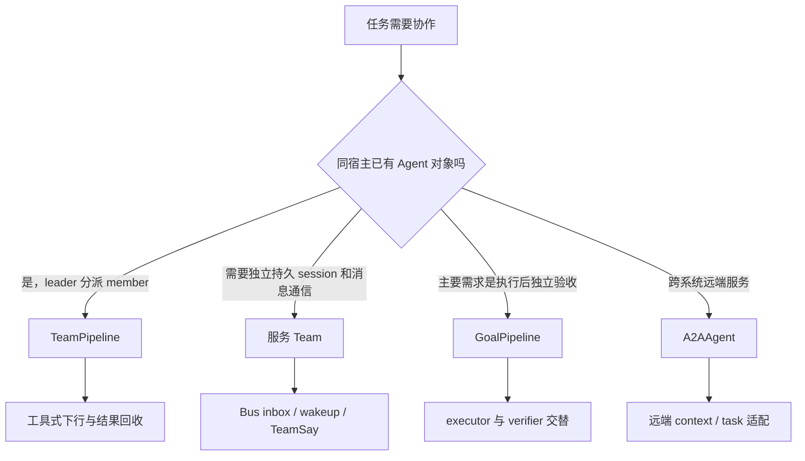
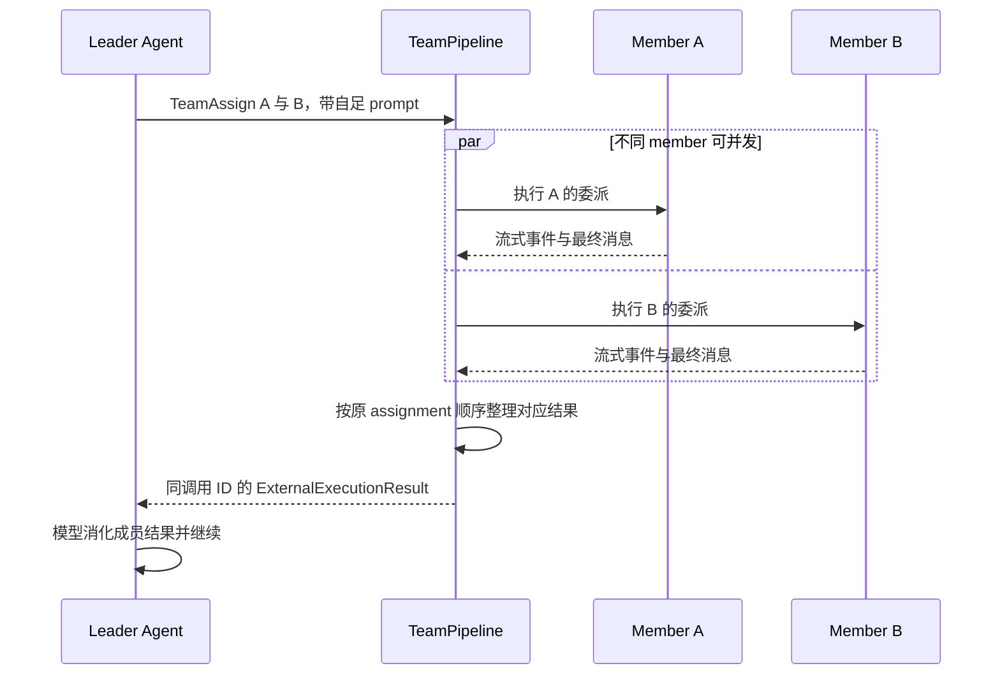
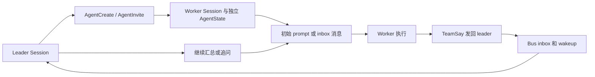
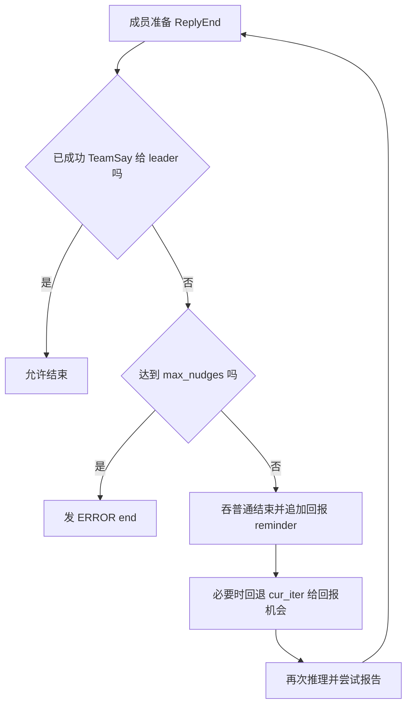
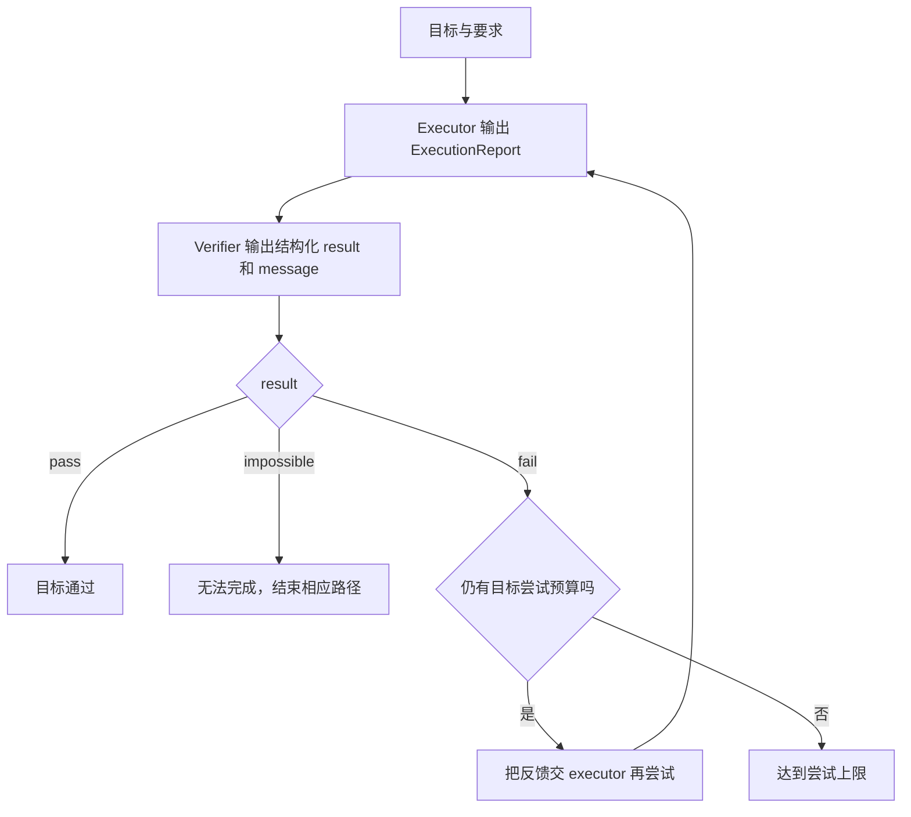
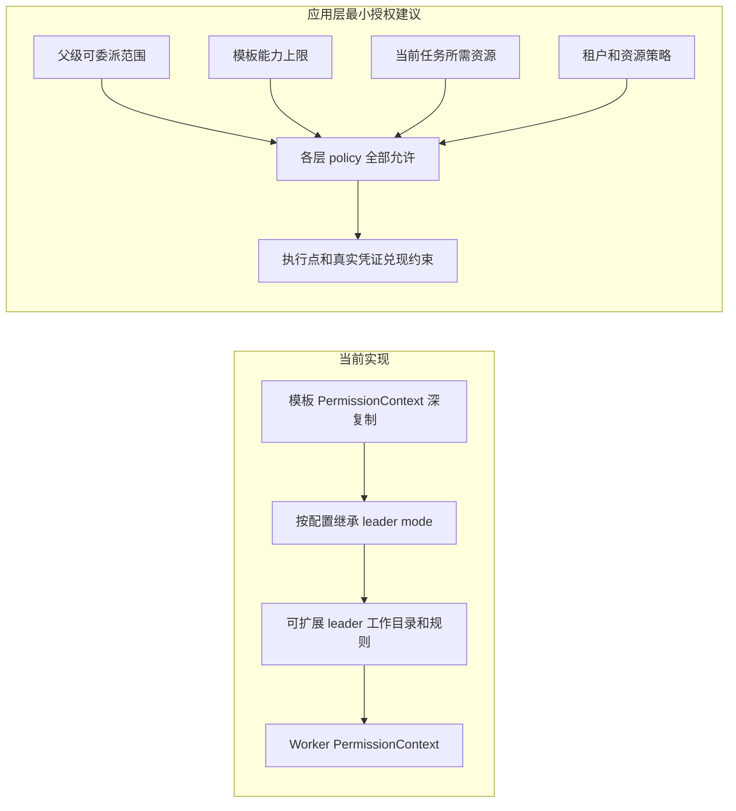

# 多 Agent 编排与通信契约：引入判断、源码机制与生产缺口

本篇按五个问题分析当前 AgentScope 2.0.12dev：何时需要多 Agent、如何分派和回收、委派权限如何收敛、循环与全局预算怎么控制、何时采用 A2A。明确区分当前代码、静态推导与建议补充，不将设计建议冒充框架已有实现。没有运行多 Agent 应用或测试。

## 1. 先给出与目标标准的差距

| 要求 | 当前源码证据 | 判断 |
|---|---|---|
| 真实瓶颈触发多 Agent | TeamCreate 描述提醒小任务自己做 | 有提示约束，未见基于观测指标的准入器 |
| 结构化下行/上行 | TeamAssign(member,prompt)、AgentCreate(prompt)、TeamSay(content,to) | 路由参数有 schema，任务/结果主体仍自由文本 |
| 权限交集继承 | _merge_leader_permissions 复制模板再扩 leader 规则/目录 | 是配置合并，不是任务级权限交集 |
| 全局熔断/重复 handoff | Agent max_iters、GoalPipeline 尝试上限、成员 max_nudges | 有局部限制；未在已读路径看到统一团队 ledger/hop 检测 |
| A2A 按远端边界引入 | 本地 Pipeline/服务 Team 独立于 A2AAgent | 有内部与远端两类机制，可按部署边界选择 |

源码有组织团队和执行能力，但不能直接等同完整的生产通信契约与全局治理。下面逐项对应实现。

## 2. 三种多 Agent 机制不要混读

**库级 TeamPipeline**：已有 leader/member Agent 对象，Pipeline 拦截 TeamAssign 外部工具，在同宿主调度成员，最终结果返回 leader 工具结果。成员之间不直接聊天。

**服务级 Team**：TeamCreate/AgentCreate/AgentInvite 建持久 team/session，TeamSay 借 bus inbox+wakeup 通信。成员可以定向联系/广播，服务装配 TeamMemberLoopMiddleware 保证回报。

**GoalPipeline**：executor 与 verifier 轮流运行，后者给 pass/fail/impossible；它是目标执行/验证回路，不能把它所有约束泛化到 Team。

远端 A2AAgent 是另一维度：它适配远程 Agent 的 context/task，不等于本地调度器天然使用 A2A。

## 3. 源码地图

| 入口 | 可点击源码 |
|---|---|
| Team 下行工具 | [_TeamAssign](/D:/work/fanchen/projects/company/web/ai-agent-design/open/agentscope/src/agentscope/pipeline/_team_pipeline.py:52) |
| Team 库级编排 | [TeamPipeline](/D:/work/fanchen/projects/company/web/ai-agent-design/open/agentscope/src/agentscope/pipeline/_team_pipeline.py:111) |
| 成员并发/串行调度 | [_run_assignments](/D:/work/fanchen/projects/company/web/ai-agent-design/open/agentscope/src/agentscope/pipeline/_team_pipeline.py:289) |
| 目标验证 | [GoalPipeline](/D:/work/fanchen/projects/company/web/ai-agent-design/open/agentscope/src/agentscope/pipeline/_goal_pipeline.py:55) |
| 结构化执行报告 | [_ExecutionReport](/D:/work/fanchen/projects/company/web/ai-agent-design/open/agentscope/src/agentscope/pipeline/_goal_pipeline.py:22) |
| 结构化验证结果 | [_VerificationResult](/D:/work/fanchen/projects/company/web/ai-agent-design/open/agentscope/src/agentscope/pipeline/_goal_pipeline.py:34) |
| 创建团队 | [TeamCreate](/D:/work/fanchen/projects/company/web/ai-agent-design/open/agentscope/src/agentscope/app/_tool/_team_create.py:28) |
| 创建成员/权限合并 | [_merge_leader_permissions](/D:/work/fanchen/projects/company/web/ai-agent-design/open/agentscope/src/agentscope/app/_tool/_agent_create.py:67) |
| 成员参数 | [_AgentCreateParams](/D:/work/fanchen/projects/company/web/ai-agent-design/open/agentscope/src/agentscope/app/_tool/_agent_create.py:115) |
| 通信 | [TeamSay](/D:/work/fanchen/projects/company/web/ai-agent-design/open/agentscope/src/agentscope/app/_tool/_team_say.py:98) |
| 强制回报 | [TeamMemberLoopMiddleware](/D:/work/fanchen/projects/company/web/ai-agent-design/open/agentscope/src/agentscope/app/middleware/_team_member_middleware.py:20) |
| 模板权限配置 | [SubAgentTemplate](/D:/work/fanchen/projects/company/web/ai-agent-design/open/agentscope/src/agentscope/app/_types.py:114) |
| 远端协议示例 | [A2A README](/D:/work/fanchen/projects/company/web/ai-agent-design/open/agentscope/examples/a2a/README.md:1) |

## 4. 引入阈值：先定位单 Agent 为什么失败

多 Agent 可能缓解三个不同问题。上下文瓶颈表现为输入长期接近窗口、压缩后丢关键细节、工具结果占满工作集；能力稀释表现为大量工具/技能让选错能力或参数错误变多；并行瓶颈表现为多个独立分支等待串行执行、关键路径过长。

不能只看 token 多就委派。先尝试组激活、RAG、工具返回裁剪、上下文压缩、直接并发独立工具、固定 workflow。若这些简单方案解决问题，引入成员的模型启动、上下文复制、汇总和治理成本未必值得。

建议记录单 Agent 基线：任务成功率、p95 耗时、每个成功任务 token/cost、压缩次数、失败工具/错误选工具比率、重复步骤、人工介入次数。指标阈值应由具体业务目标定，不存在统一的“80%窗口就必须上多 Agent”。

TeamCreate 的描述仅写“适合并行分解时用、小任务自己做”。这是对模型的提示，不是执行前 enforce 的准入策略。若业务需要自动限制，应在工具权限/创建服务前加观测驱动的决定与审计原因。

## 5. TeamPipeline：下行任务如何生成

_TeamAssign 是 external tool，is_concurrency_safe=true，schema 要求 member（候选 enum）与 prompt（string）。描述明确成员看不见 leader 上下文，prompt 要完整自足。

```python
"properties": {
    "member": {"type": "string", "enum": [m.agent.name for m in members]},
    "prompt": {"type": "string", ...},
},
"required": ["member", "prompt"]
```

其权限方法 ALLOW 的含义是委派动作自身允许，成员工具仍走成员权限。它不检查父权限是否允许成员将做的每个操作，也没有给 prompt 自动提取 constraints/success criteria/budget。

## 6. Pipeline 怎样并行、回收与暂停

TeamPipeline 校验成员名唯一且不同于 leader；首次 reply_stream 将 TeamAssign 加 leader Toolkit。leader 发外部调用后，Pipeline 找分派并运行成员，把最终 Msg 变成与 assignment call ID 配对的 ToolResultBlock，作为 ExternalExecutionResultEvent 回 leader。

同轮不同成员可并发；给同一个成员的多项任务按调用顺序串行，即使遇 HITL 也不能让后面任务抢占同一个 Agent 的上下文。事件用队列合流，结果最终按原 assignment 顺序整理，避免完成时间改变调用/结果对应关系。

成员审批按 reply_id 路由到对应参与者；leader 保持等待分派结果。默认 reset_members=true，leader 本轮结束后清成员上下文；同一轮可继续追问成员。复用状态有利于局部跟进，但跨轮是否保留必须明确配置。

## 7. Pipeline 结果状态不是严格成功证明

_RESULT_STATES 当前将 COMPLETED 和 EXCEED_MAX_ITERS 都映射 ToolResultState.SUCCESS；ERROR/INTERRUPTED 分别映射。成功工具状态因此可能只表示“成员返回了结果”，不能当业务验收通过。

leader 只接收成员最终回答，不接收全部中间步骤到自己的上下文，确实降低上下文污染；但若返回只有无证据摘要，leader 无法验证事实。应保留独立任务状态及证据引用，不只依赖外层工具 SUCCESS。

## 8. 服务 Team：创建即开始执行

AgentCreate 的 name/description/prompt 是模型填充字段；prompt 是初始任务，创建后立即投递，不需要再 TeamSay 重复发一次。TeamCreate 限当前 session 不重复加入/建立 team，记录 leader session 与成员 roster。

AgentCreate 根据模板创建 worker AgentRecord/SessionRecord，继承 leader 会话模型配置，并显式沿用 leader workspace_id。不同成员有独立上下文，但可能共享文件环境；上下文隔离不等于文件写隔离。多个 worker 改同一路径需要业务锁、分区目录或 patch 合并策略。

## 9. TeamSay 是可路由文本，不是结构化结果协议

_TeamSayParams 只有 content:string、to:string|None，默认广播给其他成员。运行时重新读 team 和 roster，解析显示名到 session/agent，避免只用创建时旧名单。邀请成员名字可带 agent ID 前缀避免冲突；未知接收者返回错误。

下层 deliver_to_inbox 送 HintBlock 与 wakeup，接收者通过 InboxMiddleware/dispatcher 进入推理。外层有结构化收件人，但 content 明确是自然语言。这不能满足“状态、摘要、证据、错误都必须经过 schema”的标准。

TeamSay is_read_only=true 表达它在权限模式中被当协作类操作，不表示它没有系统副作用：它会写 inbox、触发模型并产生费用。生产预算必须计入这类控制消息，不能只治理文件写工具。

## 10. 成员必须报告，如何实际强制

TeamMemberLoopMiddleware 检查最后一次工具调用是否成功 TeamSay 给 leader；未回报却 COMPLETED/EXCEED_MAX_ITERS，则吞 ReplyEnd，追加 reminder，让 Agent 再运行一次。默认 max_nudges=3，达到后发 ERROR end。

关键逻辑还把 cur_iter 降到 max_iters-1，让预算耗尽的成员有机会发送 TeamSay，否则会连续吞 end 却无进展。它是防止“没有报告就静默结束”的局部保护，不是全局工作步数严格上限。

nudges 计数在 on_reply 局部变量，不能当跨所有恢复/全团队累计的 ledger；HITL 与多次服务 run 的组合应继续核验。报告成功说明消息已交付，不证明内容满足业务标准。

## 11. GoalPipeline 的结构化协议能学到什么

执行者输出 _ExecutionReport(report:string)；验证者输出 _VerificationResult(result:pass|fail|impossible,message:string)。max_iters 默认10、max_retries 默认3，分别限制目标尝试和参与者生成有效结构化结果的重试。

_iters/_executor_retries/_verifier_retries 存在 Pipeline 对象上，HITL 恢复不重置；新输入才清计数。实例进程内保存不等于存储层耐久，跨进程重建 Pipeline 要显式保存这些预算。

这个结构已比“模型说完成”更可判断，但 report/message 仍是文本，缺少 evidence/error typed fields 和硬权限包。可用作契约设计的起点，不能宣称全部满足严格任务/结果包。

## 12. 权限继承：当前代码实际是扩展合并

_merge_leader_permissions 原文核心：

```python
merged = template.permission_context.model_copy(deep=True)
if not template.override_leader_mode:
    merged.mode = leader_context.mode
if template.extend_leader_working_directories:
    for path, wd in leader_context.working_directories.items():
        merged.working_directories.setdefault(path, wd.model_copy(deep=True))
if template.extend_leader_permission_rules:
    for attr in ("allow_rules", "deny_rules", "ask_rules"):
        ...  # leader rules append 到 template 的对应列表
```

内置 default template 继承 leader mode、扩展规则/工作目录。它复制对象避免父子状态互相修改，但不是最小授权交集：父级更宽的目录和 allow 规则会进入成员，任务本身也没有显式 required capabilities 输入。

## 13. “权限交集”应该按动作集合求，不是列表求交

建议有效权限定义为 `父级可委派权限 ∩ 模板能力上限 ∩ 当前任务所需范围 ∩ 租户/资源策略`，任一 deny 都拒绝。scope 应细到工具+动作+资源+数据范围+有效期，而不是只有工具名字。

规则列表含 glob/prefix/模式优先级，不能简单 set intersection：`/project/**` 与 `/project/docs/**` 的交集是后者；两个否定条件/ASK 策略也不能直接按字符串算。更可实现的方式是在执行点并行运行多层 policy，全部允许才允许，再为 worker 发只覆盖任务资源的凭证/能力令牌。

配置 override_leader_mode=true、关闭 extend flags 可以避免默认继承宽权限；但仅给模板一套固定规则仍不是任务级动态交集。要满足标准还需要 delegation policy 层，并防止 worker 用原 leader 凭证绕过收敛。

## 14. 推荐下行任务包（应用层建议，未在仓库实现）

```json
{
  "schema_version": "1",
  "root_run_id": "run-1",
  "task_id": "task-2",
  "parent_task_id": "task-1",
  "attempt": 1,
  "goal": "检查指定模块的权限实现",
  "inputs": [{"artifact_id": "source-snapshot", "version": "commit"}],
  "constraints": {"allowed_paths": ["src/auth/**"], "read_only": true},
  "success_criteria": ["每项结论附源码位置", "指出未核验分支"],
  "budget": {"max_steps": 20, "max_tokens": 12000, "deadline_at": "..."},
  "permission_scope_id": "scope-2",
  "output_schema": "WorkerResult/v1"
}
```

字段由 Supervisor/调度器构造并 schema 校验，worker 不能自行扩大 scope 或重置 deadline。附源文件/产物引用，避免把 parent 全部历史复制给所有成员；约束传递到实际工具执行策略，而不只留在 prompt。

## 15. 推荐上行结果包（应用层建议）

```json
{
  "task_id": "task-2",
  "attempt": 1,
  "status": "succeeded",
  "summary": "发现两处权限边界需要核验",
  "evidence": [{"artifact_id": "source-snapshot", "path": "src/auth/a.py", "line": 42}],
  "artifacts": [],
  "errors": [],
  "usage": {"steps": 12, "input_tokens": 7000, "output_tokens": 1000},
  "remaining_questions": []
}
```

status 应限定 succeeded/failed/blocked/cancelled/partial，errors 带 code/retryable/details；证据必须可解析到固定版本，不只写“我检查过”。Supervisor 验证 task/attempt、schema、scope 和成功标准，再聚合。允许摘要/说明为文本，但禁止仅靠无类型自由文本判断任务完成或触发后续写操作。

## 16. 调度、重试与聚合的契约

任务须有 root/parent/task/attempt 身份；重试增加 attempt，结果只接受当前有效 attempt，避免晚到旧 worker 结果覆盖新尝试。状态转移采用 compare-and-set/任务锁，工具副作用使用幂等键。超时不能默认无限重派。

聚合时显式列出必需分支/可选分支、失败策略、证据冲突处理和最后验证者。N 个成员返回 succeeded 不自动等于 root succeeded；共享文件冲突、缺失验收、部分结果都需要 Supervisor 判定。

## 17. 全局预算要覆盖整棵任务树

单 worker max_iters、单 reply BudgetMiddleware、GoalPipeline max_iters 都是局部预算；多个 worker 各50步仍可让团队耗费远超预期。建议 root ledger 同时维护 step/token/cost/elapsed deadline、active workers、delegation depth、handoff hops。

分派前原子预留子预算，执行中递增消费，结束归还未用部分；预留总额不可超过 root 剩余。超额/超时打开 root circuit breaker：停止新 spawn、取消在途任务、保存部分结果、关闭等待/投影并通知用户。后台工具、memory/router/verification 的模型成本也要计入，而非仅汇总主 Agent ModelCallEnd。

deadline 在子任务继承时取父 deadline 与子 deadline 较早者；HITL 暂停是否计入 wall time 应是明确策略，不能恢复后自动重置总时间。

## 18. 重复 handoff 检测需要观测状态进展

仅设 depth 上限不够：A→B→A 的循环可以不加深树。建议 fingerprint 包含 root、标准化目标、输入 artifact 版本、权限 scope、接收角色；记录 handoff 边和最近的结果/产物变化。

相同 fingerprint 多次移交且没有新 evidence、artifact version 或状态进展，才触发重复检测。不能只比较 prompt 文本，模型换句话仍可能同任务；也不能只比目标，输入版本改变后的合理重试需要允许。阈值随业务配置，并记录熔断原因供评估。

当前 TeamSay 的“不重复询问进度/不闲聊”主要是工具描述提示；TeamMemberLoop 的 max_nudges 防漏报空转，不是上述全局 handoff detector。已读源码搜索未见统一 hop ledger，不能因此证明仓库任何角落绝对没有类似能力。

## 19. A2A 的边界：协议不创造委派价值

A2AAgent 不继承本地 Agent，不拥有本地 model/toolkit/ReAct loop；它维护远端 context_id/task_id，把 JSON-RPC/SSE 产物映射内部事件。适合团队/厂商/部署边界独立且确有委托关系时连接；同进程成员可直接 TeamPipeline，内部服务团队已有 bus/任务契约时也不必额外套 A2A。

采用 A2A 多了网络故障、鉴权、数据出域、协议版本、任务幂等与取消传播边界。Agent Card 只能描述能力，不能替代资源授权/可信身份，返回内容也不是自动可信事实。

当前示例说明 INPUT_REQUIRED/AUTH_REQUIRED 在本地当前 reply 映射 COMPLETED，保留远端 task_id，下一消息再继续；与本地 parked 不发 ReplyEnd 不同。structured-data parts/部分内部块也不支持，不能假设本地 WorkerResult JSON 会无损自动穿过适配层。

## 20. 工具密集长任务的合理例子

用户要审查三个互不依赖模块：先验证单 Agent 时间/上下文问题，再拆三个 read-only worker，固定代码版本和路径 scope，每个只产结构化证据包；Supervisor 保留需求和全局约束，不把所有工具轨迹塞回主上下文。

每个 worker 获得局部预算，root 统一 ledger；一个 blocked 不无限相互委派，明确失败原因和剩余证据；最后由 verifier 对照关键源码抽查。涉及写入则分配不重叠文件或统一合并 patches。外部厂商专用审计 Agent 只有在其能力确实必要时再通过 A2A 委托。

## 21. 学习与验收顺序

先读 TeamAssign→TeamPipeline._run_assignments 的调度；再读 AgentCreate→_merge_leader_permissions→SessionRecord 的身份/权限；接着 TeamSay→inbox/wakeup→成员回报 middleware；最后对照 GoalPipeline 验证机制和 A2A 远端状态。

验收应覆盖：成员失败/超时/被取消、部分结果、重复结果、HITL 恢复、scope 越权、共享文件冲突、重复 handoff、root budget 耗尽。比较单 Agent、固定 workflow 和多 Agent 在同任务集的成功率/成本/时延，只有观测证明收益才扩大使用。

本篇没有修改运行代码实现上述建议，只将源码现状与所需设计清晰分开。通信 schema、权限交集和全局 ledger 是接下来构建生产编排时需补足的重点。

## 图解深化：委派、回报、验收与团队边界

### A. 先按运行边界选机制



选项表达适合的入口，不是严格互斥产品组合。不要为了显示多个角色就引入远端协议，也不要把库级 Pipeline 的进程内状态当服务持久化团队。

### B. TeamPipeline 的下行与返回



同一 member 多项任务按顺序执行，不能用两个并发委派抢同一个 Agent 状态。只回收最终消息减少 leader 上下文占用，但也要求结果包含足够证据供判断。

### C. 服务 Team 是消息与独立会话协作



AgentCreate 的 prompt 已作为初始任务投递，不需要再重复发一次相同 TeamSay。owner 字段只是 Task 记账，不能替代上述真实消息交付。

### D. 成员回报保护怎样续跑



这里强制的是回报行为，不是回报内容正确。max_nudges 也不是跨团队、跨恢复的全局步数账本。

### E. GoalPipeline 的独立验收回路



有效结构化结果的重试与目标重做是两套计数。计数保存在 Pipeline 实例，不天然耐久；report/message 仍是自由文本，没有自动变成带证据、错误类型与资源范围的严格协议。

### F. 当前权限合并与建议交集分别画开



规则列表存在 glob、prefix、deny 与 ask 语义，建议交集不是字符串 set intersection。当前模板开关可以减少继承，但不等于框架已经按每次任务自动收敛真实凭证。

### G. 一个委派结果应怎样验收

| 层面 | 当前能观察什么 | 建议额外保存什么 |
|---|---|---|
| 调度 | 工具/消息是否返回 | task_id、attempt、deadline |
| 权限 | 使用的规则与目录 | 委派 scope 和策略版本 |
| 成果 | 成员最终文本 | 文件引用、测试、证据与未决项 |
| 结束 | COMPLETED 或次数耗尽等状态 | 独立业务验收结论 |
| 成本 | 各成员 usage 的局部信息 | root task 全树预算与归因 |

工具 SUCCESS 不自动等于任务验收通过，特别是次数耗尽结果可能也被封装为成功返回。本文新增图示未运行团队或 A2A 测试。
