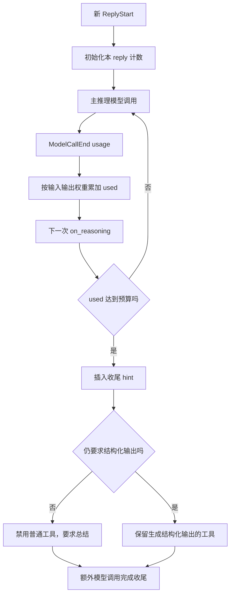
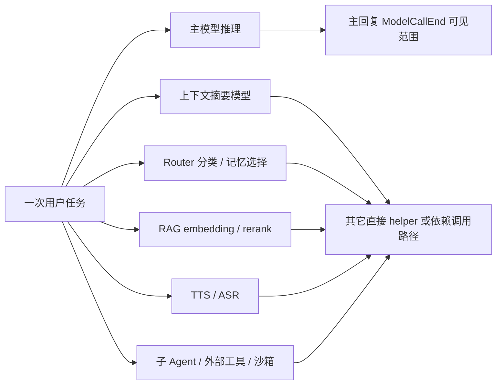
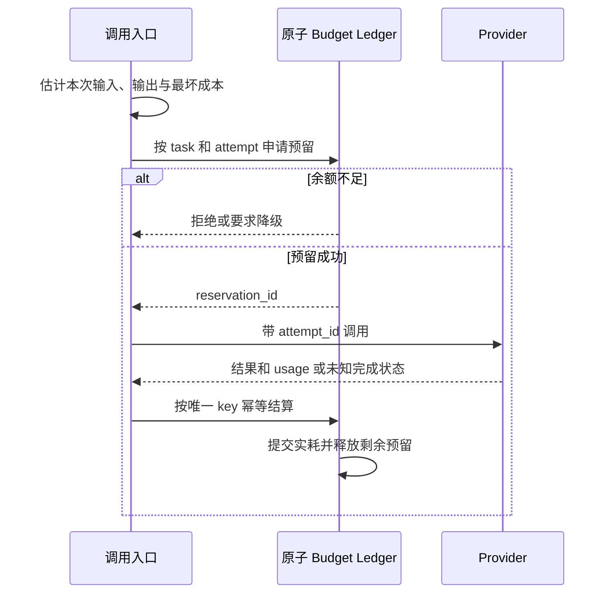
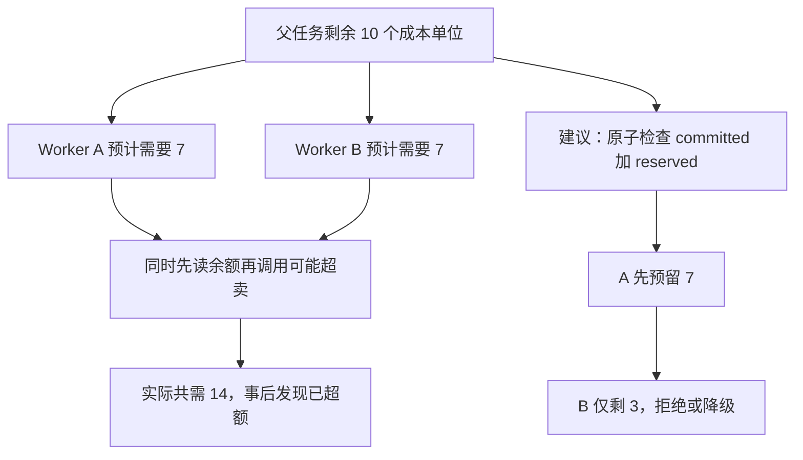
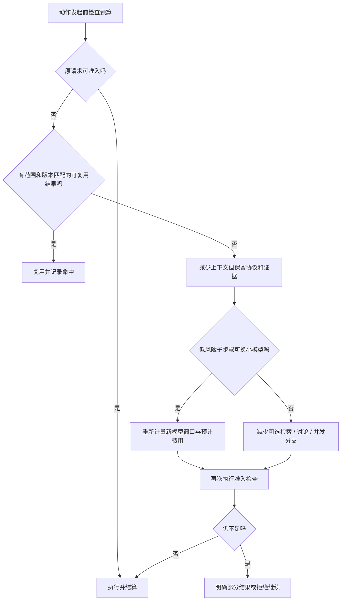
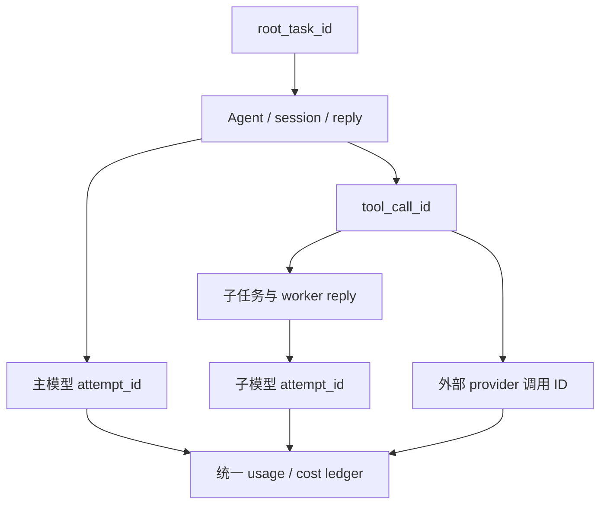

# 成本管理源码分析：入口归因、预算闸门与有序降级

本篇对照三个要求审视 AgentScope 2.0.12dev：调用发生前确定归因并透传，先复用/压缩再考虑低风险模型降级，执行前控制单次和全任务上限。已实现行为、静态判断和应用层补充设计分别标明。没有运行模型/测试，也未查询实时模型价格。

## 1. 当前能力与完整成本治理的距离

| 要求 | 已读源码可见能力 | 边界 |
|---|---|---|
| Token 可观测 | ChatUsage/Msg.Usage/ModelCallEnd/Tracing | 不等于金额账本或全部调用归因 |
| 缓存统计 | cache_input_tokens、cache_creation_input_tokens | 不等于统一业务结果缓存 |
| 上下文优化 | count_tokens、压缩、工具结果裁剪、offload | 估计预算；扩展注入后可能再次增长 |
| 模型选择 | ModelRouterMiddleware、fallback | 未表达完整有序降级/步骤风险闸门 |
| 迭代限制 | ReActConfig.max_iters | 普通模式有额外总结，结构化另有 grace |
| reply 预算 | ReplyBudgetControlMiddleware | 事后累计，下一轮收尾，非调用前金额硬限 |
| 归因 | session/reply/tool IDs 与 trace 属性 | 未在已读入口形成 tenant/feature/root task 全链条 |
| 团队总预算 | 局部 Agent/GoalPipeline 限制 | 已读路径未见统一 root ledger/原子预留 |

因此可以说“有若干成本控制基础件”，不能直接称已有满足这些要求的完整成本平台。

## 2. 具体源码位置

| 位置 | 对应内容 |
|---|---|
| [ChatRequest](/D:/work/fanchen/projects/company/web/ai-agent-design/open/agentscope/src/agentscope/app/_router/_schema/_chat.py:14) | 当前入口主要 agent_id/session_id/input |
| [ChatService.run](/D:/work/fanchen/projects/company/web/ai-agent-design/open/agentscope/src/agentscope/app/_service/_chat.py:292) | 运行入口拿 user/session/agent，但未构成完整成本上下文 |
| [Tracing 公共属性](/D:/work/fanchen/projects/company/web/ai-agent-design/open/agentscope/src/agentscope/middleware/_tracing/_extractor.py:52) | 主要 conversation_id=session_id |
| [Tracing 属性枚举](/D:/work/fanchen/projects/company/web/ai-agent-design/open/agentscope/src/agentscope/middleware/_tracing/_attributes.py:9) | provider/model/input/output/cache/reply/tool IDs |
| [响应 usage 提取](/D:/work/fanchen/projects/company/web/ai-agent-design/open/agentscope/src/agentscope/middleware/_tracing/_extractor.py:363) | 从完成响应取实际 token |
| [预算中间件](/D:/work/fanchen/projects/company/web/ai-agent-design/open/agentscope/src/agentscope/middleware/_budget.py:66) | reply 加权 token 计数与收尾 |
| [ReActConfig](/D:/work/fanchen/projects/company/web/ai-agent-design/open/agentscope/src/agentscope/agent/_config.py:362) | max_iters、结构化 grace |
| [模型路由](/D:/work/fanchen/projects/company/web/ai-agent-design/open/agentscope/src/agentscope/middleware/_model_router.py:37) | 依据输入分类选候选模型 |
| [Agent 模型重试/fallback](/D:/work/fanchen/projects/company/web/ai-agent-design/open/agentscope/src/agentscope/agent/_agent.py:3369) | 每模型 attempt 与候选切换 |
| [provider 基类调用](/D:/work/fanchen/projects/company/web/ai-agent-design/open/agentscope/src/agentscope/model/_base.py:184) | 内层重试、流累计与取消 |
| [token 估计](/D:/work/fanchen/projects/company/web/ai-agent-design/open/agentscope/src/agentscope/model/_base.py:379) | 字节估计/多模态平估，子类可覆盖 |
| [ModelCard](/D:/work/fanchen/projects/company/web/ai-agent-design/open/agentscope/src/agentscope/model/_model_card.py:11) | context/output 大小与参数 schema |
| [Msg usage 累计](/D:/work/fanchen/projects/company/web/ai-agent-design/open/agentscope/src/agentscope/message/_base.py:564) | 多轮 usage 聚合 |

## 3. Token 归因必须在调用前具有稳定身份

建议服务鉴权后构造可信 CostContext：tenant_id、feature、root_task_id、task_id、attempt_id、parent_task_id、session_id、reply_id、step_kind、budget_scope_id。tenant 由身份/组织解析，feature 由路由/业务入口给定，不让模型或客户端任意替换计费归属。

reply_id 在进入内核后才生成时，根任务身份仍应更早建立；把 reply 挂到 root task，而不是反过来等 reply 结束才猜任务。HITL 延续原 task，子 Agent 产生 child task，但保留 root/tenant/feature。重试增加 attempt，不能产生一个全新 root 逃避预算。

事后如果保存了可靠不可变映射，可做校正/补关联；但没有事前身份和完整映射，就无法可靠区分共享 session 的多个功能、后台成本和重试。不能把“有 session_id”直接当业务归因完整。

## 4. 当前 tracing 的身份字段不足以独立做账

_get_common_attributes 当前原文：

```python
return {
    SpanAttributes.GEN_AI_CONVERSATION_ID:
        session_id if session_id else "[no_session_id]",
}
```

其它函数会补 model/provider/agent/reply/tool 信息，但公共上下文没有在这里统一加入 tenant/feature/root task。框架有用户与资源访问概念，不代表这些维度已经进入每个 span/成本事件。

OTel span 还可能采样或导出失败，不能把 tracing backend 当唯一财务账本。归因应进入可靠 usage event/ledger，tracing 用同 ID 关联排查；丢 trace 不应变成调用不计费。

## 5. 归因透传不能只靠 ContextVar

同 asyncio task 的上下文变量可简化模型/工具标签，但入队、跨进程、MCP、A2A、后台线程和长期任务都需要显式序列化传播。Mem0 的专用 bridge loop/thread 不会因为主 Agent 有某变量就自动满足业务归因。

建议链路为：HTTP/渠道/调度入口→queue envelope→dispatcher→ChatService→Agent/model/tool wrapper→后台/子 Agent/远端请求→usage event。必须验证缺少归因时如何处理：受控拒绝或进入明确 unallocated 账目并报警，不能静默丢维度。

传到工具不一定要把 tenant/token 等标签暴露给模型参数；宿主执行上下文或受信 header 可携带。共享敏感 metadata 时还应按远端协议筛选，账务标签不等于用户私密资料可以全部外发。

## 6. 一次调用应有预估、预留、实际结算三阶段

```text
admit(context, limits)
 → estimate(request/model/tool)
 → reserve(root/task/tenant budget)
 → invoke(attempt_id)
 → settle(actual usage/provider receipt)
 → release unused reservation
```

先预留可避免多个并发 worker 同时看到剩余足够而各自超卖；实际 usage 到达后按唯一调用/attempt key 幂等结算。超时或 usage 缺失不能直接按0，先持保守预留并标 pending reconciliation，再与 provider 记录对账。

预留与结算需要原子更新/幂等键，不是一个 middleware 里先读 used 再写 used 就能保证跨进程一致性。tenant 总额、root task 总额和子任务配额应有同一 ledger 约束。

## 7. 加权 token 预算的实际公式与盲区

ReplyBudgetControlMiddleware 观察 ModelCallEnd：

```python
used += input_token_weight * event.input_tokens \
      + output_token_weight * event.output_tokens
```

这是一种加权消耗，不自动等于真实价格。不同模型、缓存读/写、batch/region/service tier 的单价可能不同；工具、沙箱运行分钟、存储/网络另有成本。固定两权重可作近似控制，但不能直接当 invoice 金额。

provider 对 cache_input 是否包含在 input 总数中也可能不同。计价前需把 usage 规范成不重叠类别，避免“总 input + cached input”重复计费。cache creation 和 cache hit 成本不能互换。

## 8. 有 usage 不代表没有漏记调用

Agent 正常推理发 ModelCallEnd，预算可计入；摘要直接 model.generate_structured_output，虽然压缩代码补到 Msg usage，却不通过该模型调用事件；router 分类、文件记忆选择、Mem0 提取/embedding、ReMe 内部 Agent、RAG embedding、TTS/ASR 和外部工具也各有路径。

只统计 on_reply 的 ModelCallEnd 会漏辅助工作；只统计 Msg 总 usage 又丢步骤归因，且不能可靠看到失败 attempt 已付费。需要在所有模型/embedding/工具 provider boundary 生成同一格式 usage event，再用 step_kind 区分主推理、摘要、检索、验证、路由等。

流式断开可能没有完整 usage，失败的重试也可能已计费；不能仅以最终成功响应计一次费用。未知应标 unknown/provisional，后续对账，而不是假设免费。

## 9. 默认预算是事后收尾，不是事前硬限

on_reasoning 看到 used>=token_budget 后插收尾 hint，普通模式 tool_choice=none；结构化模式保留结构化输出工具。它在上次模型调用结束后才知道超额，下一次总结仍耗 token。

这对防长任务无休止继续有帮助，但不能保证累计费用永不超过 cap，也不能拦住同轮已经启动的昂贵工具。HITL 计数留在 State 是正确的，但 root task 跨多个 reply/worker 仍需要上层账本。

## 10. 第一道闸门：单次输入/输出上限

请求前统一检查实际目标模型窗口、业务输入上限、输出上限及 tools schema 大小。超限优先查复用/压缩/裁剪，无法满足则拒绝或明确部分处理，不让 provider 错误成为唯一闸门。

ModelCard.output_size 用于参数 schema 的 max_tokens maximum，不等于所有自定义 model/direct call 在任何路径都被相同服务校验。必须追请求参数到 provider 映射，确认 max_tokens/max_output_tokens 等真正送达且不能由后续 middleware 放大。

输入估计基类 bytes/4、多模态平估有误差；需要保守余量或 provider tokenizer。输出上限是请求时设置，不应等输出流了几十万 token 才事后报警。

## 11. 第二道闸门：任务步数与派生数量

ReAct max_iters 默认50，但模型一轮可发多工具调用，普通模式还有一次强制总结、结构化有 grace，成员 middleware 可回退 cur_iter 给回报机会。因此它是逻辑循环限额，不是所有可计费动作的硬 step cap。

建议 root step ledger 将每次模型 attempt、tool invocation、child spawn、handoff 分别计数/设子上限；重试不能不算，子 Agent 不能新建预算无限派生。事前在启动动作前原子扣减，没有额度就不调用。

步数常常比金额汇总更早发现失控，因为模型反复做无进展操作/委派会持续叠加成本。但仍需同时限制单步价格与并发数量：一次超大调用或大规模 fan-out 也能很贵，步数不是唯一闸门。

## 12. 第三道闸门：累计金额与时间

root_task 维护 committed+reserved≤cap，分派子任务前预留，截止时间继承父级更早值。deadline 必须在模型/工具入口检查，timeout 后区分宿主等待停止和外部副作用真正停止。

触发上限后停止新可选工作、取消可取消的在途任务、保存 partial results，预留少量固定收尾/取消预算。没有收尾预留却要求模型“再总结一下”，会在预算已满后继续越限。

## 13. 降级第一步：缓存/复用，先判断可复用性

先查本任务已有工具结果、固定版本 artifacts、受控 response/retrieval 缓存，再考虑 provider prompt cache。复用键至少含 tenant/权限 scope、feature、模型与提示版本、输入 artifact 版本、工具版本及影响结果的参数，防跨用户泄漏与旧事实。

写操作结果不能当普通 query cache 重放；幂等请求键可避免重复副作用，但不是“查到缓存就假装又执行了一次”。取消/失败/partial 状态也不能静默当成功复用。

AgentScope 有文件缓存、prompt cache usage 和相关提示稳定设计，不等于已实现所有业务结果缓存。两种缓存机制要分别量化命中和节约。

## 14. 降级第二步：压缩上下文，保留协议与证据

当前已有 ContextConfig、SummarySchema、工具配对保护、offload 与 Read 回取，可用于这一步。优化不是只删文本：保留目标、约束、证据引用、未完成调用及成功标准，避免便宜调用因失忆造成更多重做。

压缩也要调用模型并付费，应预估“摘要成本+后续节约”是否合理；临近结束仅剩一次短回答时未必值得压缩。已读代码没有自动按货币收益选择压缩时机，应用可根据剩余任务长度评估。

## 15. 降级第三步：只在低风险步骤选小模型

内置 ModelRouter 按输入和候选描述选择，fallback 按错误切模型；它们没有自动强制“缓存→压缩→低风险小模型→减少可选步骤”的序列。fallback 也不等于降成本，候选可能更贵。

应给 step 标 risk/classification：低风险格式整理/候选归类可经评估用较小模型；授权决策、外部写操作生成、关键证据判定不可只因剩余预算低而静默降质。风险来自业务政策，不交给模型自报“低风险”即可放行。

切模型前重算目标窗口、tools/schema/模态兼容、结构化输出约束；小模型若频繁参数错误和重试，总成本可能上升。评估指标是每成功任务成本与风险，不是单 token 单价。

## 16. 降级第四步：减少可选工作

按 required/optional 标记分支：可减少额外复核样本、重复搜索、多余润色或候选数；必须保留安全检查、用户硬要求和必要验证。无法完成 required 分支时应明确 partial/blocked，而不把省略包装成完整交付。

这些选择应由任务规划/预算策略控制并记录 reason，不靠改一个通用 max_iters 让模型自己猜该删什么。已经开始的工具和后续可选步骤也是不同取消边界。

## 17. 一套可落地的调用决策（建议伪代码）

```python
ctx = trusted_cost_context(entrypoint, auth, task)
require_labels(ctx)
check_deadline_and_root_step_cap(ctx)
if reusable := cache.lookup(validated_key(ctx, request)):
    record_reuse(ctx, reusable)
    return reusable
request = fit_context_without_breaking_contract(request)
model = choose_allowed_model(step_risk, quality_policy, remaining_budget)
request = clamp_input_output(request, model, step_limits)
reservation = ledger.reserve(ctx, worst_case_cost(request, model))
try:
    result = invoke_with_attempt_id(ctx, model, request)
    ledger.settle(reservation, normalized_usage(result))
finally:
    reconcile_unknown_attempts_and_release_unused(reservation)
```

这是补充设计，仓库中没有直接这段实现。并发/异常处理需可靠持久事件及幂等更新，不能只复制伪代码 finally 就认定不丢账。

## 18. 最小可靠 usage event（建议）

```json
{
  "tenant_id": "tenant-1",
  "feature": "architecture_review",
  "root_task_id": "root-1",
  "task_id": "worker-2",
  "attempt_id": "model-attempt-7",
  "step_kind": "verification",
  "provider": "provider-id",
  "model_version": "pinned-model",
  "input_uncached_tokens": 5000,
  "input_cached_tokens": 2000,
  "cache_write_tokens": 0,
  "output_tokens": 800,
  "price_version": "effective-rate-id",
  "status": "settled"
}
```

这些数值仅示例，不是模型真实价格/用量。工具另记 invocation、execution duration、sandbox allocation 等计量；不产生 token 的工具也可能有费用，产生内部模型调用的工具则可记子 attempt，避免主子都重复记整笔。

## 19. 幂等、失败与可观测性验收

应检验：queue 恢复/重试不丢 tenant/feature/root；HITL 不重置预算；子任务原子预留不超卖；provider 失败已扣费能对账；流断开 unknown usage 不归0；fallback 重算限额；缓存跨 tenant 不可读；辅助模型/工具成本有归属；breaker 打开后不能继续 spawn。

Tracing 可帮助定位是哪条链耗费，但账本应即使 trace 未导出也可靠。运营看任务成功率、每成功任务成本、可选步骤比例、无进展步数、缓存命中、压缩后重做率、降级后错误率；仅看平均每调用 token 会掩盖任务停不下来的问题。

## 20. 对当前框架的实施优先级

先在可信入口和所有异步 envelope 固化 CostContext；然后统一 provider/tool boundary 的 usage 与 attempt ID，补 root step/call/spawn 硬限；再做并发预留/结算和输入输出阈值；最后把缓存、压缩、低风险路由和可选步裁减组合成明确策略。

现有 ReplyBudgetControlMiddleware 仍有价值，可作为软着陆/收尾提示；但不应让它承担本不具备的租户计价、全局任务熔断和准确账务保证。本篇分析的是能力与缺口，没有修改运行代码，也未实现账本服务。

## 图解深化：已有回复预算与完整账务系统的区别

### A. 当前预算中间件是事后计量、后续收尾



触发检查时上一请求已经付出成本，收尾也会继续消耗。这个机制控制无限继续的倾向，不是金额绝不超 cap 的事前硬闸门。

### B. 哪些调用不必经过这条计数路径



图按成本入口归类，具体子 Agent 是否产生自己的事件取决宿主。主回复计数不能自动汇总所有这些调用；Msg usage 也不天然保留每个失败 attempt 的归因。

### C. 可靠预留与结算是应用层建议



这是前文 ledger 设计建议，当前 ReplyBudgetControlMiddleware 不提供这个原子账本。timeout/usage 缺失应保持 provisional 待对账，不应直接当零成本释放全部额度。

### D. 并发为什么需要 reserved



数字仅解释并发资源预留，不是实际模型价格。预算若跨 root task、tenant 与子任务，必须在同一一致性约束下更新，不能分别维护彼此看不见的 self.used。

### E. 降级决策图：保留必要验收



这也是建议策略。小模型、压缩、少做可选步骤不能被当成跳过必要授权与验收的理由；真正换模型后要重新检查窗口与 schema 能力。

### F. 归因身份应该沿执行树连续



ContextVar 在同进程可辅助透传，跨 bus、线程桥、子 Agent、外部协议仍需显式携带可信关联字段。账务标签不必作为模型可编辑的业务参数，也不代表可以随意外发用户私密信息。

### G. 成本验收的三种数值

| 数值 | 责任 | 不应混淆 |
|---|---|---|
| token 估计 | 请求准入与窗口保护 | provider 最终实耗 |
| 加权 token | 当前中间件近似控制 | 实际货币账单 |
| committed + reserved | 建议原子账本的额度约束 | 最终发票已完成对账 |

验证应包括并发超卖、失败重试、流断开无 usage、辅助模型漏记、worker 派生与缓存分类。新增图解未运行价格查询或计费实验，也不引入具体实时单价。
