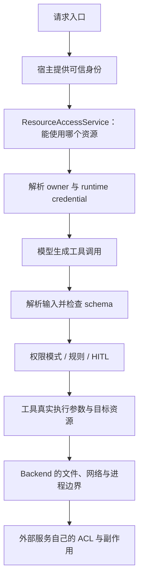
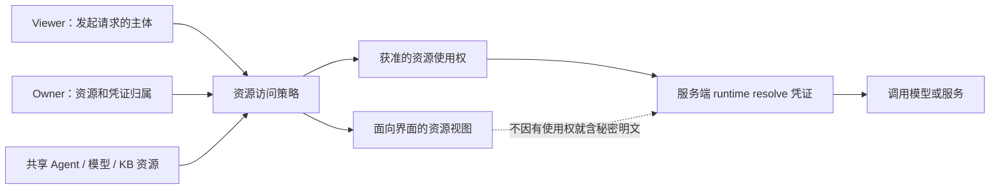
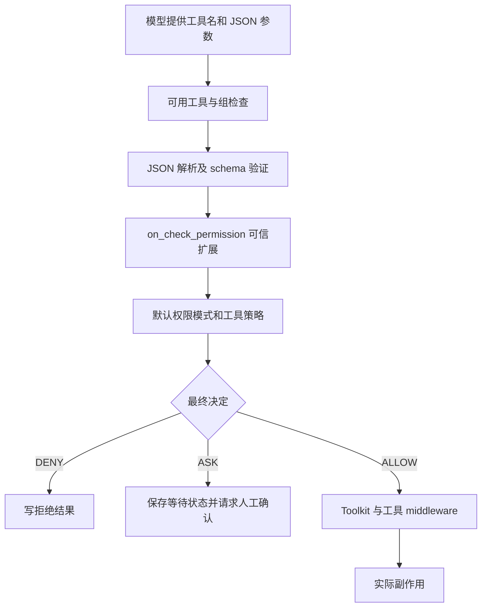
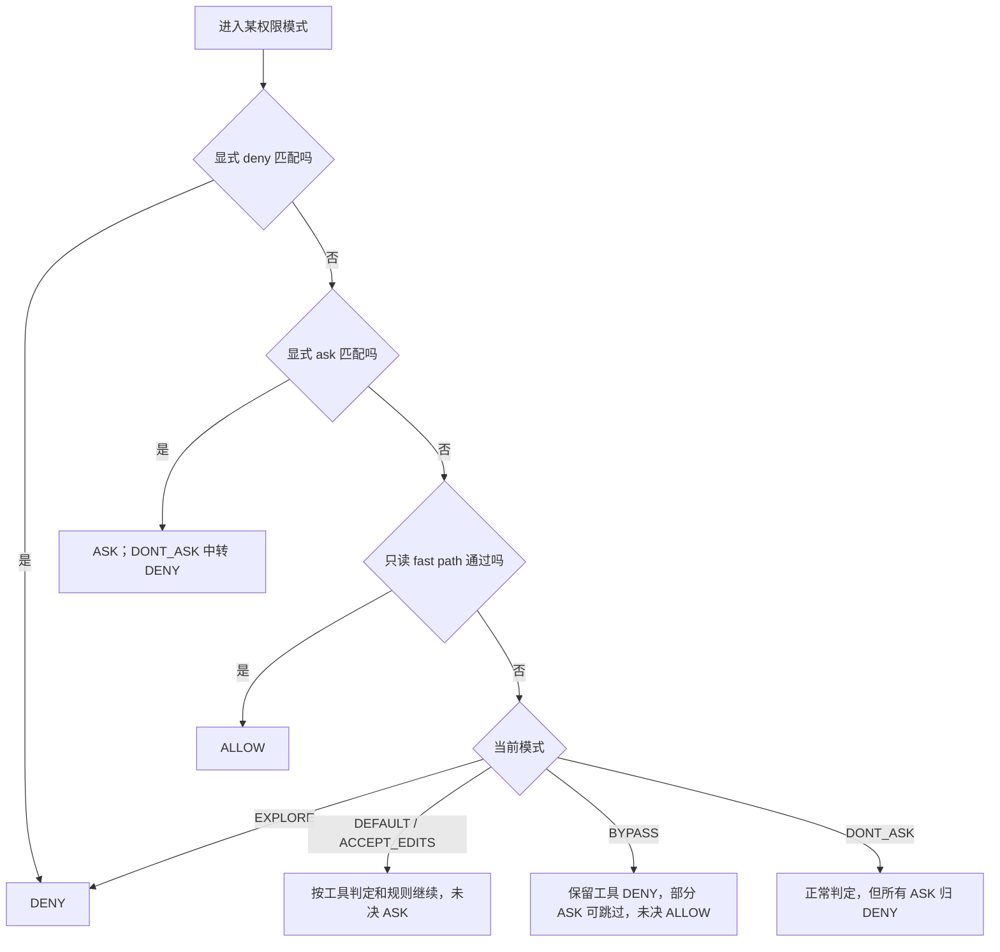
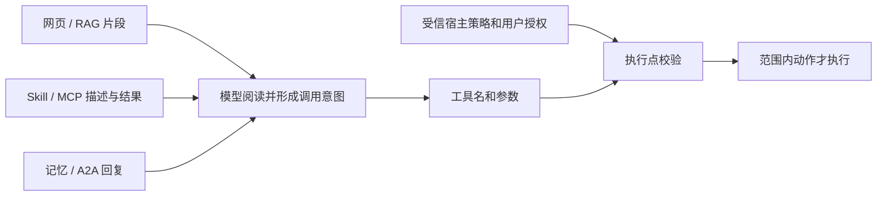
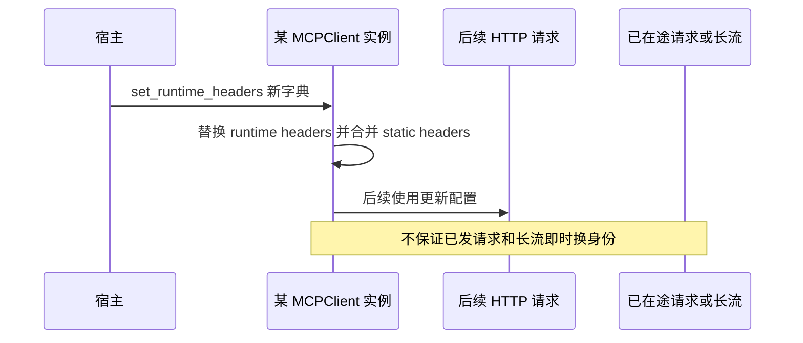
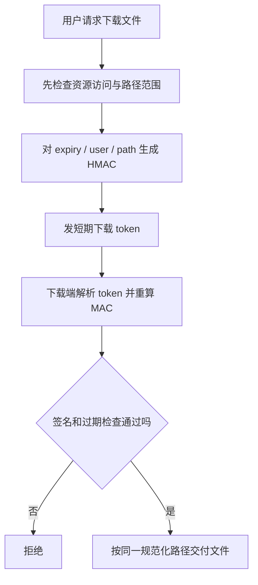

# 安全、权限与协议治理：源码级拆解

本篇从工具专题抽离权限实现，并补齐身份、资源授权、协议信任、凭证和文件安全边界。基于本地 AgentScope 2.0.12dev 静态阅读，未运行安全测试。下面先分析跨层架构，后续章节保留迁入的权限求值源码。

工具加载、调用与MCP执行机制继续见 [Tools、Skills与MCP](08-Tools-Skills-MCP-and-Permissions.md)，原文件路径保持兼容。

## 安全架构：六个不同的执行边界

```text
HTTP/渠道身份
 → viewer/owner 资源授权
 → Agent 工具参数与 PermissionEngine
 → MCP/A2A/external executor 协议与凭证
 → Backend 文件/进程/网络隔离
 → 结果验证、下载、日志与审计
```

权限模式只能决定工具动作，不能替代可信身份、业务资源 ACL、沙箱或远端服务授权。JSON schema 负责数据形状，不证明用户能访问其中的账号/路径。以下按实际调用边界解释。

## 源码导航

| 入口 | 责任 |
|---|---|
| [get_current_user_id](/D:/work/fanchen/projects/company/web/ai-agent-design/open/agentscope/src/agentscope/app/deps.py:35) | 当前 HTTP 身份来源 |
| [ResourceAccessPolicy](/D:/work/fanchen/projects/company/web/ai-agent-design/open/agentscope/src/agentscope/app/access/_policy.py:79) | 跨 owner 可见/可编辑策略 |
| [ResourceAccessService](/D:/work/fanchen/projects/company/web/ai-agent-design/open/agentscope/src/agentscope/app/_service/_access.py:204) | viewer 授权、真实 owner 读取、UI 脱敏 |
| [PermissionContext](/D:/work/fanchen/projects/company/web/ai-agent-design/open/agentscope/src/agentscope/permission/_context.py:25) | 模式、目录和规则 |
| [PermissionEngine](/D:/work/fanchen/projects/company/web/ai-agent-design/open/agentscope/src/agentscope/permission/_engine.py:17) | 执行动作求值 |
| [ToolBase 权限原语](/D:/work/fanchen/projects/company/web/ai-agent-design/open/agentscope/src/agentscope/tool/_base.py:298) | 只读、复合操作、规则匹配 |
| [Agent 权限链](/D:/work/fanchen/projects/company/web/ai-agent-design/open/agentscope/src/agentscope/agent/_agent.py:2361) | middleware 与引擎入口 |
| [MCP runtime headers](/D:/work/fanchen/projects/company/web/ai-agent-design/open/agentscope/src/agentscope/mcp/_mcp_client.py:280) | 请求头校验和运行态凭证更新 |
| [下载签名](/D:/work/fanchen/projects/company/web/ai-agent-design/open/agentscope/src/agentscope/app/_service/_download_token.py:26) | 绑定时间、用户、路径 |
| [Skill archive](/D:/work/fanchen/projects/company/web/ai-agent-design/open/agentscope/src/agentscope/workspace/_base.py:1385) | 提取预算和环境内安装 |
| [委派权限合并](/D:/work/fanchen/projects/company/web/ai-agent-design/open/agentscope/src/agentscope/app/_tool/_agent_create.py:67) | 默认权限扩展边界 |

## 1. 身份入口：实际只是读取 X-User-ID

deps.py 的 get_current_user_id 从 Header 取得 x_user_id，空值抛401，其余直接 return。schema 描述明确写 temporary header-based identity，将来替换 JWT。当前函数没有验证签名、issuer/audience、expiry 或用户组织关系。

```python
if not x_user_id:
    raise HTTPException(status_code=status.HTTP_401_UNAUTHORIZED, ...)
return x_user_id
```

如果可信网关已认证、移除客户端伪造 header 并注入身份，该接口可用于内部转发；若直接暴露给不可信请求方，任填用户 ID 会影响所有依赖它的 owner-scoped 访问。本仓库函数不证明外围一定存在可信网关。文档称 authenticated user ID 也不能替代真实验证。

缺失 header 可能先由 FastAPI 参数校验处理，空值才进入函数401；未运行请求测试，不把 docstring 的401当每种输入的实测状态码。

## 2. 资源访问策略不等于 IAM 系统

ResourceKind 包 credential/agent/knowledge_base；ResourceRef 含 kind、owner_id、resource_id、permission。READ 可见且可使用，EDIT 额外可修改。DenyAllResourceAccessPolicy 默认不返回任何跨 owner 引用，owner 的自有资源仍按存储读取。

ResourceAccessPolicyBase.list_accessible 是宿主可扩展策略；can_edit 默认 owner=true，否则查 matching EDIT ref。它不管理用户/组/分享记录，应用可接外部 IAM/LDAP。不能从存在 policy 接口就宣称框架已有完整多租户 RBAC/ABAC。

## 3. viewer 与 owner 为什么必须分别保存

Service 先读 viewer 自有记录，不存在再解析策略引用，再按真实 owner_id/resource_id 获取资源。共享资源存储不迁移到 viewer 名下，修改时也应在授权后写真实 owner 的记录。

get_resource 返回 viewer-relative view，runtime resolve_* 返回执行所需记录，resolve_for_edit 验证可写权限。editable 字段供 UI 展示，不能只隐藏按钮不做服务器校验；扩展新 route/工具应复用 service 边界，而非直接按输入资源 ID 访问 StorageBase。

共享 Agent 解析还区分 user-source 和内部 team worker，内部执行对象并不自动成为可共享产品资源。

## 4. 共享凭证：使用权与明文读取权分离

CredentialView 对共享凭证只保留 type/name；resolve_credential 给 runtime 原始 record，以便真正调用模型。这允许用户使用共享凭证但不直接从 API 看密钥。

运行服务因此是特权边界：工具日志、trace、env、MCP配置或响应 dump 都可能再次泄漏原始秘密。SecretStr 的显示遮盖不等于数据库静态加密，也不保证网络/日志脱敏。本轮未逐行检查所有 storage 加密与 secret manager 集成，不宣称已有轮换/加密闭环。

共享凭证还需限制调用资源/额度；UI 隐藏 key 不代表其使用范围已最小化。

## 5. 工具权限根据解析后的真实参数求值

Agent先 check_tool_available→修复 JSON→jsonschema.validate→_check_permission→执行。模型输入里自称管理员或声明已经获准不改变 PermissionContext。ALLOW/ASK/DENY/PASSTHROUGH 是服务端结果，不由模型直接赋予。

PermissionContext 是 Agent 运行策略，含 mode/working_directories/allow/deny/ask，不是业务行级数据授权。数据库/支付/客户系统工具仍需在业务服务验证 principal-resource-action；仅让模型调用正确 schema 的工具仍可能访问不属于它的记录。

## 6. 只读检查不等于无风险

ToolBase.check_read_only 默认返回 is_read_only，Bash 等可按具体输入覆写。MCP readOnlyHint 是远端声明，参与 fast path；接入未知服务器不能默认其标记可信。

读文件也可泄密，TeamSay 可触发新 Agent 并付费；“read-only”在权限引擎里的分类不涵盖所有数据出域/费用风险。deny/ask规则在只读 fast path 前求值，提供额外约束，但业务数据隔离仍另管。

## 7. 复合操作采用 deny-any / allow-all

ToolBase.get_permission_inputs 默认单项，复合工具可拆成多个操作。deny/ask 有任意子操作匹配就生效；allow 必须覆盖全部操作。`safe && unsafe` 不应因第一段匹配允许规则就整体通过。

engine._rule_matches 对非 ALLOW 遍历拆分项；ALLOW 聚合由 _check_allow_rules 单独处理。规则匹配委派 tool.match_rule，不能把所有工具 rule_content 都当同一种正则或字符串前缀。

engine 对空 rule_content 直接工具名级全匹配；ToolBase 默认 match_rule 只对 None 返回 true。未覆写匹配的 FunctionTool/MCPTool 不会因为传入任意字符串就自动获得精细参数 ACL。建议规则也可能默认整个工具名，审批 UI 应让用户看清授权范围。

## 8. 权限 middleware 是高权限扩展代码

on_check_permission 拿调用/输入副本，改副本不会改变实际执行；但可短路 ALLOW，从而绕过内建引擎。后续 on_acting 和 ToolMiddlewareBase 又能改参数，所以必须信任谁能安装 middleware。

应审计最终实际参数与批准参数的一致性。用户确认可改 name/input，宿主必须限制可修改范围；HITL 本身不是所有业务审批的安全证明。完整状态协议见 [HITL](11-Human-in-the-Loop.md)。

## 9. MCP 发现过滤不是远端 ACL

enable_tools/disable_tools 控制列举输出，完整缓存仍保存未过滤工具，get_tool 可按名称显式取得。工具组激活也只控制暴露与调用可用性，不自动授权业务动作。

stdio MCP 的 command/env 是启动进程配置，允许添加服务器的人实际上有重要代码执行配置权。HTTP MCP 又引入 URL、出站网络、凭证、redirect/服务身份边界。名字校验和 schema 保真解决协议兼容，不能证明来源可信或阻止 prompt injection。

接入治理建议固定来源/版本、允许能力、网络目的地、凭证 scope、超时与审计。当前源码有这些机制的部分构件，未见已读入口统一强制全部准入策略。

## 10. runtime header 的热更新与隔离

set_runtime_headers 只允许 Streamable HTTP，SSE/stdio 拒绝；name/value 正则拒绝非法字符/CRLF，Host、Content-Length、Connection、Transfer-Encoding 由 HTTP层独占，不能覆盖。

```python
self._runtime_headers = dict(headers)
if self._http_client is not None:
    merged = httpx2.Headers(self._static_headers)
    merged.update(self._runtime_headers)
    self._http_client.headers = merged
```

这是整体替换；空字典回到静态 headers。PrivateAttr 不进入 workspace 持久化。但在途请求保留旧快照、长 GET stream 也不瞬间换身份；token 轮换与撤销语义不能等同“调用方法后所有旧会话立即失效”。

同 client 若为多个用户并发更新 token，live instance 状态可能串用。应按用户/session 隔离或用真正请求级凭证，不能把实例字段当 context-local。

## 11. A2A 适配不自动传递最小授权

A2AAgent 管远端 context/task，认证 out-of-band；本地 PermissionContext 不会自动安全映射到远端。Agent Card 和返回 schema 是能力/形状，不是身份和可信证据。

跨团队需要定义任务 scope、输入出域、期限、幂等、取消、证据、成本归因。内部已有 Pipeline/bus 协作不必为了协议增加网络信任边界。具体本地/远端生命周期见 [多 Agent](12-Multi-Agent-Orchestration-and-Contracts.md)。

## 12. schema 与业务校验的分界

JSON schema 限类型/字段，不能证明 URL 不指内网、文件没经 symlink 逃逸、账号属于当前主体或答案真实。Pydantic after-validator 也未必反映为 JSON schema，执行端若只 jsonschema.validate，不自动运行 Python 语义检查。

协议治理应显式关联 session/reply/call、输入版本、任务 attempt 和输出状态。外部成功 metadata 需 shape 校验，但业务仍须把答案与原问题/证据关联，不能凭自然语言“已完成”触发下一高风险动作。

## 13. Prompt injection 在能力边界处治理

Skill、RAG、网页、MCP 描述/结果、A2A 回复和记忆都可能包含指令。HintBlock/XML-like 包装只是表达来源/结构，不天然隔离模型注意力。真正的硬防线是服务器授权、参数/路径策略、最小凭证、出站目的地与 backend 隔离。

system prompt 的“不要越权”可辅助行为，不能替代 ACL。也不建议把关键词删除当通用注入防护。内容应标可信度/来源，重要执行按 policy 判断；模型被诱导仍不应获得原本没有的能力。

## 14. 下载 token 是短期 capability

sign_download_token 对 expires_at、user_id、path 以 NUL 分隔生成 HMAC-SHA256，返回 expiry.base64(user).base64(signature)。verify 用请求重新导出的 path 算 MAC，compare_digest 后查过期，默认 TTL60秒。

绑定 path 防 token 跨文件使用；它不加密用户 ID，也不是一次性，TTL内可重放。签发前需要正确授权，签发/验证路径规范化需一致；短签名不能把任意文件自动变成可下载资源。

URL可能进入历史/referrer/日志，需脱敏；多副本共享稳定 signing secret，轮换/撤销策略由宿主明确。这里只核对签名 helper，没有审完每个下载 router 的完整授权链。

## 15. 文件安装与沙箱隔离

Skill archive 提取有环境内 shim 和默认500MiB展开预算，意图限制路径/解压爆炸风险；本轮未逐条穷尽所有 tar/zip链接/成员处理，不宣称已通过恶意归档安全审计。

Docker Manager 的 realpath 检查防 workspace_id 逃出 basedir；直接构造 host_workdir 是另一可信入口。Bubblewrap 当前共享网络，Docker 创建点未显式强制资源限额/禁网。工具授权与 OS/容器边界要联合审查，详见 [沙箱](09-Workspace-and-Artifacts.md)。

## 16. 委派权限与审计

worker 默认合并父规则和工作目录，不是按任务求交集。推荐以父可委派能力、模板上限、任务必需范围和租户策略共同约束，并用真实凭证/执行点兑现，不能只在 prompt 写只读。

审计记录应含可信主体、session/reply/call、策略版本、决定原因、批准人/时间、最终参数摘要和结果。Trace 可携输入/工具返回，也会收集秘密/个人信息，需脱敏、访问控制、保留期限；OTel采样日志不自动等于可靠授权审计账本。

## 17. 一次跨层请求的检查顺序

使用共享 Agent 检索知识并发布报告：可信身份→ResourceAccessService 资源使用权→凭证 runtime resolve→知识 scope→发布参数 schema→工具/HITL授权→受限 MCP token→环境文件/网络限制→外部结果验证→签名下载→脱敏审计。

共享 key 使用权不等于看明文 key，schema 正确不等于目标被授权，sandbox 也不能替代业务身份。任何一项缺失都不该用“有权限模式”掩盖。

## 18. 已读范围与后续验证

已静态阅读身份依赖、Policy完整契约、AccessService方法与view/runtime区分、PermissionContext、复合匹配、runtime headers、下载签名，承接已读模式/HITL/沙箱。未运行测试，未逐条审完所有router、业务工具、存储加密和协议对端。

下面为原工具文档迁入的权限模式、只读 fast path、工作目录、规则及无人值守策略，继续解释执行层细节。

## 21. 五种权限模式：按实现对照

| 模式 | deny/ask 显式规则 | 只读 | 工具自身判定 | 最终未决 |
|---|---|---|---|---|
| DEFAULT | deny 优先，ask 再次 | fast path allow | ALLOW/DENY 直接；safety ASK 保留 | ASK |
| ACCEPT_EDITS | 同上 | fast path allow | 工具可将工作目录内编辑 allow；safety ASK 保留 | ASK |
| EXPLORE | deny/ask 优先 | allow | 不调用工具 permission，不看 allow rules | DENY |
| BYPASS | 仍遵守 deny/ask | allow | ALLOW/DENY 保留，工具 ASK 包括 safety 可跳过 | ALLOW |
| DONT_ASK | ask 转 deny | allow | ALLOW/DENY 保留，safety ASK 转 deny | DENY |

具体入口分别是 engine.py 的 _check_default:117、_check_explore:214、_check_accept_edits:297、_check_bypass:395、_check_dont_ask:491。表格依据实现及方法契约，不能只看旧枚举长注释。


## 22. 只读 fast path 是所有模式共享的代码

[helper](/D:/work/fanchen/projects/company/web/ai-agent-design/open/agentscope/src/agentscope/permission/_engine.py:659) 调 `await tool.check_read_only(tool_input)`，返回 true 就 ALLOW。它在 deny/ask 规则之后、工具自身 check_permissions 之前。

```python
if await tool.check_read_only(tool_input):
    return PermissionDecision(
        behavior=PermissionBehavior.ALLOW,
        message=f"Permission granted for {tool.name} (read-only invocation)",
        decision_reason="Read-only operations are auto-allowed",
    )
```

这解释了实际行为可能与 _types.py 某段历史文字“DEFAULT 的 Read 都要询问”不一致。只读工具并非无条件绕过 deny/ask；明确规则仍先判。


## 23. ACCEPT_EDITS 的目录判断属于工具层

引擎没有在每个工具输入中通用查找 file_path 然后放行。它委派 tool.check_permissions；Write/Edit/Bash 等工具各自解析路径与命令，判断是否处于 working directories。相同模式下不同工具可能返回不同结果，是设计边界而非引擎一定失效。

危险文件、目录、命令注入检测等也需要具体工具实现。只审 PermissionEngine 不足以证明 shell 安全；本篇未逐行穷尽 Bash/PowerShell 的命令解析器，不能宣称已审完所有危险命令模式。


## 24. rule matching 和建议规则

引擎按 tool_name 归类 allow/deny/ask，匹配策略交给 ToolBase.match_rule；shell 前缀/文件 glob 各有语义，不能统一当正则。suggested_rules 是确认 UI 可让用户选择保存的规则，不是模型说一句“永远允许”就写入。

收到确认时 Agent 更新 ALLOWED、允许修改后的调用参数，并加入用户接受的规则。下一次该 call 的内建权限求值短路 ALLOW，但仍走权限 middleware。跨会话保存规则取决 state/storage，不是仅调用 add_rule 就写入全局系统配置。


## 25. BYPASS 与 DONT_ASK 的关键区别

BYPASS 不是“没有 UI 自动选择安全项”，它会跳过工具 safety ASK，包括 bypass_immune，只有显式 deny/ask 和工具 DENY 等仍限制。DONT_ASK 则把询问转拒绝，适合无人响应但仍需约束的执行。

显式 ask rule 在 BYPASS 下仍可返回 ASK，因此名称不表示永远不产生卡片；DONT_ASK 的不变量才是不能返回 ASK。平台选择后台权限模式时必须按这个实际语义，不能只按“无人值守”选 BYPASS。


## 图解深化：可信身份、资源使用权与真实执行权限

### A. 一次业务操作穿过哪些不同边界



本地默认身份依赖读取 X-User-ID，本身不是完整认证系统。接入生产时需由可信网关或会话认证保证其来源，而不是让客户端任填头就获得任意主体身份。

### B. viewer 与 owner 为什么不能合并



“允许使用共享模型”与“允许读取 API key”是不同权限。view 返回和 runtime resolve 应分别审查；不能为了显示配置而把真正 credential 放进前端响应。

### C. 工具参数从不可信输入到执行



JSON schema 正确不证明 URL 不指内网、路径不经 symlink 逃逸、账号属于当前用户或自然语言内容真实。工具 middleware 若改参，还要审计最终执行参数是否仍在获准范围。

### D. 五种模式的共同前置与不同兜底



图只归纳关键公共逻辑；ACCEPT_EDITS 的目录允许判断在具体工具内，不是引擎对任意 file_path 通用放行。EXPLORE 不调用工具自身 permission 或普通 allow rule；BYPASS 仍可能因显式 ask rule 发卡。

### E. 不可信内容不能升级为权限来源



HintBlock 或 XML-like 包装可以说明来源，不是模型注意力的硬隔离。模型即使被内容诱导，也不应因此得到原本没有的凭证、资源访问权或目标网络能力。

### F. runtime token 更新的实例边界



同一 client 被多个用户并发更新 token，实例字段可能发生身份串用；应使用按用户/会话隔离的 client，或真正请求级的受信凭证机制。PrivateAttr 不持久化不代表在内存里没有共享风险。

### G. 下载签名校验的是 capability，不是原始访问资格



签名绑定路径，不能替代签发前授权；token 不加密用户身份，也不天然一次性。TTL 内可重放，日志/URL 泄漏和多副本 secret 管理仍要由宿主处理。

### H. 审查证据应跨越哪些层

| 结论 | 必须保留的证据 | 单独不足的证据 |
|---|---|---|
| 身份可信 | 认证链与主体来源 | 有 X-User-ID 字段 |
| 可访问资源 | viewer/owner 与策略决定 | 模型提到资源名 |
| 动作获准 | 最终参数、策略版本、人工决策 | schema 校验通过 |
| 环境受限 | 挂载/用户/网络/资源配置 | 类名叫 Sandbox |
| 外部结果有效 | 请求关联、结果形状和业务证据 | 对端说已完成 |
| 可追责 | 稳定关联 ID、脱敏和可靠保存 | 采样 trace 中出现一条日志 |

新增图解属于源码边界说明，不是渗透测试报告。真实 shell 解析、恶意归档、全部 router 与远端协议端点仍需专项验证。
