# 计划与任务跟踪：Task 工具、LLM 回路、EXPLORE 与持久化

分析对象为本地 AgentScope Python **2.0.12dev**，基准提交 `4474c832dfccfd4d9a54a6f0a79a636c34817625`。本文延续前面专题，以源码实际控制流为准；不把其它版本或 Java Harness 的同名能力混入当前实现。分析为静态阅读，未运行模型或测试。

核心判断：当前 Python 实现提供了结构化任务跟踪、运行时提醒、前端 Plan 面板和独立的 EXPLORE 只读权限模式。已追踪入口没有形成统一的“进入计划模式 → 生成计划 → 用户批准计划版本 → 切换执行”的内置状态机。TaskCreate 描述中提到 Plan mode，不足以证明完整产品流程已经实现。

本版按“先看图，再对照源码”的顺序阅读即可。第 3 节说明 LLM 如何使用任务工具；第 5～8 节说明任务创建、更新与依赖；第 10～13 节说明上下文、权限、UI 和保存；第 15 节把这些机制串成一个完整例子。图中明确标为建议的审批流程属于待补充设计，其余图描述当前代码或标明前提的使用轨迹。图只展开与本专题有关的分支，不代替完整 Agent Loop。

## 1. 先区分四种“计划”

| 概念 | 当前对应实现 | 作用与边界 |
|---|---|---|
| LLM 自然语言规划 | 系统提示、用户指令、普通模型输出 | 可以先列方案，但不自动改变权限 |
| 结构化任务跟踪 | TaskCreate/Get/List/Update + TaskContext | 记录任务、状态、依赖与 owner |
| 只读探索 | PermissionMode.EXPLORE | 在权限检查层限制工具调用 |
| 计划审核后执行 | 本文已读路径没有统一实现 | 需要应用层补阶段、审核与切换协议 |

前端显示 Plan，并不表示 Agent 进入了只读阶段；任务列表存在，也不表示所有操作都会绑定任务 ID 或受到任务依赖的强约束。

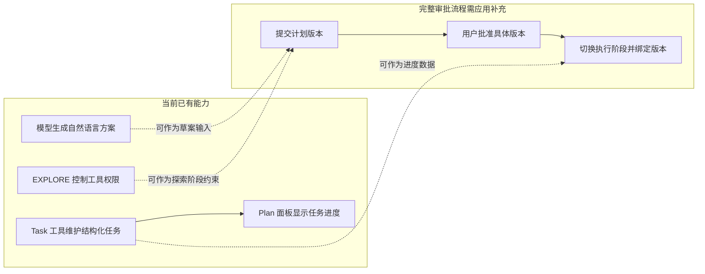

实线表示当前实现中的直接联系，跨区域虚线表示可以设计的集成关系。任务账本、工具权限和审批流程分别回答“记录什么”“允许做什么”“批准哪一版”，不能用一个开关替代。

## 2. 源码地图

| 入口 | 重点 |
|---|---|
| [state/_task.py](../../open/agentscope/src/agentscope/state/_task.py) | Task 字段与状态 |
| [state/_state.py](../../open/agentscope/src/agentscope/state/_state.py) | TaskContext、AgentState.tasks_context |
| [Task 工具基类](../../open/agentscope/src/agentscope/tool/_task/_task_tool_base.py) | 状态注入、权限、并发声明 |
| [TaskCreate](../../open/agentscope/src/agentscope/tool/_task/_create_task.py) | 任务 ID、创建与工具描述 |
| [TaskUpdate](../../open/agentscope/src/agentscope/tool/_task/_update_task.py) | 更新、依赖维护、删除 |
| [TaskGet](../../open/agentscope/src/agentscope/tool/_task/_get_task.py) | 单任务详情 |
| [TaskList](../../open/agentscope/src/agentscope/tool/_task/_list_task.py) | 全列表摘要 |
| [Toolkit](../../open/agentscope/src/agentscope/tool/_toolkit.py) | 将 AgentState 注入工具 |
| [Agent](../../open/agentscope/src/agentscope/agent/_agent.py) | _inject_runtime_state、_next_action |
| [InjectionConfig](../../open/agentscope/src/agentscope/agent/_config.py) | 提醒开关与任务工具名 |
| [权限引擎](../../open/agentscope/src/agentscope/permission/_engine.py) | _check_explore、只读判定 |
| [服务 Toolkit 装配](../../open/agentscope/src/agentscope/app/_service/_toolkit.py) | 默认添加 Task 工具 |
| [StateChangeMiddleware](../../open/agentscope/src/agentscope/app/middleware/_state_change_middleware.py) | 任务状态变化事件 |
| [Chat 服务](../../open/agentscope/src/agentscope/app/_service/_chat.py) | 恢复与保存完整 AgentState |
| [TaskPanel](../../open/agentscope/examples/web_ui/frontend/src/components/panel/TaskPanel.tsx) | Plan 面板展示 |

## 3. 总体调用链：计划如何与 LLM 生效

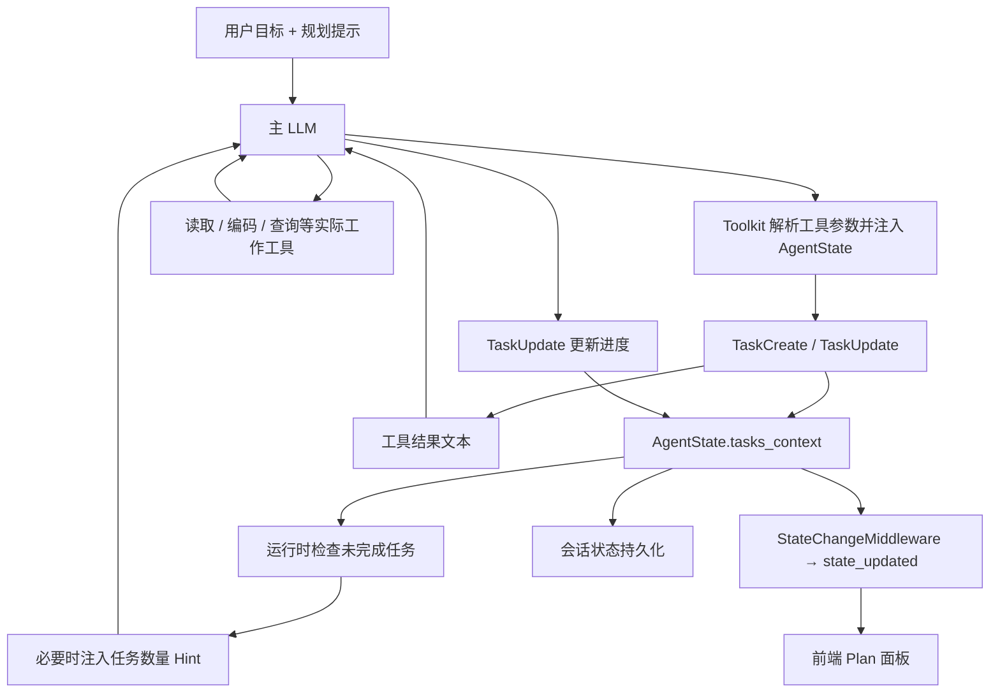

这是主 LLM 的普通 reasoning/acting 回路，没有单独强制运行一个 Planner 模型。模型根据提示和工具 schema 决定何时创建任务、选择下一步、执行工作、更新状态。

Task 工具只修改任务账本，不执行任务 description 中的操作。创建“修复登录问题”不会自动修改代码；设置 owner 也不会自动发送任务给另一个 Agent。

任务如何影响模型有两条路径：工具结果进入会话上下文；上下文丢失任务线索时，运行时注入提醒，引导模型重新调用 TaskList。结构化任务不会每一步都完整拼进系统提示。

### 3.1 模型看到的输入与程序维护的状态

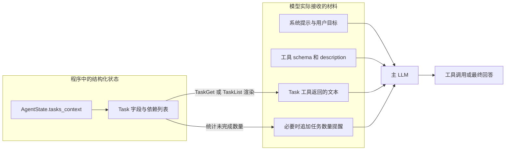

TaskContext 是 Python 状态，不会因为存在就自动成为模型输入。模型需要通过工具结果或 hint 得知它；“程序里状态正确”和“模型已经读到最新状态”应分别检查。

### 3.2 一次任务更新的完整时序

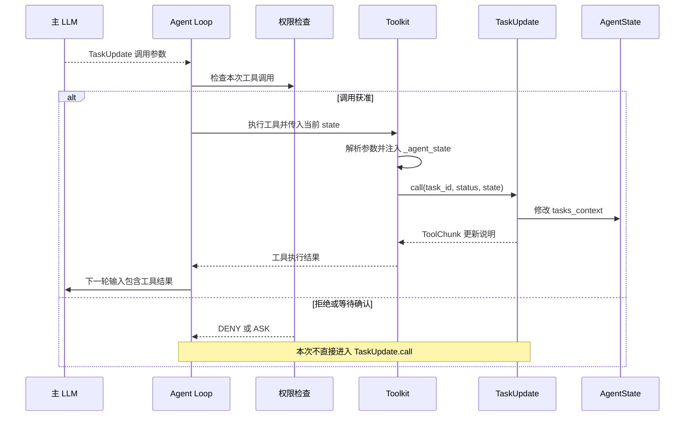

图中权限步骤为 Agent 执行路径的概括。直接在 Python 中调用 `TaskUpdate.call` 不等于已经通过 Agent 的工具权限检查；单元测试直接调用工具主要验证 mutation 行为。

## 4. Task 和 TaskContext 的真实数据结构

Task 字段如下：

| 字段 | 类型/默认 | 含义 |
|---|---|---|
| subject | str | 简短标题 |
| description | str | 任务正文 |
| metadata | dict | 任意附加数据 |
| created_at | 自动时间戳 | 创建时间 |
| state | pending / in_progress / completed | 存储状态 |
| id | 默认生成 ID | 任务标识，TaskCreate 会显式改用数字 ID |
| owner | str 或 None | 记录负责人 |
| blocks | list[str] | 当前任务阻塞哪些任务 |
| blocked_by | list[str] | 当前任务依赖哪些任务 |

TaskContext 只有 `tasks: list[Task]`，AgentState 通过 default_factory 持有独立 TaskContext。

没有独立 Plan 对象、计划版本号、approved 状态、failed 状态、验收记录、预算和自动运行队列。metadata 可以放自定义内容，但当前框架不会因为写了 `approved=true` 就自动建立审批边界。

工具入参用 status，持久对象用 state。deleted 只是 TaskUpdate 的删除命令，不是 Task.state 的第四种状态；删除后记录从列表消失。

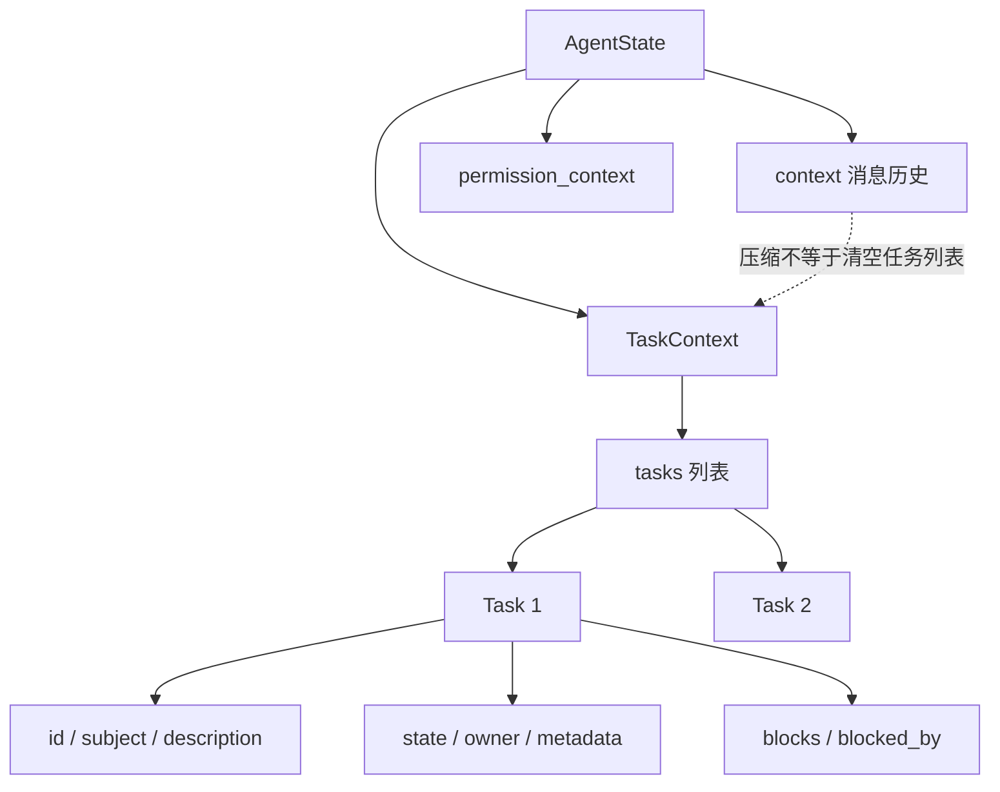

任务内容、聊天历史与权限配置处于同一 AgentState 的不同字段。修改任务状态不会自动修改权限；压缩消息也不是对整个 AgentState 做清空。

## 5. TaskCreate：创建描述，而非生成执行程序

### 5.1 工具描述如何引导模型

TaskCreate 的 description 建议复杂任务、三步及以上工作、用户明确要求 todo、多个目标等场景使用；简单任务跳过。还要求工作前标 in_progress，完成后标 completed，并建议先 TaskList 避免重复。

这些是提供给模型的行为指令，不是自动复杂度分类器。框架不会自动数用户目标的步骤，再强制调用工具。提到“Plan mode”也只是描述文字。

### 5.2 实际创建步骤

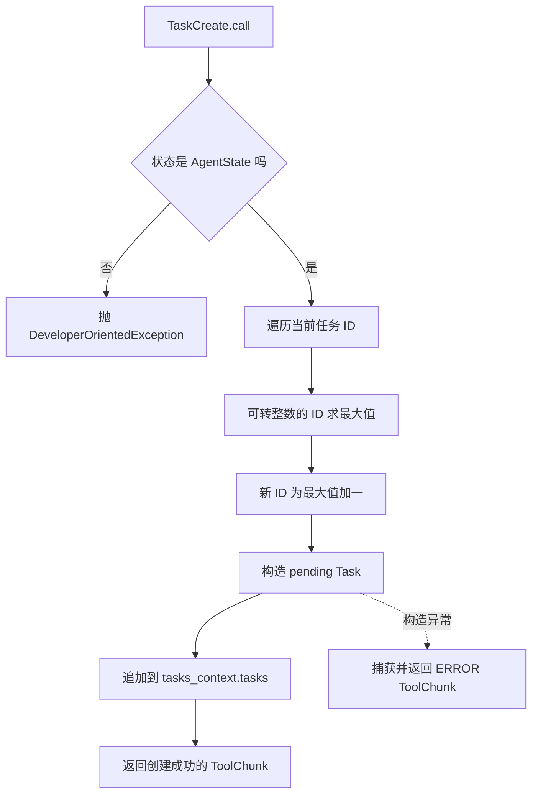

图中标出主要错误边界：状态类型校验在 try 外，创建等内部操作在 try 内。成功返回的是“任务条目已创建”，不是“任务所描述的业务已完成”。

Task 模型自身默认 ID 是生成值，但工具覆盖成便于模型操作的连续数字字符串。它按当前仍存在的任务求最大值，不维护永不回退的全局计数器：删除最高 ID 后可能复用它，全部删除后可能重新从 1 开始。外部审计不能只把 task.id 当永久唯一标识。

创建本身不做重复标题检测、语义去重或自动展开子任务。空标题也没有 Field(min_length=1) 约束。创建错误在内部转换为 ERROR ToolChunk；缺少有效 AgentState 则在 try 外抛 DeveloperOrientedException，属于接线错误。

### 5.3 并发声明与实际隔离

_TaskToolBase 声明 is_concurrency_safe=True。当前 TaskCreate 的读最大值到 append 之间没有 await，在单事件循环里没有显式异步挂起点；但没有跨线程、跨进程原子 ID 分配器，也没有针对多份状态副本的 CAS。

因此不能从该标记推导同一会话可被多个独立 worker 同时安全修改。服务会话锁、状态保存顺序与工具内部逻辑是不同层次。

## 6. TaskGet 与 TaskList：给模型重新建立任务视野

TaskGet 按 ID 顺序找到第一项，返回标题、state、description，以及非空 owner、依赖、metadata；不存在返回 ERROR。

TaskList 遍历整个列表，输出 ID、state、subject、owner 和 blocked_by，不包含完整 description；空列表返回 No tasks available。

TaskList 描述建议模型优先处理“pending、无 owner、无阻塞”的工作，但实现没有自动过滤或排序，只按当前列表顺序输出全部任务。谁可以运行、下一项选什么仍由模型判断。

TaskGet 描述提到依赖检查；它只展示信息，不建立执行锁，也不会因为 blocked_by 非空拒绝返回或阻止工作。

## 7. TaskUpdate：逐字段 mutation 的详细行为

### 7.1 更新入口与边界

先校验 AgentState，再遍历列表寻找匹配 ID；循环不提前 break，因此异常重复 ID 情况下更新最后一个匹配任务，而 TaskGet 返回第一个。正常 TaskCreate 生成的列表应避免这种冲突。

字段更新按顺序直接修改对象，没有先构建完整候选再原子提交的事务。

| 输入 | 实际行为 |
|---|---|
| subject | 真值时更新，空字符串被忽略 |
| description | 非 None 即更新，允许空字符串 |
| owner | 非 None 即设置，None 表示不更新，不能用 null 清空 |
| metadata | 非空字典逐键合并，值为 None 删该键；不是整体替换 |
| add_blocks | 给依赖关系增边 |
| add_blocked_by | 从反方向给依赖关系增边 |
| status=deleted | 从任务列表物理移除并清理引用 |
| status=completed | 标完成并解除其它任务对它的 blocked_by |

### 7.2 状态箭头是建议，不是强制状态机

描述写 pending → in_progress → completed，但代码没有检查当前状态是否允许转移。模型可以 pending 直接 completed，也可以 completed 改回 pending；也没有检查测试结果、工作证据或阻塞项是否已清空。

同一时间可以有多个 in_progress；没有“最多一个进行中任务”的硬限制。owner 没有唯一认领、身份鉴权或自动委派逻辑。

更关键的是 _next_action 不读取 tasks_context 来决定能否结束 reply。因此即使仍有 pending/in_progress，模型仍可能正常结束本轮。任务提醒不等同“全部任务完成前禁止停止”。

### 7.3 metadata 不等于结果验收

```json
{"task_id":"2","metadata":{"test_result":"passed","old_note":null}}
```

这只合并键并删除 old_note，不执行测试，也不核验 passed 是否真实。TaskUpdate 描述要求“没有错误且完整完成才标 completed”，但没有外部 verifier。

需要可信完成状态时应把验收结果、证据和授权更新放在应用层；不能把 LLM 自报状态当独立验收。

### 7.4 TaskUpdate 的执行顺序图

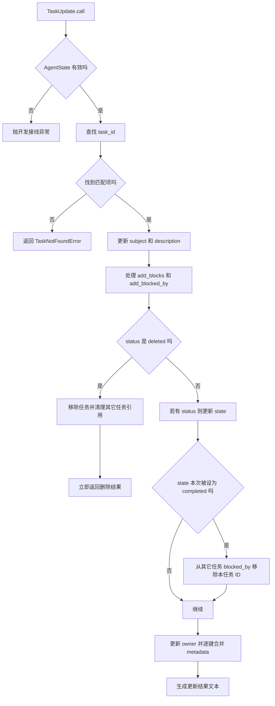

顺序有实际影响：同一次调用同时传 status=deleted 与 metadata，删除分支会提前返回，metadata 不会继续处理。add_blocks 在删除前处理，随后又随删除被清理，最终不会留下这次增边。

### 7.5 建议工作流与实际允许的更新

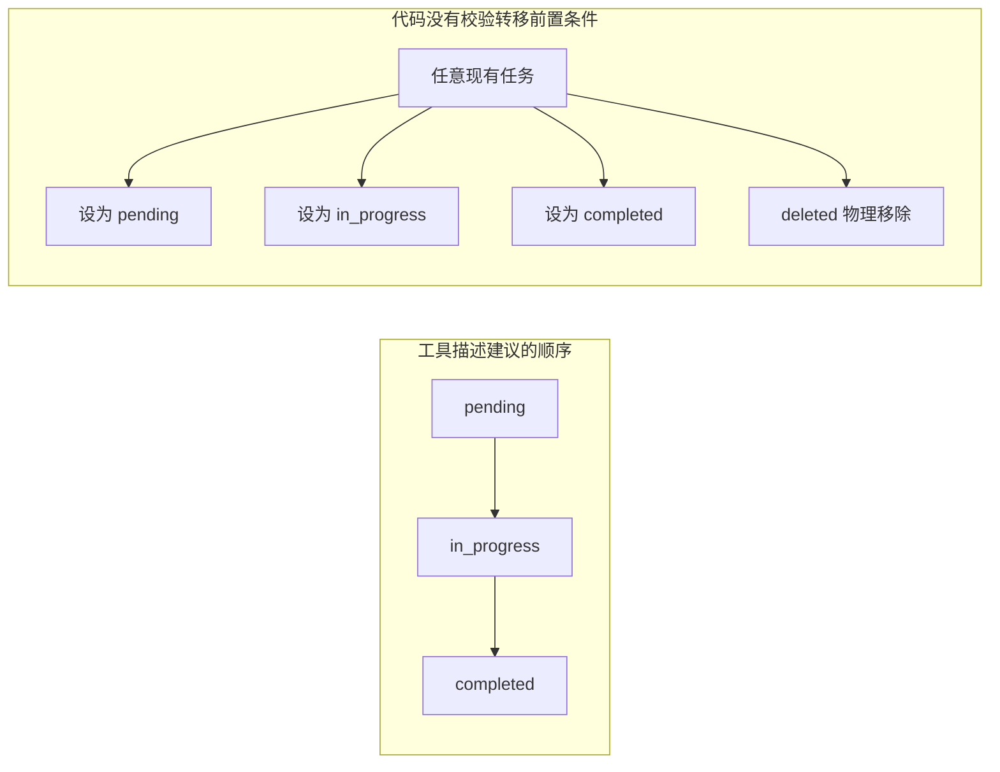

右图表达合法输入下的状态赋值能力，不代表每一种变更都保持依赖关系可逆。特别是 completed 后再改回 pending，不会自动重建已经解除的阻塞。

## 8. 依赖关系：维护双向列表，不执行 DAG 调度

### 8.1 增边的方向

`TaskUpdate(task_id="2", add_blocked_by=["1"])` 会调用 `_update_block_relation("1", "2", state)`：

```text
Task 1.blocks     += ["2"]
Task 2.blocked_by += ["1"]
```

`TaskUpdate(task_id="1", add_blocks=["2"])` 产生同样关系。不存在的 ID 被忽略，已存在关系尽量不重复添加。

### 8.2 没有图校验与启动拦截

当前没有自依赖检查、环检测、拓扑排序、依赖完成状态验证或强制启动门禁。可以形成 1→1，也可以 1→2→1。即便 Task 2.blocked_by 包含 1，仍可把 Task 2 标为 in_progress 或 completed。

传入一个已完成任务作为 blocker 也没有被拒绝；TaskList 不会动态过滤 completed blocker，只显示已有 blocked_by。关系列表不是每次从全局状态重新计算的依赖视图。

### 8.3 completed 与 deleted 的清理不对称

当 1 标 completed，会从所有任务的 blocked_by 中删掉 1，但保留 Task 1.blocks。它的出边仍记录在本任务，反向列表却已被消费。

如果再把 1 改回 pending，先前解除的 blocked_by 不会自动恢复。因此这个实现不能被当成始终保持双向一致、支持回滚的依赖图。

deleted 则从 tasks 列表移除任务，并清理其它任务中的 blocks 与 blocked_by 引用。没有独立墓碑或删除审计记录。

### 8.4 一个具体例子

```text
1: 查清接口契约
2: 修改调用代码，blocked_by=[1]
3: 回归验证，blocked_by=[2]
```

模型应先完成 1，再做 2，最后 3；这是提示驱动的操作顺序。源码只在完成 1 时更新 2 的依赖列表，并不会自动执行 2，也不会把 2 自动改成 in_progress。

### 8.5 同一依赖关系的三次快照

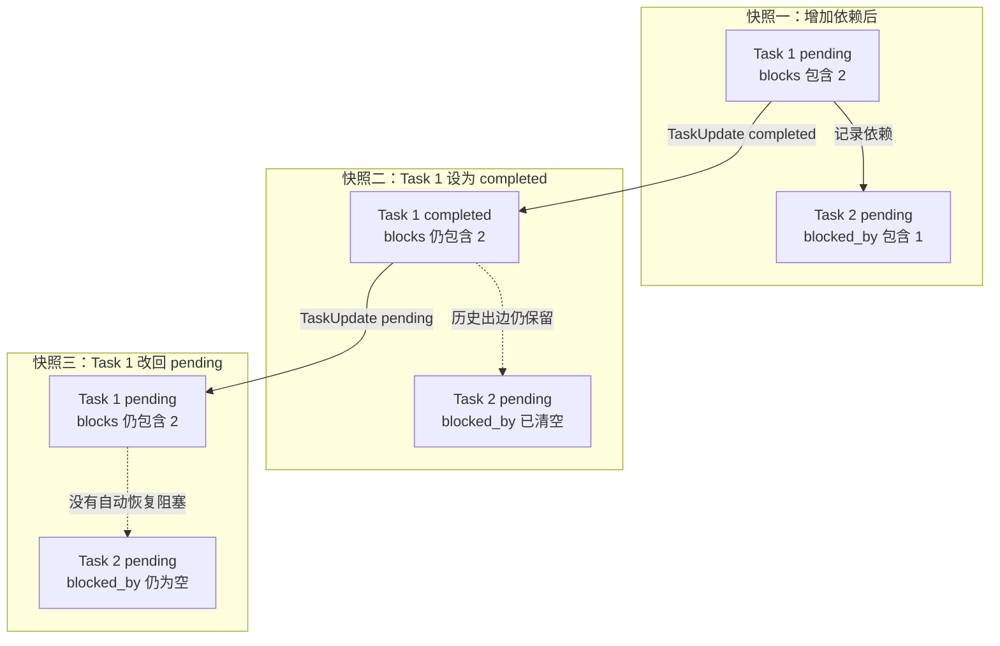

这解释了为什么依赖字段适合做轻量进度辅助，而不能直接当成可回滚的 DAG 调度器。如果业务允许重新打开已完成任务，应用层应定义下游是否重新阻塞，并显式维护它。

## 9. Toolkit 如何让工具访问当前任务状态

_TaskToolBase 的关键声明：

```python
is_state_injected = True
is_external_tool = False
is_mcp = False
is_concurrency_safe = True
is_read_only = False
```

Toolkit.call_tool 在解析模型参数后，对 state-injected 且非 MCP/非 external 工具添加 `kwargs["_agent_state"] = state`，再执行工具。

所以模型只填写业务参数，不负责提供或序列化整个 AgentState。任务属于当前 AgentState，不是工具实例自己的全局列表，也不是通过参数选任意 session。

Library 模式需要显式注册：

```python
from agentscope.agent import Agent
from agentscope.tool import Toolkit, TaskCreate, TaskGet, TaskList, TaskUpdate

agent = Agent(
    name="worker",
    system_prompt=(
        "复杂任务先创建任务列表；工作前更新为 in_progress，"
        "完成并核验后更新为 completed。"
    ),
    model=chat_model,
    toolkit=Toolkit(tools=[TaskCreate(), TaskGet(), TaskList(), TaskUpdate()]),
)
```

片段假设 chat_model 已准备好。这里只有任务工具，不能实际读写项目；工作工具应另行配置。服务端 build_toolkit 则默认始终加入四个 Task 工具；“工具已注册”和“权限允许执行”仍需区分。

## 10. 运行时提醒：计划如何在压缩后重新被看见

### 10.1 时机

Agent Reasoning 分支先 `compress_context()`，再 `_inject_runtime_state()`，然后 `_reasoning()`。InjectionConfig.inject_runtime_state 默认 True，可整体关闭。

任务结构在 tasks_context，与消息 context 分开。消息被压缩，不意味着任务列表也被删除。

### 10.2 提醒触发条件

运行时统计 pending 与 in_progress 数量，并倒序扫描 assistant 消息：

- 发现配置 injection_source 的 HintBlock，且内容包含 `<tasks>`，视为模型知道任务。
- 发现 task_tool_names 中的 ToolCallBlock，也视为知道任务。
- 没有未完成任务则不需要任务提醒。

若仍有未完成任务且没有这些线索，注入类似：

```text
<tasks>You have 1 in-progress tasks and 2 pending tasks.
Use `TaskList` to view them if you don't know.</tasks>
```

它只告诉数量并建议查列表，不自动附加所有任务详情、依赖图与验收条件。自定义改名的任务工具需要同步 task_tool_names，才能参与这套线索判断。

### 10.3 去重策略的局限

只要上下文中仍有任意任务工具调用或旧 tasks hint，就可能抑制新提醒；这里没有任务版本与“模型已读版本”比较。外部更新任务但保留旧上下文线索，不保证马上重新注入最新计划。

注入本身持久追加到 context，不像 RAG 默认 one-shot 清理。它是模型注意力提示，不执行调度或强制完成。

任务状态还影响压缩提示：没有 in_progress 时可提示模型主动压缩，但这不是“只要在任务中就绝不会压缩”的全局保证。

### 10.4 只看任务这一维度的注入判断图

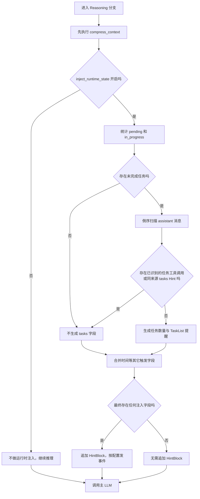

这里特意保留了“其它字段”的分支：没有任务提醒，不表示本轮完全没有运行时 hint；时间、上下文长度、重复工具错误可以独立触发。

## 11. EXPLORE：只读计划阶段的权限基础

### 11.1 真实模式名与决策顺序

PermissionMode 包含 DEFAULT、ACCEPT_EDITS、EXPLORE、BYPASS、DONT_ASK。没有 PLAN 枚举。

EXPLORE 的 _check_explore 顺序是：

```text
匹配 deny rule → DENY
匹配 ask rule  → ASK
tool.check_read_only(input) 为 True → ALLOW
否则 → DENY
```

它不调用 tool.check_permissions，也不应用普通 allow rule。默认非只读调用会被拒绝；读取工具、能被 Bash 识别为只读的命令可通过。只读判定依赖工具实现，不是操作系统级只读文件系统。

有一个必须保留的限定：ASK 规则优先于只读兜底，可产生用户确认路径。因此不能仅凭模式名断言每一种配置都没有人工确认或例外路径。

### 11.2 当前 Task 工具与 EXPLORE 的不兼容点

四个 Task 工具全部继承 is_read_only=False，TaskGet/List 也没有覆盖 check_read_only。默认的 ToolBase.check_read_only 直接返回该标记。

因此无前置 ASK 等特殊规则时，EXPLORE 中 TaskCreate/Update/Get/List 都会落到 DENY，即便 TaskGet/List 只是读任务。工具基类自己返回 ALLOW 没用，因为 EXPLORE 不调用它。

这不是已经执行测试的结论，而是继承属性与权限分支组合的静态推导；现有测试导航里没有据此证明“所有 Task 工具在 explore 可用”。

如果产品要求“可改内部计划、不可改外部项目”，需要明确区分内部状态写入与外部副作用，再改权限策略或实现专用计划服务。不要为了通过只读判断而给实际会写文件的工具错误标注只读。

### 11.3 模式切换不等于计划审批

库模式可在适当的调用边界设置 `agent.state.permission_context.mode = PermissionMode.EXPLORE`。服务端 session PATCH 支持 permission_mode；处理器检查会话运行状态，运行中修改配置会返回 409，而非任意时刻直接切换。

该接口只改变权限配置，没有同时绑定 plan_version、计划 hash 或批准人。执行某一次工具的 UserConfirm 也不自动意味着整份计划被批准。

### 11.4 EXPLORE 决策树与 Task 工具示例

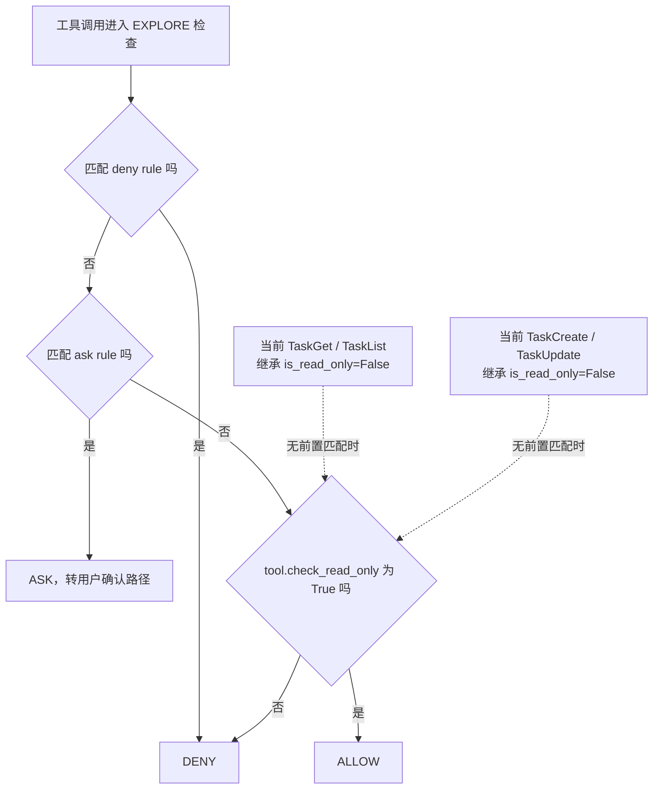

这棵树没有“工具自己的 check_permissions 返回 ALLOW”分支，也没有“普通 allow rule 放行”分支。两者在其它模式下可能有作用，在 EXPLORE 这一分支中不会执行。

| 调用意图 | 任务数据会怎样变化 | 默认 EXPLORE 下的静态判断 |
|---|---|---|
| TaskList 查进度 | 不改任务 | 继承非只读标记，落到 DENY |
| TaskCreate 写计划条目 | 改内部任务列表 | 落到 DENY |
| Read 阅读源码 | 不改项目文件 | 只读判定通过时 ALLOW，仍先检查规则 |
| Write 修改实现 | 写项目文件 | 非只读调用落到 DENY |

所以“先切 EXPLORE，再让模型用默认 Task 工具写计划”并不是当前代码可以直接保证的组合。

## 12. 前端 Plan 面板如何同步

StateChangeMiddleware 在 on_acting 和 on_reply 前后计算 tasks_context、permission_context JSON 的 MD5，变化时发布 `CustomEvent(name="state_updated")`。它不比较完整消息历史，避免每个 token 都触发任务面板刷新。

事件直接发到 session bus，不作为 on_acting 的普通 AgentEvent yield，因为 acting 的流类型是 ToolChunk/ToolResponse。SSE 再传给前端。

ChatViewport 收到 tasks_context 后更新本地状态；某会话第一次收到非空任务列表时自动打开 plan 面板，后续更新不反复强制打开用户已关的面板。permission-only 事件同样携带 tasks_context，因此不能只检查字段存在就打开面板。

TaskPanel 是只读展示组件：状态图标、标题、依赖、完成数和总数。前缀连续已完成任务超过 3 条时折叠较早部分，可点击展开；这是视觉折叠，不是从服务端删除任务。

这里没有“批准这个版本计划”的控制流程。组件展示的是模型维护的进度状态，不代表独立核验结果。

状态变化通知也不是每次 mutation 的可靠提交日志：中间件在下游 async for 正常结束后比较，相关代码不是 finally；异常/提前关闭时不能仅凭此路径保证最后一份状态必发事件。

### 12.1 一次进度变更如何到达浏览器

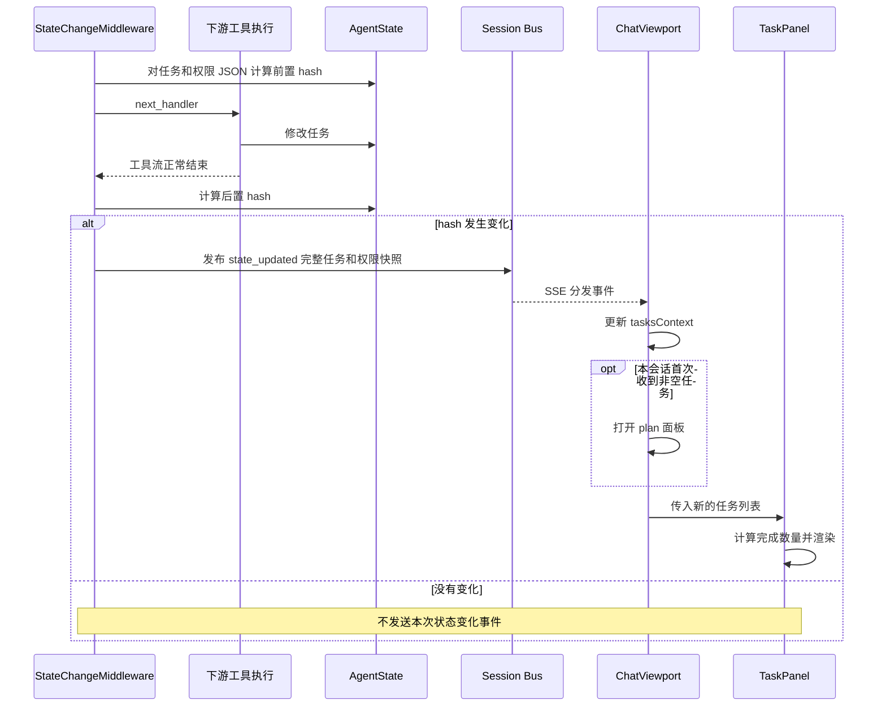

MD5 用于发现字段变化，不是安全签名、计划版本 hash 或幂等提交编号。on_reply 还会对整个回复前后做类似检查，以捕获工具执行窗口外的状态变化；因此一次回复可能有增量通知，也可能在收尾再发送最新快照。

## 13. 持久化、恢复与多 Agent 边界

任务是 AgentState 字段，Library 只在内存中使用时不会因为调用 TaskCreate 自动落盘。需要调用者自行保存/恢复完整状态，或使用服务端 session 存储。

服务端 Chat 用 session_record.state 恢复 Agent，收尾将 agent.state 交给 update_session_state。任务因包含在完整状态内随会话保存，不是工具每次更新都单独提交一行 task 表。

UI 实时看到 state_updated，不等于每个任务更新已经完成 durable commit；bus 事件与 storage 写是不同通道。崩溃恢复应按会话快照、消息与检查点语义分析。

当前状态列表没有任务级乐观版本或 CAS claim。多个 Agent 各自拥有 AgentState 时不会因为 owner 相同就共享实时任务队列。服务创建子 Agent 可以从模板复制 tasks_context，但复制不是共享引用或自动同步。

跨 Agent 委派应走 TeamAssign/TeamSay 等相应协议，不能只 TaskUpdate(owner="worker")。详见 [多 Agent 编排专题](12-Multi-Agent-Orchestration-and-Contracts.md)。

### 13.1 UI 可见、内存状态与 durable commit 的区别

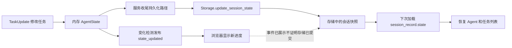

图中两条分支表示不同职责，不表示后台一定同时并发执行。要分析掉电或进程崩溃后保留哪一次进度，需要核对最后完成的状态保存与事件检查点；前端最后显示的行不能单独作为持久化证据。

## 14. 当前缺口与完整计划模式的实现建议

下面是建议架构，不是现有默认功能：

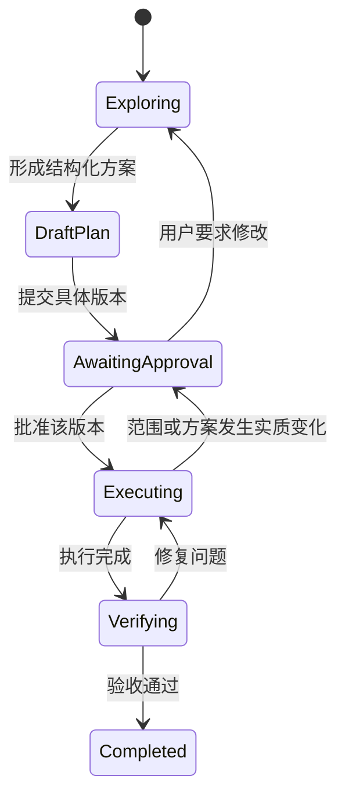

至少需要补充：独立阶段字段；计划版本与批准绑定；阶段对应工具能力；明确依赖图校验；完成条件与证据；任务级原子认领；计划更新、审批、执行的审计和持久化。

EXPLORE 可作为探索阶段的权限基础，但需处理内部 Task 工具限制。TaskContext 可作为执行进度表示，但不宜直接替代审批记录、调度队列或可信验收状态。

若只需“复杂任务先列步骤并跟踪”，现有 Task 工具已经能完成主体功能；若要“批准前不能动项目”，需要权限层约束；若还要求“批准的就是执行的那一版”，则需要应用层版本协议。

### 14.1 建议的审批门禁应检查什么

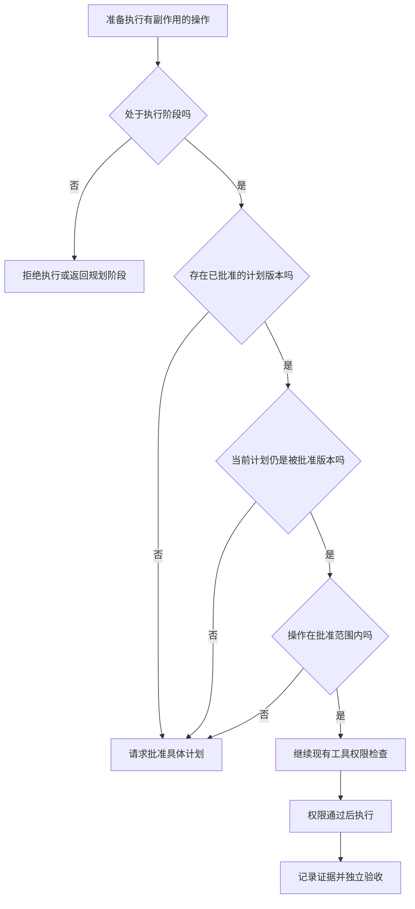

这一图完全属于应用设计建议。批准计划也不能自动跳过工具本身的权限检查；阶段批准和具体操作授权应各有可审查的依据。

## 15. 贯穿示例：给登录接口增加重试

以下是使用当前 Task 工具的一种模型行为轨迹。它假定工具已注册、调用已获准；不假定已经切到 EXPLORE，也不保证每个模型都按此轨迹执行。

### 15.1 模型工具调用与实际工作交替

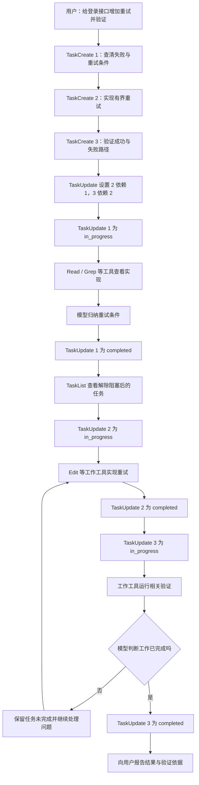

这里是模型选择了查询、编辑、验证的顺序，TaskUpdate 只记账。例如从 H 到 I，不是框架强制模型调用 TaskList，而是工具返回说明提醒它这样做。

### 15.2 三个关键时间点的任务快照

| 时间点 | Task 1 | Task 2 | Task 3 | 已发生的业务工作 |
|---|---|---|---|---|
| 任务创建完 | pending | pending，依赖 1 | pending，依赖 2 | 只记录目标，尚未读写业务实现 |
| Task 1 完成 | completed | pending，依赖已解除 | pending，依赖 2 | 已查看并归纳重试条件，未因完成状态而自动编辑 |
| Task 2 完成 | completed | completed | pending，依赖已解除 | 模型已经另行调用工作工具实施改动，仍需验证 |

若模型跳过验证直接标 Task 3 completed，TaskUpdate 不会发现。因此生产验收应检查测试或实际效果证据，而不只看三个勾选图标。

### 15.3 任务列表未完成时，回复也可能结束

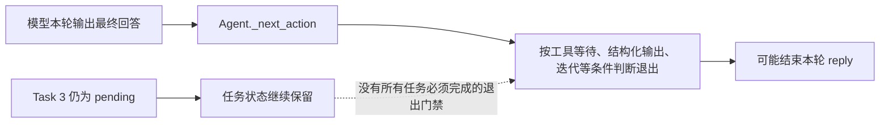

这张图专门区分“会话里还记得任务”和“当前回复一定持续运行”。自动持续推进、外部验收后才能停等要求，应在控制层增加明确策略，而不是只强化 TaskCreate 的工具描述。

## 16. 验证导航与结论边界

| 测试入口 | 已有覆盖方向 |
|---|---|
| [task_tool_test.py](../../open/agentscope/tests/task_tool_test.py) | 直接创建/读取/更新，metadata，依赖、完成解除与删除 |
| [toolkit_task_test.py](../../open/agentscope/tests/toolkit_task_test.py) | 经 Toolkit 调用及 AgentState 注入 |
| [permission_mode_test.py](../../open/agentscope/tests/permission_mode_test.py) | EXPLORE 读写、规则优先级、Bash 行为 |
| [permission_engine_test.py](../../open/agentscope/tests/permission_engine_test.py) | 权限引擎通用分支 |

本轮没有执行测试、启动 UI 或调用 LLM。完整模型行为、异常断流后的通知、跨 worker 更新、EXPLORE 与 Task 工具组合，以及版本化审批均未运行验证。文中把源码明确行为、静态推导和建议补充分别说明，不能把测试文件存在当作上述全部性质已被验证。

细化版已检查源码链接、Markdown 围栏配对和 Mermaid 图块类型；当前环境未使用 Mermaid 渲染器逐图渲染，实际布局仍取决于阅读器的 Mermaid 版本与容器宽度。

建议精读顺序：Task → TaskCreate/Update → Toolkit 状态注入 → Agent 运行时提醒与退出决策 → EXPLORE 权限 → StateChangeMiddleware → TaskPanel → Chat 状态保存。
