# 消息渠道源码拆解：飞书、钉钉、Discord 的连接、路由与双向交互

分析对象为本地 AgentScope Python **2.0.12dev**，基准提交 `4474c832dfccfd4d9a54a6f0a79a636c34817625`。本文是编号 `16` 的专题，按实际代码区分当前实现、静态推导和需要应用补充的策略。未连接真实机器人、调用平台 API 或运行测试；平台行为只讨论仓库适配代码，不作为平台最新 API 配置指南。

核心结论：渠道不是给 Agent 换一个 HTTP 地址。它包含**渠道管理、长连接接收、消息归一化、确定性会话路由、后台执行、出站投递和人工确认恢复**。当前连接节点与执行节点可以分开，回复由执行节点构造 REST client 发送；不能把旧注释中的“dispatcher 订阅后转发回复”当成当前实现。

## 1. 先看三种平台的真实差异

| 维度 | 飞书 Feishu | 钉钉 DingTalk | Discord |
|---|---|---|---|
| 入站 SDK | lark-oapi WebSocket | dingtalk-stream + 可停止子类 | discord.py Gateway |
| 入站执行位置 | 独立线程与事件循环，回调桥接应用 loop | 应用 asyncio loop，连接获取用 to_thread | 应用 asyncio loop |
| 凭证 | app_id、app_secret | client_id、client_secret | bot_token、application_id |
| 群聊默认 | only_at_reply=True | only_at_reply=True | only_at_reply=True |
| 群聊 @ 判断 | 核对 bot open_id，不明身份时拒绝 | isInAtList 明确为 False 才丢弃 | bot user 是否在 mentions |
| 回复流式 | CardKit 卡片更新 | 配置模板则 AI Card 更新，默认有模板 | 当前非流式，结束后分段发送 |
| 纯文字分段上限 | 配置声明 4000 字符 | 配置声明 4000 字符 | 配置声明 2000 字符 |
| 审批 UI | 每工具一张 interactive card | 每工具一张模板审批卡 | 每工具一个按钮 View |
| 平台额外工具 | 列群、群成员、发消息/图/文件 | 会话、用户查询、发消息/图/文件、条件 Wiki | 未覆写 list_tools，默认无这些专用工具 |
| 交互式凭证绑定 | FeishuCredentialBinding 设备流程 | 当前类没有配置 provider | 当前类没有配置 provider |

表中的长度是代码使用的字符切分限制，不是所有卡片、附件、Markdown 渲染和平台配额的统一上限。interactive 标记也不证明跨进程或重启后按钮回调已端到端验证。

## 2. 源码地图：从哪里进入

| 层次 | 入口 | 重点 |
|---|---|---|
| 存储模型 | [storage/_model/_channel.py](../../open/agentscope/src/agentscope/app/storage/_model/_channel.py) | ChannelRecord、RoutingConfig、SessionScope |
| 统一协议 | [channel/_base.py](../../open/agentscope/src/agentscope/app/channel/_base.py) | 事件、能力、渲染与 ChannelBase |
| 类型注册 | [channel/_registry.py](../../open/agentscope/src/agentscope/app/channel/_registry.py) | 配置 schema、实例构造 |
| 管理服务 | [_service/_channel.py](../../open/agentscope/src/agentscope/app/_service/_channel.py) | CRUD、bot 唯一索引、状态 |
| 管理 API | [_router/_channel.py](../../open/agentscope/src/agentscope/app/_router/_channel.py) | owner 检查与安全响应 |
| 生命周期 | [channel/_dispatcher.py](../../open/agentscope/src/agentscope/app/channel/_dispatcher.py) | reconcile、监听任务、heartbeat |
| 独立 worker | [channel/worker](../../open/agentscope/src/agentscope/app/channel/worker/__init__.py) | 连接进程与共享后端 |
| 入站编排 | [channel/_gateway.py](../../open/agentscope/src/agentscope/app/channel/_gateway.py) | busy/idle、附件、会话创建 |
| 会话路由 | [channel/_routing.py](../../open/agentscope/src/agentscope/app/channel/_routing.py) | 首个匹配与 UUIDv5 |
| 出站 runtime | [channel/_clients.py](../../open/agentscope/src/agentscope/app/channel/_clients.py) | REST client 缓存和 delivery task |
| 事件读取 | [channel/_stream.py](../../open/agentscope/src/agentscope/app/channel/_stream.py) | replay/live 交接与终止条件 |
| 确认恢复 | [channel/_decision.py](../../open/agentscope/src/agentscope/app/channel/_decision.py) | 从权威 state 找 ASKING 调用 |
| Agent 接入 | [_service/_chat.py](../../open/agentscope/src/agentscope/app/_service/_chat.py) | origin、工具、系统提示与 deliver |
| 飞书 | [_feishu/_channel.py](../../open/agentscope/src/agentscope/app/channel/_feishu/_channel.py) | 线程、归一化、CardKit、REST |
| 钉钉 | [_dingtalk/_channel.py](../../open/agentscope/src/agentscope/app/channel/_dingtalk/_channel.py) | Stream、消息、卡片与媒体 |
| 钉钉 API | [_dingtalk/_openapi.py](../../open/agentscope/src/agentscope/app/channel/_dingtalk/_openapi.py) | token、上传下载、发送与 Wiki |
| 钉钉审批协议 | [_dingtalk/_card.py](../../open/agentscope/src/agentscope/app/channel/_dingtalk/_card.py) | tracking ID、参数预算、回调解析 |
| 飞书审批协议 | [_feishu/_card_templates.py](../../open/agentscope/src/agentscope/app/channel/_feishu/_card_templates.py) | 卡片内容与 action 值解析 |
| Discord | [_discord/_channel.py](../../open/agentscope/src/agentscope/app/channel/_discord/_channel.py) | Gateway、REST-only client、按钮 |

## 3. 整体架构：控制面、入站和出站分别负责什么

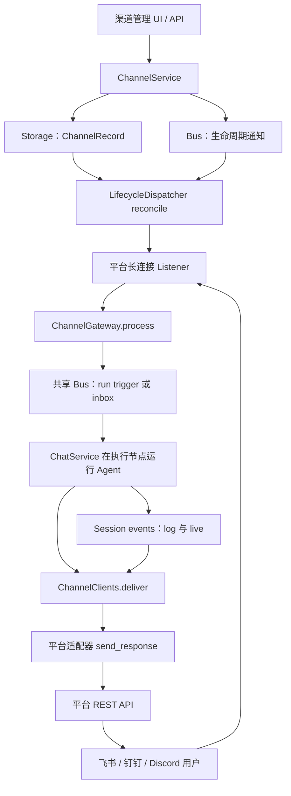

ChannelGateway 不收集答案，也不等待 Agent 完成。Dispatcher 当前只保持长连接、协调本节点实例和发布状态。ChannelClients 拥有出站 client 与投递任务，执行 Agent 的节点无需持有平台 Gateway 连接。

这一设计让定时任务和后台唤醒也能回到会话绑定的聊天，而不限于“刚收到一条平台消息”的请求栈。

## 4. 数据契约：平台身份不是应用用户身份

### 4.1 ChannelEvent

主要字段为 channel_id、channel_user_id/name、chat_id/name、channel_message_id、content、metadata、received_at。

content 复用 TextBlock/DataBlock，因此后续可直接构造 UserMsg。message 属性只拼接 TextBlock，是便利访问，不是另一份真实正文。

| 标识 | 实际含义 | 不应混用 |
|---|---|---|
| ChannelRecord.user_id | AgentScope 侧渠道 owner | 平台发言人 ID |
| channel_user_id | 平台用户 ID | 应用账号或可信审批权限 |
| chat_id | 平台聊天/群/频道 | AgentScope session_id |
| channel_message_id | 平台消息 ID | Agent tool_call_id 或自动去重键 |
| session_id | 路由派生的应用会话 | 某条平台消息 |

平台用户通过渠道进入 owner 所属的 AgentScope 资源域，代码没有在这里把每个 sender 自动创建成独立应用账号。群成员能否触发某个高权限 Agent，应由渠道访问和业务策略补充约束。

### 4.2 ChannelConfirmationResultEvent

字段包含 channel/chat/user、可选固定 agent_id/session_id、tool_call_id、approved 与 actor。它只带查找键和决定，不把卡片上的工具参数当执行权威。

actor 是可记录的字段，但当前 Gateway 调 resume_after_decision 时没有继续传入 actor 做审批人验证。不能因事件包含 user ID 就推导已实现管理员审批 ACL。

## 5. 注册与渠道管理：配置如何变成活连接

ChannelTypeRegistry 从 `create_app(channels=[...])` 接收类，按 channel_type 注册；Credentials/Config 嵌套 Pydantic 模型生成前端表单 schema，也用于 create_channel 的实例构造校验。

register 对相同 channel_type 后写覆盖，不应假设重复注册一定报错。没有注册的类型不能构造实例。

ChannelService.create 抽取平台 bot 标识，先查询唯一索引，保存 record 后发生命周期通知。bot 标识分别来自 app_id、client_id、application_id；真正并发唯一约束是否原子由 storage backend 决定，先查后写本身不提供跨进程唯一保证。

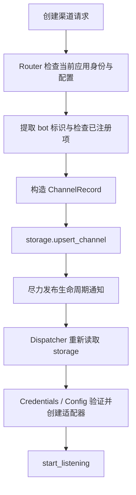

管理 API 的 _owned 检查 record.user_id，_to_response 不返回 credentials，而是展示 platform_bot_id 等配置。存储模型明确说明当前 at-rest encryption 仍是未来 hook；API 不回传秘密不等于数据库已加密。

当前 update 主动删除 updates 中 credentials 和 channel_type：常规更新不能直接更换凭证或类型，需要重建渠道。ChannelClients 具备“record 版本变化时替换实例”的能力，不应误说当前管理 API 已支持任意凭证热轮换。

## 6. 生命周期：reconcile 与 heartbeat

### 6.1 Dispatcher 的比较规则

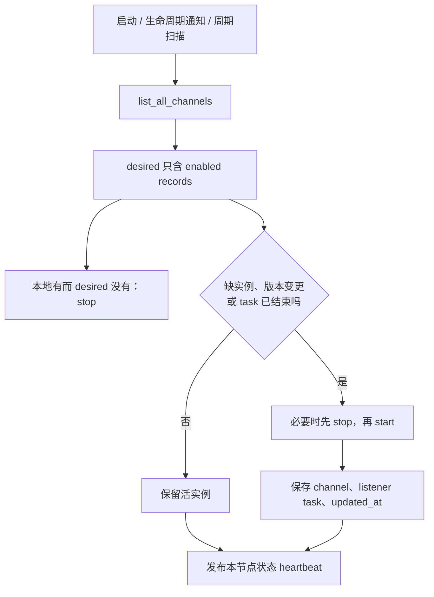

failed 的 adapter 可能故意保持 task 活着，因此 task.done=False；周期 reconcile 不会不断重启坏凭证。编辑配置使 updated_at 变化，才会重新尝试。

周期为 10 秒，状态可信窗口为 30 秒。每个报告有 reported_at，读端不能只相信 registry 整体 TTL，因为旧节点字段可能被新节点续活整个 namespace 后长期保留。

### 6.2 状态不是分布式选主

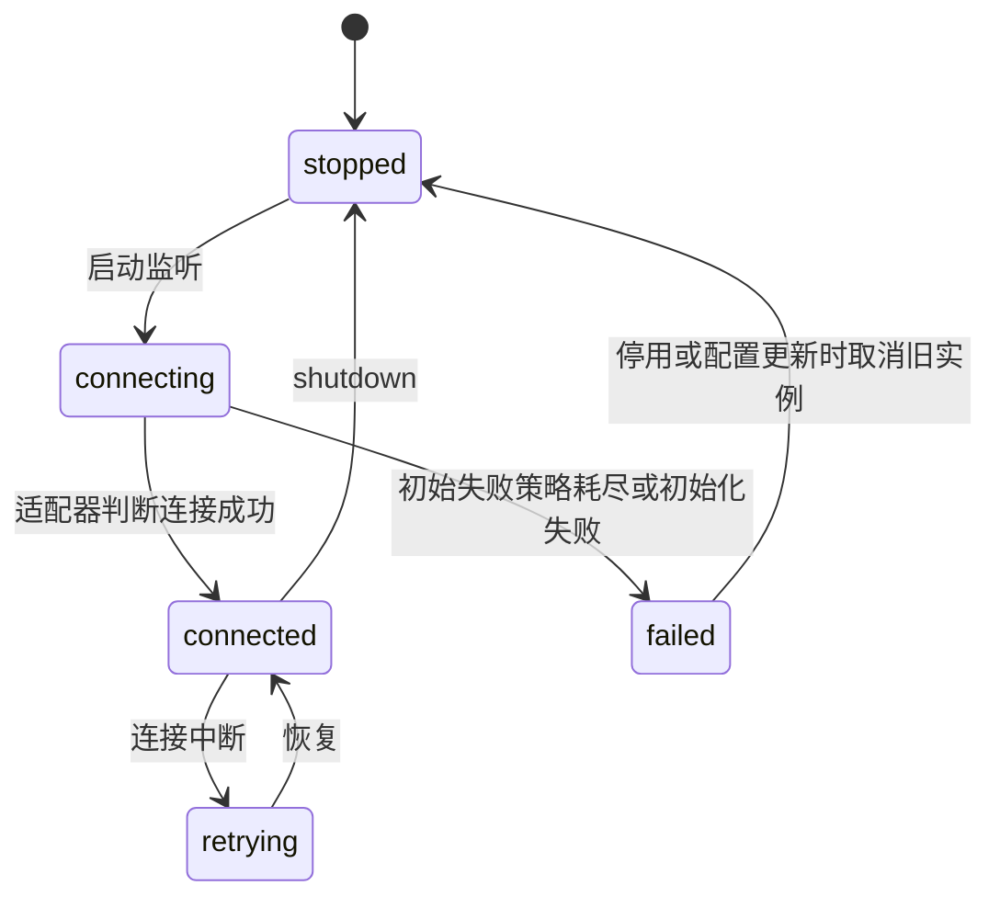

状态是各 adapter 的观测，不是执行健康证明。Feishu 与 Discord 有初始两次失败后 parked 的策略；DingTalk 在可停止 Stream 子类内自行重连，外层异常才 parked，不能把所有平台统一成“两次后失败”。

get_status 优先返回新鲜 connected 报告；没有新鲜报告而 record enabled 时返回 connecting。这个值可能只是“尚未被 worker 接管”，不证明正在真实握手。

Dispatcher 没有按 channel_id 做集群唯一租约，所有启用它的节点都会 reconcile。heartbeat 只是观测，不是选主锁；多副本部署要明确谁持有连接。

## 7. 路由：首个匹配与确定性 session ID

RoutingConfig 是有序 ChannelBinding 列表，要求至少一项、恰有一个 catch-all 且在末尾，不允许重复 match_key/match_value。匹配 chat_id、user_id 或 metadata 的字符串值；星号表示全匹配，其余是相等比较，不是任意 glob。

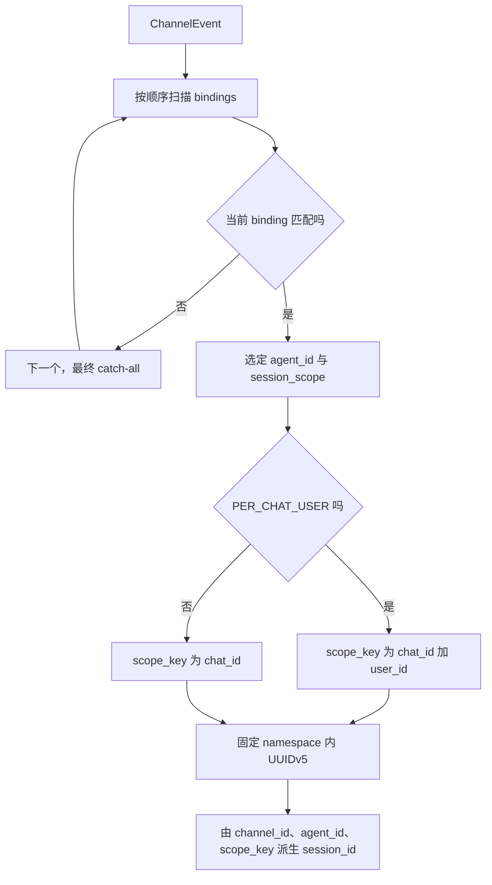

UUID namespace 固定为由 `agentscope.channel.session` 派生的值；改变 namespace 会使旧会话无法按同一路径再次定位。更换 agent 路由也会改变 session ID，而不是把旧上下文自动迁给新 Agent。

源码中的派生关键段为：

```python
_SESSION_NAMESPACE = uuid5(NAMESPACE_URL, "agentscope.channel.session")
scope_key = (
    f"{event.chat_id}:{event.channel_user_id}"
    if binding.session_scope is SessionScope.PER_CHAT_USER
    else event.chat_id
)
session_id = str(uuid5(
    _SESSION_NAMESPACE,
    f"{record.id}:{binding.agent_id}:{scope_key}",
))
```

这里不是将完整 platform event 做 hash，message_id 不参与会话 ID；相同用户连续多条消息落同一会话，而不会每条消息创建独立上下文。

| 场景 | PER_CHAT | PER_CHAT_USER |
|---|---|---|
| 群 G 中甲乙发言 | 共用一个会话 | 各有一个会话 |
| 甲在群 G 与群 H | 两个会话 | 两个会话 |
| 同群改路由至另一 agent | 新 agent 对应另一 session | 同样改变 session |
| 输出去向 | 仍回该 chat_id | 仍回该 chat_id |

**会话隔离不等于输出私密**：PER_CHAT_USER 分离模型上下文，但答案仍可发回公开群，不能把它当私聊通道。

## 8. Gateway：附件合并、忙会话和新用户轮次

### 8.1 普通消息主链

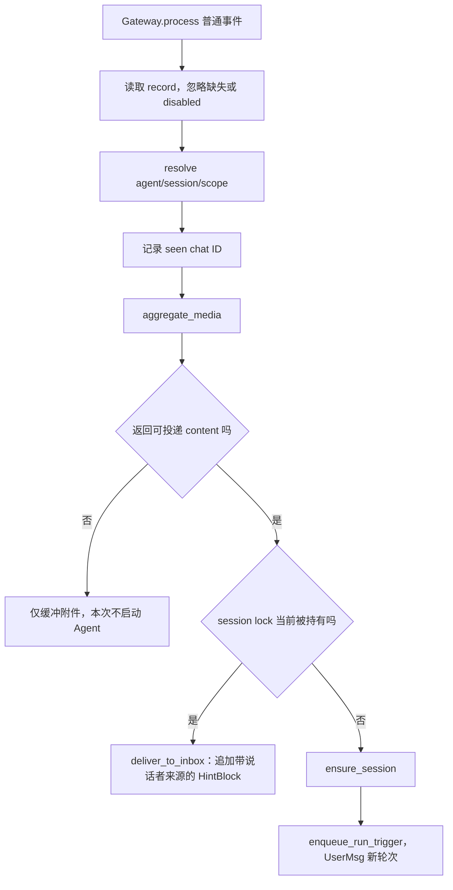

消息进入 busy session 时不是再启动一个同时写同份 state 的 Agent，而是给运行中的回路投递 inbox hint。is_locked 只是一次观测，不是 check-and-act 事务；实际调度仍依赖后续 dispatcher、inbox/wakeup 与会话锁，不能从此分支推导精确一次或严格到达顺序。

UserMsg.name 使用 channel_user_id；busy Hint 的 source 使用显示名或 ID。用户身份不会因为 display name 相同自动合并。

### 8.2 纯附件为什么没有立即回答

buffer key 按 channel_id、chat_id、channel_user_id 隔离；纯 DataBlock 逐项 queue_push，TTL=300 秒，返回 None。下一条包含任何 TextBlock 的消息 queue_drain，最多取 9 个附件，并放到当前 content 前面。

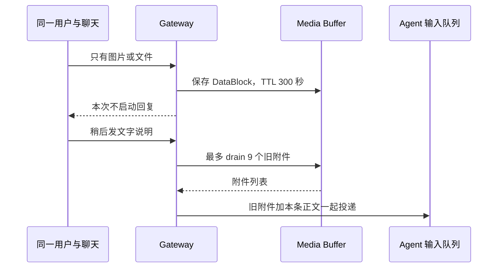

300 秒是 bus TTL 配置，具体续期与余下项目行为依赖 backend。9 是单次 drain 上限，不是“附件队列总长绝不会超过 9”；代码也不是按 message_id 配对，只能把同发送者随后文字视为关联说明。

has_text 判断是 TextBlock 的存在，不是检查文字非空。语音带平台识别文字时可直接触发，单独图片没有 TextBlock 则继续等待。

### 8.3 ensure_session 只在首次创建时复制配置

首次会话由 ChannelRecord.session 复制主/备模型与 permission_mode，并经 WorkspaceManager 分配 workspace_id，保存 ChannelOrigin(channel/chat/sender)。已存在 session 则直接返回。

因此修改渠道默认模型或权限不会在这里自动覆盖所有旧会话。初始 state 的 session_id 与服务执行时设置的会话身份还应按 ChatService 的装配路径理解，不应只读创建函数就认定所有运行字段已就绪。

## 9. ChatService：渠道怎样影响实际 Agent

服务从 SessionRecord.origin 取 ChannelOrigin，通过 ChannelClients.get 获取不连接 Gateway 的 client，调用 chat_kind，再构建渠道工具与 system-notification。

提示会告诉主模型当前平台、chat ID/名称、群聊还是私聊，以及额外平台工具。它解释语境，不授予平台权限。

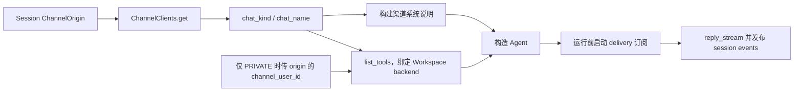

只有 ChatKind.PRIVATE 才把平台 user ID 传给需要“以用户身份读取”的 Wiki 工具；GROUP 或未知不给。即便 PER_CHAT_USER 分离了群成员上下文，当前这条判断仍看 chat_kind，不会自动给群聊开启用户 Wiki 读取。

ChannelOrigin 还使定时/后台 run 能回原群：ChatService 在运行前调用 deliver，不要求此刻存在一条新平台消息。

## 10. 出站：ChannelClients 与事件流

### 10.1 client 缓存、退休和关闭

缓存按 channel_id + updated_at。记录消失、停用或版本变更时 retire 旧实例；不立即 aclose，因为正在执行的工具可能还持有它。shutdown 先取消 delivery tasks，再关闭 cached 和 retired clients。

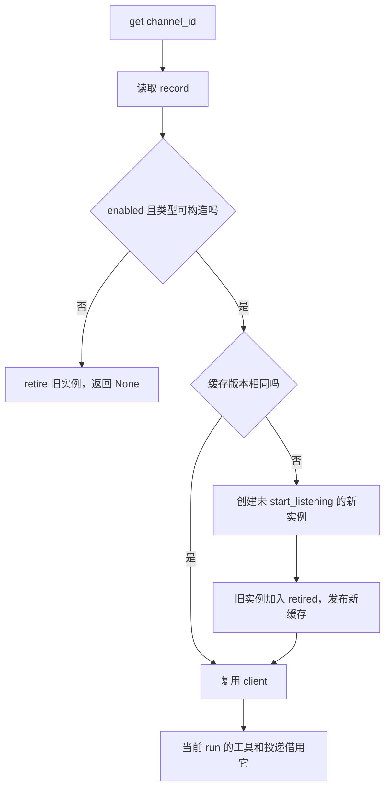

retired 延迟到进程结束才释放，频繁配置变更会积累闲置 client。共享的是平台客户端与缓存，reply 累计器必须是 send_response 内的局部变量；不能用 self.reply 保存不同 run 的内容。

### 10.2 deliver 先建立订阅，再放行模型执行

deliver 构造合成 ChannelEvent，只含 chat 目标以及 metadata 中的 agent_id/session_id，不带原始 sender/message ID。普通回传因此不一定是对用户原消息的线程回复，飞书 _send 在没有 reply_to 时直接向 chat 发新消息。

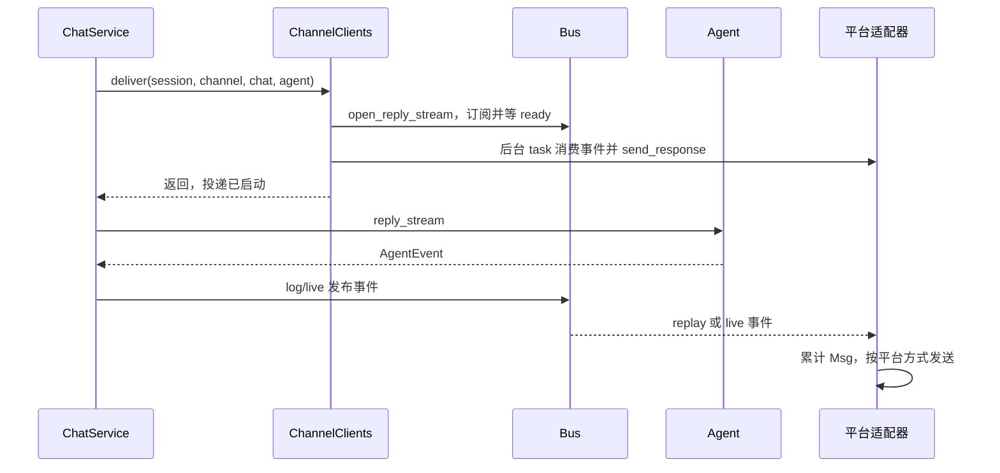

投递后台运行，不阻塞 Agent 等整个平台发送结束。失败只记日志，不能从 Agent 正常完成推断用户已经成功收到；本路径没有完整投递 outbox/重试账本。

### 10.3 open_reply_stream 的终止边界

先订阅、等待 ready（5 秒超时），再读 persisted checkpoint 后的 replay，随后消费 live，按 entry_id 去重。队列与 seen 集合在这里没有额外容量上限。

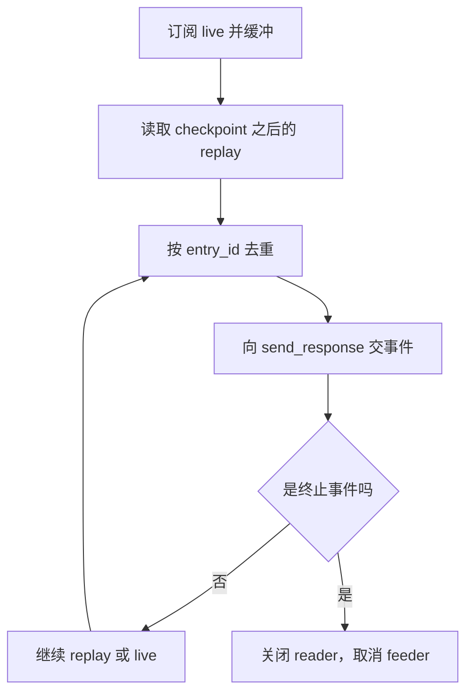

终止事件包括 REPLY_END、REQUIRE_USER_CONFIRM、REQUIRE_EXTERNAL_EXECUTION。park 时没有正常 ReplyEnd，所以 reader 必须在请求人工/外部执行时结束。

这也带来一个需要验证的边界：并发批若连续发多个独立确认事件，reader 在第一个终止事件就返回，不能据此保证余下确认都已在同次渠道投递中展示。恢复与后续 delivery 如何覆盖该组合应做集成测试。

## 11. 公共渲染：UI 看到的内容不等于完整执行历史

_EVENT_ADAPTER 把 bus dict 还原 AgentEvent；各 send_response 用 Msg.append_event 累计。

ChannelBase._render 收集 TextBlock；ThinkingBlock 和工具过程按配置显示，默认两个开关都 False。工具结果只有 output 为 str 且开启过程显示时才直接加入文本；DataBlock 独立收集。

它先输出合并文本，再输出数据块，因此并非总能保持原始文本/附件交错顺序。HintBlock 不在这里作为正常消息正文展示；用户收到回复不等于看到了注入模型的全部 RAG 或记忆证据。

ERROR 且没有文字时用通用错误提示；没文字也没数据则用 no-text 占位。_split_long_message 是 Python 字符定长切片，不维护 Markdown 代码围栏、表格和 Discord mention 的语义完整性。

URLSource 附件在这些自动回传分支没有统一下载转发；各平台主要发送 Base64Source。模型给一个 workspace 路径也不会自动变为可下载附件，需要工具/事件明确产生或发送文件。

## 12. 飞书：独立 SDK 线程与应用事件循环

### 12.1 start_listening 和线程桥接

`_feishu/_channel.py:183` 保存 emit 和应用 loop，获取 tenant token 与 bot open_id，然后启动 daemon WS thread。SDK 的消息回调通过 run_coroutine_threadsafe 把 _on_message 放回应用 loop；card callback 同样异步调度决定，并同步给 SDK 返回 toast/card 响应。

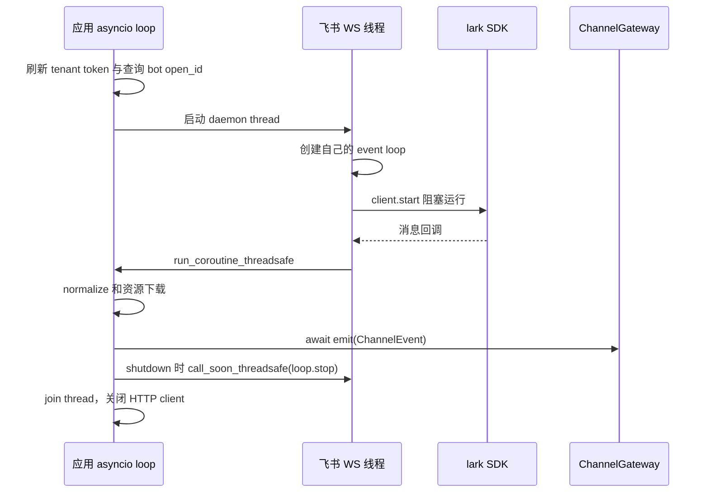

SDK 使用 import-time 全局 loop，源码以 _ThreadLoopProxy 委派到线程自己的 loop，避免多个 bot 共享同一 SDK loop。它依赖 SDK 内部结构，升级 lark-oapi 时应测试，而不是视为标准 asyncio API 契约。

连接状态判断也有精确边界：外层每隔 5 秒检查线程存活并标 connected，不是完整的应用层收发探针；uptime≥60 秒才重置退避。初次始终未成功最多两次后 failed parked；此前连上过则继续重试。

finally 设置 stop，停止 WS loop，join 最多 5 秒，并关 HTTP。超时 join 不等于所有 SDK 底层线程/资源绝对已终止，仍需实际版本验证。

### 12.2 normalize 与群聊过滤顺序

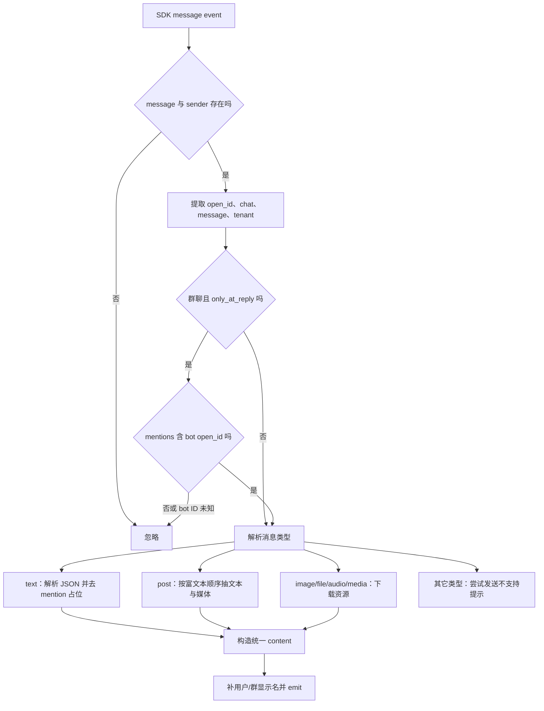

@ 过滤在下载媒体之前发生，避免未 @ 的群图片被下载后混进下次请求。只 @ 其它成员不算 @ 机器人；无法识别 bot ID 时 fail closed。

post 处理 title、text、a、img、media，遇图片先 flush 已累积文字，尽量保留正文顺序。但链接优先取显示文字，未必同时保留 href，复杂富文本语义不能声称无损转换。

### 12.3 媒体下载与 token 刷新

_download_media 从 image_key/file_key 找资源，使用消息资源 endpoint 下载 resp.content，再 base64。该函数没有钉钉式可配置 max_media_bytes 流读取上限，因此不应将钉钉的 10MiB 限制泛化至飞书。

_ensure_ready 延迟创建 HTTP/token，支持 REST-only 实例。_api 和 _upload 遇已列出的 token 过期 code 时刷新一次并重试；没有通用无限重试，_download_resource 也没有复用同一套过期重试分支。

配置值和平台错误可能进入日志；租户 token 缓存在对象中，当前刷新逻辑没有钉钉那样显式 token_lock，不宜推导并发首次刷新已串行。

### 12.4 CardKit 流式回复

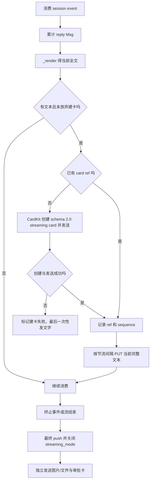

_card_push 每次写当前全文并递增 sequence，不是只追加本次 token。当前飞书更新节流间隔为 0.7 秒；最终 _finish_card 仍补完整内容，随后关闭 streaming mode。

需保留两个边界：

- 明确降级判断主要在 _card_open：建卡或发送失败返回 None，最后发分段文字；已有卡的 _card_push 返回 None 且不检查 API 成功，不能声称更新失败都自动切换文本。
- _render 对空 reply 可以产生 no-text 占位，而飞书没有钉钉的 _has_streaming_text guard，可能在真正文本到达前先建卡展示占位；需真实事件序列验证体验。

自动投递的 target 通常无原 message_id，因此 _send 走发送到 chat 而非 reply-to 原消息。SDK 具备 reply 接口不代表当前后台 delivery 保留了原消息线程关系。

### 12.5 审批卡回调

_present_confirm 每个工具一张卡，显示工具名与截到 800 字符的参数，payload 带 tool/chat/agent/session 标识。_on_card_action 解析 action，获取 operator.open_id，调度 Gateway emit，并同步返回已同意/拒绝的卡片响应。

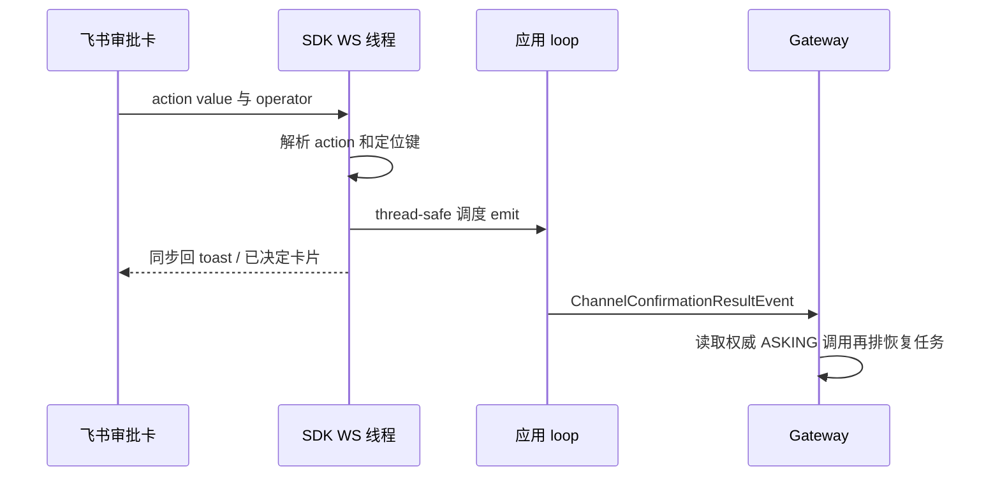

卡片先更新不证明工具已经执行；异步提交可能失败或发现旧点击无效。open_id 的存在也不等于它具有业务批准资格。

## 13. 钉钉：可停止 Stream、编码目标与 AI Card

### 13.1 为什么没有原样调用官方 SDK 生命周期

源码为所用 SDK 的关闭行为定义 _StoppableStreamClient：连接票据获取 via asyncio.to_thread(open_connection)，用 websockets.connect 进入连接，后台处理消息，显式保存 keepalive 和 worker tasks。

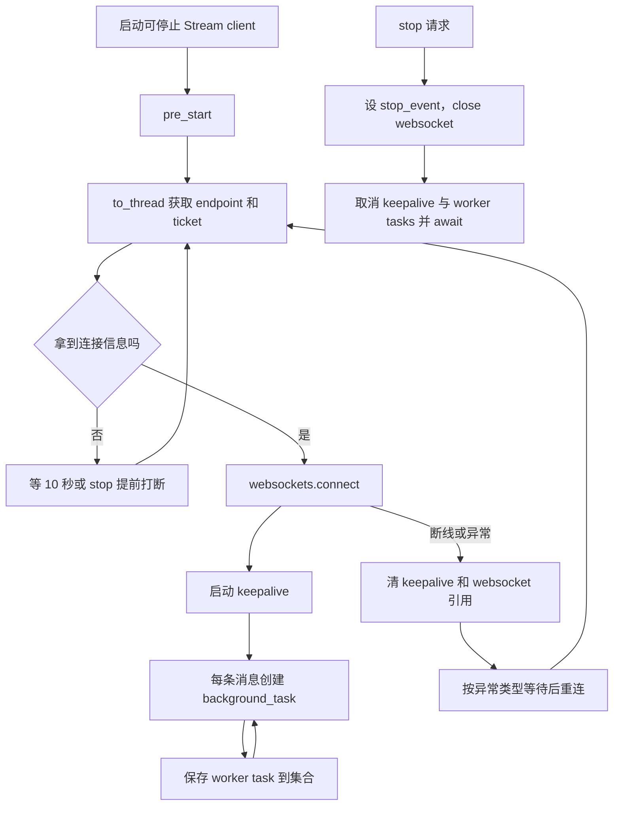

连接断开异常等待 10 秒，一般异常等待 3 秒；无连接信息也等 10 秒，等待可被 stop_event 提前解除。CancelledError 明确重抛，不吞取消继续永久重连。

外层每 0.2 秒看 websocket 是否存在，标 connected/retrying。消息和高级卡片分别注册到 `/v1.0/im/bot/messages/get`、`/v1.0/card/instances/callback`，handler 抛异常返回 SYSTEM_EXCEPTION，否则返回 OK。

注意 Gateway.process 自己会捕获普通异常并记日志。因此 SDK 看到 handler 正常返回不必然表示下游队列或存储都成功，不能把 ACK OK 当完整业务事务提交。

### 13.2 入站目标不是直接使用原 conversation ID

群聊 conversationType=`"2"`，chat_id 编成 `group:<conversationId>`；私聊按 senderStaffId 或 senderId 编成 `user:<sender>`。缺少稳定 sender/target 直接忽略。

这避免同一字符串的群与用户目标混淆。_send_message 再按前缀选择 groupMessages/send 或 oToMessages/batchSend，不能给钉钉工具随意传飞书 chat ID 或裸会话 ID。

群聊 only_at_reply 条件是 `payload.get('isInAtList') is False`：字段缺失并不等于 False，也不会像飞书那样核验机器人 open_id。描述都叫只 @ 回复，但实现条件不同，兼容 payload 测试应覆盖缺字段。

### 13.3 消息类型与媒体安全边界

text 提取 text.content；picture/audio/video/file 可带 downloadCode；audio 等若有 recognition，先放入 TextBlock；richText 逐项保留文字/图片相对顺序。

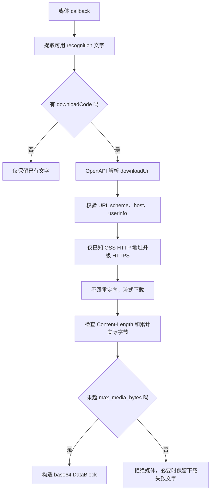

默认媒体限制 10MiB，可配至 100MiB，入站和出站都使用。_safe_download_url 拒绝 userinfo、localhost、非 global 字面 IP；允许 HTTPS，HTTP 只对 `.aliyuncs.com` 升级。它不是完整 DNS/IP 级出站 ACL，不能据此宣称已阻止所有域名解析到私网的场景。

出站 _send_data 只接受 Base64Source，validate=True 解码，检查实际字节，清理文件名的路径部分。过大附件返回 False；自动 send_response 没有把每个失败都转成用户可见 ERROR，因此需要日志与平台回执观测。

### 13.4 token 缓存与发送成功含义

_DingTalkOpenAPI._access_token 用 monotonic 过期时间和 asyncio.Lock 双检查刷新，预留 `min(buffer, max(expireIn//10,1))` 秒提前刷新。它不同于飞书通过已知过期 code 触发一次重试的主要路径。

send_text 使用 Markdown 模板，按 user/group target 发 API；成功表示平台接受请求，不证明最终用户已阅读。HTTP 4xx 与业务 code 不成功会返回 False 并保留部分错误正文日志。

### 13.5 流式是实例能力，不只看类属性

类 capabilities.streaming=False；构造实例按 bool(config.streaming_card_template_id) 覆盖。默认有公开模板，所以默认实例可以流式；清空模板后改为完整 Markdown 回复。

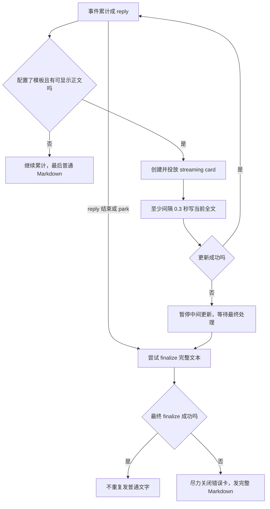

中间失败不必然意味着最终一定降级：_finish_streaming_card 还会尝试 finalize，最终成功仍以卡片为准。配置为空时不调用创建流式卡；_has_streaming_text 避免仅因 no-text 占位就启动卡片。

### 13.6 审批卡的定位与参数预算

审批模板可配置；为空时发明确错误文字，但 Agent 仍然 parked，不能自动批准，也不能自动当拒绝。创建失败同样提示检查模板与权限。

tracking ID 为 `uuid4().hex + tool_call_id`，前 32 字符保证同名工具 ID 不会复用卡片 tracking；callback 可从尾部还原 call ID。工具参数按 UTF-8 前 900 bytes 截断，保护卡片参数预算；这只是展示，不改执行参数。

_parse_card_callback 接受 cardPrivateData.params 为 dict 或 JSON，识别 action/id 的 allow/approve/agree/reject 等拼写。它不靠未确定的 type 值过滤；chat 可从 params 或 spaceType/spaceId 还原，agent/session 若缺失交 Gateway fallback 搜索。

当前 approver_id 被解析成字段，但此 helper 没比较点击者与 approver_id 是否相等。_on_card_callback 先 await emit 再更新已处理卡；Gateway 吞异常或旧点击无效时，卡片显示决定也不代表真实工具已运行。

## 14. Discord：原生 asyncio、REST-only 与按钮的边界

### 14.1 连接、入站与身份过滤

start_listening 创建 discord.Client，打开 message_content intent，注册 on_message/on_ready。on_ready 标 connected；初始两次失败后 parked；曾成功连接后会继续重试，discord.py 还有自身重连逻辑。

_on_message 只明确过滤机器人自己的 author.id，不是过滤所有 bot。群/服务器频道默认要求 bot 在 message.mentions，DM 不要求；去 `<@id>` 与 `<@!id>` 后下载每个 attachment.read()，生成 Base64Source，再追加非空文字。

没有类似钉钉的 max_media_bytes 检查在这段适配代码中；外部平台与 SDK 仍可能限流/限附件，但不能把那些限制当此实现的流式内存上限。

### 14.2 出站 client 可以只 login，不连 Gateway

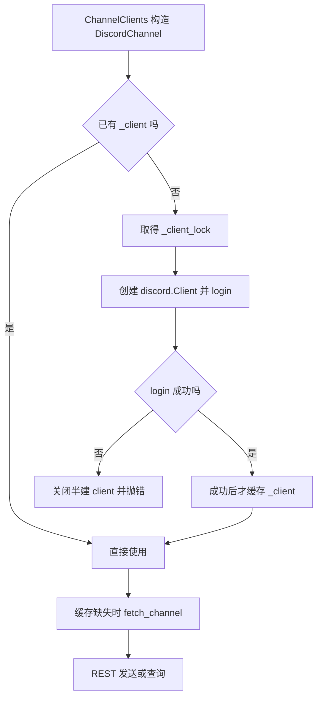

list_bot_chats 使用 fetch_guilds/fetch_channels，不依赖只 login 实例为空的 Gateway guild cache。chat_kind 把 DMChannel 当 PRIVATE，其余已解析频道当 GROUP；无法解析时返回 None，chat_name 返回空串。

### 14.3 回复不做 token 级 edit

send_response 累计 session event，遇 RequireUserConfirm 保存请求并退出，或遇 ReplyEnd 结束。最后 _render，文字按 2000 字符发送多条，Base64Source 以 discord.File 发送，随后才展示审批 View。

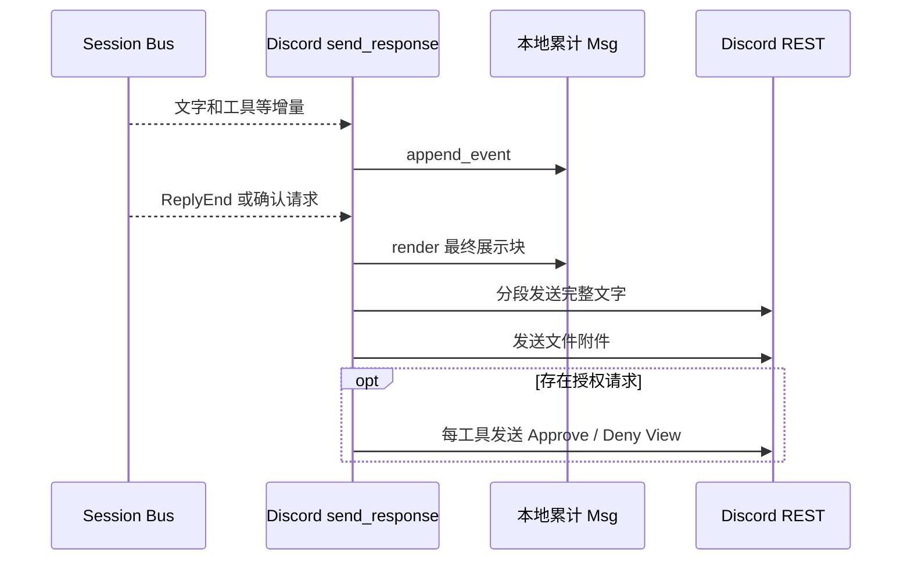

流式 Agent 不等于流式平台体验；此 adapter 没有用 message.edit 持续更新普通回复。

### 14.4 timeout=None 不等于跨重启持久交互

_build_view 构造 timeout=None 的 _ApprovalView，回调捕获 tool_call_id 和目标 agent/session。_decide 先 defer，尝试 edit 卡片并移除 View，再在 self._emit 存在时提交决定。

需要特别核实拆分进程后的交互：

1. 发送 View 的 client 可能是执行节点的 REST-only 实例。
2. 真正接收 Discord Gateway interaction 的 client 是另一个监听实例。
3. 当前代码没有看到共享 View registry、跨 client 转发或启动时 add_view 恢复的实现。
4. REST-only 实例也未调用 start_listening 设置 emit。

因此“同一个 connected 实例中按钮可回调”的局部逻辑，不能证明当前 ChannelClients 分离架构下按钮端到端可用。timeout=None 只表示 View 自己不按时超时，不保证重启或跨节点恢复；应优先做真实机器人集成测试，并视结果补持久 custom_id/interaction 路由。

这是基于实例归属的静态风险，不是已运行复现的故障结论。当前 Discord 测试主要覆盖聊天查询行为，不能用它们证明上述跨 client 审批链路。

## 15. 统一确认恢复：卡片只带定位键

```mermaid
sequenceDiagram
    participant P as 平台卡片回调
    participant G as ChannelGateway
    participant S as Storage
    participant Q as Run Trigger Queue
    participant A as Agent
    P->>G: tool_call_id 和 approved，附目标键
    G->>S: 读取渠道并确认 enabled
    G->>G: 优先用 pinned agent/session，否则 resolve
    G->>S: 读取 session 与 Agent，查当前 ASKING 工具
    S-->>G: 权威 ToolCallBlock 与 reply_id
    alt 存在匹配 ASKING
        G->>Q: UserConfirmResultEvent，kind=RESUME
        Q->>A: 沿原 reply_id 恢复
    else 已处理或目标不匹配
        G->>G: 忽略或在同 chat 的其它 session 查找
    end
```

固定目标优先是为防止路由规则变化、metadata 缺失、不同群成员点击时错路由。老卡片没有目标键时，Gateway 会遍历该渠道服务的 session，只对同 chat 的候选尝试等待 call 匹配。

安全边界应准确表述：同 chat 限制在 fallback 遍历中明确存在；优先 pinned target 的 _resume 调用本身未再次核对 session.origin.chat_id。审批人身份、目标键完整性应由可信平台事件与业务策略共同保证，不能把这段写成完整卡片授权系统。

resume_after_decision 从 state 取真实工具，不使用卡片回传的参数；过时点击没有 ASKING 匹配时返回 False。但读取 state 与 enqueue 不是原子 claim，两个近同时点击仍可能各自入队，之后由会话串行和内核等待验证处理；这不是外部副作用 exactly-once 的证明。

## 16. 平台工具：自动回话与主动外发是两条能力路径

飞书 list_tools 返回列聊天、列成员、发消息、发图、发文件；钉钉返回会话、用户查找、发消息/图/文件，再叠加基类可用的 Wiki 工具。Discord 不覆写该方法，且无 wiki 标记，当前默认不提供同等专用工具。

```mermaid
flowchart LR
    R[Agent 正常回答事件] --> D[ChannelClients 自动投递到 origin.chat]
    L[模型显式调用平台发送工具] --> P[Tool schema 和权限引擎]
    P --> H[DEFAULT 下非只读发送请求确认]
    H --> F[文件从当前 Workspace backend 读取]
    F --> A[调用平台 API，目标可为其它群或用户]
```

自动回话不要求每条都再经一遍模型工具审批；主动发送工具则是普通 ToolBase，纳入权限与工具结果。两类输出可能同时发生，模型若既用 SendMessage 向本群发文字又最终重复回答，用户可能收到重复内容。

工具基类 is_concurrency_safe=False，文件绑定 workspace backend，而非任意宿主 open。权限方法对只读查询返回 ALLOW，对发送返回 ASK，但最终仍受模式与规则影响：BYPASS 可以跳过普通 ASK，DONT_ASK 可转拒绝，不能承诺所有发送永远显示卡片。

Wiki 基类只在 capabilities.wiki=True 且有明确 channel_user_id 时提供三种工具。当前钉钉实现这些 API，并在 OpenAPI 层解析用户 operator 身份；飞书虽有通用基类接口，当前 capabilities 未声明 wiki=True，不能把基类方法当成飞书已完成 Wiki 对接。

WikiDocument 使用分块分页与 next_start_index，不是把整库自动变为 AgentScope RAG 索引；与第 07 篇的向量知识库是不同能力路径。

## 17. 飞书交互式绑定：设备流程与凭证归属

[FeishuCredentialBinding](../../open/agentscope/src/agentscope/app/channel/_feishu/_credential_binding.py) 直接调用 registration endpoint，拆成 begin 与 advance，而不是把整段平台轮询绑死一个进程。

```mermaid
flowchart TD
    A[管理员开始绑定] --> B[begin 请求 device_code 与验证 URL]
    B --> S[服务保存 provider_state 和过期时间]
    S --> U[UI 展示链接或二维码]
    U --> P[管理员在平台批准]
    S --> C[客户端查询状态，服务推进一次 advance]
    C --> Q{平台返回什么}
    Q -->|pending| W[按 interval 等下一次查询]
    Q -->|slow_down| I[interval 加 5 秒]
    Q -->|Lark 租户| L[后续改用 Lark accounts domain]
    Q -->|client_id 与 secret| R[AUTHORIZED，等待 claim]
    Q -->|其它错误| E[FAILED]
    W --> C
    I --> C
    L --> C
    P -.影响下一次 poll.-> C
```

服务端 [CredentialBindingService](../../open/agentscope/src/agentscope/app/_service/_credential_binding.py) 管 user 归属、轮询节流、TTL、取消与一次 claim。授权成功是获取建渠道的凭证，不是授权某个聊天用户执行任意工具，也不是自动把设备批准映射成 AgentScope 业务审批。

DingTalk/Discord 当前没有配置 credential_binding，不能因为管理 UI 有通用绑定入口就假设三平台都可扫码建 bot。

## 18. 部署：一个连接 worker 与多个执行节点

```mermaid
flowchart LR
    P[平台消息] --> W[Channel Worker：持有长连接]
    W --> G[Gateway]
    G --> B[共享分布式 MessageBus]
    B --> A[API / Run Node A]
    B --> C[API / Run Node B]
    A --> R[平台 REST 回复]
    C --> R
    S[共享 Storage] --> W
    S --> A
    S --> C
```

run_channel_worker 管 storage、bus、workspace manager 与 dispatcher 的 AsyncExitStack，不运行 Agent 或 HTTP，也不直接投递回复。API 配 `enable_channel_worker=False`，但仍注册相同渠道类型用于客户端构造与管理 schema。

当前每个启用 dispatcher 的 worker 都会启动所有 enabled records，没有内置渠道分片/主节点租约。多连接在平台侧如何分发由各平台决定；Discord 还需 shard/interaction 协调。部署文档不能把“可多副本 API”直接扩大为“任意数量渠道 worker 都无重复消息”。

WorkspaceManager 还负责渠道新会话的 ID 分配；分进程时需保持 storage/bus/workspace 的实际可达与隔离一致。只把 storage 换 Redis 而 bus 仍在进程内，worker 与 API 不会自动互通。

### 18.1 应用接线片段

```python
from agentscope.app import create_app
from agentscope.app.channel import FeishuChannel, DingTalkChannel, DiscordChannel

CHANNEL_TYPES = [FeishuChannel, DingTalkChannel, DiscordChannel]

# 假定三个后端已由应用配置构造；这里只说明 API 侧能力装配。
app = create_app(
    storage=storage,
    message_bus=message_bus,
    workspace_manager=workspace_manager,
    channels=CHANNEL_TYPES,
    enable_channel_worker=False,
)
```

另一个进程调用 `run_channel_worker(storage=..., message_bus=..., workspace_manager=..., channels=CHANNEL_TYPES)` 持有连接。应为两个进程分别构造后端对象，指向一致的共享基础设施；不是把同一活跃 Python client 对象跨进程传递。

该片段只注册类型与服务能力，没有自动创建 bot 或 ChannelRecord。还需通过管理 API 配置对应凭证、session 模型以及以 catch-all 结束的路由。单进程演示可启用默认 channel worker，但这不是多副本连接协调方案。

## 19. 可靠性与权限：已有保证到哪里

| 问题 | 当前依据 | 仍需补充或验证 |
|---|---|---|
| 平台消息重复 | 保存 channel_message_id 但 Gateway 不据此去重 | 入站持久去重键与重试策略 |
| 平台 ACK | SDK handler 返回状态 | 下游失败被吞时的重投/恢复 |
| 出站失败 | delivery task 日志和部分 API bool | durable outbox、发送回执、幂等重试 |
| 群聊成员隔离 | PER_CHAT_USER 分 context | 同群输出可见性与真实 ACL |
| 卡片点击 | state 中 ASKING 权威工具 | 审批人角色与并发重复入队 |
| 多 worker | 本节点 reconcile 与 heartbeat | 分布式连接 owner / shard |
| 密钥保护 | API 不返回 credentials | 存储加密、日志脱敏、轮换流程 |
| 外部执行请求 | reader 在 REQUIRE_EXTERNAL_EXECUTION 终止 | 三适配器没有通用 AskUser/external UI 执行器 |
| 异步流订阅中断 | reader finally 尝试取消 feeder | feeder 非取消异常后 queue 等待等故障路径 |
| 修改默认模型/权限 | 新会话创建复制配置 | 旧会话迁移与版本策略 |

不要用更宽的 BYPASS 掩盖审批链路不可达：它会改变工具权限语义，而非修好卡片回调。渠道需要让用户回答 AskUser 时，也要另实现对应外部结果 UI 与回传协议，不能仅因 interactive=True 就声称已支持所有 HITL。

## 20. 贯穿案例：群里发图、补文字、审批发送报告

```mermaid
sequenceDiagram
    participant U as 群成员甲
    participant P as 平台 Adapter
    participant G as Gateway
    participant B as Bus / Storage
    participant A as ChatService / Agent
    participant O as 出站 Adapter
    U->>P: 发送被 @ 规则允许的图片
    P->>G: DataBlock
    G->>B: 媒体缓冲，不启动回复
    U->>P: 补发文字：分析图片并发送报告
    P->>G: TextBlock
    G->>B: drain 媒体并路由会话
    G->>B: 创建会话或投递 inbox / trigger
    B->>A: 执行 run
    A->>O: 先订阅会话事件开始 delivery
    A->>A: 模型读取附件并生成报告文件
    A->>B: 发送工具请求审批，state=ASKING
    B->>O: 确认事件
    O-->>U: 显示发送报告的审批卡
    U->>P: 点击同意
    P->>G: 定位键加 approved
    G->>B: 从 state 查工具，排 RESUME
    B->>A: 沿旧 reply 继续
    A->>A: 发文件工具读取 workspace 并上传发送
    A->>B: 最终回答事件和状态保存
    B->>O: 正常回复
    O-->>U: 完成说明
```

图假设平台回调与审批策略已正确部署，Discord 跨 client 的 View 分发需先验证。若 Agent 以纯文本模型运行，附件可能经模型输入降级/外置而非原生视觉理解；媒体进入 ChannelEvent 不证明模型已经“看懂图片”。

关键检查点是 ChannelEvent.content、派生 session_id、ChannelOrigin、tools schema、ASKING tool_call_id、恢复 reply_id、平台返回状态与最终存储快照。只看群里最后出现“已完成”，不能证明上述每层都成功。

## 21. 测试入口与故障定位

| 测试文件 | 已定位的覆盖方向 |
|---|---|
| [channel_routing_test.py](../../open/agentscope/tests/channel_routing_test.py) | catch-all、首匹配、metadata、作用域、确定性 ID |
| [channel_gateway_test.py](../../open/agentscope/tests/channel_gateway_test.py) | 渲染、附件缓冲、busy 输入、origin 和确认查找 |
| [channel_clients_test.py](../../open/agentscope/tests/channel_clients_test.py) | REST-only 构造、缓存/退休、投递 task、状态新鲜度 |
| [channel_stream_test.py](../../open/agentscope/tests/channel_stream_test.py) | checkpoint、回放/live、交界去重、park 终止 |
| [channel_worker_test.py](../../open/agentscope/tests/channel_worker_test.py) | 独立连接 worker 生命周期 |
| [channel_dingtalk_test.py](../../open/agentscope/tests/channel_dingtalk_test.py) | 卡片、媒体限额、编码目标、token/Wiki 与停止 |
| [channel_discord_test.py](../../open/agentscope/tests/channel_discord_test.py) | 聊天查询默认值、DM/群类型 |
| [service_chat_channel_delivery_test.py](../../open/agentscope/tests/service_chat_channel_delivery_test.py) | origin 出站、Web 不发平台、私聊用户工具范围 |
| [channel_feishu_credential_binding_test.py](../../open/agentscope/tests/channel_feishu_credential_binding_test.py) | 飞书设备绑定步骤 |
| [channel_credential_binding_test.py](../../open/agentscope/tests/channel_credential_binding_test.py) | 绑定服务归属、状态与 claim |

测试文件存在不代表本轮已执行，更不代表真实 bot 权限、CardKit 模板、Discord interaction 和多副本故障已验证。尤其要分别测试：监听正常但发送失败、发送正常但点击回调失败、重复平台消息、多个并发审批、重启后旧卡片、附件 TTL 和旧 session 配置。

| 现象 | 首先检查 |
|---|---|
| enabled 却无消息 | worker 是否启用、类型是否注册、平台连接状态与 @ gate |
| 状态总是 connecting | heartbeat 是否新鲜、worker 是否实际接管，而非只看 enabled |
| 发图片机器人不答 | 是否纯附件在等后续文字，以及群 @ 是否已先过滤 |
| 群成员上下文串用 | SessionScope、路由顺序与 Agent ID 是否改变 |
| 新模型配置不生效 | 是否已有 session，ensure_session 不覆盖旧配置 |
| 正常回答收不到 | ChannelClients delivery、event stream 与平台 API 日志 |
| 卡片显示同意但没执行 | emit 是否有路由、state 是否 ASKING、run trigger 是否消费 |
| Discord 卡片点了无反应 | View 所属 client、Gateway interaction 分发与重启恢复 |
| 钉钉不流式 | 实例模板配置、建卡与 finalize 返回值 |
| 飞书卡片更新停住 | _card_push API 返回、sequence 与配额，而不只看建卡成功 |

## 22. 阅读结论与后续扩展位置

新增平台优先实现 ChannelBase：Credentials/Config、start_listening/emit、send_response、REST-only 准备与 aclose；需要平台业务工具再覆写 list_tools。不要把会话路由、存储和私有 Agent loop 塞回每个 adapter。

业务成员白名单、审批人角色、消息去重、可靠投递、连接唯一 owner、secret 加密等应在相应控制面/执行点补齐。这里只是架构建议，未将它们描述成当前已经提供的默认功能。

本篇已静态追踪公共模型、registry/service/router、dispatcher、gateway/routing、clients/stream/decision、ChatService 渠道接入，以及三种 adapter 的主要收发和回调路径。未穷尽所有 Wiki block 转换、所有 SDK 内部 reconnect、storage 事务与平台权限配置。未运行单元测试或真实平台实验；Mermaid 只作为控制流解释，不能代替端到端可用性验证。

关联专题：[Agent Loop](02-Agent-Loop.md)、[状态与恢复](05-State-and-Session.md)、[Tools 与 MCP](08-Tools-Skills-MCP-and-Permissions.md)、[HITL](11-Human-in-the-Loop.md)、[权限治理](14-Security-Permissions-and-Protocol-Governance.md)。
