# Pipeline 流水线源码拆解：Goal、Team 与固定步骤 SOP

分析对象为本地 AgentScope Python **2.0.12dev**，基准提交 `4474c832dfccfd4d9a54a6f0a79a636c34817625`。本文是编号 `17` 的专题，以当前 checkout 为准，不混入旧版接口。图中建议方案、静态推导与当前控制流分别说明；本轮未运行 Agent、模型或测试。

核心判断：**Pipeline 统一的是消费接口，不是自动提供一个通用 DAG 调度器。** 当前 `agentscope.pipeline` 导出 PipelineProtocol、GoalPipeline、TeamMember、TeamPipeline。固定顺序里程碑由另一个 `agentscope.sop` 模块实现，服务端再为它增加持久会话与提交工具。

## 1. 先选对“流水线”的含义

| 需求 | 当前实现入口 | 控制顺序的人 |
|---|---|---|
| 一个目标反复执行与检查 | GoalPipeline | Python 固定 executor/verifier 回路 |
| leader 动态分派多个成员 | TeamPipeline | LLM 选成员，Python 调度与回收 |
| 固定顺序步骤逐项交付 | SOP + SOPEngine | 已定义的 steps 与每步验收状态 |
| 在服务里存 run、恢复步骤 | SOPService + SessionSOPStep | run state 与普通 ChatService 会话 |
| 任意 DAG、分支、join、通用 map/reduce | 本次已读模块没有完整默认引擎 | 需自定义或引入其它编排层 |

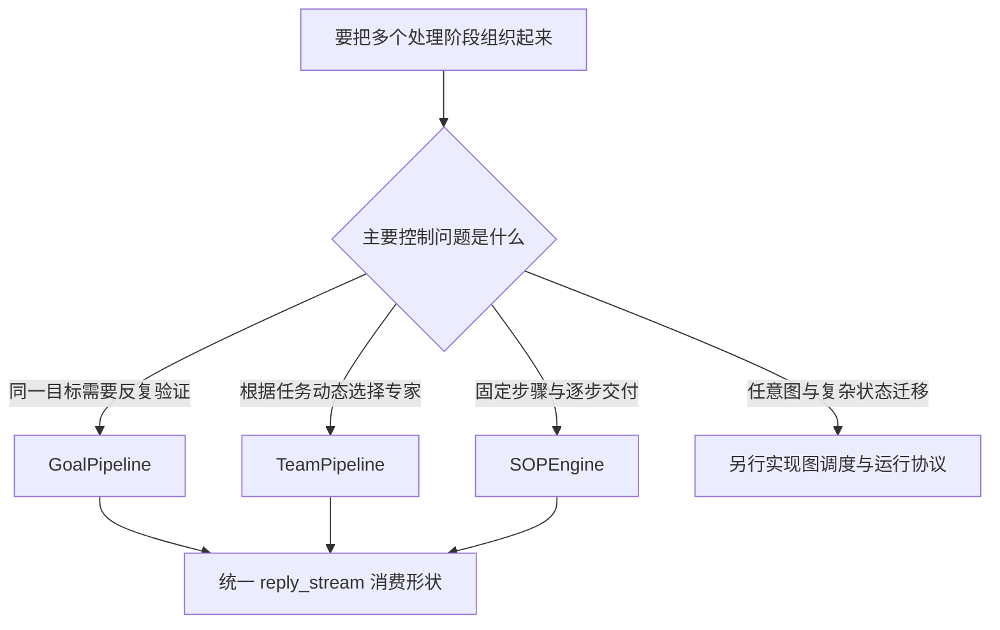

当前目录没有导出 SequentialPipeline、ConcurrentPipeline。普通 Python 顺序/并发当然可以组合 Agent，但不要把可自行编程的能力写成当前已有的同名类。

## 2. 源码地图

| 入口 | 重点 |
|---|---|
| [pipeline/__init__.py](../../open/agentscope/src/agentscope/pipeline/__init__.py) | 当前公开 API |
| [pipeline/_base.py](../../open/agentscope/src/agentscope/pipeline/_base.py) | PipelineProtocol |
| [pipeline/_goal_pipeline.py](../../open/agentscope/src/agentscope/pipeline/_goal_pipeline.py) | Goal 的两阶段回路、预算与 HITL |
| [pipeline/_team_pipeline.py](../../open/agentscope/src/agentscope/pipeline/_team_pipeline.py) | TeamAssign、并发、结果与取消 |
| [console/_console.py](../../open/agentscope/src/agentscope/console/_console.py) | 共用消费者如何 drain 流 |
| [sop/_schema.py](../../open/agentscope/src/agentscope/sop/_schema.py) | Step 协议、默认执行验收、handover |
| [sop/_state.py](../../open/agentscope/src/agentscope/sop/_state.py) | 可序列化 run 与 step 状态 |
| [sop/_engine.py](../../open/agentscope/src/agentscope/sop/_engine.py) | 固定顺序推进与尝试预算 |
| [app/_service/_sop.py](../../open/agentscope/src/agentscope/app/_service/_sop.py) | 持久 SOP 的会话执行 |
| [SOP 存储模型](../../open/agentscope/src/agentscope/app/storage/_model/_sop.py) | definition 快照、session key 与 workspace grain |
| [Submit 工具](../../open/agentscope/src/agentscope/app/_tool/_sop_submit.py) | 服务端 handover/verdict 持久提交 |
| [提交约束中间件](../../open/agentscope/src/agentscope/app/middleware/_sop_step_middleware.py) | 不提交不能正常结束的局部保护 |
| [Goal 示例](../../open/agentscope/examples/pipeline/goal/goal_pipeline.py) | 共享 LocalWorkspace 的 executor/verifier |

## 3. PipelineProtocol：只有流入口，没有通用 run state

协议定义的是普通 def，返回 AsyncGenerator：

```python
class PipelineProtocol(Protocol):
    def reply_stream(self, inputs: Msg | list[Msg]
        | UserConfirmResultEvent | UserInterruptEvent
        | ExternalExecutionResultEvent
    ) -> AsyncGenerator[AgentEvent | Msg, None]:
        ...
```

调用方应 `async for event in obj.reply_stream(inputs)`，不是 `await obj.reply_stream(inputs)`。具体实现是 async-generator 函数，调用时得到可异步迭代对象。

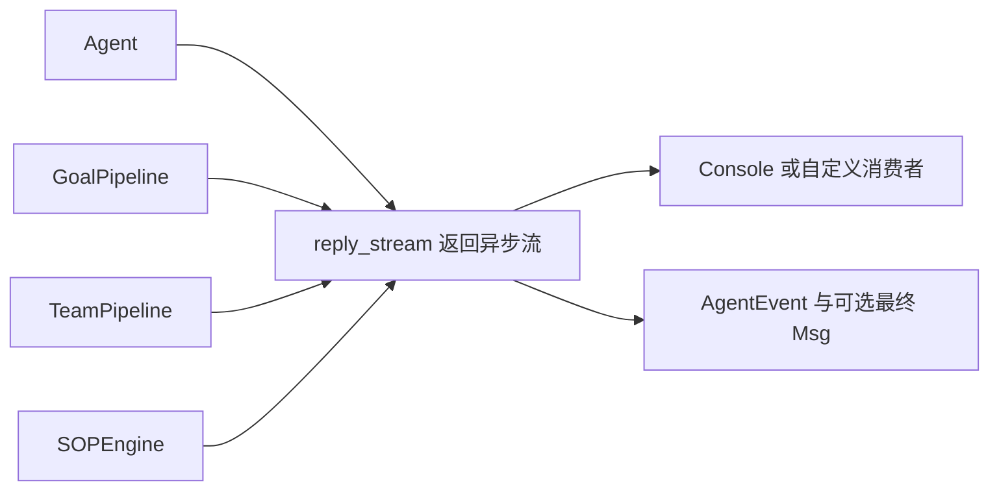

Protocol 不要求继承同一基类，没有定义 pipeline_id、阶段枚举、全局 usage、save/load、cancel API 或统一汇总结果。它也没有标 @runtime_checkable，不能据此假设适合直接做运行时 isinstance 检查。

“可交给同一个流消费者”不等于“可替换任何 Agent 位置”。Goal 构造需要能访问 Agent.state 等字段；SOP 的 AgentLike 还要求 structured_schema 与 yield_final_msg 参数；TeamPipeline.reply_stream 没有这些结构化参数，嵌套前要检查具体契约。

## 4. 流中有多个参与者，不能见到第一个 ReplyEnd 就停止

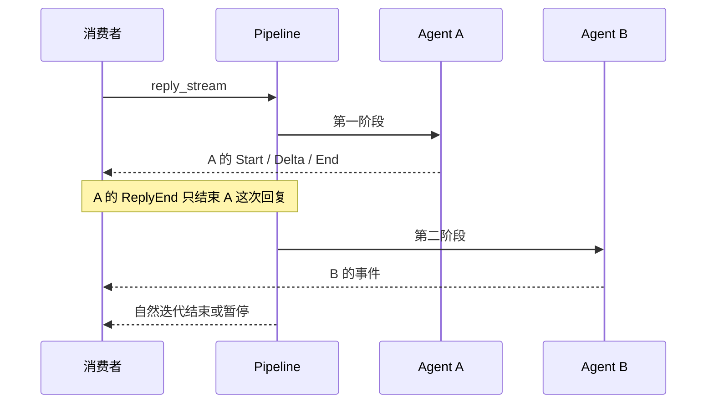

Console._run_reply 持续消费整个异步流，不在第一个 ReplyEnd break，符合这种接口。自定义 UI 应按 reply_id 归并参与者输出，不能把全部文本拼进单个无身份气泡。

整条流结束也可能是 HITL park，并非流水线成功。Goal/Team 当前没有统一的 PipelineEnd(pass/fail) 事件，需要消费者理解具体机制或由应用补充明确外层状态。

## 5. GoalPipeline 的角色与结构化契约

executor 和 verifier 都是普通 Agent。执行者用 `_ExecutionReport(report: str)` 报告产物、路径、运行方式；验证者用 `_VerificationResult(result: pass|fail|impossible, message: str)` 判断。

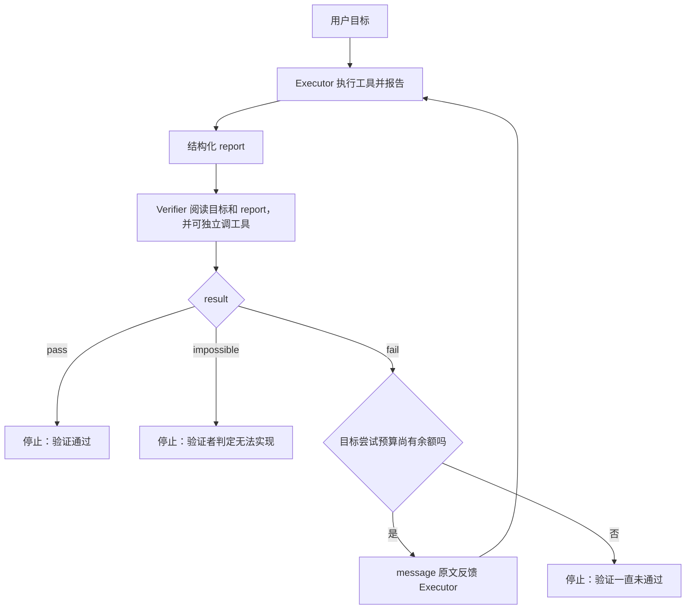

Python 保证“先执行再验证”的控制流；LLM 决定如何做和如何检查。report 是文本，不是自动可信证据。Verifier 需要真实工具与产物访问，否则可能只是审阅 Executor 的自述。

### 5.1 构造参数与进程内状态

| 参数/字段 | 默认 | 实际作用 |
|---|---:|---|
| executor / verifier | 必填 | 两个运行 Agent 对象 |
| verifier_reset_context | True | fail 后清 verifier.context 与 summary |
| max_iters | 10 | 已失败验证轮次达到上限时结束 |
| max_retries | 3 | 每阶段有效结构化结果的额外重试 |
| _iters | 0 | 实际在 fail 分支递增 |
| _executor_retries / _verifier_retries | 0 | 当前报告/裁决的格式重试进度 |
| _goal | None | 当前目标的 blocks，供 verifier 使用 |

这些字段在 Pipeline 对象上，恢复事件不会重置，但进程重启后不自动恢复。保存两份 AgentState 也不包含 _goal 和这些计数。

## 6. Goal 新输入：目标与提醒怎样分别保存

普通 Msg 或 Msg 列表被识别为新 run，计数清零，executor_inputs=deepcopy(inputs)。单 Msg 的副本正文追加“为 verifier 总结产物”的提醒；列表则再追加一条 UserMsg。

_goal 从原 inputs 的 content 收集，保留 TextBlock/DataBlock，而不是仅取纯文字。

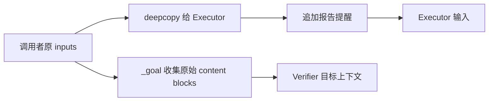

要保留一个细节：executor_inputs 做了 deepcopy，但 _goal 的单消息赋值/列表 extend 仍引用原 block 对象。不要把“不会把提醒追加到调用者原消息”扩大为整条 pipeline 对所有后续外部 mutation 都完全隔离。

新输入只重置 pipeline 计数，不清 executor 的历史，也不先清 verifier 的历史。因此复用同一个 GoalPipeline 做新目标时，之前的 Agent 上下文仍可能参与；需要干净实验应自行重建或明确清理状态。

## 7. Goal 的内层重试不是重新执行整个目标的同一种预算

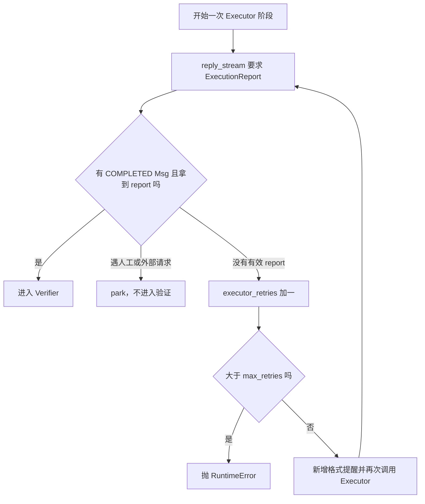

检查条件是 retries > max_retries，因此 max_retries=3 通常意味着首次尝试加最多 3 次额外尝试；不是总共只调用三次。每份 report 成功后该阶段计数归零，Verifier 也有独立计数。

Verifier 没给完成 Msg 或 structured_output=None，会在自己的格式重试回路里继续，不立即把 Executor 的工作判 fail。只有真实结构化 fail 才增加 _iters 并让 Executor 修复。

普通 API 重试、Agent 内部结构化输出 grace 和 Goal 格式重试还可叠加，不能用 max_iters×2 估算所有模型请求或成本。

### 7.1 fail 后清理了什么

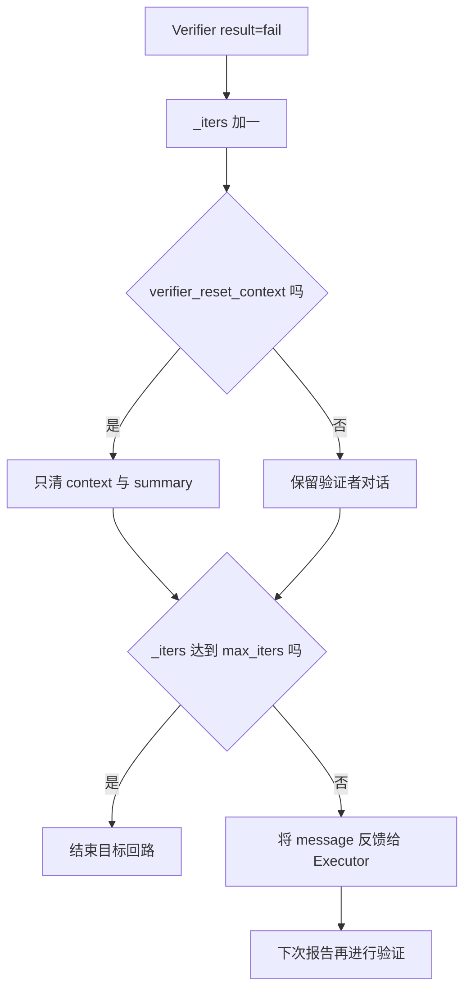

权限、ToolContext 缓存、TaskContext、middle_context 不因此清空；文件副作用也不回滚。参数名的 reset_context 不能理解成完全重建验证者。

构造函数对 max_iters/max_retries 没有 Pydantic 的 gt/ge 验证，本回路也没有在第一次执行前就检查 max_iters。生产调用应传有效范围，不用 0 猜测“禁止任何尝试”。

## 8. Goal 的 HITL：按 reply_id 回到真正暂停者

确认、外部结果或中断事件匹配 executor.state.reply_id / verifier.state.reply_id。都不匹配时 ValueError，不能任意把结果转给当前看起来空闲的角色。

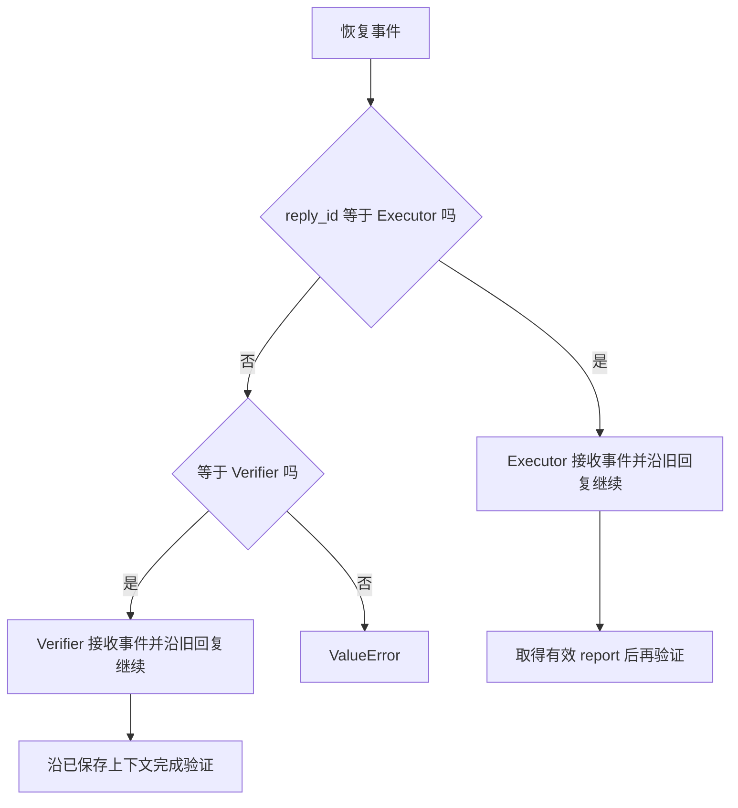

Executor park 时没有完整报告，不调用 Verifier。Verifier park 后恢复时，局部 execution_report 可能是 None，但直接把恢复事件交给 Verifier，依赖它已有 AgentState 保存原目标与 report，不重新构建新验证问题。

UserInterruptEvent 只发送给按 reply_id 匹配的参与者并返回，不主动再启动另一角色。Constructor 没有校验两个角色是不同对象；复用同一个 Agent 会破坏身份和上下文分工，应由调用者避免。

### 8.1 暂停跨调用，预算仍然连续

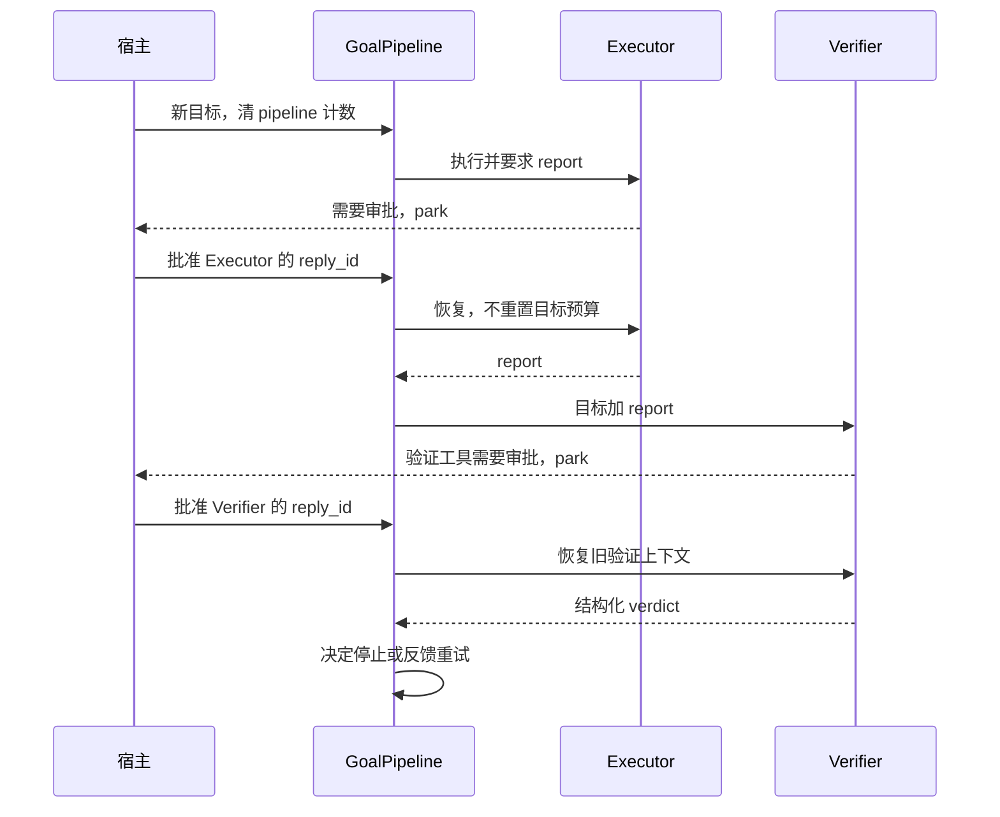

## 9. Goal 输出：report 可见，最终 verdict 没有统一外层结果

Executor 的事件与最终 Msg 被原样 yield；Verifier 的 COMPLETED Msg 被内部消费，不向外 yield，但其余事件会转发。这在现有测试中可见：首轮通过的输出 Msg 列表仅含 execution report。

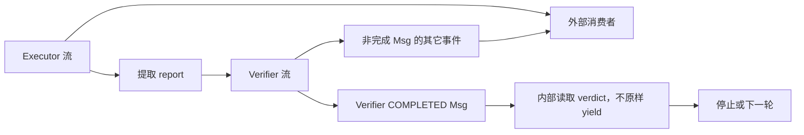

pass、impossible 和耗尽 max_iters 都会让异步流结束，没有统一 GoalResult 对象或 pipeline finished_reason；verifier.state 中仍有它自己的结果，但外部宿主需要显式定义如何读取与保存。

因此不能拿“最后一个 Executor 报告看起来完整”“Verifier 的 ReplyEnd 是 COMPLETED”当整体通过。COMPLETED 表示这次 Agent 回答完成，结构化 result 仍可能是 fail。

示例 README 写过 passed，当前 Goal schema 实际是 result=pass/fail/impossible；passed 是 SOP _Verdict 的另一个字段，不应混用。

## 10. TeamPipeline：动态分派由外部工具连接内核

TeamMember 持有现成 Agent 和 description。成员名必须唯一、不能等于 leader 名；构造不复制成员、模型、权限或 workspace，也不自动创建隔离环境。

首次 reply_stream 将 _TeamAssign 加到 leader.toolkit，之后用 _tool_registered 跳过。一个 pipeline 实例与该 leader/Toolkit 的注册状态绑定；若中途换 toolkit，不应假设工具会自动重新装配。

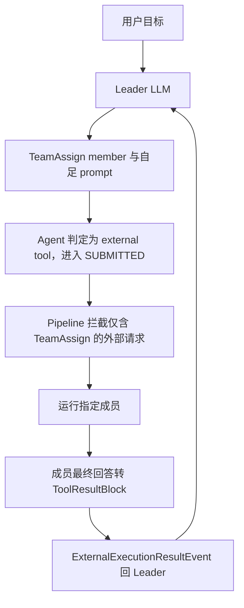

TeamAssign input_schema 将 member 限为候选枚举，prompt 是完整任务字符串。成员看不到 leader 的全部上下文，未包含的需求不会自动共享。

_TeamAssign 自身 check_permissions 返回 ALLOW，但仍受引擎模式和显式规则影响；尤其 EXPLORE 中该工具非只读，不能用它自己的 ALLOW 推断一定放行。成员的实际工具再走自身权限。

## 11. Team 如何区分内部委派和真正宿主外部工具

拦截条件是 RequireExternalExecutionEvent 且其中 **all** 工具名都是 TeamAssign。符合则吞掉该请求，收集 assignments，自己负责执行；其它外部请求照样 yield 给宿主。

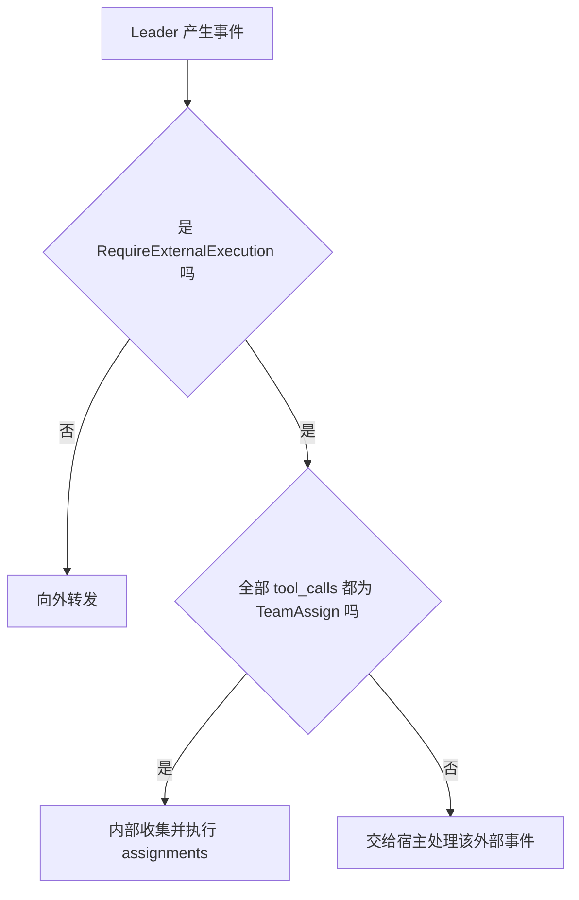

不能把“Pipeline 支持 external tools”解释成它会执行任意外部工具。混合批事件是否出现受 Agent 的工具分批影响；若出现 TeamAssign 与其它 external 混在同一个请求，不会被此条件拆开自动执行。

Pipeline 使用与 leader 一致的 _json_loads_with_repair 解析输入，避免 leader 通过修复校验后 Pipeline 又用裸 json.loads 拒绝相同参数。

## 12. Team 调度：跨成员并行，同成员按调用顺序串行

_run_assignments 先按 member 名分组。每个 run_group 顺序跑自己的 calls，各组 create_task 后 gather。

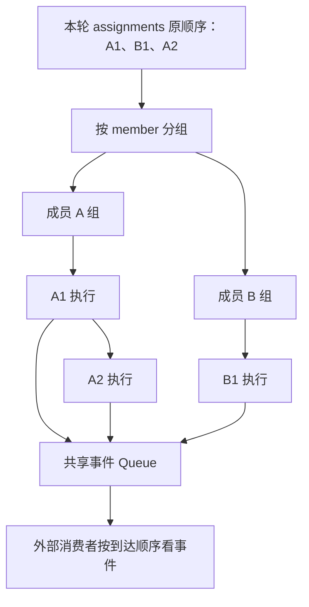

成员名是并发隔离键，不是任务 ID。A1 park 时 A2 不启动，即使 B1 已完成；否则同一个 Agent 会用同一份 context 同时跑两条相互覆盖的任务。

### 12.1 两种顺序刻意不同

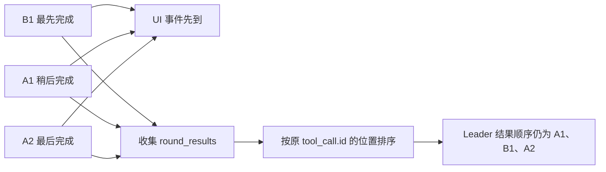

事件保持实时完成顺序，避免慢成员阻塞 UI；结果按原调用顺序回到 leader，保持调用/结果对应。无界 Queue 没有在此提供背压容量，不能把并发事件通道当已受限消息缓存。

## 13. Team 的结果封装不等于业务验收

成员 yield 的普通事件入 Queue；最终 Msg 不直接作为最终回答交给 leader，而是选 TextBlock/DataBlock 构成 output，用原 assignment tool_call_id 创建 ToolResultBlock(name=TeamAssign)。没有可用内容则给占位说明。

| 成员 finished_reason | 包装后的 ToolResultState |
|---|---|
| COMPLETED | SUCCESS |
| EXCEED_MAX_ITERS | SUCCESS |
| INTERRUPTED | INTERRUPTED |
| ERROR | ERROR |

次数耗尽也映射 SUCCESS，因此 SUCCESS 的含义更接近“拿到了委派返回”，不等于成员达成验收目标。report 的证据、未决项和验证仍需 leader/应用检查。

成员工具步骤不进入 leader 上下文，只有最终输出回传；但它们的事件仍向外可见。数据 token 减少发生在 leader 输入，不等于用户或 trace 完全看不到成员过程。

## 14. Team 的成员暂停与队列恢复

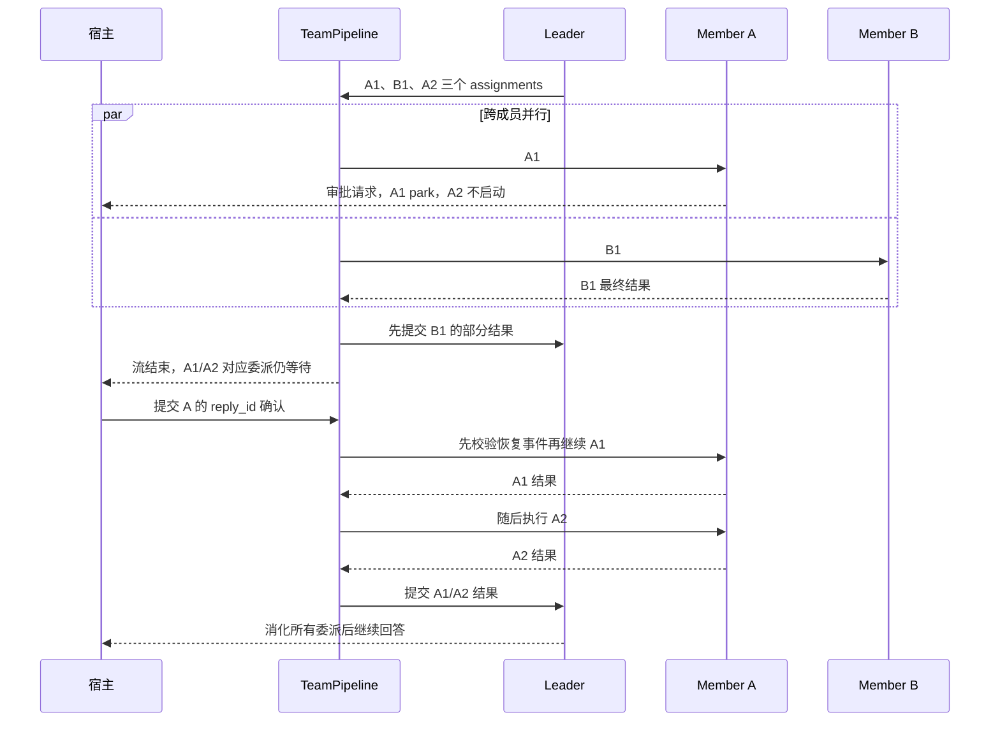

定位恢复成员靠 _parked_members 与 reply_id；_assigning_calls 从 leader 仍在等待的 TeamAssign 中筛选该成员，恢复同组队列。排队信息不是另一份显式 scheduler 队列，而是可由 leader 工具调用状态推导。

恢复前先调用 member.agent._check_incoming_event。无效 ID 应直接拒绝，不能进入执行失败清理把整个 parked team 中断；现有测试专门检查这一性质。

## 15. Team 的异常、取消与清理

### 15.1 一个成员异常时必须等待其它组停止

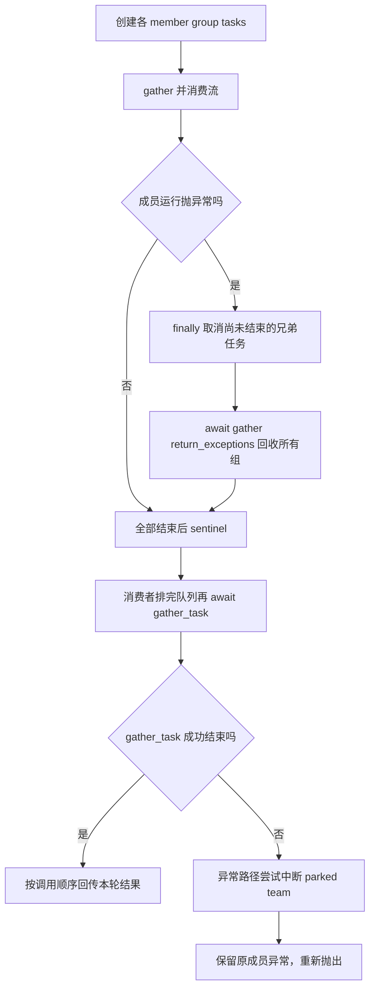

这里与 Agent 内核独立工具批“尽量等其它成功结果”的策略不同：Team 的 gather 遇成员失败会进入 finally 取消兄弟。不能看到同样使用 Queue/gather 就推断错误策略相同。

清理再次失败只记录 warning，不覆盖原始成员错误；调用内部 _reply interrupt 路径一次，避免递归清理异常无限重试。没有跨成员文件或 API 副作用回滚。

### 15.2 主动取消也要闭合 leader 的 SUBMITTED 委派

外层 CancelledError 会在 leader 仍 awaiting 时发 UserInterruptEvent，通过 pipeline 路由中断 parked members 与 leader；最终是否重抛由 leader.react_config.interruption_raise_cancelled_error 控制。

_run_assignments 取消 gather_task，等待它回收，再排出已生成的成员中断事件；reply 层继续补未配对工具结果。网络已提交操作是否停止仍取决工具执行端。

### 15.3 reset_members 不是恢复到干净工厂状态

leader 的 ReplyEnd 被 yield 后，默认清成员 context 和 summary，保留任务、权限、缓存、middle_context 和文件。一次 leader reply 内部可追问同一成员，跨 reply 默认不保留其对话正文。

清理位于 yield 之后，消费者若在该 ReplyEnd 立即关闭生成器，不能仅凭这个分支保证后置清理已执行。正常使用应 drain 流；需要关闭时的强清理保证应放在宿主协议或 finally 设计中。

## 16. SOP：固定顺序流程为什么另设模块

SOP 将“流程定义”和“某次运行状态”分开，SOPEngine 只根据 StepRunState 判断继续、重试、等待或结束。默认 SOPStep 是执行再验收；自定义 SOPStepBase 可以实现外部系统或人工操作。

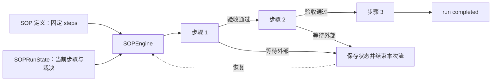

SOP 是固定线性 milestones，不提供通用条件分支或并发 join。步骤内部如何达到目标可由 Agent 自由决策，流程层只规定交接与验收门槛。

## 17. SOP 状态：submission 区分工作与验收阶段

| 对象/字段 | 作用 |
|---|---|
| SOP | name、description、steps，持有运行参与者引用 |
| SOPStepBase | subject、description、max_attempts 与 state_type |
| SOPRunState | id、原始 inputs、各 steps state、created_at |
| SOPStepRunState.phase | pending/running/awaiting/completed/failed |
| given | 本次尝试收到的输入，由 Engine 写入 |
| submission | 当前交接内容；None 表示尚未完成工作半段 |
| verifications | 已形成的裁决记录；长度用于尝试计数 |

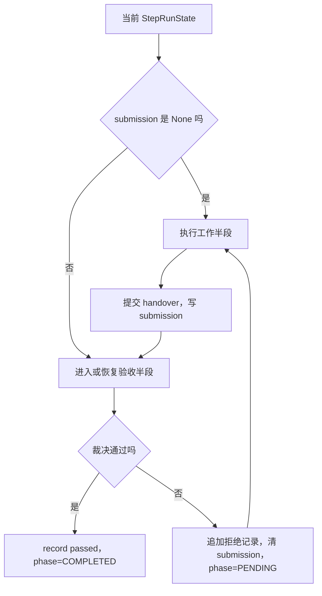

None 与空列表不是同一语义：即便 submission=[]，也表示已经提交过，后续进入验收。默认 SOPStep 接收 handover 字符串再转 TextBlock，自定义步骤可以保存其它 TextBlock/DataBlock。

state_type 可由自定义 Step 指定派生类；extra=allow 与 SerializeAsAny 保留额外运行字段。Engine 重建时按各 Step.state_type 再验证已存 state，不把扩展字段简单丢掉。

SOPRunState 只保存流程层，不保存 executor 的完整 AgentState。恢复步骤与恢复其内部工具等待是两层持久化，缺一不可。

## 18. SOPEngine.reply_stream 的主循环

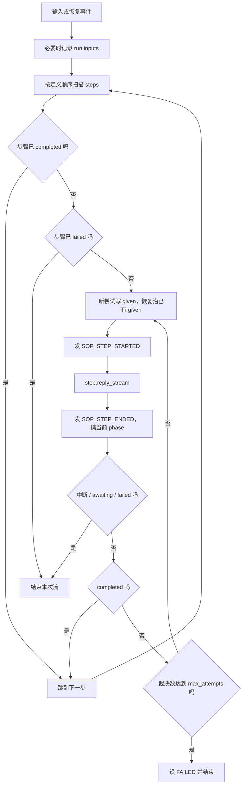

恢复事件交给首个尚未完成步骤，而不是 Engine 自己按 Agent reply_id 选角色；默认 Step 通过 submission 判断应把事件转给 executor 还是 verifier，再由 Agent 验证 ID。

SOP_STEP_STARTED/ENDED 也会在恢复调用中出现，且同一 attempt 可重复出现；它们不是“每个 step 一生只发一对”的唯一执行记录。达到失败上限可能发生在 ENDED 事件发出之后，所以最终结果应看 engine.state，而不只看最后一个事件值。

### 18.1 整体 phase 是计算结果

优先级为：无步骤或全 pending → PENDING；存在 failed → FAILED；全 completed → COMPLETED；存在 awaiting → AWAITING；其余 RUNNING。

它不是另外一个独立可随意赋值的 run.status，修改步骤后会反映到计算结果。Engine 恢复只检查已有 state 的步骤数量与定义一致，不检查每个步骤语义版本；库模式若同数量重排定义，仍可能错配旧记录。服务模式的 definition 快照有助于避免这个问题。

### 18.2 自定义步骤必须真的 park 或记裁决

StepBase 的约定是一次调用完成一次尝试，返回前要 park 或 record。Engine 本身没有通用“无进展次数”检测；自定义步骤若返回时仍 PENDING、又不增加 verifications，while 可能持续重试。

因此扩展点的最小契约是：提交内容、形成裁决或明确 AWAITING/FAILED，而不只是 yield 一段日志。max_attempts 计裁决，不是每调用一次步骤就自动消耗一个计数。

## 19. SOPStep 默认实现：handover 与 verdict 都是结构化输出

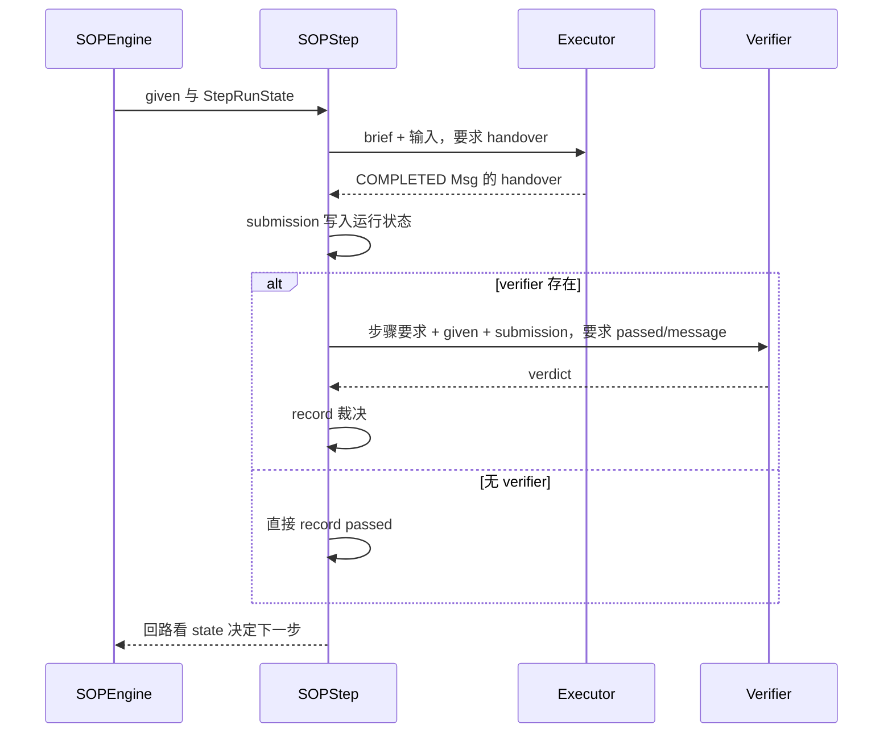

完成 Msg 的 handover/verdict 被内部消费，避免再显示一份重复消息；其它参与者事件照常流出。与 Goal 相比，SOP 将结果明确写入 StepRunState，外层可检查，不只靠推断流终止。

Executor 没 handover 或 Verifier 没裁决时，默认 SOPStep 记录一次拒绝，计入 max_attempts；Goal 对这类结构缺失则有独立 max_retries。两个回路的预算语义不同。

UserInterruptEvent 根据 submission 阶段转给当前参与者，清 submission，设 PENDING 后返回；没有新增拒绝裁决，意味着中断本身不消耗一次验收拒绝预算。

### 19.1 下一步骤只得到前一步的交接

```mermaid
flowchart LR
    U[run 原始 inputs] --> A[步骤 1 given]
    A --> S1[步骤 1 submission]
    S1 --> B[步骤 2 given：handover 包装]
    B --> S2[步骤 2 submission]
    S2 --> C[步骤 3 given]
    H[步骤 1 完整工具历史] -.不自动复制.-> C
```

第二步以后默认不再附加原始输入全集与全部祖先历史，因此关键约束必须被可靠交接。文件不随 handover 自动复制：共享 workspace 时可引用路径，隔离 workspace 时路径相同也不说明文件可读。

复用同一 Agent 做多个步骤，会共享它已有 context；图里的“只交接 submission”指 Engine 的显式输入，不保证复用 Agent 没有其它历史。追求严格阶段隔离应使用独立参与者和明确 workspace 策略。

## 20. 服务 SOP：复用普通 ChatService，不直接持久化活 Pipeline 对象

SOPRunRecord 保存创建时 definition 副本、sessions 映射和 SOPRunState；定义中 executor/verifier 用 agent_id/session_key 引用。相同 session_key 必须指同一个 agent，不能一把 key 同时装两个 Agent。

workspace_grain=RUN 时整 run 共用新 workspace_id；PER_SESSION_KEY 时每个会话 key 单独新建。不是调用通常可能复用 per-agent 环境的 assign_workspace_id，而是为 run 新铸 ID，避免不同 run 共享文件。

```mermaid
flowchart TD
    D[持久 SOP 定义] --> R[创建 SOPRunRecord 的 definition 快照]
    R --> M[按 session_key 创建普通 sessions]
    M --> W[按 RUN 或 PER_SESSION_KEY 分配新 workspace IDs]
    W --> S[SessionSOPStep 调用 ChatService.run]
    S --> A[普通 Agent + SOP 提交工具]
    A --> H[提交工具写 SOPRunState]
    H --> E[SessionSOPStep 读回提交与裁决]
    E --> G[SOPEngine 决定继续或 park]
```

SessionSOPStep 不把 ChatService 的事件再 yield 一遍，Agent 直接发布到自己的 session。故 library SOPEngine 流与 service run 的事件消费入口不同，不能假设服务端引擎流里包含每个 token。

## 21. 服务端提交：SubmitHandover 与 SubmitVerdict

两个工具绑定 user_id、run_id、step_index，不依赖模型填写这三个身份。_write 从 storage 读 run、修改对应 StepRunState，再 update_sop_run。

```mermaid
sequenceDiagram
    participant E as SessionSOPStep
    participant S as Storage
    participant C as ChatService
    participant A as Step Agent
    participant T as Submit 工具
    E->>S: 运行前先持久化 given 和阶段
    E->>C: run，附 sop_dispatch
    C->>A: 装配本阶段专用提交工具
    A->>T: SubmitHandover 或 SubmitVerdict
    T->>S: 读取并更新对应 run state
    T-->>A: 提交成功结果
    C-->>E: 本次聊天 run 结束或 park
    E->>S: 重新读取工具已提交的状态
    E->>E: 根据 submission/verdict/等待状态推进
```

工具 SUCCESS 说明提交被接受；SubmitHandover 不表示验收通过。SubmitVerdict(false) 清 submission 并记录反馈，下一次仍从执行半段开始。

工具的 check_permissions 自称 ALLOW，但仍受 PermissionEngine 模式规则影响；EXPLORE 非只读兜底也会阻止这类状态写工具。服务端需要按真实配置保证提交路径可达，不能只看方法注释中的“never asks”。

### 21.1 提交约束中间件的作用

```mermaid
flowchart TD
    E[步骤 Agent 发 ReplyEnd] --> Q{最后工具是成功 Submit 吗}
    Q -->|是| P[放行结束]
    Q -->|否| T{普通完成或迭代耗尽吗}
    T -->|否| X[错误或中断结束照常放行]
    T -->|是| B{提醒次数耗尽吗}
    B -->|否| H[吞 ReplyEnd，追加提交提醒]
    H --> I[回退一轮迭代机会后继续]
    B -->|是| F[发 ERROR 结束，让步骤失败而不是永久空转]
```

默认 max_nudges=3，检查的是当前 reply 最后工具调用与同 ID SUCCESS result，而不是只要历史上某处曾经提交。提交后又调用其它工作工具，会影响它是否接受结束。

这只保证报告动作，不核验报告真伪；数据里写 passed=true 仍来自验证者判断，不能替代独立业务验收。

## 22. SOP 服务暂停恢复：run 锁、session 锁和 dispatch claim

SOPService.run 先取 sop_run_lock，读取 record.definition 重建 SessionSOPStep 与 SOPEngine，驱动至完成、失败或等待，再写 state。run 锁协调流程推进；ChatService 的 session 锁协调具体参与者，两个锁负责不同范围。

```mermaid
flowchart TD
    A[SOPService.run 取得 run lock] --> E[Engine 选中当前步骤半段]
    E --> C[ChatService.run 取得 session lock]
    C --> Q{参与者工具 park 吗}
    Q -->|否| S[读提交结果并继续流程]
    Q -->|是| P[步骤 AWAITING，保存 sop_dispatch claim]
    P --> R[释放 run，等待用户恢复普通 session]
    R --> H[用户确认或外部结果进入 ChatService]
    H --> D[原 claim 使它仍使用 SOP 提交工具]
    D --> F[会话收尾后 advance_later]
    F --> A
```

SessionSOPStep 遇仍然 parked 的会话不会用一个新 brief 覆盖它，先返回等待。提交结果与 AgentState 分别存储，存在多资源写入边界；不能把 acquire_lock 加连续 await 当作跨资源事务。

advance_later 跟踪后台任务并在 service 关闭时 cancel/join，但它不是持久任务队列。重启后自动扫描并推进所有可继续 run 的能力，不能仅从这个方法推导已经具备。

### 22.1 人工验收不是某个工具执行授权

HumanVerifier 的步骤完成 handover 后进入 AWAITING。record_verdict 在 run 锁内检查索引、类型和等待状态，然后使用相同 SubmitVerdict 写 passed/message；下一次推进据此继续或重做。

这与 UserConfirmResultEvent 授权执行一个工具不同：前者接受业务成果，后者允许某次操作执行。平台的工具审批卡也不会自动变成 SOP 人工验收界面。

## 23. 正确使用：最小调用与消费方式

以下片段置于宿主的异步函数中，模型、Agent、Workspace 等依赖已由调用者配置；handle 是示例中的同步事件消费函数。片段不负责平台权限和资源关闭，未在本轮执行。

### 23.1 GoalPipeline

```python
from agentscope.message import UserMsg
from agentscope.pipeline import GoalPipeline

# executor/verifier 是已配置好模型、工具与权限的 Agent。
pipe = GoalPipeline(
    executor=executor,
    verifier=verifier,
    max_iters=3,
    max_retries=2,
)
async for item in pipe.reply_stream(UserMsg(name="user", content="生成报告并验证")):
    handle(item)  # 宿主提供的同步事件处理函数；不要在首个 ReplyEnd 就 break
```

这段没有自动创建资源或保存状态，也不从流结束推断 pass。若 verifier 要核查文件，必须自己能访问文件，通常显式共用 workspace；示例里的 BYPASS 是演示选择，不是 verifier 天生只读。

### 23.2 TeamPipeline

```python
from agentscope.pipeline import TeamMember, TeamPipeline

pipe = TeamPipeline(
    leader=leader,
    members=[
        TeamMember(agent=researcher, description="查证资料并给出处"),
        TeamMember(agent=writer, description="按明确输入撰写报告"),
    ],
    reset_members=True,
)
async for item in pipe.reply_stream(UserMsg(name="user", content="查证并撰写报告")):
    handle(item)
```

leader 可以选择不委派，也可以同轮发多个任务；这不是固定先 researcher 后 writer 的串联。若顺序是业务硬要求，使用 SOP 或自己显式控制交接，不能只在成员列表里排序。

### 23.3 SOP

```python
from agentscope.sop import SOP, SOPStep, SOPEngine

engine = SOPEngine(SOP(
    name="报告流程",
    steps=[
        SOPStep("查证", "形成带来源的材料", researcher, reviewer),
        SOPStep("撰写", "根据交接材料形成报告", writer, reviewer),
    ],
))
async for item in engine.reply_stream(UserMsg(name="user", content="研究指定主题")):
    handle(item)
print(engine.state.phase)
```

示例复用 reviewer，意味着它的上下文可能跨步骤保留。handover 内必要的来源和约束仍需清楚，隔离运行时应使用不同参与者。

## 24. 一次复杂工作应如何分层

“研究 → 撰写 → 审核”可用固定 SOP；研究步骤内部若要分领域探索，可另实现能满足 Step 协议的团队适配器；某一步需要多轮质量修复，可采用目标执行/验证的设计。

```mermaid
flowchart TD
    S[固定 SOP milestones] --> R[研究步骤]
    S --> W[撰写步骤]
    S --> V[最终验收步骤]
    R -.若要内部并行，需契约适配.-> T[TeamPipeline 或自定义调度]
    W -.若要局部修复，需契约适配.-> G[执行 / 验证回路]
    T --> A[底层仍由 Agent Loop 跑工具]
    G --> A
```

这是建议的组合架构，不是所有对象可不加适配直接互相嵌套。Protocol 的消费接口、AgentLike 的结构化参数和完整 Agent 的状态访问要求不同，组合前必须核对签名、结果与恢复身份。

## 25. 贯穿案例：两个成员查证，leader 汇总，再独立验收

```mermaid
sequenceDiagram
    participant U as 用户
    participant L as Leader
    participant P as TeamPipeline
    participant A as 专家 A
    participant B as 专家 B
    participant H as 宿主验收适配
    U->>L: 目标与交付要求
    L->>P: 分派 A 和 B 自足任务
    par 并行研究
        P->>A: 核对来源一
        A-->>P: 证据与不确定项
    and
        P->>B: 核对来源二
        B-->>P: 证据与不确定项
    end
    P->>L: 原调用 ID 对应的工具结果
    L->>L: 汇总形成产物
    L-->>H: leader 交付
    H->>H: 独立检查来源、产物与验收条件
    H-->>U: 业务验收结果
```

末端验收是宿主增加的阶段，不是 TeamPipeline 默认自带 Verifier。若直接使用 GoalPipeline 的角色形状替换 Team，需要先解决输入签名、最终 report 与状态访问契约。

验收应看：任务是否传齐、各成员是否真做、失败是否被正确封装、leader 是否丢失证据、最终产物是否真实存在，而非只看 TeamAssign SUCCESS 或界面角色数量。

## 26. 状态与持久化对照

| 机制 | 保存在哪 | 新输入的影响 | 跨进程恢复还缺什么 |
|---|---|---|---|
| Goal | 两份 AgentState + Pipeline 实例字段 | 清迭代/格式预算，不清角色历史 | _goal、计数、参与者配置与状态 |
| Team | leader/member AgentState + 对象映射 | leader 接收新输入，成员按结束策略清历史 | 所有参与者状态、工具映射与配置重建 |
| Library SOP | SOPRunState + 参与者自己的状态 | 可更新 run.inputs，不自动抹掉已完成步骤 | 定义匹配、Step 状态、AgentState 与资源 |
| Service SOP | SOPRunRecord、普通 sessions、dispatch registry | 每次 run 有独立 definition 快照 | backend 保证、后台恢复扫描与副作用幂等 |

复用一个已 completed 的 SOPEngine 再传新 Msg，不会自动清掉已完成步骤重跑全部；应新建 SOPRunState/Engine 开始独立 run。它与 Goal 新输入重置计数的行为不同。

## 27. 故障定位与现有测试

| 现象 | 优先检查 |
|---|---|
| 执行过但未进入验证 | Executor 是否生成有效 report，还是 HITL parked |
| 验证一直重复 | 是否只有格式重试，result 是否真实 fail，max_retries 与 max_iters 区别 |
| 流结束却没有 pass | Goal 没统一结果，verdict 在内部被消费 |
| 同成员第二任务没启动 | 第一任务是否 parked，组内串行是预期 |
| 其它成员出错后工具残留 | group task 的 cancel/join 与工具自己的 finally |
| 恢复确认导致整个团队退出 | 先验事件校验与执行失败清理是否被混淆 |
| 下一 SOP 步骤不知道原需求 | handover 是否遗漏约束，Engine 不自动重发全部祖先历史 |
| SOP 不停重试但预算没消耗 | 自定义 Step 是否没 record 也没 park |
| 更新流程定义后旧 run 异常 | library 定义语义错配，或服务是否使用 definition 快照 |
| 提交工具不工作 | 当前阶段装备、权限模式、run 是否还存在 |

| 测试入口 | 已定位覆盖方向 |
|---|---|
| [pipeline_goal_test.py](../../open/agentscope/tests/pipeline_goal_test.py) | pass/fail/impossible、格式重试、多模态目标、上下文清理、恢复预算 |
| [pipeline_team_test.py](../../open/agentscope/tests/pipeline_team_test.py) | 委派、并发、同成员排队、部分 park、修复 JSON、无效恢复与取消 |
| [pipeline_team_cleanup_test.py](../../open/agentscope/tests/pipeline_team_cleanup_test.py) | 成员异常保留原错并等待所有兄弟清理 |
| [sop_engine_test.py](../../open/agentscope/tests/sop_engine_test.py) | 固定步骤、状态、交接与验收回路 |
| [sop_step_middleware_test.py](../../open/agentscope/tests/sop_step_middleware_test.py) | 必须提交的提醒与结束策略 |
| [app_sop_service_test.py](../../open/agentscope/tests/app_sop_service_test.py) | 持久 run、会话执行和人工裁决 |
| [app_sop_router_test.py](../../open/agentscope/tests/app_sop_router_test.py) | 服务 API 形状与调用边界 |

## 28. 阅读与验证边界

本篇已静态读完 pipeline 三个实现文件与导出，并追踪 SOP engine/state/default step、服务 SessionSOPStep、提交工具和中间件的主要路径。库级队列/清理、Goal 输出形状、SOP 预算与两层状态均按实际实现解释。

未运行上述测试、Console、多模型或服务部署；没有对全部 storage 事务、锁续租、router 鉴权、用户人工验收界面和供应商副作用做完整验证。结构图描述控制协议，不保证模型一定产出合格方案或外部动作可回滚。

已检查文档本地链接、代码示例的 Python 语法和 Mermaid 围栏及基础结构；未使用 Mermaid 渲染器逐图渲染，实际布局仍取决于阅读器。

建议阅读顺序：PipelineProtocol → Goal 两套预算 → TeamAssign 外部工具桥 → group 并发与 HITL → SOPRunState → SOPEngine → 服务提交协议。关联专题：[Agent Loop](02-Agent-Loop.md)、[Middleware](03-Middleware.md)、[状态恢复](05-State-and-Session.md)、[HITL](11-Human-in-the-Loop.md)、[多 Agent 治理](12-Multi-Agent-Orchestration-and-Contracts.md)、[任务计划](15-Planning-and-Task-Management.md)。
