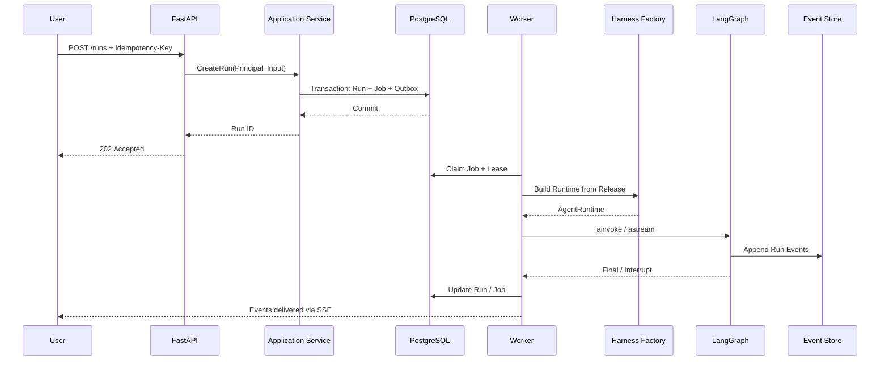
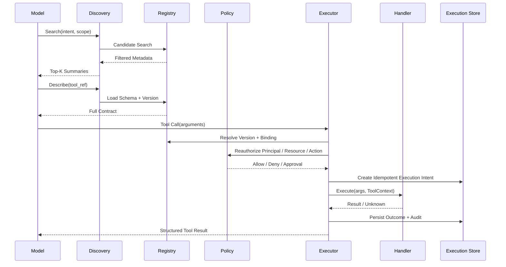
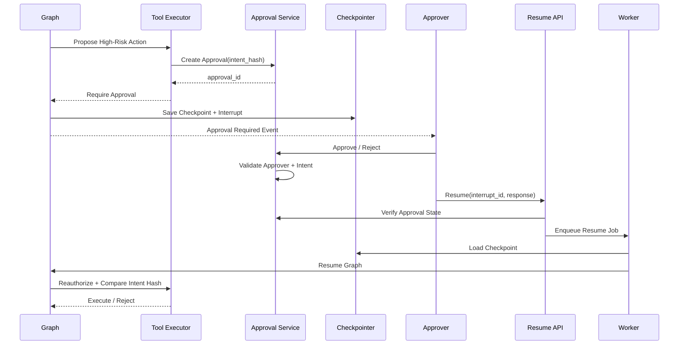
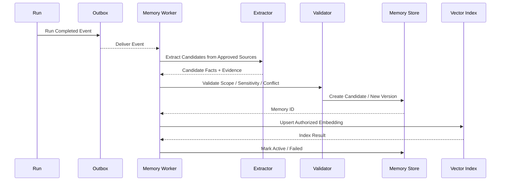
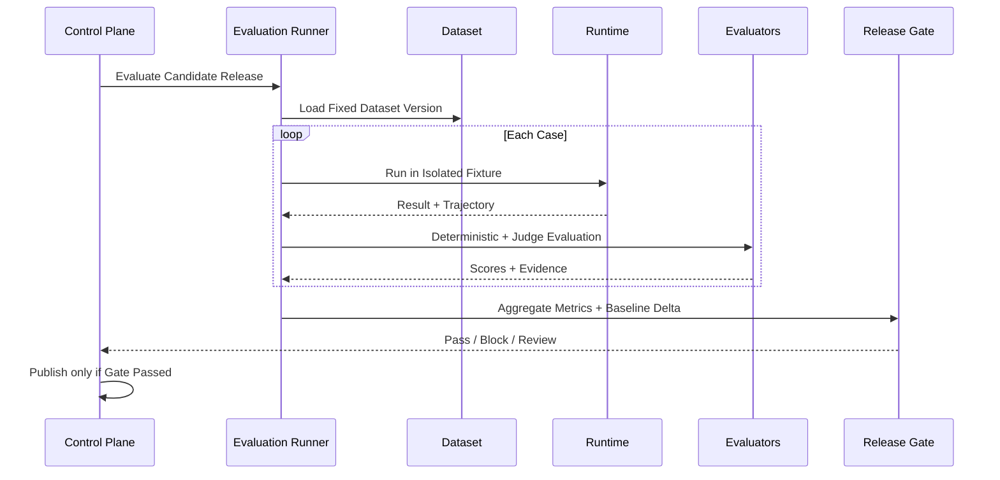

# Agent 平台端到端时序图

## 本文档在系统中的作用

用时序图描述 Agent Run、Tool Call、Approval / Resume、Memory Consolidation 和 Evaluation 的跨模块协作，避免各子系统只理解自身而不理解系统级调用关系。

## 1. Run 创建与 Worker 执行

## 2. Tool Search / Describe / Invoke

## 3. Approval / Interrupt / Resume

## 4. Memory Consolidation

## 5. Evaluation Release Gate

## 6. 阅读时重点检查

- Run 创建与执行分离；
- Tool Search 与 Invoke 的授权边界；
- Approval Service 与 Graph Interrupt 分离；
- Memory Worker 异步化；
- Evaluation 与生产身份隔离；
- 每个跨模块边界都有持久化 ID 和 correlation_id。
